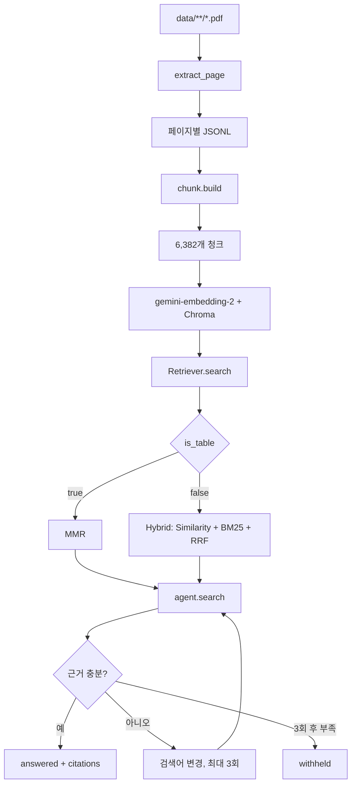

# 26.10.15 58일차(PDF 추출 · 유형별 청킹 · 검색기 평가 · RAG 에이전트)

## [TIL] 오늘 한 일을 한 문장으로 요약하기

오늘은 PDF 59개, 1,258쪽을 텍스트·표·이미지로 추출하고 유형별 청킹과 검색기 평가를 거쳐 RAG 에이전트를 연결했다. **표 질문은 MMR, 일반 질문은 Hybrid를 선택하고 최대 3회 재검색하는 구조**를 실제 코드와 평가 결과로 확인했다.



```plain text
PDF 목록
→ 페이지별 추출(JSONL)
→ 유형별 청킹
→ 임베딩·Chroma 저장
→ 표 질문이면 MMR / 그 외 Hybrid
→ 근거 판단
→ 답변 또는 최대 3회 재검색 후 보류
```

---

## 1. PDF 멀티모달 추출

### 1-1. 추출 기준

`pipeline/extract.py`는 페이지를 `text`, `mixed`, `scan`, `empty`로 분류한다. 본문은 `pdfplumber`, 표는 `find_tables()`, 면적 10% 초과 이미지는 OCR·Gemini 후보로 기록한다.

```python
# pipeline/extract.py
MARGIN = {"top": 0.06, "bottom": 0.07, "left": 0.03, "right": 0.03}
MIN_IMAGE_AREA_RATIO = 0.10
MIN_TABLE_TEXT_RATIO = 0.7

def is_real_table(rows):
    """1행 또는 1열은 실제 표가 아닌 일반 텍스트로 본다."""
    return len(rows) >= 2 and len(rows[0]) >= 2
```

여백을 제거하고 가짜 표를 걸러내며, 표 내부 글자 추출량이 실제 글자의 70%보다 작으면 깨진 표로 판단해 본문 텍스트로 되돌린다.

### 1-2. 표와 본문 분리

```python
# pipeline/extract.py - 표 영역을 제외한 본문 읽기
table_boxes = [r["bbox"] for r in regions]
text_page = body.filter(
    lambda o: o.get("object_type") != "char"
    or not any(inside(o, b) for b in table_boxes)
)
layout = detect_columns(text_page)
positioned = [
    {"content_type": "text", "text": l["text"],
     "bbox": (l["x0"], l["top"], l["x1"], l["bottom"])}
    for l in read_lines(text_page, layout)
]
```

표 영역의 중복 추출을 막고 2단 편집을 감지해 읽기 순서를 만든다. 결과는 페이지 한 장당 JSONL 한 줄로 저장한다.

| 대상 | 처리 방법 | 결과 |
|---|---|---:|
| 본문 | `pdfplumber` + 여백 제거 + 2단 감지 | 텍스트형 869쪽, 혼합형 207쪽 |
| 표 | `find_tables()` → 마크다운 | 130개 |
| 이미지 글자 | RapidOCR | 462곳 |
| 이미지 속 표 | `rapid-layout` + `rapid-table` | 56개 |
| 차트·다이어그램 | `rapid-layout` → Gemini | 277개·152개 |
| OCR 실패 | Gemini 보완 | 53곳 |

---

## 2. 유형별 청킹과 임베딩

### 2-1. `build()`의 청크 생성

```python
# pipeline/chunk.py - 파일별 청크 생성 핵심
for r in records:
    doc_type = classify_doc(first["file_name"], records)
    for ct in CONTENT_TYPES:
        for text, meta in chunk_page(r, doc_type, size, overlap, drop):
            header = f"[{first['file_name']} | p.{r['page_no']}]\n" if with_header else ""
            file_chunks.append({
                "chunk_id": f"{first['domain']}/{jsonl.stem}/p{r['page_no']:03d}/c{idx:02d}",
                "text": header + text,
                "metadata": {"file_name": first["file_name"],
                             "page_no": r["page_no"], "doc_type": doc_type,
                             "content_type": ct, **meta},
            })
```

일반 문서는 300자·겹침 50자, 의학 논문은 문단 단위, 표는 행 단위와 헤더 반복, 그림 설명은 그림 하나당 하나의 청크로 만들었다. 결과는 `base_300_50` 설정에서 6,382개이며, `gemini-embedding-2`와 Chroma 컬렉션에 저장했다.

---

## 3. 검색기 평가와 선택

### 3-1. 질문 유형별 검색기 선택

```python
# pipeline/retriever.py
def search(self, query, is_table=False, domain=None, k=None):
    """에이전트 검색: 표 질문이면 MMR, 아니면 Hybrid"""
    k = k or self.k
    domain = domain if domain in DOMAINS else None
    return self.mmr(query, k, domain) if is_table else self.hybrid(query, k, domain)
```

`similarity`는 Chroma 벡터 검색, `bm25`는 Kiwi 형태소 검색이며 `hybrid`는 두 결과를 RRF로 합친다. `domain`을 주면 해당 분야 청크만 검색한다.

| 검색기 | 내 골든셋 73문제 MRR | 제공 골든셋 267문제 MRR |
|---|---:|---:|
| Similarity | 0.782 | 0.837 |
| MMR | 0.765 | 0.832 |
| BM25 | 0.679 | 0.813 |
| **Hybrid** | **0.809** | **0.839** |

표 질문만 보면 MMR의 `hit@5` 0.979, MRR 0.856이 가장 좋았다. 검색 결과를 무조건 합치면 표 청크가 일반 질문을 방해하므로 질문 유형에 따라 검색기를 하나 선택했다.

---

## 4. 검색 툴 기반 RAG 에이전트

### 4-1. 검색 결과와 artifact 분리

```python
# pipeline/agent.py
@tool(response_format="content_and_artifact")
def search(query: str, is_table: bool = False, domain: Optional[str] = None):
    chunks = retriever.search(query, is_table=is_table, domain=domain)
    artifact = [{k: c[k] for k in ("chunk_id", "file_name", "page_no", "content_type")}
                for c in chunks]
    return format_results(chunks), artifact

self.agent = create_agent(
    model=llm,
    tools=[search],
    system_prompt=SYSTEM_PROMPT,
    middleware=[ToolCallLimitMiddleware(tool_name="search", run_limit=MAX_SEARCHES)],
    response_format=Answer,
)
```

LLM에는 본문을 전달하고 실행 기록에는 청크 식별자를 artifact로 남긴다. `Answer`는 `answered` 또는 `withheld`, 답변, 판단 이유, 파일명·페이지·인용 구절을 구조화한다.

### 4-2. 재검색과 실행 기록

```python
# pipeline/agent.py
"n_searches": sum(1 for s in searches if not s.get("blocked")),
"retrieved_chunk_ids": sorted({
    cid for s in searches for cid in s.get("chunk_ids", [])
}),
"elapsed_sec": round(elapsed, 2),
```

근거가 부족하면 핵심어·동의어·문서 표현으로 검색어를 바꾼다. 3회 모두 부족하면 지어내지 않고 보류하며, 실행 결과는 `output/runs/agent_runs.jsonl`에 저장한다.

---

## 5. 조회 결과 확인

- PDF 추출 → 59개 파일, 1,258쪽.
- 청킹 → 6,382개 청크.
- 검색 평가 → Hybrid가 전체 MRR에서 최고.
- 표 질문 → MMR 별도 선택이 유리.
- 에이전트 → 1회 답변, 2회 재검색 후 답변, 3회 후 보류 확인.

### 5-1. 결과 해석과 설계 선택

| 비교·현상 | 원인 | 대응 | 결과와 선택 |
|---|---|---|---|
| 표 칸 글자가 사라짐 | 표 셀 추출 결과가 실제 영역의 70% 미만인 깨진 표가 포함됨 | `MIN_TABLE_TEXT_RATIO = 0.7` 기준으로 깨진 표를 본문 텍스트로 재처리 | 9개 파일 16쪽 수정, 수정 후 검색 재평가 필요 |
| 표 질문에서 MMR 성능 우수 | 표 질문은 서로 다른 표 행을 탐색해야 하므로 결과 다양성이 중요함 | 표 질문에만 MMR 적용 | `hit@5 0.979`, MRR `0.856`을 기준으로 MMR 선택 |
| 결과를 단순 병합했을 때 성능 저하 | 표 청크가 일반 질문의 1위로 올라와 일반 결과를 방해함 | 질문 유형별 검색기 선택 | 일반 질문은 Hybrid, 표 질문은 MMR로 분리 |
| 에이전트 구조를 분야별로 나누지 않음 | 현재 기능이 검색 하나이고 분야는 메타데이터로 구분 가능함 | 단일 에이전트 + `domain` 유지 | 도구가 늘어날 때 슈퍼바이저를 추가하기로 결정 |
| 문서에 없는 질문을 답변하지 않음 | 3회 검색 후에도 충분한 근거 청크가 없음 | `withheld` 상태로 보류하고 검색 기록 저장 | 근거 없는 답변을 막고 보류율을 평가할 수 있게 됨 |

```plain text
청킹·검색 실험
→ MRR·hit@k 비교
→ 표 질문은 MMR / 일반 질문은 Hybrid
→ 질문 유형별 검색기 선택
→ search(query, is_table, domain)에 반영
→ 수정된 표 데이터로 재평가
```

---

## 6. 헷갈린 점

처음에는 분야별 에이전트와 슈퍼바이저를 모두 나누는 구조를 생각할 수 있다. 하지만 현재 기능은 문서 검색 하나이므로 단일 에이전트에 `domain` 메타데이터를 전달하는 편이 단순하다. 계산이나 웹 검색처럼 도구가 늘어날 때 슈퍼바이저를 추가하기로 했다.

검색 결과를 많이 합치면 항상 좋아질 것이라고 보기 쉽지만, 실제 평가에서는 표 청크가 일반 질문의 순위를 방해했다. 따라서 질문 유형에 맞는 검색기를 선택하는 방식으로 정리했다.

---

## 추가!

오늘 배운 것 정리

- PDF 추출은 텍스트·표·이미지 후보를 분리한다.
- `find_tables()` 결과는 가짜 표와 깨진 표를 검증한다.
- 페이지별 JSONL은 중단 후 재실행에 유리하다.
- 문서 유형별로 청킹 단위를 다르게 적용한다.
- Hybrid는 일반 질문, MMR은 표 질문에 적합하다.
- `content_and_artifact`로 LLM 입력과 실행 기록을 나눈다.
- 근거 파일명·페이지·인용문을 구조화 출력에 포함한다.
- 답변 불가 질문은 `withheld`로 보류한다.

```plain text
추출 오류 확인
→ 청킹 설정 비교
→ 검색기 Hit@k·MRR 비교
→ 기본 RAG와 에이전트 비교
→ 근거 적중·보류율·검색 횟수·응답 시간 확인
→ 실패 사례를 기준으로 최종 설정 선택
```

#부트캠프 #멀티캠퍼스부트캠프 #AI캠퍼스 #AI에이전트엔지니어
