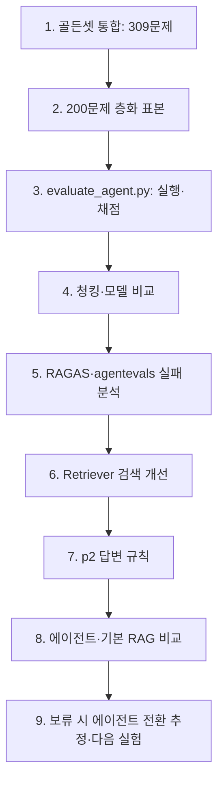

# 26.10.16 59일차(RAG 에이전트 평가 · 검색 개선 · 기본 RAG 비교)

## [TIL] 평가 결과로 RAG 에이전트의 검색과 답변을 개선하기

오늘은 골든셋을 통합하고 에이전트 평가기를 만든 뒤 **청킹·모델·검색·프롬프트**를 비교했다. 200문제 평가에서 에이전트의 정답은 초기 0.791 수준에서 최종 0.888 / 0.903(답할 수 있는 196문제 기준)으로 높아졌고, 같은 조건의 기본 RAG와 정확도·속도를 비교했다.



```plain text
골든셋 309개 통합 → 200개 표본
→ 에이전트 실행·답변/근거/보류/검색 횟수/시간 채점
→ 청킹·모델 비교 → 실패 원인 분석
→ 검색과 프롬프트 수정 → 기본 RAG와 비교
→ 보류 시 전환 방식 추정 → 실제 구현·재검증
```

---

## 1. 평가 데이터와 평가기 구성

### 1-1. 골든셋 통합과 평가 범위

제공 골든셋 267개와 직접 만든 77개를 합치고 중복 35개를 제거해 `data/goldenset_all.csv`의 **309문제**를 만들었다. 반복 실험에는 분야와 근거 유형의 비율을 맞춘 `data/goldenset_200.csv` 200문제를 사용했다. 이 중 답할 수 있는 문제는 196개, 답이 없는 문제는 4개다.

| 구분 | 문제 수 | 용도 |
|---|---:|---|
| 제공 골든셋 | 267 | 기존 평가 질문 |
| 직접 만든 골든셋 | 77 | 추가 평가 질문 |
| 통합 골든셋 | 309 | 중복 35개 제거 |
| 비교용 표본 | 200 | 분야·근거 유형 비율을 맞춘 반복 실험 |

### 1-2. 답변과 근거를 따로 채점

`pipeline/evaluate_agent.py`의 `evaluate_answer()`는 답변 가능 여부를 먼저 확인한다. 답할 수 있는데 보류하면 오답, 답이 없는 질문을 보류하면 정답으로 처리하며, 실제 답변은 `openevals`의 `CORRECTNESS_PROMPT`로 채점한다.

```python
# pipeline/evaluate_agent.py: evaluate_answer()
withheld = run["status"] == "withheld"
if not case["answerable"]:
    return withheld, "답변 불가 문제: " + ("보류함" if withheld else "답을 지어냄")
if withheld:
    return False, "답할 수 있는 문제인데 보류함"
res = judge(inputs=case["question"], outputs=run["answer"], reference_outputs=case["target_answer"])
return bool(res["score"]), res["comment"]
```

입력은 골든셋 질문·정답과 에이전트 실행 결과이며, 출력은 정오 판정과 채점 이유다. `evaluate_pages()`는 인용한 `(파일명, 쪽)`과 검색된 청크의 쪽을 정답 쪽과 각각 대조한다. 쪽 적중은 **정답 문장이 든 청크 적중과 다르다**는 점을 실패 분석에서 확인했다.

`main()`은 문제마다 `details.jsonl`에 즉시 기록하고, 재실행 시 채점이 끝난 문제를 건너뛴다. `summarize()`는 전체·분야·근거 유형·출처별 정답률, 근거 쪽 적중, 검색 적중, 잘못된 보류, 답변 불가 보류, 평균 검색 횟수와 시간을 `report.md`에 쓴다. 평가 중 LangSmith 추적은 사용량 초과 로그 때문에 끄고 결과 파일로 기록했다.

---

## 2. 모델·청킹을 실제 답 정확도로 선택

### 2-1. 답변 모델과 채점 모델

모델 비교에서 `gemini-3.6-flash`는 질문당 약 11초, `gemini-3.5-flash-lite`는 약 4초였다. 2.5 계열은 약 5초였지만 재검색이 없거나 보류 판단이 어긋난 사례가 있어 **3.5-flash-lite**를 답변 모델로 선택했다. 채점 모델도 12문제 판정이 4개 모델에서 같았고 약 0.9초로 빨랐던 3.5-flash-lite로 고정했다. 이 모델 선택은 소수 질문 비교이며 3.6-flash의 전체 정답률을 비교한 결과는 아니다.

| 모델 | 질문당 시간 | 관찰·결정 |
|---|---:|---|
| gemini-3.6-flash | 약 11초 | 답변은 좋았으나 느림; 전체 평가 없음 |
| gemini-3.5-flash-lite | 약 4초 | 재검색·보류 동작 확인 후 선택 |
| gemini-2.5-flash / lite | 약 5초 | 재검색·보류 문제로 제외 |

### 2-2. 청킹별 검색 점수와 에이전트 정답률

검색기 평균 역순위(MRR)는 300자/50자 겹침이 **0.830**으로 가장 높았다. 하지만 답변 정답률은 500/60이 두 실행에서 0.827 / 0.811로 300/50의 0.786 / 0.796보다 높아 **500/60을 선택**했다. 검색 지표만으로 최종 RAG 품질을 결정하면 잘못 고를 수 있다.

| 청킹(크기/겹침) | 검색 MRR | 에이전트 정답률 1차 / 2차 |
|---|---:|---:|
| 300/50 | **0.830** | 0.786 / 0.796 |
| **500/60** | 0.819 | **0.827 / 0.811** |
| 800/100 | 0.812 | 0.806 / 미실행 |

---

## 3. 실패 분석에서 검색 문제를 찾다

### 3-1. RAGAS와 agentevals의 관찰

RAGAS로 틀린 34문제를 분석하니 24개가 검색 문제였다. 정답 **쪽**은 찾았어도 정답이 적힌 **청크**를 전달하지 못해 보류한 사례가 많았다. 근거 없이 답을 지어내는 문제는 거의 없었다. 성공 34개도 표본으로 비교했으며, 분석 자체도 lite 모델의 채점에 의존한다.

`agentevals`로 검색 과정을 보니 잘못된 분야(`domain`)를 고른 경우 정답률이 0.3 수준이었다. 표 질문에 적용했던 최대 한계 관련성(MMR) 검색은 같은 표의 여러 행 대신 일부 행만 가져와 계산 질문에 불리했다.

| 현상 | 확인된 원인 | 대응 | 결과 또는 다음 확인 |
|---|---|---|---|
| 정답 쪽을 찾았는데 보류 | 답이 든 청크가 검색 결과에서 빠짐 | 같은 쪽 앞뒤 청크 1개씩 연결 | 단독 적용 0.806으로 개선 없음; 다른 수정과 결합 |
| 표 질문에서 행이 빠짐 | MMR의 다양성 선택으로 필요한 표 행 누락 | 표도 Hybrid 검색 | 표 정답률 0.55 → 0.67 |
| 분야를 잘못 고르면 근거 누락 | 선택한 분야만 검색 | 분야 결과와 전체 결과를 RRF로 결합 | 세 검색 변경 결합 평균 0.819 → 0.885 |
| 계산 가능 질문을 보류 | 비교 문장이 없다는 이유로 보류 | 숫자 계산·복합 질문·연도 일치 규칙 추가 | 최종 평균 0.896; 표 0.818 |

처음에는 실패의 약 70%를 판단 문제로 보았으나, 청크 단위 분석 후 **검색 문제**가 더 큰 원인임을 바로잡았다. 근거 쪽 적중률만으로 검색 품질을 판정할 수 없다.

### 3-2. `Retriever.search()`에 적용한 세 변경

`pipeline/retriever.py`는 임베딩 유사도와 Kiwi 형태소 기반 BM25 결과를 상호 순위 융합(RRF)으로 합쳐 Hybrid 검색을 한다. 분야가 지정되면 해당 분야와 전체 검색 결과를 다시 RRF로 합치고, `with_neighbors()`로 같은 쪽의 앞뒤 청크를 연결한다.

```python
# pipeline/retriever.py: Retriever.search()
k = k or self.k
domain = domain if domain in DOMAINS else None
find = self.mmr if is_table and self.table_mode == "mmr" else self.hybrid
hits = find(query, k, domain)
if domain and self.domain_fallback:
    hits = rrf(hits, find(query, k, None), top=k)
return self.with_neighbors(hits, self.neighbors) if self.neighbors else hits
```

입력은 검색어와 선택적 분야이며, 최종 설정은 `neighbors=1`, `table_mode="hybrid"`, `domain_fallback=True`다. `agent.py`의 검색 도구는 `is_table` 인자를 없앴으므로 최종 에이전트에서는 표도 Hybrid를 사용한다. 각 변경을 하나씩 더해 평가했기 때문에 표 Hybrid와 분야 보완의 **개별 순수 효과**는 분리할 수 없다.

| 검색 설정 | 답할 수 있는 문제 정답률 | 판단 |
|---|---:|---|
| 초기 500/60 | 0.827 / 0.811 | 기준 |
| 앞뒤 청크만 추가 | 0.806 | 단독 효과 없음 |
| 앞뒤 청크 + 표 Hybrid | 0.842 | 표 질문 개선 |
| 앞뒤 청크 + 표 Hybrid + 분야 보완 | **0.872 / 0.898** | 결합 설정 선택 |

BM25 형태소 색인은 `BM25Search.__init__()`에서 청크 ID·본문 지문을 확인해 `vectordb/bm25_<설정>.pkl`에 재사용한다. 시작 시간이 약 20초에서 0.2초로 줄었고 검색 결과는 동일한지 확인했다. 공통 코드를 모으면서 183줄을 줄였고 추출·청크·검색 결과의 동일성도 확인했다.

---

## 4. p2 프롬프트와 최종 에이전트

### 4-1. 근거 판단 후 답변

`pipeline/agent.py`의 `ANSWER_RULES`는 질문의 모든 부분에 답하고, 계산에 쓴 숫자와 결과를 함께 적으며, 연도·대상·단위를 맞추도록 한다. 표 숫자로 계산할 수 있으면 별도 비교 문장이 없어도 답하고, 근거가 부족하면 보류한다. 구조화 응답 `Answer`에서 `judgement`를 `status`보다 먼저 생성하게 했다.

```python
# pipeline/agent.py: Answer, RagAgent.__init__()
class Answer(BaseModel):
    judgement: str = Field(description="질문의 부분마다 근거가 충분/부족한지와 그 이유")
    status: Literal["answered", "withheld"] = Field(description="answered=답변, withheld=근거 부족으로 보류")
    answer: str = Field(description="한국어 답변. 보류면 근거를 찾지 못했다는 안내")
    citations: list[Citation] = Field(default_factory=list, description="답에 쓴 근거")

self.agent = create_agent(
    model=llm,
    tools=[search],
    system_prompt=SYSTEM_PROMPT,
    middleware=[ToolCallLimitMiddleware(tool_name="search", run_limit=MAX_SEARCHES)],
    response_format=Answer,
)
```

`RagAgent.ask()`는 질문을 받아 검색 도구를 최대 3회 호출한 뒤 답변 또는 보류와 인용을 남긴다. p2 적용 후 정답률은 0.888 / 0.903으로, 표 질문은 0.818로 측정됐다. 답 없는 4문제는 두 번 모두 보류했다. p1 대비 평균 향상은 약 1.1%p로, 동일 설정의 반복 실행 변동 1~2%p와 비슷해 확정적인 개선으로 해석하기 어렵다.

### 4-2. 최종 설정과 결과

| 항목 | 최종 선택 | 근거 |
|---|---|---|
| 청킹 | 500자 / 겹침 60자 | 300/50보다 답변 정답률 높음 |
| 검색 | Hybrid + 앞뒤 청크 1개 + 분야/전체 결과 혼합 | 검색 실패·표 행 누락·분야 오선택 대응 |
| 모델 | gemini-3.5-flash-lite | 약 4초와 재검색·보류 동작 |
| 프롬프트 | p2 | 계산·복합 질문·조건 일치 명시 |
| 답변 방식 | 에이전트, 검색 최대 3회 | 기본 RAG보다 약 4%p 높은 평균 정답률 |

| 200문제 평가 | 1차 | 2차 |
|---|---:|---:|
| 전체 200문제 중 정답 | 178 (89.0%) | 181 (90.5%) |
| 답변 가능 196문제 기준 정답률 | 0.888 | 0.903 |
| 답했으나 오답 | 9 | 7 |
| 답이 있으나 보류 | 13 | 12 |
| 답 없는 4문제 보류 | 4/4 | 4/4 |
| 평균 검색 횟수 / 시간 | 1.3회 / 약 4초 | 1.4회 / 약 4초 |

---

## 5. 기본 RAG와 공정하게 비교

`pipeline/agent.py`의 `BasicRag.ask()`는 **질문 원문으로 한 번 검색**하고 같은 검색기·모델·답변 규칙으로 즉시 답하거나 보류한다. 에이전트만 검색어 선택과 재검색을 수행한다.

```python
# pipeline/agent.py: BasicRag.ask()
chunks = self.retriever.search(question)
answer = self.llm.invoke(BASIC_RAG_PROMPT.format(
    question=question, context=format_results(chunks)))
```

입력은 같은 질문과 최종 검색 설정이며, 기본 RAG의 검색 횟수는 항상 1회다. 두 실행 평균 정답률은 에이전트 **0.896**, 기본 RAG **0.855**로 약 4.1%p 차이였다. 에이전트 평균 4.1초, 기본 RAG 2.4초로 에이전트가 약 1.7배 느렸다.

| 지표 | 에이전트 1차 / 2차 | 기본 RAG 1차 / 2차 |
|---|---:|---:|
| 전체 200문제 중 정답 | **178 / 181** | 174 / 169 |
| 답변 가능 196문제 정답률 | **0.888 / 0.903** | 0.867 / 0.842 |
| 답했으나 오답 | 9 / 7 | 8 / 12 |
| 답이 있으나 보류 | **13 / 12** | 18 / 19 |
| 답 없는 문제 보류 | 100% / 100% | 100% / 100% |
| 표 질문 정답률 | **0.818 / 0.818** | 0.758 / 0.697 |
| 평균 검색 / 시간 | 1.3회 / 4.1초 | 1회 / **2.4초** |

두 번 모두 에이전트만 맞힌 문제는 9개, 기본 RAG만 맞힌 문제는 3개였다. 에이전트만 맞힌 9개 중 5개는 2~3회 **재검색**, 4개는 한 번 검색하되 **핵심어로 검색어를 바꾼 효과**와 연결됐다. 에이전트도 76%의 질문은 한 번만 검색했다. 차이는 주로 검색 실패 후의 잘못된 보류가 줄어든 데서 나타났다.

---

## 6. 선택 기준, 한계와 다음 실험

### 6-1. 기본 RAG 보류 시 에이전트로 넘기기

저장된 두 결과를 조합해 **기본 RAG가 보류한 문제만 에이전트로 넘기는 방식**을 추정했다. 실제 라우팅 구현을 실행한 값은 아니다. 200문제 중 22~23개만 에이전트로 넘어가는 계산에서 정답률은 0.908 / 0.893, 평균 시간은 약 3.0초였다.

| 방식 | 정답률 1차 / 2차 | 평균 시간 | 상태 |
|---|---:|---:|---|
| 기본 RAG만 | 0.867 / 0.842 | 2.4초 | 실제 평가 |
| 에이전트만 | 0.888 / 0.903 | 4.1초 | 실제 평가 |
| 기본 RAG 보류 시 전환 | **0.908 / 0.893** | 약 3.0초 | 저장 결과 조합 추정 |

정의·사실 하나를 묻고 문서 표현과 질문이 비슷하거나 빠른 응답이 중요하면 기본 RAG가 적합하다. 복합 질문, 표현 차이, 표 계산, 한 번의 검색 실패가 잦은 경우에는 에이전트가 유리했다. 이 프로젝트는 의료·법률·금융 문서와 표 질문이 있어 에이전트를 선택했고, 속도까지 줄이는 전환 방식은 실제 구현으로 검증해야 한다.

### 6-2. 결과 해석의 한계

- 같은 설정도 두 번 실행하면 정답률이 1~2%p 달랐다. p2의 약 1%p 개선을 단정하지 않는다.
- 설정별 평가는 200문제로 1~2회 수행했다. 채점 모델은 12문제로만 교차 확인했다.
- 답이 없는 질문은 4개뿐이므로 p2가 억지 답변을 늘리는지 충분히 시험하지 못했다.
- 골든셋에는 의심스러운 정답과 하나의 정답 쪽만 적힌 항목이 있다. 다른 쪽의 올바른 근거도 쪽 적중에서 빠질 수 있다.
- 청킹 비교는 초기 검색 방식에서 했다. 개선한 검색으로 300/50·800/100을 재비교하지 않았다.
- 검색 변경을 누적 적용해 각 변경의 독립 효과는 모른다. 3.6-flash 전체 평가도 수행하지 않았다.
- RAGAS는 실패 34개와 성공 34개의 표본 분석이다. 응답 시간은 동시 실행 조건의 영향을 받으므로 대략적인 비교다.
- 남은 잘못된 보류에는 그래프·이미지 속 숫자 추출 문제가 있다. 검색과 프롬프트만으로 해결되지 않는다.

### 6-3. 다음에 할 것

1. 기본 RAG 보류 시 에이전트로 넘기는 흐름을 실제로 구현하고 같은 200문제로 평가한다.
2. 그래프·이미지의 숫자 추출 품질을 개선하고 남은 보류 문제를 재검증한다.
3. 골든셋의 의심스러운 정답과 근거 쪽을 검수하고 답이 없는 문제를 늘린다.

---

## 7. 헷갈린 점

처음에는 실패의 약 70%가 에이전트의 판단 문제라고 보았다. 그러나 RAGAS 분석에서 정답 쪽을 찾고도 답이 적힌 청크를 못 가져오는 사례가 많음을 확인했다. **쪽 적중 → 청크 적중 → 답변 가능 여부**를 구분해야 원인에 맞는 수정을 할 수 있다.

또 검색 MRR이 가장 높은 300/50을 바로 선택할 수 없었다. 최종 목적은 검색 순위 자체가 아니라 답변 정답률이므로, 500/60의 에이전트 평가 2회 결과를 기준으로 선택했다.

---

## 추가!

오늘 배운 것 정리

- 골든셋은 중복 제거와 분야·근거 유형 분포를 확인한 뒤 비교에 사용한다.
- 답변 정확도와 검색·인용 쪽 적중은 다른 지표다.
- 검색 쪽에 정답이 있어도 필요한 청크가 빠지면 보류가 생긴다.
- 청킹은 MRR과 최종 답 정확도를 함께 보고 고른다.
- 표 행을 함께 읽어야 할 때 MMR의 다양성 선택이 불리할 수 있다.
- 분야 선택 오류는 전체 검색 결과를 섞어 완화할 수 있다.
- 답변 규칙은 계산, 복합 질문, 연도·대상·단위 일치를 명시한다.
- 에이전트의 재검색과 검색어 선택은 정확도를 높였지만 응답 시간을 늘렸다.
- 보류 시 전환 방식은 저장 결과 기반 추정이므로 실제 실행 검증이 필요하다.

다음 실험은 다음 순서로 진행한다.

```plain text
골든셋·채점 기준 검수
→ 이미지·그래프 숫자 추출 개선
→ 기본 RAG 보류 시 에이전트 전환 구현
→ 같은 200문제 반복 평가
→ 정확도·보류·응답 시간 비교
```

#부트캠프 #멀티캠퍼스부트캠프 #AI캠퍼스 #AI에이전트엔지니어
