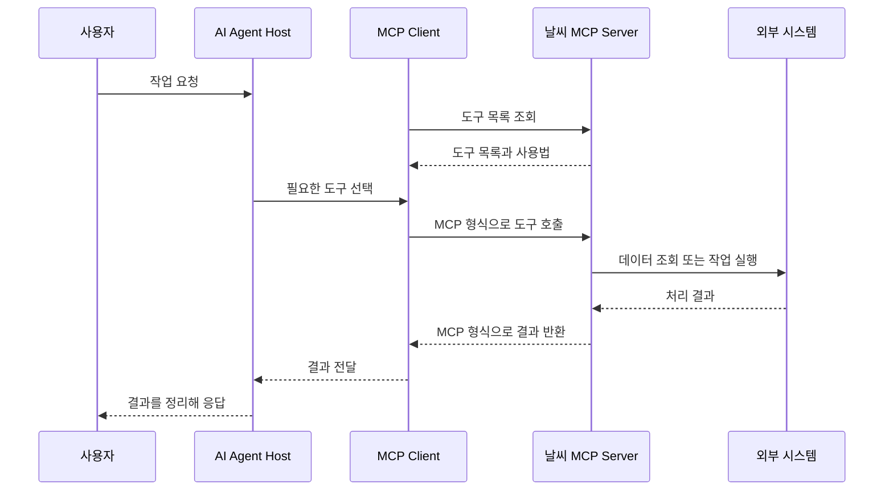

# 26.10.19 60일차(MCP · 날씨 도구 연결 · Ollama 로컬 LLM)

## [TIL] MCP 서버의 도구를 Agent에 연결하고 로컬 LLM 체인을 비교하기

오늘은 `36-mcp.ipynb`의 날씨 MCP 서버 연결과 `37-local-llm.ipynb`의 Gemini API·Ollama 체인을 정리했다. **MCP(Model Context Protocol)**는 AI 앱이 외부 도구와 데이터를 같은 방식으로 찾고 호출하게 하는 규약이고, **Ollama**는 모델을 로컬에서 실행하는 도구이다.

이론과 실습은 다음 흐름으로 이어졌다.

```plain text
MCP 서버의 Tool·Resource·Prompt 확인
→ 클라이언트에서 날씨 Tool 직접 호출 및 Agent에 전달
→ Gemini API 체인 구성
→ Ollama 로컬 모델로 체인의 모델 부분 교체
```

---

## 1. MCP의 역할과 구성

### 1-1. Tool Calling과 MCP

**Tool Calling**은 LLM이 도구 이름과 인자를 골라 호출을 제안하는 기능이다. MCP는 도구를 제공하는 서버와 AI 앱이 통신하는 표준 형식이다. 같은 날씨 MCP 서버를 LangGraph Agent와 Claude Code에서 재사용할 수 있다.

| 구분 | LangChain `@tool` | MCP 서버의 Tool |
|---|---|---|
| 등록 | Python 함수를 앱의 Tool로 등록 | 서버에 기능을 MCP Tool로 등록 |
| 호출 | 앱이 등록된 함수를 실행 | 클라이언트 요청을 받아 서버가 실행 |
| 재사용 | 주로 해당 LangChain 앱에서 사용 | 여러 MCP 지원 앱에서 서버에 연결해 사용 |

### 1-2. Host·Client·Server와 흐름

**Host**는 대화와 모델 실행을 관리하는 LangGraph Agent 앱 또는 Claude Code이다. **Client**는 Host 안에서 서버와 통신하는 `MultiServerMCPClient` 연결이고, **Server**는 Tool·Resource·Prompt를 제공하는 `weather_server.py`이다. 모델은 서버에 직접 접속하지 않고 Host가 Client를 통해 호출한다.



```plain text
사용자 작업 요청 → AI Agent Host
→ MCP Client가 서버의 도구 목록과 사용법 조회
→ Host가 필요한 도구 선택 → Client가 MCP Server에 호출
→ Server가 외부 시스템에서 조회·실행 → 결과를 Client·Host에 전달
→ Host가 사용자에게 응답
```


`36-mcp.ipynb`의 그림은 사용자·AI Agent·앱 내부 MCP Client·MCP Server·외부 시스템 사이에서 도구 목록을 조회하고 실행 결과를 되돌리는 순서를 보여준다.

### 1-3. Tool·Resource·Prompt

| 제공 기능 | 의미 | 날씨 예제 |
|---|---|---|
| Tool | 실행 가능한 함수 | 현재 날씨와 예보 조회 |
| Resource | URI로 읽는 데이터 | `weather://cities` 지원 도시 목록 |
| Prompt | 인자를 넣어 만드는 메시지 | `weather_briefing` 날씨 요약 요청 |

`get_tools()`는 Tool 목록만 가져온다. Resource와 Prompt는 각각 `get_resources()`와 `get_prompt()`로 따로 읽는다. MCP 메시지는 JSON-RPC 2.0 형식을 사용하며 `tools/list`로 목록을, `tools/call`로 도구 실행을 요청한다.

---

## 2. 날씨 MCP Tool 연결과 실행

### 2-1. 서버 실행과 클라이언트 연결

`36-mcp.ipynb`는 `mcp_examples/weather_server.py`를 별도 터미널에서 실행하도록 안내한다. 이 서버의 값은 **실습용 가상 날씨 데이터**이며 실제 날씨 API는 사용하지 않는다.

```bash
python mcp_examples/weather_server.py
```

서버가 실행되면 `http://127.0.0.1:8000/mcp`에서 요청을 받는다. 다만 현재 자료 폴더에는 `mcp_examples/weather_server.py`가 없어 새 환경에서 재현하려면 서버 파일을 확보해야 한다.

`36-mcp.ipynb`의 `MultiServerMCPClient`는 `"weather"`라는 이름으로 서버 주소를 등록하고 Tool 목록을 읽는다.

```python
weather_connection = {
    "transport": "streamable_http",
    "url": "http://127.0.0.1:8000/mcp",
    "timeout": 10,
}

weather_client = MultiServerMCPClient({"weather": weather_connection})
weather_tools = await weather_client.get_tools()
weather_tool_map = {tool.name: tool for tool in weather_tools}
```

`get_tools()` 출력에서 `get_current_weather`와 `get_weather_forecast`가 확인되었다. 두 Tool 모두 `city` 입력으로 `서울`·`부산`·`제주`를 받는다.

### 2-2. 직접 호출과 Agent 호출

연결을 먼저 검사하기 위해 `36-mcp.ipynb`는 LLM 없이 두 Tool을 비동기 호출한다. `ainvoke()`는 비동기 실행이고 `await`는 결과를 기다린다.

```python
current_result = await weather_tool_map["get_current_weather"].ainvoke({"city": "서울"})
forecast_result = await weather_tool_map["get_weather_forecast"].ainvoke({"city": "서울"})
```

입력은 두 호출 모두 `서울`이다. 직접 호출 결과와 Agent의 최종 답변에는 같은 실습 데이터가 나타났다.

| 조회 항목 | 값 | 단위 |
|---|---:|---|
| 현재 기온 | 22 | °C |
| 현재 습도 | 50 | % |
| 예보 최저 기온 | 18 | °C |
| 예보 최고 기온 | 25 | °C |
| 강수 확률 | 20 | % |

`36-mcp.ipynb`의 `create_agent()`는 Gemini 모델과 가져온 `weather_tools`를 결합한다. `weather_agent.ainvoke()` 뒤의 호출 기록에는 모델이 `get_current_weather`와 `get_weather_forecast`를 모두 선택하고 `city=서울`을 전달한 사실이 남았다. 직접 호출은 코드가 Tool을 정하고, Agent 호출은 모델이 Tool과 인자를 고른다는 차이가 있다.

### 2-3. Resource·Prompt와 Claude Code

`36-mcp.ipynb`에서는 지원 도시 Resource와 도시별 요약 Prompt를 읽어 Agent 요청에 함께 넣는다. Prompt를 가져오는 것만으로는 LLM이 실행되지 않으며, `weather_agent.ainvoke()`가 별도로 필요하다.

```python
resources = await weather_client.get_resources("weather", uris="weather://cities")
cities_text = resources[0].as_string()

weather_messages = await weather_client.get_prompt(
    "weather", "weather_briefing", arguments={"city": "서울"}
)
prompt_text = weather_messages[0].text
```

같은 서버를 Claude Code에서도 쓰려면 `36-mcp.ipynb`에 제시된 명령으로 주소를 등록한다. 서버가 실행 중이어야 하며, 등록 후 `claude mcp list`와 `/mcp`로 연결을 확인한다.

```bash
claude mcp add --transport http --scope local weather http://127.0.0.1:8000/mcp
claude mcp list
```

**Smithery**는 다른 MCP 서버를 찾고 연결 방법을 확인하는 서비스이며, **A2A(Agent2Agent)**는 독립 Agent 간에 업무와 결과를 주고받는 규약이다. MCP가 앱과 도구·데이터를 연결한다면 A2A는 Agent와 Agent를 연결한다.

---

## 3. Gemini API 체인을 Ollama 로컬 모델로 바꾸기

### 3-1. 로컬 모델과 Model Hub

`37-local-llm.ipynb`에서 **Ollama**는 로컬 모델 다운로드·실행과 로컬 API 서버를 맡는다. **Hugging Face**는 모델·데이터셋·데모를 찾는 Model Hub이다. **양자화(quantization)**는 모델 가중치를 낮은 정밀도로 표현해 크기와 메모리 사용량을 줄인다.

Ollama 서버를 실행한 뒤 새 터미널에서 약 8억 파라미터의 `qwen3.5:0.8b` 모델을 받는다. `langchain-ollama`는 LangChain 연동 패키지이다.

```bash
ollama serve
ollama pull qwen3.5:0.8b
pip install langchain-ollama
```

서버 실행 터미널은 실습 중 열어 둔다. 노트북에는 위 명령과 코드가 있지만 실행 출력은 저장되어 있지 않다.

### 3-2. 같은 프롬프트와 파서에 다른 모델 넣기

`37-local-llm.ipynb`는 `.env`의 `GOOGLE_API_KEY`를 읽고 `ChatPromptTemplate`·Gemini·`StrOutputParser`로 체인을 만든다.

```python
prompt = ChatPromptTemplate.from_messages([
    ("system", "너는 {role} 전문가야. 모든 답변은 한국어로 해줘."),
    ("human", "{question}"),
])

llm = ChatGoogleGenerativeAI(model="gemini-3.6-flash")
parser = StrOutputParser()
chain = prompt | llm | parser

result = chain.invoke({"role": "Python", "question": "for 문을 설명해줘"})
```

로컬 실습에서는 `37-local-llm.ipynb`의 `ChatOllama`로 모델 부분만 바꾼다. 프롬프트·파서·질문은 같아서 연결 방식을 비교할 수 있다.

```python
local_llm = ChatOllama(model="qwen3.5:0.8b", reasoning=False)
chain = prompt | local_llm | parser

result = chain.invoke({"role": "Python", "question": "for 문을 설명해줘"})
```

| 비교 | 로컬 LLM `qwen3.5:0.8b` | Gemini API `gemini-3.6-flash` |
|---|---|---|
| 비용 | API 호출 비용 없음, 장비·전력 필요 | 요금제와 사용량에 따름 |
| 인터넷 | 다운로드 후 로컬 추론은 불필요 | 필요 |
| 한계 | PC 메모리·연산 성능 | 요청 수·토큰 수 한도 |

두 모델의 실제 답변이나 품질·속도 측정값은 노트북에 없으므로 어느 쪽이 더 낫다고 결론 내릴 수 없다. 선택은 인터넷 연결, 실행 장비, API 사용 조건에 맞춘다.

---

## 4. 실행 결과와 재현 시 확인할 점

36번 노트북의 저장된 출력에서는 Tool 두 개가 등록되고, 직접 호출과 Agent 호출 모두 서울의 동일한 가상 날씨 값을 반환했다. Agent 호출 기록은 모델이 현재 날씨와 예보 Tool 두 개를 선택했음을 보여준다. 37번 노트북에는 Gemini와 Ollama 체인 코드만 있으며 출력은 없다.

| 현상 | 원인 | 대응 | 결과 또는 다음 확인 |
|---|---|---|---|
| 36번 실행 로그에 LangSmith 429가 표시됨 | 월간 고유 trace 사용 한도 초과라는 로그가 남음 | 추적 사용량·설정을 확인 | 날씨 Tool과 Agent 답변은 저장된 출력에서 확인됨 |
| 현재 폴더에서 날씨 서버 파일을 찾지 못함 | 노트북이 참조하는 `mcp_examples/weather_server.py`가 현재 자료에 없음 | 서버 파일 확보 후 실행 | 새 환경 실행은 재검증 필요 |
| 37번 노트북의 모델 답변 없음 | 실행 출력이 저장되지 않음 | Ollama 서버·모델과 API 키를 준비해 실행 | 답변 품질·속도 비교는 재검증 필요 |

비교 대상은 직접 Tool 호출과 Agent Tool 호출이다. 둘 다 같은 가상 날씨 수치를 반환했고, Agent 기록에서 두 Tool 호출이 확인되었다. 따라서 이 예제에서는 연결을 직접 호출로 확인한 다음 모델의 Tool 선택을 확인하는 순서를 사용했다.

---

## 5. 헷갈린 점

`FastMCP`는 서버에서 Tool·Resource·Prompt를 등록하는 데 쓰이고, `MultiServerMCPClient`는 실행 중인 서버에 연결한다. `get_tools()`만 호출하면 Resource와 Prompt까지 자동으로 읽힌다고 생각하기 쉽지만 두 기능은 별도 메서드로 가져와야 한다. 또한 MCP는 모델 자체의 기능이 아니라 앱과 서버 사이의 연결 규약이며, Tool 실행 여부와 인자 선택은 Agent의 모델 호출 과정에서 정해진다.

---

## 추가!

오늘 배운 것 정리

- MCP는 AI 앱과 외부 도구·데이터 사이의 표준 통신 규약이다.
- Host는 대화와 모델을 관리하고, Client는 서버에 연결하며, Server는 기능을 제공한다.
- Tool Calling은 모델의 도구 선택 기능이고 MCP는 연결 방식이다.
- `get_tools()`는 Tool 목록만 가져오며 Resource와 Prompt는 따로 읽는다.
- `ainvoke()`는 비동기 호출이며 `await`로 결과를 기다린다.
- 날씨 예제의 서울 값은 실제 기상이 아닌 가상 데이터이다.
- Claude Code와 LangGraph Agent가 같은 MCP 서버를 사용할 수 있다.
- Ollama는 로컬 모델을 실행하고 Hugging Face는 모델을 찾는 플랫폼이다.
- 프롬프트와 파서를 유지한 채 Gemini를 `ChatOllama`로 교체할 수 있다.

MCP 도구와 로컬 모델을 확인할 때는 다음 순서로 생각하면 된다.

```plain text
서버 파일과 실행 상태 확인
→ Client로 Tool 목록 조회
→ Tool 직접 호출로 연결 확인
→ Agent에서 Tool 선택 확인
→ Ollama 서버·모델 준비 후 같은 체인으로 결과 비교
```

#부트캠프 #멀티캠퍼스부트캠프 #AI캠퍼스 #AI에이전트엔지니어
