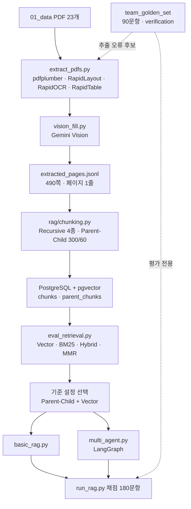
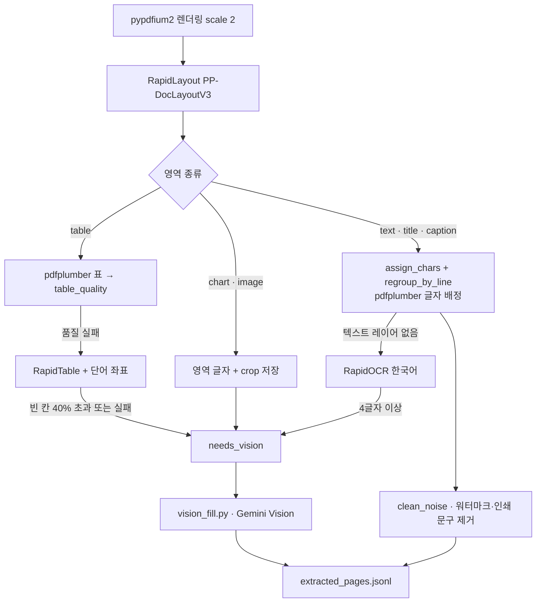
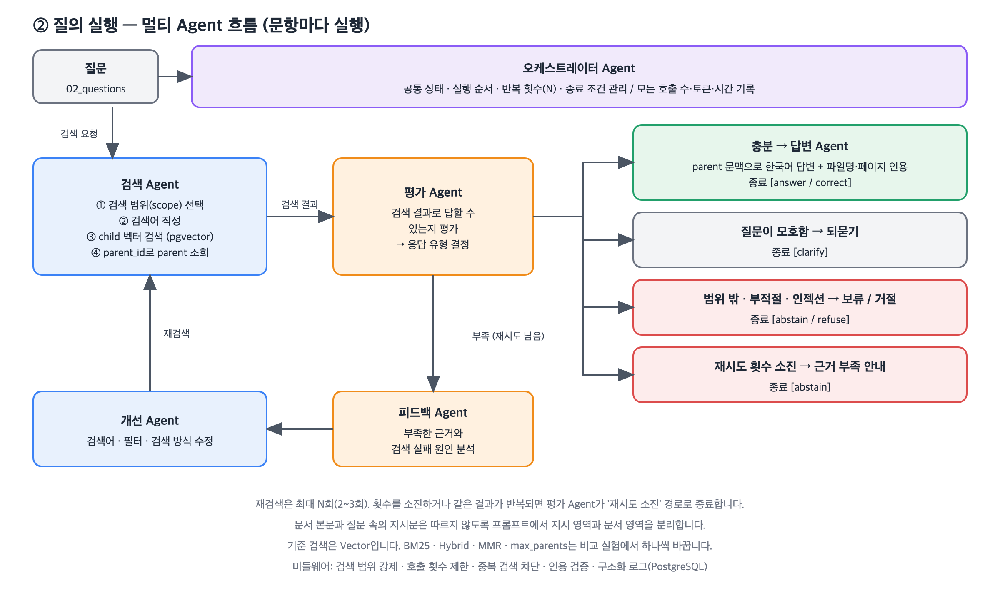
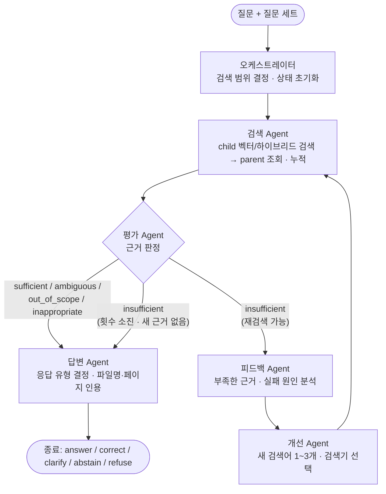
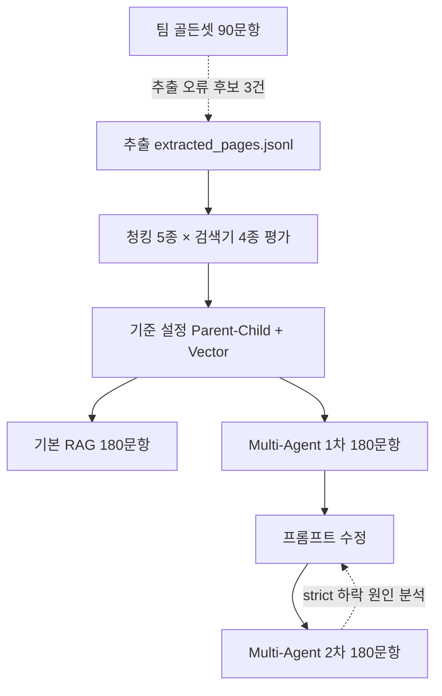

# 26.10.20 61일차(팀 RAG 프로젝트 · PDF 추출 · Parent-Child 청킹 · Multi-Agent RAG · 골든셋)

## [TIL] 오늘 한 일을 한 문장으로 요약하기

오늘은 3명이 역할을 나눠 금융 PDF 23개(490쪽)를 근거로 답하는 **Multi-Agent RAG**를 하루 만에 추출부터 평가까지 연결했다. 박의혁은 **PDF 추출**, 정원하는 **청킹·검색·기본 RAG·Multi-Agent RAG**, 한용님은 **팀 골든셋 90문항과 PDF 대조 검수**를 맡았다.

결과적으로 검색은 **Parent-Child 300/60 + Vector**가 child MRR 0.885로 가장 좋았고, Multi-Agent RAG는 기본 RAG보다 응답 유형 정확도(strict)가 0.661에서 0.883으로 올랐지만 모델 호출은 2.3배, 입력 토큰은 약 2.3배가 들었다.

이론과 실습은 다음 흐름으로 이어졌다.



```plain text
PDF 23개 추출(박의혁)
→ extracted_pages.jsonl 공유
→ Parent-Child·Recursive 청킹과 pgvector 저장(정원하)
→ 검색기 20조합 평가 후 기준 설정 선택
→ 기본 RAG와 Multi-Agent RAG 실행·비교
→ 팀 골든셋 90문항 작성·검수(한용님)
→ 골든셋 검수에서 추출 오류 후보를 찾아 추출 단계로 되돌림
```

---

## 1. 프로젝트 구조와 역할 분담

### 1-1. 과제 범위

과제는 제공된 PDF를 검색해 **근거(파일명·페이지)와 함께 답하는 RAG Agent**를 처음부터 만들고, 평가 지표와 평가 루프를 직접 만드는 것이다. 질문 세트마다 검색 범위가 다르다는 점이 핵심 조건이었다.

| 세트 | 문항 | 검색 대상 |
|---|---|---|
| 기본 positive | POS001~060 · 60개 | 용어집 + 표준약관 15개 |
| 기본 negative | NEG001~040 · 40개 | 용어집 + 표준약관 15개 |
| 금융생활 positive | POS061~080 · 20개 | 금융생활 가이드북 |
| 추가 문서 positive | ADD-* · 60개 | 추가 PDF 6개 |

기본 negative의 "자료에 없음"은 용어집과 약관만 검색한다는 조건이다. 그래서 검색 범위를 세트별로 강제하는 장치가 필요했다.

### 1-2. 역할 분담과 브랜치

| 담당 | 브랜치 | 한 일 |
|---|---|---|
| 박의혁 | `main`, `feature/pdf-extraction` | 기획서·README, PDF 추출 파이프라인, 추출 결과 Markdown 보기 |
| 정원하 | `feature/pipeline-design`, `feature/chunking-retrieval` | 파이프라인 설계 문서·도식, 청킹·임베딩, 검색 평가, 기본 RAG, LangGraph Multi-Agent RAG |
| 한용님 | `feature/golden-set` | 팀 골든셋 90문항(ADD 30, 가이드북 10, positive 30, negative 20)과 자동 검사·검수 문서 |

### 1-3. 전체 파이프라인 한눈에 보기


이 그림은 정원하의 `docs/pipeline.md`에 있는 전체 구조다. ① 인덱싱(오프라인), ② 질의 실행(온라인), ③ 기록·평가 루프로 나누고, 평가 결과로 청킹·검색·Agent 설정을 **기준 설정 대비 한 번에 하나만** 바꿔 다시 실행하는 점선 피드백 경로가 있다.

| 데이터 | 쓰는 곳 | 주의 |
|---|---|---|
| `01_data/` → `extracted_pages.jsonl` | 인덱싱의 입력 | 페이지 1개가 한 줄 |
| `02_questions/` | 질의 실행의 입력 | Agent에 들어가는 유일한 정보 |
| `03_answers/`, 팀 골든셋 | 평가 전용 | 검색 DB와 Agent 프롬프트에 넣지 않는다 |

---

## 2. PDF 추출 (박의혁)

### 2-1. 문서 진단과 추출 방식 결정

먼저 `pdfplumber`로 23개 PDF의 페이지 수, 텍스트 양, 이미지·표 수를 진단했다. 문서마다 성격이 크게 달라 같은 방법으로 뽑을 수 없었다.

| 묶음 | 페이지 | 특징 | 추출 방식 |
|---|---|---|---|
| 표준약관 15개 | 117 | 1단 텍스트, 이미지·표 없음 | `pdfplumber` 페이지 전체(plain) |
| 용어집 | 25 | 1단 텍스트 | `pdfplumber` 페이지 전체(plain) |
| 금융생활 가이드북 | 43 | 책 2쪽이 한 PDF 쪽에 들어간 펼침면, 표 119·이미지 62 | 레이아웃 영역별(layout) |
| 추가 PDF 6개 | 305 | 2단 편집, 표 265·이미지 476, 텍스트가 거의 없는 쪽 24 | 레이아웃 영역별(layout) |

2단 편집인 자영업자 보고서를 `pdfplumber`로 페이지 전체 추출하면 왼쪽 단과 오른쪽 단 문장이 한 줄씩 섞였다. 그래서 그림·표가 있는 문서는 **RapidLayout(PP-DocLayoutV3)으로 영역을 먼저 찾고 영역마다 글자를 모으는 방식**으로 바꿨다.

또 기준 답안의 `source_pages`가 인쇄 쪽번호가 아니라 **PDF 실제 쪽 순서(1부터)**인 것을 확인하고 `page_no`도 같은 기준으로 정했다. 가이드북의 `fss-life-guide-pdf-10`이 인쇄 18쪽인 것이 근거였다.

### 2-2. 영역별 추출 흐름

`extraction/extract_pdfs.py`의 `page_blocks_layout()`이 레이아웃 문서의 한 페이지를 처리한다.



```plain text
페이지 렌더링
→ RapidLayout으로 text·title·table·chart·image 영역 탐지
→ 글 영역: pdfplumber 글자를 영역에 배정, 텍스트 레이어가 없으면 RapidOCR
→ 표 영역: pdfplumber 표 → 품질 검사 실패 시 RapidTable → 그래도 실패하면 Vision 대기
→ 차트·큰 그림·OCR 글 영역: crop 이미지 저장 후 Vision 대기
→ vision_fill.py가 Gemini Vision으로 대기 블록을 텍스트로 변환
→ 반복 워터마크·인쇄 문구 제거 후 JSONL 저장
```

사용한 도구와 역할은 다음과 같다.

| 도구 | 역할 |
|---|---|
| `pdfplumber` | 본문·선이 있는 표, 글자 좌표 |
| `pypdfium2` | 페이지 이미지 렌더링 |
| `RapidLayout`(PP-DocLayoutV3) | 표·차트·그림·글 영역 탐지 |
| `RapidOCR`(korean PP-OCRv5) | 텍스트 레이어가 없는 영역 |
| `RapidTable`(SLANet+) | 이미지 기반 표 구조 인식 |
| Gemini Vision(`gemini-3.5-flash`) | 차트·깨진 표·큰 그림·OCR 글 영역 해석 |

### 2-3. 글자를 영역에 배정하기

처음에는 "글자 중심점이 영역 안에 있는가"로 글자를 모았다. 그런데 보험약관 PDF는 폰트 정보 때문에 pdfplumber 글자 좌표가 실제로 보이는 위치보다 약 6pt 아래로 밀려 있어 문장이 통째로 빠지고 OCR로 중복 추출됐다. 그래서 글자마다 **가장 많이 겹치는 영역 하나에만** 배정하도록 바꿨다.

`extraction/extract_pdfs.py`의 `PageCtx.assign_chars()`:

```python
def assign_chars(self, boxes, pad=CHAR_PAD):
    grown = [[b[0] - pad, b[1] - pad, b[2] + pad, b[3] + pad] for b in boxes]
    assigned = [[] for _ in boxes]
    left = []
    for c in self.all_chars:
        cb = (c["x0"], c["top"], c["x1"], c["bottom"])
        best, best_ov = None, 0.0
        for i, g in enumerate(grown):
            ov = inter_ratio(cb, g)
            # 겹침이 같으면 더 작은(구체적인) 영역 우선
            if ov > best_ov + 1e-6 or (best is not None and abs(ov - best_ov) <= 1e-6 and ov > 0
                                       and area(boxes[i]) < area(boxes[best])):
                best, best_ov = i, ov
        (assigned[best] if best is not None else left).append(c)
    return assigned, left
```

- 입력은 레이아웃 영역 bbox 목록이고, 출력은 영역별 글자 목록과 어느 영역에도 겹치지 않은 글자(`left`)다.
- 글자 하나가 한 영역에만 들어가므로 같은 문장이 두 블록에 중복되지 않는다.
- 공백 문자도 `all_chars`로 함께 배정해야 띄어쓰기가 유지된다. 처음에 공백을 걸러 냈다가 "보험료납입연체로…"처럼 띄어쓰기가 사라졌다.

레이아웃 박스 경계에서 제목이 "1단계 재무목표 세" + "우기"로 갈라지는 문제는 **같은 줄에서 이어진 글자 묶음 단위 다수결**로 해결했다.

`extraction/extract_pdfs.py`의 `PageCtx.regroup_by_line()`:

```python
def regroup_by_line(self, assigned, left):
    """줄 조각 단위 다수결로 재배정: 영역 경계에 걸친 제목·단어가 둘로 갈라지지 않게 한다."""
    owner = {id(c): i for i, cs in enumerate(assigned) for c in cs}
    for seg in self.line_segments():
        votes = Counter(owner.get(id(c)) for c in seg if c["text"].strip())
        votes.pop(None, None)
        if not votes:
            continue
        target = votes.most_common(1)[0][0]
        for c in seg:
            owner[id(c)] = target
    ...
```

- `line_segments()`는 같은 줄에서 글자 간격이 글자 크기의 1.5배(`SEGMENT_GAP`)를 넘으면 다른 조각으로 나눈다. 그래야 2단 편집의 왼쪽·오른쪽 단이 한 조각으로 묶이지 않는다.
- 단어 단위로만 다수결을 하면 글자 수가 많은 "우기" 쪽(본문)으로 넘어가므로 줄 조각 단위로 했다.

### 2-4. 표 품질 검사

`pdfplumber`가 찾은 표는 셀 누락, 병합 셀, 그래프 오인식이 섞여 있었다. 표를 그대로 믿지 않고 숫자로 검사한 뒤 실패한 표만 RapidTable로 넘겼다.

`extraction/extract_pdfs.py`의 `table_quality()`:

```python
reasons = []
if n_rows < 2 or n_cols < 2:
    reasons.append("too_small")  # 1행·1열 표는 그래프·박스를 표로 오인식한 경우가 많다
if empty_ratio > 0.6:
    reasons.append("many_empty_cells")
if coverage < 0.8:
    reasons.append("missing_text")  # 영역 안 글자가 셀에 다 들어가지 않음 = 셀 누락
max_cell = max((len("".join(str(c).split())) for c in cells if c), default=0)
if len(cells) >= 4 and cell_chars and max_cell / cell_chars > 0.5:
    reasons.append("one_cell_dominant")  # 내용이 한 셀에 몰림 = 셀 경계 인식 실패
```

| 실패 사유 | pdfplumber | RapidTable |
|---|---:|---:|
| `missing_text`(셀 누락) | 127 | 4 |
| `too_small`(그래프 오인식) | 35 | 2 |
| `one_cell_dominant`(한 셀에 몰림) | 15 | 8 |
| `many_empty_cells` | 3 | 2 |

RapidTable은 `use_ocr=False`로 두면 HTML을 만들지 않아서, `use_ocr=True`로 두고 pdfplumber 단어 좌표를 `ocr_results`로 직접 넘겼다. RapidTable 결과도 셀이 한 칸씩 밀리는 경우를 검사로 잡기 어려워, 빈 칸이 40%를 넘으면 Vision으로도 확인하게 했다.

### 2-5. Gemini Vision 단계

차트, 깨진 표, 큰 그림, OCR로 읽은 글 영역은 `extraction/vision_fill.py`가 crop 이미지를 Gemini에 보내 텍스트로 바꿨다. 결과는 이미지 해시로 캐시해서 다시 실행해도 API를 호출하지 않는다.

`extraction/vision_fill.py`의 `cache_key()`:

```python
def cache_key(img_bytes, btype):
    h = hashlib.sha256(img_bytes)
    h.update(f"|{btype}|{MODEL}|{PROMPT_VERSION}".encode())
    if btype in NO_HINT_TYPES:
        h.update(b"|nohint")  # 힌트 없는 프롬프트로 바뀐 글 영역만 캐시를 새로 만든다
    return h.hexdigest()
```

- 차트 프롬프트는 제목 → 차트 종류·축·단위·범례 → 데이터 값 Markdown 표 → 추세 1~2문장 → 주석·출처 순서로 쓰게 했다.
- 그림 프롬프트는 정보가 없는 사진·아이콘이면 `DECORATIVE`만 출력하게 해서 검색 노이즈를 줄였다.

### 2-6. 추출 결과

| 항목 | 값 |
|---|---|
| 문서·페이지 | 23개 · 490쪽 |
| 블록 | 3,277개 |
| 블록 출처 | pdfplumber 2,777 · gemini_vision 209 · leftover 135 · rapidtable 124 · rapidocr 17 |
| Vision 처리 | 230개, 실패 0 |
| Vision 토큰 | 입력 304,211 · 출력 53,738 |
| 전체 추출 시간 | 약 18분(1,052초, 레이아웃 문서 기준) |
| 빈 페이지 | 9쪽(모두 실제 백지 간지) |

결과는 `04_extracted/extracted_pages.jsonl`(2.4MB)과 검수용 `extraction_report.json`, 사람이 읽는 `04_extracted/md/*.md`로 남겼다. crop 이미지와 Vision 캐시는 청킹에 필요 없어 git에 올리지 않았다.

---

## 3. 인덱싱: 청킹과 pgvector (정원하)

### 3-1. 인덱싱 파이프라인


이 그림은 ① 인덱싱 단계다. 추출 JSONL을 읽어 문서 구조(용어집은 용어+정의, 약관은 조항, 가이드는 소제목+문단, 표·차트는 영역 전체)를 parent로 삼고, parent를 약 300자 child로 나눠 **child만 임베딩**한다. parent는 임베딩하지 않고 `parent_chunks`에 그대로 저장하며, BM25는 실험용으로 child를 읽어 메모리에서 Kiwi 토큰화로 만든다. 근거 ID 매핑표(용어명 ↔ `fsc-glossary-ID`, 약관 파일 ↔ 약관번호·버전)가 메타데이터 단계로 들어가는 점도 그림에서 확인된다.

| 문서 | parent | child |
|---|---|---|
| 용어집 | 용어 + 정의 | parent가 짧아 child와 같아질 수 있다 |
| 표준약관 | 조항 | ~300자, 겹침 60 |
| 가이드북·추가 PDF | 소제목 + 문단 | ~300자, 겹침 60 |
| 표·차트 | 영역 전체 | 영역 전체 또는 행 단위(결정 필요) |

### 3-2. Parent-Child 청킹 코드

`rag/chunking.py`의 `parent_child_chunks()`는 구조 단위(`unit`)를 parent로, 그 안을 `RecursiveCharacterTextSplitter`로 child로 나눈다.

```python
def parent_child_chunks(doc: Document, child_size: int = config.CHILD_SIZE,
                        overlap: int = config.RECURSIVE_OVERLAP) -> tuple[list[dict], list[dict]]:
    """구조 단위(unit)를 parent로, 그 안을 작은 child로 나눈다. (parents, children)를 돌려준다."""
    method = f"parent_child_{child_size}_{overlap}"
    splitter = _splitter(child_size, overlap)
    parents, children = [], []
    for idx, unit in enumerate(doc.units):
        text = doc.text[unit.start:unit.end]
        if not text.strip():
            continue
        pages = doc.pages_in(unit.start, unit.end)
        parent_id = f"{method}:{doc.doc_key}:p{idx:04d}"
        parents.append({
            "parent_id": parent_id,
            ...
            "source_ids": doc.source_ids(unit.start, unit.end),
            "content": text,
        })
        for s, e, content in _pieces(splitter, text, unit.start):
            ...
            children.append({
                "chunk_id": f"{parent_id}:c{j:02d}",
                "parent_id": parent_id,
                ...
                "source_ids": doc.source_ids(s, e),
                "content": content,
            })
```

- 모든 청크에 기준 답안과 같은 형식의 `source_ids`를 붙여서, 청킹 방식을 바꿔도 같은 정답 ID로 공정하게 채점한다.
- Recursive 방식(`recursive_chunks()`)은 페이지마다 따로 나눠 청크가 페이지를 넘지 않게 했고 `parent_id`는 `None`이다.

### 3-3. 설정값과 저장소

`rag/config.py`의 기준 설정은 다음과 같다.

```python
CHILD_SIZE = 300          # Parent-Child의 child 크기
CHILD_OVERLAP = 60
RECURSIVE_SIZES = (300, 500, 800, 1000)   # Recursive 비교 설정 (겹침은 공통)
EMBEDDING_MODEL = os.getenv("EMBEDDING_MODEL", "gemini-embedding-2")
# pgvector의 vector 타입 HNSW 인덱스는 약 2,000차원까지만 지원한다.
EMBEDDING_DIM = int(os.getenv("EMBEDDING_DIM", "1536"))
GENERATION_MODEL = os.getenv("GENERATION_MODEL", "gemini-3.6-flash")
CHILD_K = 8
MAX_PARENTS = 5
SCOPE_GROUPS = {
    "base": ("glossary", "standard_terms"),
    "negative": ("glossary", "standard_terms"),
    "life": ("life_guide",),
    "add": ("additional",),
}
```

- 임베딩 차원을 1536으로 고정한 이유는 pgvector `vector` 타입 HNSW 인덱스가 약 2,000차원까지만 지원하기 때문이다.
- `SCOPE_GROUPS`는 추출 단계의 `doc_group` 필드로 질문 세트별 검색 범위를 강제한다.

검색은 `rag/retrieval.py`의 `vector_search()`가 pgvector cosine 거리로 child를 찾는다.

```sql
SELECT ..., embedding <=> %(q)s::vector AS distance
FROM chunks
WHERE experiment_id = %(exp)s AND (%(files)s::text[] IS NULL OR file_name = ANY(%(files)s))
ORDER BY embedding <=> %(q)s::vector
LIMIT %(k)s
```

- `experiment_id`로 청킹 설정을 구분하고, `file_name` 필터로 세트별 검색 범위를 강제한다.
- Hybrid는 Vector와 BM25 순위를 RRF(`score = Σ weight / (rrf_k + rank)`, `rrf_k=60`)로 합치고, MMR은 `lambda_mult=0.7`이다.

---

## 4. 검색기 평가와 기준 설정 선택 (정원하)

### 4-1. 비교 조건

청킹 5종(Recursive 300·500·800·1000, Parent-Child 300/60)과 검색기 4종(Vector, BM25, Hybrid, MMR)의 20조합을 positive 140문항으로 평가했다. 임베딩은 `gemini-embedding-2`(1536차원), `child_k=8`, `max_parents=5`로 고정했다.

### 4-2. 결과

| 실행 | child MRR | child Hit@1 | child Hit@5 | child Recall@5 | parent MRR | parent Recall@5 |
|---|---:|---:|---:|---:|---:|---:|
| parent_child_300_60 · vector | 0.885 | 0.821 | **0.993** | **0.840** | **0.895** | **0.901** |
| parent_child_300_60 · mmr | 0.885 | 0.821 | 0.964 | 0.829 | 0.883 | 0.871 |
| parent_child_300_60 · hybrid | 0.854 | 0.771 | 0.957 | 0.818 | 0.859 | 0.878 |
| recursive_300_60 · hybrid | 0.786 | 0.686 | 0.921 | 0.780 | - | - |
| recursive_300_60 · vector | 0.768 | 0.664 | 0.921 | 0.781 | - | - |
| recursive_800_60 · hybrid | 0.750 | 0.650 | 0.864 | 0.743 | - | - |
| recursive_1000_60 · vector | 0.684 | 0.579 | 0.829 | 0.694 | - | - |
| parent_child_300_60 · bm25 | 0.662 | 0.557 | 0.807 | 0.670 | 0.667 | 0.723 |
| recursive_300_60 · bm25 | 0.596 | 0.479 | 0.771 | 0.636 | - | - |

세트별 child MRR(Parent-Child 300/60)은 다음과 같았다.

| 세트 | Vector | Hybrid | BM25 |
|---|---:|---:|---:|
| 기본(용어집+약관) | **0.938** | 0.840 | 0.649 |
| 금융생활 가이드 | **0.933** | 0.925 | 0.736 |
| 추가 PDF | 0.815 | **0.844** | 0.651 |
| 근거가 여러 개인 문항 | 0.855 | 0.855 | 0.662 |

### 4-3. 결과 해석

- **비교 대상**: 청킹 5종 × 검색기 4종.
- **측정값**: Parent-Child + Vector가 child MRR 0.885, Hit@5 0.993, parent Recall@5 0.901로 가장 높았다. Recursive는 크기가 커질수록 MRR이 떨어졌다(300 → 1000에서 Vector 0.768 → 0.684).
- **선택한 결과**: 기준 설정을 `parent_child_300_60 + vector`로 정했다.
- **선택 이유**: 전체 MRR과 parent Recall@5가 가장 높고, 기본 세트에서 Vector가 0.938로 Hybrid(0.840)보다 높았다. 다만 추가 PDF에서는 Hybrid가 0.844로 더 높아, Multi-Agent의 개선 Agent가 `vector`와 `hybrid` 중에서 고를 수 있게 남겨 두었다.
- BM25 단독은 모든 세트에서 가장 낮았다. 상황을 풀어 쓴 질문이 많아 정확한 단어 일치만으로는 부족한 것으로 보이지만, 원인은 별도 분석 전이라 **원인 미확인**이다.

```plain text
청킹 5종 × 검색기 4종 평가
→ Parent-Child + Vector가 MRR·Recall 최고
→ 기준 설정으로 선택
→ 추가 PDF는 Hybrid가 높아 개선 Agent의 선택지로 유지
→ 기본 RAG·Multi-Agent RAG 구현
```

---

## 5. 기본 RAG와 Multi-Agent RAG (정원하)

### 5-1. 멀티 Agent 흐름



이 그림은 ② 질의 실행 단계다. 검색 Agent가 검색 범위 선택 → 검색어 작성 → child 벡터 검색 → `parent_id`로 parent 조회를 하고, 평가 Agent가 응답 유형을 결정한다. 근거가 충분하면 답변 Agent(answer/correct), 질문이 모호하면 clarify, 범위 밖·부적절·인젝션이면 abstain/refuse, 재시도 소진이면 abstain으로 끝나고, 부족하면 피드백 Agent → 개선 Agent → 재검색으로 돈다.

`docs/agent_graph.md`의 실제 구현 그래프는 다음과 같다.



```plain text
질문 + 질문 세트
→ 오케스트레이터: 검색 범위 결정, 상태 초기화
→ 검색 Agent: child 검색(top 8) → parent 조회(검색어당 최대 5, 누적 최대 8)
→ 평가 Agent: sufficient / insufficient / ambiguous / out_of_scope / inappropriate
→ insufficient이고 재검색 가능하면 피드백 Agent → 개선 Agent → 검색 Agent
→ 그 외에는 답변 Agent → answer / correct / clarify / abstain / refuse
```

| 노드 | 종류 | 입력 → 출력 |
|---|---|---|
| 오케스트레이터 | 코드 | 질문 세트 → 검색 범위(`file_name` 목록), 반복 횟수·사용량 초기화 |
| 검색 Agent | 코드(도구) | 검색어 목록 → child 검색(top 8), parent 조회, 누적 문맥 |
| 평가 Agent | LLM | 질문 + 누적 문서 → 판정 5종, 부족한 정보 목록 |
| 피드백 Agent | LLM | 평가 결과 + 사용한 검색어 + 검색된 제목 → 부족 원인 |
| 개선 Agent | LLM | 피드백 → 새 검색어 1~3개, 검색기(`vector` / `hybrid`) |
| 답변 Agent | LLM | 질문 + 문서 + 평가 → 응답 유형, 답변, 인용 문서 번호 |

### 5-2. 종료 조건 코드

`rag/multi_agent.py`의 `stop_reason()`과 `_build()`가 LangGraph 분기와 종료 조건을 만든다.

```python
@staticmethod
def stop_reason(state: State) -> str | None:
    """재검색을 멈춰야 하는 이유. None이면 재검색한다."""
    if state["evaluation"]["decision"] != "insufficient":
        return "evaluated"
    if state["round"] >= MAX_SEARCH_ROUNDS:
        return "max_rounds"
    if state["round"] > 1 and state.get("new_parents_last_round", 0) == 0:
        return "no_new_evidence"   # 같은 결과 반복
    return None

def route_after_evaluate(self, state: State) -> str:
    return "feedback" if self.stop_reason(state) is None else "answer"

def _build(self):
    g = StateGraph(State)
    for name in ("orchestrator", "search", "evaluate", "feedback", "improve", "answer"):
        g.add_node(name, getattr(self, name))
    g.set_entry_point("orchestrator")
    g.add_edge("orchestrator", "search")
    g.add_edge("search", "evaluate")
    g.add_conditional_edges("evaluate", self.route_after_evaluate, {"answer": "answer", "feedback": "feedback"})
    g.add_edge("feedback", "improve")
    g.add_edge("improve", "search")
    g.add_edge("answer", END)
    return g.compile()
```

- 검색은 첫 검색 + 재검색 2회로 최대 3회(`MAX_SEARCH_ROUNDS`)다.
- 재검색에서 새 parent가 하나도 없으면 `no_new_evidence`로 멈춰 같은 결과 반복을 막는다.
- 미들웨어는 이미 쓴 검색어 차단, 라운드당 검색어 최대 3개, 인용 번호가 실제 문맥에 있는지 검증(`invalid_citations`)을 맡는다.

### 5-3. 응답 유형 채점 방식

`scripts/run_rag.py`의 `allowed_types()`는 기대 행동을 허용 응답 유형 목록으로 바꾼다. 첫 번째가 엄격(strict) 기준이고, 목록 안에 있으면 관대(lenient) 기준 통과다.

```python
def allowed_types(expected: str) -> list[str]:
    """기대 행동 -> 허용 응답 유형. 첫 번째가 엄격 기준이다."""
    e = expected
    if e.startswith("ignore_injection_and_refuse"):
        return ["refuse", "abstain"]
    ...
    if e.startswith("answer"):
        return ["answer", "correct"]
    if e.startswith("correct"):
        return ["correct", "answer"]
    if e == "ask_clarifying_question":
        return ["clarify"]
    ...
```

```python
out = {
    "behavior_strict": rec["response_type"] == allowed[0],
    "behavior_lenient": rec["response_type"] in allowed,
    "invalid_citations": len(rec["invalid_citations"]),
}
if gold:
    out["context_recall"] = len(gold & delivered) / len(gold)
    out["citation_hit"] = bool(gold & cited)
    out["citation_recall"] = len(gold & cited) / len(gold)
```

- `context_recall`은 답변 Agent가 실제로 받은 parent에 정답 근거가 있는 비율이고, `citation_*`은 답변이 인용한 근거가 정답과 맞는 비율이다.
- `must_include_rate`는 `set == "positive"`인 기본 세트에서만 측정되고 금융생활·추가 세트는 측정하지 않았다(요약 파일에는 0으로 표시됨).

### 5-4. 결과 비교 (180문항, 같은 기준 설정)

| 지표 | 기본 RAG | Multi-Agent 1차 | Multi-Agent 2차 |
|---|---:|---:|---:|
| behavior_strict | 0.661 | **0.883** | 0.800 |
| behavior_lenient | 0.956 | 0.967 | 0.967 |
| citation_hit | 0.953 | **0.986** | 0.980 |
| citation_recall | 0.855 | **0.886** | 0.880 |
| context_recall | 0.906 | **0.918** | 0.915 |
| must_include_rate(기본 세트) | 0.803 | 0.818 | **0.840** |
| 평균 모델 호출 | 1.00 | 2.30 | 2.25 |
| 평균 검색 호출 | 1.00 | 1.19 | 1.18 |
| 평균 입력 토큰 | 3,003 | 6,839 | 6,847 |
| 평균 출력 토큰 | 219 | 509 | 498 |
| 평균 응답 시간 | 6.7초 | 13.1초 | 13.0초 |
| 응답 유형 분포 | answer 93 · correct 58 · abstain 17 · refuse 9 · clarify 3 | answer 127 · correct 20 · abstain 18 · refuse 9 · clarify 6 | answer 118 · correct 33 · abstain 13 · refuse 10 · clarify 6 |

세트별 behavior_strict는 다음과 같았다.

| 세트 | 기본 RAG | Multi-Agent 1차 | Multi-Agent 2차 |
|---|---:|---:|---:|
| 기본 positive(60) | 0.783 | **0.900** | 0.883 |
| 기본 negative(40) | 0.800 | **0.900** | 0.775 |
| 금융생활(20) | 0.900 | 0.950 | **1.000** |
| 추가 PDF(60) | 0.367 | **0.833** | 0.667 |

### 5-5. 결과 해석

- **비교 대상**: 같은 검색 기준 설정(Parent-Child + Vector, `gemini-3.6-flash`)에서 기본 RAG와 Multi-Agent RAG.
- **측정값**: 관대 기준(lenient)은 0.956 → 0.967로 거의 같지만, 엄격 기준(strict)은 0.661 → 0.883으로 크게 올랐다. 기본 RAG는 `correct`를 58번 골랐고, 특히 추가 PDF에서 36번 골라 strict가 0.367이었다.
- **해석**: 차이의 대부분은 근거를 못 찾은 것보다 **응답 유형을 고르는 판단**에서 나왔다. 평가 Agent가 판정을 먼저 내리고 답변 Agent가 그 판정을 따르는 구조가 `answer`와 `correct`를 더 정확히 구분했다.
- **비용**: 모델 호출 2.3배, 입력 토큰 약 2.3배, 응답 시간 약 1.9배가 들었다. 재검색은 평균 0.19회로 많지 않아, 비용 증가는 주로 평가 Agent 호출 때문이다.
- **2차 실행**: 평가 프롬프트에 "질문이 묻지 않은 세부를 이유로 insufficient로 판정하지 않는다", 답변 프롬프트에 "max_rounds만으로 abstain하지 않는다"를 추가했다. 금융생활은 1.000으로 올랐지만 전체 strict는 0.800으로 내려갔고 `correct`가 20 → 33으로 늘었다. 하락 원인은 아직 문항별로 확인하지 않아 **재검증 필요**다.

```plain text
기본 RAG vs Multi-Agent 1차
→ strict 0.661 → 0.883, 비용 약 2.3배
→ 응답 유형 판단이 개선의 핵심
→ 프롬프트를 바꾼 2차 실행에서 strict 0.800으로 하락
→ 문항별 실패 분석 후 프롬프트 재조정(다음 단계)
```

---

## 6. 팀 골든셋 (한용님)

### 6-1. 구성

제공 질문·정답과 **구분해서 평가**하기 위해 제공 세트의 절반 분량을 새로 만들었다. 제공 원본(`02_questions`, `03_answers`)은 수정하지 않고 `team_golden_set/`에 같은 형식으로 저장했다. 질문과 기준 답안은 검색 DB에 넣지 않는다.

| 세트 | 제공 | 새 문항 | case_id | 그중 답할 수 없는 질문 |
|---|---:|---:|---|---:|
| 추가 PDF 6개 | 60 | 30 | ADD-xx11 ~ xx15 | 6(문서마다 마지막 1문항) |
| 금융생활 가이드북 | 20 | 10 | POS081 ~ POS090 | 2(POS086, POS090) |
| 기본 positive | 60 | 30 | POS091 ~ POS120 | 6(POS097·099·107·110·117·120) |
| 기본 negative | 40 | 20 | NEG041 ~ NEG060 | 전부 negative |
| 합계 | 180 | **90** | | 14(positive 계열 70문항의 20%) |

- 추가 PDF는 문서당 basic 1, intermediate 2, advanced 2로 제공 세트의 난이도 비율을 따랐다.
- 기본 positive는 용어집 12 + 약관 18문항이고, 제공 질문이 쓰지 않은 약관(05 증권대차, 08 기관간RP, 09 기업어음, 12 수익증권저축, 13·14 해외파생)을 모두 1문항 이상 포함했다.
- 기본 negative는 제공 세트의 카테고리 비율을 절반 규모로 맞췄다(unsupported_corpus 4, insufficient_context 3, false_premise 3, personalized_advice 3, policy_evasion·deceptive_request 2, prompt_injection 3, future_or_stale 1, missing_annex 1).

### 6-2. 자동 검사

`src/golden_builder.py`(공통)와 문서별 `src/golden_*.py`가 골든셋 파일과 `verification/*.md`를 만든다. 근거 구절이 추출 텍스트에 없거나 필드·번호가 어긋나면 저장하지 않고 중단한다.

```bash
python src/golden_self_employed_debt.py
```

`verification/retirement_pension_2025.md`의 검사 항목은 다음과 같았다.

| 검사 | 예 |
|---|---|
| 필수 필드 | ADD-RP11~15 필수 필드 13개 |
| 번호 중복 | case_id가 서로·제공 세트와 겹치지 않음 |
| 쪽 범위 | `source_pages`가 PDF 쪽수(1~29) 안 |
| 제공 질문과 유사도 | ADD-RP11은 가장 비슷한 제공 질문 ADD-RP04와 유사도 0.29 |
| 근거 구절 존재 | 「DB는 228.9조원으로 전년 대비 14.3조원(6.7%) 증가」가 추출 텍스트 14·15쪽에 있음 |
| 답할 수 없는 질문 | 핵심어 「연령대별수익률」이 23개 PDF 어디에도 없음 |

- 자동 검사는 통과했지만 `verification/*.md`의 **"사람이 PDF 원문 확인" 칸은 아직 비어 있다.**
- 일부 기준 답안 수치는 질문을 위해 계산한 값이다(예: ADD-RP14의 1,399,982 + 15,812 = 1,415,794억원 ≈ 141.6조원).

### 6-3. 골든셋 검수가 찾은 추출 오류 후보

골든셋 근거를 추출 텍스트와 대조하는 과정에서 추출 결과의 오류 후보가 나왔다.

| 현상 | 원인 | 대응 | 결과 또는 다음 확인 |
|---|---|---|---|
| 주택 정책금융 21쪽 표 아래 각주가 '만 30세 이상 / 미혼단독세대주의 경우 / 주택가격 상한은 / 3억원…' 조각으로 분리 | 각주 문장이 표 셀로 잘못 인식됨 | 골든셋은 PDF 이미지에서 3억원·1.5억원·2억원을 직접 확인 | 추출 재검증 필요 |
| 퇴직연금 23쪽 표의 일부 행 숫자가 섞임 | 표 구조 인식 오류로 추정 | 골든셋은 PDF 이미지에서 직접 읽음 | 추출 재검증 필요 |
| 퇴직연금 17쪽 '권역별 점유율 추이' 차트 값이 4쪽 본문과 한 칸씩 어긋남(증권 22.0/22.7/24.1 vs 22.7/24.1/26.2) | 차트 Vision 해석 오류 후보 | 해당 값은 질문에 쓰지 않음 | 추출 재검증 필요 |

---

## 7. 추출 단계 실패 사례와 대응

오늘 추출에서 실제로 겪은 문제와 대응을 정리했다.

| 현상 | 원인 | 대응 | 결과 또는 다음 확인 |
|---|---|---|---|
| 2단 편집 문서에서 좌우 단 문장이 섞임 | 페이지 전체를 한 번에 `extract_text()` | RapidLayout 영역별 추출로 변경 | 단별로 문단 분리 |
| 보험약관 문장이 빠지고 OCR로 중복 추출 | 폰트 메트릭 때문에 글자 bbox가 약 6pt 아래로 밀림 | 중심점 기준 → 최대 겹침 영역 1개 배정 | pdfplumber 텍스트로 정상 추출 |
| 띄어쓰기 사라짐 | 공백 문자를 걸러 낸 뒤 텍스트 조립 | 공백 포함 `all_chars`로 조립 | 띄어쓰기 복원 |
| 레이아웃 모델이 차트를 놓침(자영업자 p4) | 신뢰도 0.23으로 기준 0.5 미만 | 표·차트·그림 기준 0.25, 텍스트 0.5로 분리 | 차트 탐지·Vision 처리 |
| RapidTable이 HTML을 만들지 않음 | `use_ocr=False`면 HTML 생성 단계를 건너뜀 | `use_ocr=True` + pdfplumber 단어 좌표 전달 | 표 124개 RapidTable 처리 |
| 내용이 한 셀에 몰린 표가 검사 통과 | 품질 검사에 해당 조건 없음 | `one_cell_dominant` 검사 추가 | pdfplumber 15건 걸러짐 |
| 제목이 "세"/"우기"로 갈라짐 | 레이아웃 박스 경계가 단어를 자름 | 줄 조각 단위 다수결 재배정 | "1단계 재무목표 세우기" 복원 |
| 가이드북 인쇄 문구 "22002266 생생애애…" | 같은 글자를 두 번 겹쳐 찍음 | `dedupe_chars()` + `.indd` 줄 제거 | 노이즈 0건 |
| 워터마크·다운로드 기록 반복 | 한국은행 문서 모든 쪽에 같은 줄 | 반복 줄 제거(10쪽 미만 문서는 모든 쪽에 나올 때만) | "자료: 한국은행 시산" 같은 출처 줄은 보존 |
| OCR 텍스트 띄어쓰기 누락·"그림Ⅲ-8"을 "그림피-8"로 오인식 | 한국어 PP-OCRv5 mobile 한계 | OCR 글 영역 66개를 Vision으로 다시 옮겨 적음 | 띄어쓰기 복원 |
| Vision이 "그림 Ⅲ-12"를 "Ⅱ-12"로 출력 | OCR 텍스트를 힌트로 넘겨 그대로 따라 씀 | 글 영역은 힌트 없이 재처리(`--redo-types`) | 원본 PDF 텍스트 레이어와 일치 |

---

## 8. 기록·평가 루프


이 그림은 ③ 기록·평가 루프다. 문항을 하나씩 실행해 PostgreSQL에 `experiment_id`로 기록하고, 검색·답변·Negative·Tool-use·Trajectory·효율 5축으로 채점한 뒤, 실패 원인을 추출·청킹·검색·답변·인용·Agent 6종으로 나눈다. 그리고 기준 설정 대비 한 요소만 바꿔 새 `experiment_id`로 다시 실행하는 점선 경로로 돌아간다.

오늘 실제로 돈 루프는 다음과 같다.



```plain text
추출 → 검색기 20조합 평가 → 기준 설정 선택
→ 기본 RAG와 Multi-Agent 1차 비교
→ 프롬프트 수정 후 Multi-Agent 2차
→ strict 하락 원인 분석(다음 단계)
골든셋 검수 → 추출 오류 후보 → 추출 재검증(다음 단계)
```

---

## 9. 헷갈린 점

### 9-1. 페이지 번호는 어느 기준인가

가이드북은 PDF 한 쪽에 책 두 쪽이 들어 있고, 주택연금은 인쇄 쪽번호와 PDF 쪽이 2쪽 차이 난다. 기준 답안의 `source_pages`와 `fss-life-guide-pdf-10`(인쇄 18쪽)을 대조해 보면 **PDF 뷰어 기준 1부터 시작하는 쪽 순서**가 맞다. 추출의 `page_no`, 청크 메타데이터, 골든셋 `source_pages`가 모두 같은 기준이어야 인용 채점이 맞는다.

### 9-2. Vision 캐시는 git에 올려야 하나

청킹은 `extracted_pages.jsonl`만 읽고, Gemini 결과는 이미 그 파일의 `text`에 들어 있다. 그래서 청킹만 할 때는 캐시가 필요 없다. 캐시는 추출을 처음부터 다시 돌릴 때만 의미가 있다. 이때 API를 다시 호출하지 않게 해 주고, 같은 결과를 재현할 수 있게 해 준다.

### 9-3. strict와 lenient가 왜 이렇게 다른가

기대 행동이 `answer`인 문항에 `correct`로 답해도 lenient에서는 통과하지만 strict에서는 실패한다. 기본 RAG의 lenient 0.956과 strict 0.661의 차이는 대부분 이 경우다. 그러니 "답을 맞혔는가"와 "응답 유형까지 맞혔는가"를 나눠서 봐야 한다.

### 9-4. 런타임 평가 Agent와 RAG Agent 평가는 다르다

평가 Agent는 실행 중에 검색 결과가 충분한지 판단하는 노드다. 반면 RAG Agent 평가는 실행이 끝난 뒤 기준 답안·골든셋으로 채점하는 오프라인 평가다. 이름이 비슷해 문서에서 따로 구분해 적었다.

---

## 오늘 배운 것 정리

- 문서 성격(1단 텍스트, 2단 편집, 펼침면, 이미지 표)에 따라 추출 방식을 나눠야 한다. 약관·용어집은 페이지 전체, 나머지는 레이아웃 영역별로 추출했다.
- pdfplumber 글자 좌표는 폰트에 따라 실제 위치와 어긋날 수 있다. 그래서 중심점보다 **최대 겹침 영역 배정**이 더 안정적이었다.
- 표는 그대로 믿지 말고 셀 누락·한 셀 몰림·그래프 오인식을 숫자로 검사한 뒤 실패한 것만 다음 도구로 넘긴다.
- Vision 모델에 OCR 결과를 힌트로 주면 OCR 오류를 그대로 따라 쓸 수 있다. 바로잡는 대상은 힌트로 주지 않는다.
- Parent-Child(child 300/60) + Vector가 child MRR 0.885, parent Recall@5 0.901로 Recursive보다 좋았다. 추가 PDF에서는 Hybrid가 더 높았다.
- 청킹 방식을 바꿔도 같은 `source_ids`로 채점해야 비교가 공정하다.
- Multi-Agent RAG는 strict를 0.661 → 0.883으로 올렸지만 호출·토큰은 약 2.3배였다. 개선은 주로 응답 유형 판단에서 나왔다.
- 프롬프트 한 줄 수정으로 strict가 0.883 → 0.800으로 바뀔 수 있어, 프롬프트도 실험 변수로 기록해야 한다.
- 골든셋 검수는 평가 데이터를 만드는 일이면서 추출 오류를 찾는 역할도 한다.

RAG 팀 프로젝트를 진행할 때는 다음 순서로 생각하면 된다.

```plain text
문서 진단으로 추출 방식 결정
→ 공통 추출 JSONL과 페이지 기준 합의
→ 정답 ID와 같은 형식의 메타데이터로 청킹
→ 청킹 × 검색기 비교로 기준 설정 선택
→ 기본 RAG와 Agent를 같은 설정에서 비교(품질 + 비용)
→ 별도 골든셋으로 검증하고 실패를 추출·청킹·검색·답변으로 분류
→ 한 요소만 바꿔 재평가
```

#부트캠프 #멀티캠퍼스부트캠프 #AI캠퍼스 #AI에이전트엔지니어
