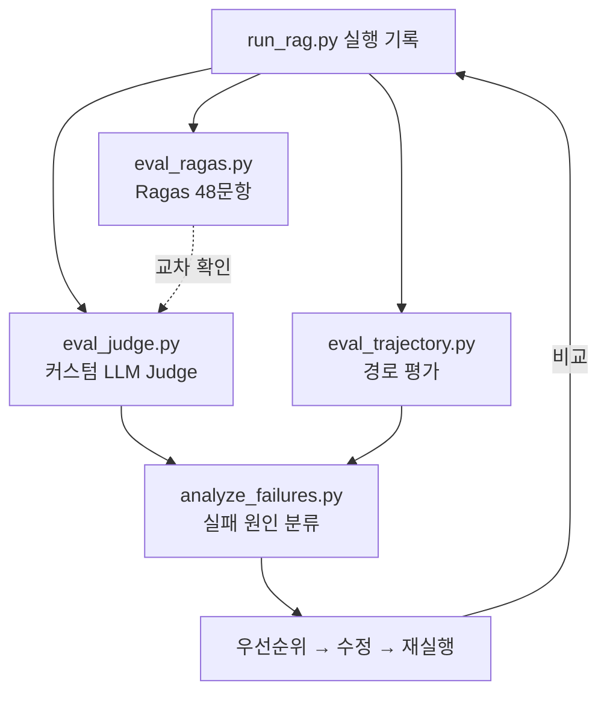
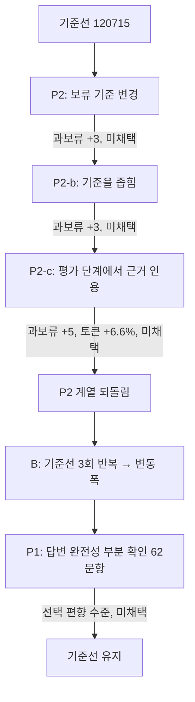

# 26.10.21 62일차(RAG 평가 · LLM Judge · 경로 평가 · 실행 간 변동 · 프롬프트 개선 실험)

## [TIL] 팀 RAG 시스템을 270문항으로 평가하고, 프롬프트 수정 실험이 왜 효과가 없었는지 변동 폭으로 확인하기

오늘은 팀 RAG 프로젝트에서 한용님이 진행한 **평가·개선 작업**(브랜치 `eval/1021-baseline`)을 기준으로 정리했다. 제공 골든셋 180문항과 팀 골든셋 90문항, 총 270문항으로 기본 RAG와 Multi-Agent RAG를 실행하고 **LLM Judge · Ragas · 경로(Trajectory) 평가**로 채점한 뒤, 실패 원인을 분류해 우선순위를 정하고 프롬프트를 한 번에 하나씩 고쳐 다시 평가했다.

결론은 프롬프트 한 줄 수정(P2, P2-b, P2-c, P1)은 모두 **실행 간 변동 폭 안**이라 채택하지 않았고, 대신 채점 기준을 보정해 실제 정답률이 약 59%가 아니라 **약 79%**라는 것을 확인했다.

이론과 실습은 다음 흐름으로 이어졌다.

```plain text
270문항 실행 (기본 RAG · Multi-Agent)
→ LLM Judge · Ragas · 경로 평가
→ 실패 원인 분류 (주원인 하나)
→ 문제점·개선책 우선순위
→ 한 번에 하나씩 수정 → 재실행 → 비교
→ 기준선 3회 반복으로 변동 폭 측정
→ 채점 보정 (핵심/부가 항목 분리)
→ 채택 여부 판정
```

---

## 1. 평가 대상과 실행 조건

### 1-1. 무엇을 비교했는가

두 파이프라인을 같은 문항·같은 설정으로 실행했다. 실행 결과는 `06_results/rag/`, 평가 결과는 `06_results/eval/`에 저장된다.

| 항목 | 값 |
|---|---|
| 문항 | 제공 골든셋 180 + 팀 골든셋 90 = **270문항** |
| 검색 설정 | Parent-Child 300/60 + Vector, `child_k` 8, `max_parents` 5 |
| 답변 모델 | `gemini-3.6-flash` |
| Judge·Ragas 모델 | `gemini-3.8-flash` (temperature 0) |
| 임베딩 | `gemini-embedding-2` (1536차원), PostgreSQL + pgvector (child 3,041 / parent 965) |
| 기본 RAG 실행 ID | `20261021_115125__basic_rag__both_golden` |
| Multi-Agent 실행 ID | `20261021_120715__multi_agent__both_golden` |

Judge 모델을 답변 모델과 다르게 둔 이유는 **자기 채점 편향(Self-preference Bias)**을 줄이기 위해서다.

### 1-2. 실행 명령

병렬 16개로 실행하면 270문항이 약 5분에 끝난다. 아래 명령은 `docs/handoff_eval_1021.md`의 "자주 쓰는 명령"에서 발췌했다.

```bash
# 실행 (병렬 16개, 270문항 약 5분)
PYTHONIOENCODING=utf-8 python scripts/run_rag.py --pipeline multi --golden both --workers 16
# 특정 문항만 (저장 안 함)
PYTHONIOENCODING=utf-8 python scripts/run_rag.py --pipeline multi --golden both --no-save --cases POS120 ADD-PF15
# Judge (병렬 16개로 약 4분)
PYTHONIOENCODING=utf-8 python scripts/eval_judge.py --run <run_id> --workers 16
# 경로 평가 (LLM 경로 Judge는 --llm-judge-n 0 이면 호출 없음)
PYTHONIOENCODING=utf-8 python scripts/eval_trajectory.py --run <run_id> --llm-judge-n 0
```

- 병렬 실행에서 DB 연결이 `max_connections`를 넘는 문제가 있어 `scripts/run_rag.py`가 **문항마다 DB 연결을 닫도록** 수정했다.
- Windows 콘솔 한글 깨짐을 막기 위해 `PYTHONIOENCODING=utf-8`을 붙이고 Git Bash에서 실행한다.

---

## 2. 세 가지 평가 방식

### 2-1. 평가 흐름

한 번의 실행 기록을 세 가지 방식으로 채점하고, 문항별로 합쳐 실패 원인을 분류한다.



```plain text
run_rag.py 실행 기록
→ eval_judge.py (LLM Judge) / eval_ragas.py (교차 확인) / eval_trajectory.py (경로)
→ analyze_failures.py (실패 원인 분류)
→ 우선순위 → 수정 → 재실행 → 다시 평가
```

| 평가 | 스크립트 | 역할 |
|---|---|---|
| A. 커스텀 LLM Judge | `scripts/eval_judge.py` | 정확성·`must_include`·충실성·인용 지지·행동 적절성 채점 (주 지표) |
| B. Ragas | `scripts/eval_ragas.py` (`.venv_ragas`) | 48문항 교차 확인 |
| C. 경로 평가 | `scripts/eval_trajectory.py` | 기대 경로 일치, 재검색·헛된 재검색 등 코드 지표 |

### 2-2. 커스텀 LLM Judge(LLM-as-a-Judge)

Judge는 문항당 1회 호출하고, 구조화 출력(Pydantic 스키마)으로 항목별 점수를 받는다. `scripts/eval_judge.py`의 `Verdict` 모델이 채점 항목을 정의한다.

```python
class ItemCheck(BaseModel):
    item: str = Field(description="must_include 항목 원문")
    met: bool = Field(description="답변이 이 항목을 의미상 충족하면 true")


class Verdict(BaseModel):
    correctness: int = Field(description="0/1/2. 기준 답안·기대 행동의 핵심과 일치하면 2, 일부 누락·부정확이면 1, 틀리면 0")
    must_include: list[ItemCheck] = Field(description="must_include 항목별 충족 여부 (항목이 없으면 빈 목록)")
    must_not_violation: bool = Field(description="must_not_include에 해당하는 내용을 답변이 말하면 true")
    must_not_evidence: str = Field(description="위반이라면 해당 문장, 아니면 빈 문자열")
    faithfulness: int = Field(description="0/1/2. 답변의 사실·수치·조건이 모두 제공된 문맥에 있으면 2, 일부만 없으면 1, 핵심 수치·조건을 지어냈으면 0")
    citation_support: int = Field(description="0/1/2. 인용한 문서가 답변 문장을 실제로 뒷받침하면 2, 일부만이면 1, 아니면 0. 인용이 필요 없는 응답이면 2")
    behavior_appropriate: bool = Field(description="보류·거절·되묻기·정정 문항에서 이유와 확인할 곳을 적절히 안내했으면 true. 일반 답변 문항이면 true")
    reason: str = Field(description="점수의 핵심 이유 2~3문장")
```

- 입력: 질문, 기대 행동, 기준 답안, `must_include`/`must_not_include`, 시스템이 받은 문맥(parent 원문), 최종 응답과 인용 문서.
- 출력: 문항별 `*__judge.jsonl`과 집계 `*__judge.summary.json`. 정확성은 0/1/2를 2로 나눠 0~1로 환산한다.
- `must_include`를 **항목 단위로 `met` 여부를 남긴 것**이 뒤의 채점 보정(5장)을 LLM 재호출 없이 가능하게 했다.

채점 원칙은 `SYSTEM` 프롬프트에 적었다. 핵심은 "표현이 달라도 같은 의미면 충족", "정정하는 문장은 `must_not` 위반이 아님"이다.

```python
SYSTEM = """당신은 금융 RAG 시스템의 답변을 채점하는 엄격한 평가자입니다.
주어진 질문, 기대 행동, 기준 답안, must_include/must_not_include, 시스템이 받은 문맥, 시스템의 최종 응답을 보고 항목별로 채점하세요.

채점 원칙:
- 기준 답안은 유일한 정답 문장이 아닙니다. 같은 의미면 표현이 달라도 충족으로 봅니다.
- 기대 행동이 보류(abstain)·거절(refuse)·되묻기(clarify)·정정(correct)이면, 그 행동을 하고 이유와 확인할 곳을 안내했는지를 correctness와 behavior_appropriate의 기준으로 봅니다. 문서에 없다고 밝힌 뒤 지어낸 수치를 덧붙이면 감점합니다.
- faithfulness는 제공된 '문맥'만 기준입니다. 문맥에 없는 수치·조건·조항 번호를 말하면 감점합니다. 계산 결과는 문맥의 수치에서 정확히 계산했다면 충실한 것으로 봅니다.
- must_not_include는 답변이 그 내용을 사실로 주장할 때만 위반입니다. 그 내용이 틀렸다고 정정하는 문장은 위반이 아닙니다.
- 인용 번호([문서 N])와 문맥 번호가 일치하는지 보고 citation_support를 채점하세요."""
```

### 2-3. LLM Judge 결과

| 지표 | 기본 RAG 전체 | Multi-Agent 전체 | 기본 제공 | MA 제공 | 기본 팀 | MA 팀 |
|---|---:|---:|---:|---:|---:|---:|
| 정확성 | 0.763 | **0.789** | 0.792 | **0.822** | 0.706 | **0.722** |
| 정확성 만점 비율 | 0.567 | **0.589** | 0.622 | **0.656** | 0.456 | 0.456 |
| must_include 충족 | 0.771 | **0.802** | 0.790 | **0.833** | 0.733 | **0.742** |
| must_not 위반율 | 0.015 | 0.015 | 0.011 | 0.006 | 0.022 | 0.033 |
| 충실성 | 0.998 | 0.998 | 1.000 | 1.000 | 0.994 | 0.994 |
| 인용 지지 | 0.963 | **0.989** | 0.972 | **0.992** | 0.944 | **0.983** |
| 행동 적절 | 0.944 | **0.952** | 0.956 | **0.967** | 0.922 | 0.922 |

- Judge 토큰: 기본 RAG 입력 859,847 / 출력 68,635, Multi-Agent 입력 922,829 / 출력 68,887.
- **결과 해석**: 충실성이 0.998이라 지어낸 내용은 거의 없다. 점수를 깎는 쪽은 기준 답안의 **핵심 항목 누락**(`must_include`)이다.

### 2-4. Ragas 교차 확인

같은 48문항(answer/correct 기대 문항)으로 Ragas를 돌렸다.

| 지표 | 기본 RAG | Multi-Agent |
|---|---:|---:|
| Faithfulness | 0.915 | 0.874 |
| FactualCorrectness | 0.529 | 0.499 |
| ContextRecall | 0.831 | 0.859 |

- Judge 정확성과의 상관은 0.28(기본), -0.30(MA)로 **일치하지 않았다**.
- 원인: FactualCorrectness는 주장 단위 F1이라 기준 답안이 짧은 제공 positive에서 낮게 나온다(제공 0.30에서 0.41, 팀 0.64에서 0.70).
- **선택**: Ragas는 절대 점수로 쓰지 않고 **Judge 점수가 크게 어긋나는 문항을 찾는 교차 확인용**으로만 쓴다.

### 2-5. 경로 평가(Trajectory Evaluation)

Multi-Agent가 기대한 노드 순서로 움직였는지, 재검색이 쓸모 있었는지를 **코드로** 계산한다. `scripts/eval_trajectory.py`의 `expected_paths()`와 `code_metrics()`가 핵심이다.

```python
def expected_paths(case: dict) -> list[list[str]]:
    n_ids = len(case.get("expected_source_ids") or [])
    return [DEFAULT_PATH, RETRY1_PATH] if n_ids >= 3 else [DEFAULT_PATH]


def code_metrics(rec: dict, case: dict, sizes: dict) -> dict:
    steps = [s for s in rec["trace"] if s["step"] == "search"]
    searched_more = rec["search_rounds"] > 1
    checks = rec["checks"]
    passed = bool(checks.get("behavior_strict")) and checks.get("context_recall", 1.0) == 1.0
    queries = rec["used_queries"]
    return {
        "re_searched": searched_more,
        "re_search_passed": passed if searched_more else None,
        "wasted_re_search": searched_more and (rec["stop_reason"] == "max_rounds" or any(s.get("new_parents", 1) == 0 for s in steps[1:])),
        "max_rounds_stop": rec["stop_reason"] == "max_rounds",
        "scope_ok": rec["scope_files"] == sizes[rec["question_set"]],
        "duplicate_queries": len(queries) != len(set(queries)),
        "unneeded_re_search": searched_more and case["expected_behavior"].startswith(NON_ANSWER),
    }
```

- 기대 경로는 기본 `orchestrator → search → evaluate → answer`이고, 근거 ID가 3개 이상인 문항은 재검색 1회 경로도 허용한다.
- **헛된 재검색(`wasted_re_search`)**: 재검색했는데 `max_rounds`로 끝났거나 새 parent가 0개인 경우.
- **불필요한 재검색(`unneeded_re_search`)**: 보류·거절·되묻기가 기대인데 재검색한 경우.

| 지표 (Multi-Agent 270문항) | 값 |
|---|---:|
| 기대 경로 일치(strict) | 0.930 (제공 0.944 / 팀 0.900) |
| 재검색률 | 0.081 (22문항) |
| 재검색한 문항의 최종 통과율 | 0.455 |
| 헛된 재검색 | 13 |
| 보류·거절 문항의 불필요한 재검색 | 10 (팀 9) |
| 검색 범위 준수 / 검색어 중복 | 1.000 / 0건 |
| LLM 경로 Judge(50문항) | 1.000 |

- **선택**: LLM 경로 Judge는 헛된 재검색 문항에도 모두 통과를 줘 변별력이 없었다. 그래서 **코드 지표를 주 지표**로 본다.

---

## 3. 실패 원인 분류와 우선순위

### 3-1. 분류 규칙

`scripts/analyze_failures.py`의 `classify()`가 실행·Judge·경로 결과를 문항별로 합쳐 플래그를 붙인다. 한 문항에 문제가 여러 개면 **응답 유형 → 추출 → 검색 → 인용 → 답변** 순으로 처음 걸리는 것을 주원인 하나로 센다.

```python
def classify(rec, case, judge, traj):
    expected = case["expected_behavior"]
    answerable = expected.startswith(ANSWER_PREFIX)
    gold = set(case.get("expected_source_ids") or [])
    chk = rec["checks"]
    flags = []
    child_ids = set().union(*[ids_of_parent(c) for c in rec["retrieved_children"]]) if rec["retrieved_children"] else set()
    child_recall = len(gold & child_ids) / len(gold) if gold else None
    parent_recall = chk.get("context_recall")
    ...
    if not chk["behavior_lenient"]:
        flags.append("응답 유형 오류")
    elif not chk["behavior_strict"]:
        flags.append("응답 유형 경계(허용 유형)")
    if answerable and gold:
        if child_recall < 1:
            flags.append("child 단계 근거 누락")
        if child_recall == 1 and parent_recall < 1:
            flags.append("parent 단계 근거 잘림")
        if parent_recall == 1 and not chk.get("citation_hit"):
            flags.append("인용 누락")
    if judge["correctness"] < 2:
        flags.append("답변 불완전·부정확")
```

- child 단계에서 근거를 못 찾은 것과, child는 찾았는데 `max_parents`에서 parent가 잘린 것을 **구분**한다.
- 결과는 `06_results/eval/failure_analysis.json`.

### 3-2. 실패 유형 결과

| 실패 유형 | 기본 RAG | Multi-Agent | 요약 |
|---|---:|---:|---|
| 답변 실패 (내용 불완전·부정확) | 85 | 92 | 가장 큼. 핵심은 맞지만 조건·예외·단서 누락 |
| Agent 실패 (응답 유형 판단) | 16 | 11 | 문서에 없는 질문에 `answer`, 모호한 질문에 되묻지 않음 / 기본 RAG는 과보류 |
| 검색 실패 (child 단계 근거 누락) | 27 | 25 | 모두 일부 누락. 다중 근거 질문에 집중 |
| 검색 실패 (max_parents 잘림) | 2 | 4 | POS043, 049, 052, 059 |
| 인용 실패 / 인용 지지 부족 | 6 | 3 | Multi-Agent에서 대부분 해결 |
| 추출 실패 | 1 | 1 | ADD-RP14 (퇴직연금 17쪽 차트 값) |
| 청킹 실패 | 0 | 0 | 직접 증거 없음 |
| 실패 합계 | 137 / 270 | 136 / 270 | Judge 정확성 만점이 아닌 것까지 포함한 보수적 기준 |

### 3-3. 문제별 원인과 개선안

| 문제 | 현상 | 원인 | 개선안 |
|---|---|---|---|
| P1 답변 완전성 | `must_include` 한 항목만 빠진 경우 88/110(MA) | 전제·예외·하위 질문을 모두 쓰라는 지시가 약함 (`context_recall` 0.96이라 검색 문제 아님) | 답변 프롬프트에 하위 질문·단서 포함 지시 |
| P2 보류 판단 | 답할 수 없는 팀 질문 8개를 `answer`로 분류 | "근거 일부만 확인되면 answer" 규칙 | 핵심 값이 없으면 `abstain` |
| P3 되묻기 | NEG013·NEG046에서 `answer` | 평가의 `ambiguous` 판정이 대상 상품 누락을 못 잡음 | `ambiguous` 기준·예시 추가 |
| P4 기본 RAG 과보류 | 답할 수 있는 8문항 보류 | P2와 반대 방향 | 판단 기준 명확화 (우선순위 낮음) |
| P5 헛된 재검색 | 13문항 평균 **22,640토큰** (1회 검색의 3.5배) | 종료 조건이 라운드 수뿐 | 같은 `missing` 반복 시 종료 |
| P6 검색 양 | 26문항 근거 일부 누락, 4문항 잘림 | `child_k`·`max_parents` 한도 | `max_parents` 5→7, `child_k` 8→12 |
| P7 추출 오류 | ADD-RP14 | 차트 값 추출 오류 | 재추출·재적재 |
| P8 측정 한계 | 답할 수 없는 질문에도 근거 ID가 있어 인용 Hit 하락 | 평가 체계 문제 | 지표에서 제외 집계 |

### 3-4. 비용 대비 효과

| | 기본 RAG | Multi-Agent |
|---|---:|---:|
| 총 토큰(270문항) | 858,374 | 2,053,492 |
| 평균 토큰 | 3,179 | 7,606 |
| 평균 응답 시간 | 6.6초 | 13.6초 |
| Judge 정확성 | 0.763 | 0.789 |
| 응답 유형 엄격 | 0.730 | 0.830 |
| Judge 정확성이 기본 RAG보다 높은 문항 / 낮은 문항 | | 35 / 23 |

토큰은 약 2.4배인데 Judge 정확성 향상은 +0.026으로 작고, 응답 유형 판단(+0.10)과 인용(+0.026)에서 이득이 크다. 헛된 재검색 13문항이 Multi-Agent 전체 토큰의 약 14%다.

### 3-5. 우선순위

순위는 **심각도 · 영향 범위 · 비용 · 난이도 · 의존성**으로 정했다. 문서에 없는 내용을 확정 답변처럼 내는 것을 가장 심각하게 봤다.

| 순위 | 문제 | 영향(Multi-Agent) | 심각도 | 수정 대상 |
|---|---|---|---|---|
| 선행 | 측정 보정 (Judge 사람 보정, 팀 negative 인용 지표 처리) | 모든 비교의 신뢰도 | - | 시스템 변경 없음 |
| 1 | P2 보류 판단 | 8문항 | 높음 | 답변 프롬프트 |
| 2 | P1 답변 완전성 | 92문항 | 중간 | 답변 프롬프트 |
| 3 | P5 헛된 재검색 | 13문항, 토큰 약 14% | 중간(비용) | 종료 조건(코드) |
| 4 | P3 되묻기 실패 | 2문항 | 중간 | 평가 프롬프트 |
| 5 | P6 검색 양 | 25 + 4문항 | 중간 | `max_parents`, `child_k` |
| 6 | P4 기본 RAG 과보류 | 기본 RAG 8문항 | 낮음 | 기본 RAG 프롬프트 |
| 병행 | P7 추출 오류 | 1문항 | 낮음 | 재추출·재적재 |

- P2와 P1은 **같은 답변 프롬프트**를 고치므로 P2 효과를 읽은 뒤 P1을 한다. 두 변경이 섞이면 원인을 가를 수 없다.
- 재평가 1회 비용은 Multi-Agent 약 205만 + 기본 RAG 약 86만 + Judge 약 180만 = 약 470만 토큰이다. Multi-Agent에만 해당하는 수정은 기본 RAG 기준선을 재사용한다.

---

## 4. 한 번에 하나씩 수정하고 재평가하기

### 4-1. 실험 흐름

수정은 승인받은 문구 하나만 바꾸고, 같은 270문항으로 재실행해 **사전에 정한 채택 기준**으로 판정한다. 되돌린 시도도 `docs/eval_changes_log.md`에 남긴다.



```plain text
기준선
→ P2 (보류 기준 변경) → 미채택
→ P2-b (기준을 좁힘) → 미채택
→ P2-c (평가 단계에서 근거 인용) → 미채택 → P2 계열 되돌림
→ B (기준선 3회 반복, 변동 폭 측정)
→ P1 (답변 완전성, 62문항 부분 확인) → 미채택
→ 기준선 유지
```

### 4-2. P2: 답변 프롬프트의 보류 판단 기준

`rag/multi_agent.py`의 `ANSWER_PROMPT` 한 곳만 바꿨다(커밋 `2a2f24f`).

```plain text
[수정 전]
근거 일부만 확인된 경우 확인된 부분은 인용과 함께 답하고(response_type은 answer 또는 correct), 확인하지 못한 부분만 문서에서 확인할 수 없다고 분명히 적습니다.
abstain은 질문의 핵심에 답할 근거가 문서에 전혀 없을 때만 씁니다. 재검색이 끝났다(stop_reason=max_rounds)는 이유만으로 abstain을 고르지 않습니다.

[수정 후]
질문이 묻는 핵심 값(수치·비율·기간·기준일·금액)이 문서에서 확인되고 부수적인 세부만 빠졌다면, 확인된 부분은 인용과 함께 답하고(response_type은 answer 또는 correct) 확인하지 못한 부분만 문서에서 확인할 수 없다고 분명히 적습니다.
반대로 질문이 직접 묻는 핵심 값이 문서에 없으면, 관련 조항이나 설명이 일부 있어도 response_type은 abstain입니다. 그 값이 빈칸 '( )'이거나, 별첨·약정·회사별 기준에 맡겨져 있거나, 문서 기준일 이후의 정보이거나, 개인 정보인 경우가 여기에 해당합니다. 이때 문서에서 확인되는 관련 내용과 확인할 곳을 안내합니다.
재검색이 끝났다(stop_reason=max_rounds)는 이유만으로 abstain을 고르지 않습니다.
```

| 지표 (전체 270) | 기준선 → P2 |
|---|---|
| 응답 유형 엄격 | 0.830 → 0.844 (+0.015) |
| 응답 유형 완화 | 0.959 → 0.963 (+0.004) |
| Judge 정확성 | 0.789 → 0.794 (+0.005) |
| 정확성 만점 비율 | 0.589 → 0.611 (+0.022) |
| 인용 지지 | 0.989 → 0.972 (-0.017) |
| 인용 Hit | 0.960 → 0.938 (-0.022) |
| 평균 토큰 | 7,606 → 7,694 (+88) |

| 구분 | 건수 | 문항 |
|---|---:|---|
| `answer` → `abstain`으로 고쳐짐 | 6 | ADD-HF15, ADD-HP15, ADD-IN15, ADD-SE15, POS090, POS117 |
| 여전히 `answer` | 2 | ADD-PF15, POS120 (평가 단계가 `sufficient`로 오판) |
| 새로 생긴 과보류 | 3 | ADD-HP09, ADD-RP06, POS088 |
| `answer`↔`correct` 라벨만 바뀜 | 21 | 행동은 같음, 실행마다 흔들리는 폭 |

| 채택 기준 | 결과 | 충족 |
|---|---|---|
| 보류 대상 8문항 중 5문항 이상 `abstain` | 6 / 8 | 충족 |
| 과보류 증가 1건 이하 | +3건 | **미충족** |
| Judge 정확성 ±0.02 이내, 충실성 유지 | +0.005, 0.998 | 충족 |

- **중단 사고**: 실행 도중 Gemini API 선불 크레딧이 소진돼 52문항이 `402 RESOURCE_EXHAUSTED`로 실패했다. 충전 후 52문항만 다시 돌려 `scripts/merge_retry.py`로 합쳤다.

### 4-3. P2-b, P2-c

| 시도 | 변경 | 보류 대상 고침 | 과보류 | 총 토큰 | 판정 |
|---|---|---:|---:|---:|---|
| 기준선 | - | 0 / 8 | 0 | 2,053,492 | - |
| P2 | 답변 프롬프트 보류 기준 | 6 / 8 | 3 | 2,077,369 | 미채택 |
| P2-b | '개인 정보' 예시 삭제, "핵심 값 하나가 통째로 없을 때만 abstain" | 5 / 8 | 3 | 2,073,941 | 미채택 |
| P2-c | 평가 단계(`EVALUATE_PROMPT`)에서 값의 근거 문장을 먼저 인용(`asked_values` 필드) | 6 / 8 | 5 | 2,211,361 | 미채택 |

| 지표 (전체 270) | 기준선 / P2-b / P2-c |
|---|---|
| 응답 유형 엄격 | 0.830 / 0.844 / 0.837 |
| 응답 유형 완화 | 0.959 / 0.963 / 0.956 |
| Judge 정확성 | 0.789 / 0.793 / 0.783 |
| 정확성 만점 비율 | 0.589 / 0.600 / 0.585 |
| 평균 토큰 | 7,606 / 7,681 / 8,190 |

원인 분석은 다음과 같다.

| 현상 | 원인 | 대응 | 결과 |
|---|---|---|---|
| P2-b에서도 ADD-RP06, POS088 과보류 | 평가 단계가 `out_of_scope`로 오판, 답변 프롬프트는 "평가 판정을 따르되"로 시작 | P2-c에서 평가 단계를 직접 수정 | 과보류 5건으로 오히려 증가 |
| P2-c에서 POS003, POS053, POS116, ADD-HF09 새 과보류 | 근거 문장 인용을 찾지 못해 `insufficient`/`out_of_scope`로 감 | 채택하지 않음 | 되돌림 |
| P2-c에서 NEG005, NEG037 보류 실패 | 미래·시점 질문이 "관련 문장 인용 가능"이 되어 `sufficient` | 채택하지 않음 | 되돌림 |
| ADD-HF15, POS079가 실행마다 결과가 바뀜 | 3라운드를 다 쓰는(`max_rounds`) 경계 문항 | 단일 실행 결과는 방향성만 참고 | 변동 측정(4-4)으로 이어짐 |

- **결론**: P2 계열 세 번 모두 보류 대상 5~6문항은 고쳤지만 새 오류가 같은 수만큼 생겨 순이득이 거의 없었다. 세 커밋(`e024646`, `09e8fcb`, `2a2f24f`)을 되돌렸다.
- P2-c 실행부터 병렬 16개로 실행 285초, Judge 214초로 단축됐다.

### 4-4. B: 기준선 3회 반복으로 본 실행 간 변동

수정하지 않은 같은 코드로 Multi-Agent를 3회(`120715`, `165034`, `165515`) 돌렸다. 분석은 `scripts/variance.py`, 결과 `06_results/eval/variance_baseline.json`.

| 지표 (전체 270) | 3회 값 | 평균 | 범위 | 표준편차 |
|---|---|---:|---:|---:|
| 응답 유형 엄격 | 0.830 / 0.844 / 0.822 | 0.832 | 0.022 | 0.011 |
| 응답 유형 완화 | 0.959 / 0.959 / 0.956 | 0.958 | 0.004 | 0.002 |
| Judge 정확성 | 0.789 / 0.809 / 0.778 | 0.792 | 0.032 | 0.016 |
| 정확성 만점 비율 | 0.589 / 0.641 / 0.567 | 0.599 | 0.074 | 0.038 |
| 정확성 만점 비율 (핵심 기준 보정) | 0.785 / 0.830 / 0.770 | 0.795 | 0.059 | 0.031 |
| must_include 충족 | 0.802 / 0.824 / 0.802 | 0.809 | 0.021 | 0.012 |
| 충실성 | 0.998 / 0.994 / 0.994 | 0.996 | 0.004 | 0.002 |
| 평균 토큰 | 7,606 / 7,682 / 7,629 | 7,639 | 76 | 39 |
| 재검색률 | 0.082 / 0.089 / 0.089 | 0.086 | 0.007 | 0.004 |

- 응답 유형이 3회 모두 같은 문항은 **233 / 270(86%)**. 달라진 37개 중 28개는 `answer`↔`correct` 라벨만 바뀌었고 9개는 행동 자체가 바뀌었다.
- 행동이 흔들린 9문항(ADD-HP15, ADD-RP06, ADD-RP10, ADD-SE15, NEG047, NEG052, POS056, POS110, POS117)은 경계에 있는 "동전 던지기" 문항이라 개선 효과로 세지 않는다.
- Judge 정확성이 3회 중 달라진 문항은 59개(22%)다.

이 변동 폭을 기준으로 **단일 실행에서 효과가 있다고 볼 최소 변화**를 정했다.

| 지표 | 최소 변화 |
|---|---|
| 응답 유형 엄격 | +0.03 이상 |
| 응답 유형 완화 | +0.01 이상 (제공 세트 기준) |
| Judge 정확성 | +0.03 이상 |
| 정확성 만점 비율 | +0.08 이상 (팀 세트 +0.11) |
| 평균 토큰 | ±2% 이내는 차이 없음 |

- **결과 해석**: P2 계열의 변화량(엄격 +0.015, Judge 정확성 +0.005)은 모두 이 변동 폭 안이었다. 되돌린 판단이 타당했다는 근거가 됐다.

### 4-5. P1: 답변 완전성 지시, 부분 확인

비용을 줄이려고 전체 270문항 대신 62문항으로 먼저 확인했다(커밋 `81d436c`, 확인 후 되돌림).

```plain text
[추가한 문구]
질문에 하위 질문이나 여러 조건이 들어 있으면 하나씩 나누어 모두 답합니다. 문서가 해당 내용에 붙인 전제·적용 범위·예외·'확인 필요' 문구는 답에 함께 씁니다. 숫자를 계산하는 질문은 쓴 식과 입력 조건을 보여 줍니다. 질문이 묻지 않은 내용은 새로 덧붙이지 않고, 문서에 없는 내용은 쓰지 않습니다.
```

- 대상: 기준선 3회에서 부가 항목을 2회 이상 놓치고 정확성이 2회 이상 만점이 아니던 71개 중 무작위 50개 + 3회 모두 만점이던 대조 12개.

| 지표 | 대상 50문항 | 대조 12문항 |
|---|---|---|
| Judge 정확성 | 0.523 → 0.560 (+0.037) | 1.000 → 0.958 (-0.042) |
| 정확성 만점 비율 | 0.067 → 0.140 (+0.073) | 1.000 → 0.917 (-0.083) |
| **부가 항목 충족률** | **0.103 → 0.123 (+0.020)** | 1.000 → 1.000 |
| 핵심 항목 충족률 | 0.851 → 0.863 (+0.012) | 1.000 → 0.958 (-0.042) |
| 평균 답변 길이(자) | 240 → 254 | 283 → 280 |

- **원인 → 결과 → 선택**: "반복해서 점수가 낮았던 문항"을 골랐기 때문에 아무것도 바꾸지 않아도 다시 돌리면 점수가 오른다(**평균 회귀, Regression to the Mean**). 기준선 3회로 같은 방식을 재현하면 Judge 정확성이 +0.042~+0.047, 부가 항목 충족률이 +0.06 정도 저절로 오른다. P1의 +0.037, +0.020은 이보다 크지 않아 **채택하지 않았다**.
- 부가 항목 충족률이 0.103 → 0.123으로 거의 그대로라, 문구가 모델이 단서·예외를 더 쓰게 만들지 못했다.
- 비용: 부분 확인 실행 + Judge 약 70만 토큰. 전체 270문항 실행은 증거를 더하지 못한다고 보고 하지 않았다.

---

## 5. 채점 보정: LLM 없이 다시 집계하기

### 5-1. 답할 수 없는 질문을 인용 지표에서 제외 (C-2)

기대 행동이 보류·거절·되묻기인 58문항은 올바르게 응답해도 인용이 없어 인용 지표가 깎인다. 이를 빼고 답할 수 있는 212문항만 다시 계산했다(`scripts/rescore_nonllm.py`).

| 지표 | 기본 RAG 270 → 212 | Multi-Agent 270 → 212 |
|---|---|---|
| 인용 Hit (전체) | 0.885 → **0.948** | 0.960 → **0.995** |
| 인용 Hit (팀 골든셋) | 0.772 → **0.952** | 0.899 → **1.000** |
| 인용 Recall (전체) | 0.810 → 0.867 | 0.882 → 0.913 |
| 문맥 Recall (전체) | 0.916 → 0.920 | 0.935 → 0.936 |

- 팀 골든셋의 낮은 인용 점수는 거의 전부 **측정 방식의 문제**였다.

### 5-2. 응답 유형 라벨 정리 (C-3)

| 지표 | 기본 RAG | Multi-Agent |
|---|---:|---:|
| 엄격 (기대한 유형과 정확히 같음) | 0.730 | 0.830 |
| 완화 (허용 유형이면 통과) | 0.941 | 0.959 |

- 엄격과 완화의 차이는 거의 `answer`와 `correct` 라벨이 바뀐 것이다. 그래서 **행동이 맞는지는 완화 기준을 대표 지표**로 보고 엄격 기준은 참고로 둔다.

### 5-3. must_include 핵심/부가 분리와 재채점 (C-1)

`scripts/classify_must_include.py`가 `must_include` 795개를 **핵심(core) 642개(81%)**와 **부가(extra) 153개(19%)**로 나눴다. 기준은 "질문이 직접 묻는 결론·수치·조건·행동이면 핵심, 빠져도 핵심 답이 성립하면 부가"다. 이어서 `scripts/rescore_core.py`가 저장된 Judge 결과의 항목별 `met`으로 다시 집계했다.

```python
for j in judge:
    level = {i["item"]: i["level"] for i in cls.get(f"{j['golden']}:{j['case_id']}", [])}
    core = [i for i in j["must_include_items"] if level.get(i["item"], "core") == "core"]
    extra = [i for i in j["must_include_items"] if level.get(i["item"], "core") == "extra"]
    core_all = all(i["met"] for i in core)
    rows.append({
        ...
        "adj_full": j["correctness"] == 2 or (j["correctness"] == 1 and (core_all if core else False) and not j["must_not_violation"]),
    })
```

- `adj_full`(보정 만점) = 정확성 2점이거나, 1점이면서 핵심 항목을 모두 충족하고 `must_not` 위반이 없는 문항.
- Judge를 다시 부르지 않고 저장된 결과만으로 계산하므로 비용이 0이다.

| 지표 | 기본 RAG | Multi-Agent |
|---|---:|---:|
| Judge 정확성 만점 비율 (원래) | 0.567 | 0.589 |
| **정확성 만점 비율 (보정)** | **0.767** | **0.785** |
| 핵심 항목 충족률 | 0.854 | 0.881 |
| 부가 항목 충족률 | 0.417 | 0.452 |
| 부가 항목 하나 때문에만 만점을 놓친 문항 | 54 | 53 |

| 세트별 (Multi-Agent) | 원래 → 보정 만점 비율 | 항목 중 부가 비율 |
|---|---|---|
| 제공 180 | 0.656 → **0.806** | 89 / 532 (17%) |
| 팀 90 | 0.456 → **0.744** | 64 / 263 (24%) |

- **결과 해석**: 만점 59%는 부가 항목 하나를 놓친 53문항(20%)을 포함한 값이고, 이를 인정하면 **약 79%**다. 팀 골든셋은 부가 항목 비율이 24%로 높아 점수가 더 낮게 나왔다.
- **한계**: 분류는 LLM이 했고 사람이 검토하지 않았다. "지체 없이"(POS035), "최신성 확인"(NEG034)처럼 핵심일 수 있는 항목이 부가로 분류된 사례가 있다. 보정 만점 비율은 상한에 가까운 **추정치**다.

---

## 6. 최종 기준선 수치와 남은 작업

### 6-1. 핵심 수치 (Multi-Agent 기준선 270문항, 괄호는 기본 RAG)

| 지표 | 값 |
|---|---|
| 응답 유형 엄격 / 완화 | 0.830 / 0.959 (0.730 / 0.941) |
| Judge 정확성 / 만점 비율 | 0.789 / 0.589 (0.763 / 0.567) |
| 만점 비율 (핵심 항목 기준 보정, 추정) | 약 0.785 (0.767) |
| 충실성 / 문맥 Recall | 0.998 / 0.935 (0.998 / 약 0.916) |
| 평균 토큰 / 총 토큰 | 7,606 / 2,053,492 (3,179 / 858,374) |
| 인용 Hit (답할 수 있는 문항만, 팀 세트) | 1.000 (0.952) |

- 코드 상태는 `rag/` 폴더가 `dev`와 **차이 0줄**이다. 바뀐 것은 `scripts/run_rag.py`의 DB 연결 닫기뿐이다.
- 오늘 사용량은 약 24M 토큰(추정)이다. 크레딧 화면은 늦게 반영되므로 큰 실행 전에 잔액을 새로고침해 확인한다.

### 6-2. 남은 작업

| 우선 | 작업 | 비고 |
|---|---|---|
| 1 | D. 결과 표와 시각화 | LLM 호출 없음. 기본 RAG vs MA, 실패 원인 구성비, 시도별 점수와 변동 폭 오차 막대 등 |
| 2 | README에 평가·개선 과정 정리 | 1~4번 결과, 시도와 결과, 변동 폭, 한계점 |
| 3 | guardrail · fault tolerance · fallback 검토 | 현재 인젝션 무시 규칙(`COMMON_RULES`)과 보류·거절 응답 유형만 있음 |
| 후순위 | Judge 사람 보정 30문항, `must_include_core.json` 사람 검토 | `judge_calibration_sample.md` |
| 후순위 | 시스템 개선 후보 | `out_of_scope` 오판 교정, 헛된 재검색 종료 조건(P5), 검색 양(P6), 답변 후 누락 점검 단계 |

---

## 7. 헷갈린 점

점수가 조금 오르면 수정이 효과가 있었다고 보기 쉽다. 하지만 같은 코드를 3번 돌려도 Judge 정확성이 0.778~0.809로 흔들렸으므로, P2의 +0.005는 효과가 아니라 변동 범위 안의 값이다. 비교 전에 **변동 폭을 먼저 재야** 단일 실행 결과를 읽을 수 있다.

```plain text
수정 후 +0.005
→ 같은 코드 3회 범위 0.032
→ 효과 있음이라고 말할 수 없음
```

점수가 낮았던 문항만 골라 다시 돌리면 점수가 오르는 것도 주의할 점이다. P1 부분 확인의 +0.037은 아무것도 바꾸지 않은 재실행에서도 +0.042~+0.047이 나와 **선택 편향과 평균 회귀**로 설명된다. 대조 문항과 기준선 재현값을 함께 둬야 한다.

보류 판단을 답변 프롬프트에서만 고치면 된다고 생각하기 쉽다. 하지만 보류 판단은 **평가 단계**(`out_of_scope`, `insufficient`)와 **답변 단계** 두 곳에서 일어나고, 답변 프롬프트가 "평가 판정을 따르되"로 시작하므로 한쪽만 고치면 오류가 다른 곳으로 옮겨 간다.

정확성 만점 59%가 곧 정답률 59%라는 것도 아니었다. 정답 기준 항목 중 19%가 단서·참고 같은 부가 항목이었고, 이것만 놓친 문항을 인정하면 약 79%다. 채점 기준의 엄격함도 점수와 함께 설명해야 한다.

---

## 오늘 배운 것 정리

- RAG 평가는 **LLM Judge(주 지표) · Ragas(교차 확인) · 경로 평가(코드 지표)**로 나눠 역할을 정했다.
- Judge 모델은 답변 모델과 다르게 두고, `must_include`를 항목 단위로 기록하면 나중에 LLM 없이 재채점할 수 있다.
- LLM 경로 Judge는 50문항 모두 통과를 줘 변별력이 없었고, 헛된 재검색·불필요한 재검색 같은 **코드 지표**가 더 유용했다.
- 실패 원인은 주원인 하나로 세고, child 근거 누락과 parent 잘림을 구분해야 검색 설정을 고칠 곳이 보인다.
- 수정은 **한 번에 하나씩**, 사전에 정한 채택 기준(목표 문항, 부작용, 토큰)으로 판정하고 되돌린 시도도 기록한다.
- P2 계열 3회와 P1 모두 미채택이었다. 프롬프트 한 줄 수정은 오류를 다른 곳으로 옮길 뿐 순이득이 없었다.
- 같은 코드 3회 반복으로 **실행 간 변동 폭**을 재고, 그보다 큰 변화만 효과로 본다(엄격 +0.03, Judge 정확성 +0.03, 만점 비율 +0.08).
- 낮은 점수 문항만 골라 재실행하면 평균 회귀로 점수가 오르므로 대조군과 기준선 재현값이 필요하다.
- 답할 수 없는 질문을 인용 지표에서 빼고, `must_include`를 핵심/부가로 나누니 Multi-Agent 만점 비율이 0.589 → 약 0.785로 보정됐다.
- 비용 절약은 부분 확인 → 효과가 있을 때만 전체 실행, 수정과 무관한 파이프라인은 기준선 재사용, LLM이 필요 없는 재집계를 먼저 하는 순서로 한다.

RAG 개선 실험을 할 때는 다음 순서로 생각하면 된다.

```plain text
기준선 실행과 평가
→ 같은 코드 반복 실행으로 변동 폭 측정
→ 실패 원인 분류와 우선순위
→ 채택 기준을 먼저 정하고 한 가지만 수정
→ 영향 문항 부분 확인 (대조군 포함)
→ 효과가 변동 폭보다 클 때만 전체 실행
→ 채택 또는 되돌림, 이력 기록
```

#부트캠프 #멀티캠퍼스부트캠프 #AI캠퍼스 #AI에이전트엔지니어
