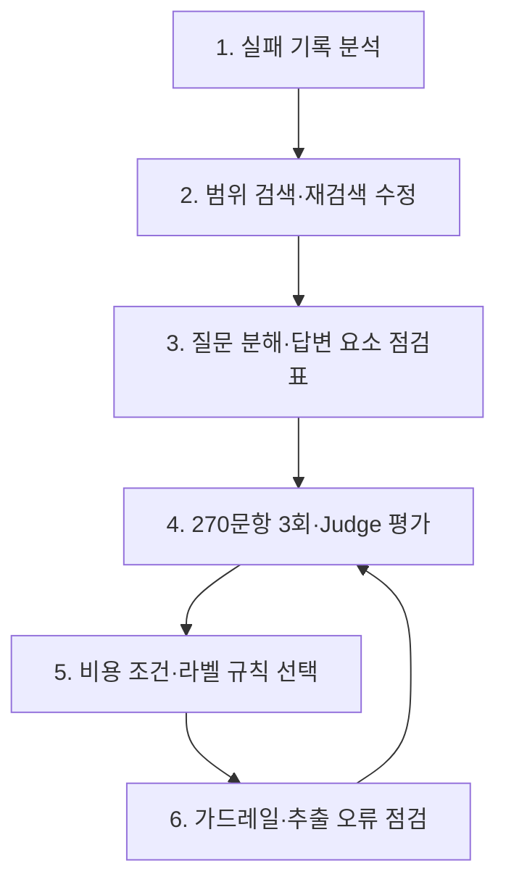

# 26.10.22 63일차(RAG Agent · 검색 오류 수정 · 가드레일 · 답변 평가)

## [TIL] 팀 RAG의 검색·답변 구조를 고치고 270문항 반복 평가로 최종 설정을 정하기

오늘은 팀 RAG 프로젝트의 `main`에 반영된 검색 오류 수정, Multi-Agent의 답변 구조 개선, 오류 대응과 가드레일 측정을 정리했다. 제공 골든셋 180문항과 팀 골든셋 90문항을 같은 조건에서 반복 실행한 결과, 최종 Multi-Agent의 Judge 정확성은 **0.883**, 정확성 만점 비율은 **0.774**였다.

실습은 다음 흐름으로 이어졌다.



```plain text
1. 실패 기록 분석
→ 2. 범위 검색·재검색 수정
→ 3. 질문 분해·답변 요소 점검표
→ 4. 270문항 3회·Judge 평가
→ 5. 비용 조건·라벨 규칙 선택
→ 6. 가드레일·추출 오류 점검 → 재평가 과제
```

---

## 1. 검색과 재검색의 구조 문제

### 1-1. 범위 지정 벡터 검색에서 근거가 사라진 문제

`rag/retrieval.py`의 `vector_search()`는 문서 범위(`scope_files`)를 지정한다. HNSW 근접 후보를 먼저 뽑은 뒤 파일 조건을 적용하자 추가 PDF 6개 범위에서 무작위 질의 300개 중 **134개가 0건**, **138개가 8건 미만**이었다. 범위 필터가 없는 검색 평가 MRR **0.885**만으로 실제 Agent 검색을 검증할 수 없었다.

이 누락을 없애기 위해 해당 질의에서 인덱스 스캔을 끄고 정확 검색을 사용했다. 아래는 `rag/retrieval.py`의 `vector_search()`에서 발췌한 핵심 부분이다.

```python
sql = f"""SELECT {_CHUNK_COLS}{extra}, embedding <=> %(q)s::vector AS distance
          FROM chunks
          WHERE experiment_id = %(exp)s AND (%(files)s::text[] IS NULL OR file_name = ANY(%(files)s))
          ORDER BY embedding <=> %(q)s::vector
          LIMIT %(k)s"""
with conn.transaction():
    conn.execute("SET LOCAL enable_indexscan = off")
    cur = conn.execute(sql, {"q": np.asarray(query_vec, dtype=np.float32), "exp": experiment_id,
                             "files": scope_files, "k": child_k})
    return _rows(cur)
```

입력은 질문 벡터, 실험 ID, 문서 범위와 `child_k`다. 수정 후 누락은 0건이었고, 청크 3,041개 환경에서 질의당 약 10ms로 기존 인덱스 검색과 비슷했다. `hnsw.iterative_scan = strict_order`도 누락은 없앴지만 정확 검색과 순위가 100개 중 63개만 같아 채택하지 않았다.

### 1-2. 재검색 문맥과 종료 조건

Multi-Agent의 문맥 상한은 parent 8개다. 기존에는 첫 검색 문서가 자리를 차지해, 재검색한 22문항 중 9문항에서 새 문서가 0개 들어왔다. `rag/multi_agent.py`의 `search()`는 재검색 전에 평가 Agent가 지정한 `relevant_docs`만 남기고, 검색어별 결과를 번갈아 문맥에 담도록 바뀌었다.

`route_after_search()`도 새 근거가 0개면 평가 LLM을 다시 부르기 전에 답변으로 보낸다. 기존 270문항에서는 `no_new_evidence` 종료가 0건이었지만, 수정 후 실패 위주 38문항 테스트에서 새 문서 0개 라운드가 0건이 됐다. 이 38문항은 어려운 사례를 골랐으므로 전체 정확도 향상으로 해석하지 않는다.

### 1-3. 응답 유형을 한곳에서 결정하기

평가 Agent가 `inappropriate` 또는 `ambiguous`로 판정해도 답변 Agent가 유형을 뒤집는 문제가 있었다. `rag/multi_agent.py`의 `decide_type()`에서 두 판정을 각각 거절·되묻기로 고정하고, 저하 모드에서는 이 고정을 적용하지 않도록 했다. `core_answered=false`를 강제로 보류로 바꾸는 규칙은 270문항 3회에서 5번 중 4번이 틀려 껐고 기록만 남겼다.

| 현상 | 확인된 원인 | 대응 | 수정 후 영향 |
|---|---|---|---|
| 추가 PDF 범위 검색 0건 | HNSW 후보 선정 뒤 파일 조건 적용 | 범위 질의 정확 검색 | 무작위 300질의의 0건 134 → 0 |
| 재검색해도 새 문서 0개 | parent 8개 문맥이 기존 문서로 참 | 관련 문서만 유지, 검색어별 교차 배치 | 실패 위주 38문항에서 새 문서 0개 라운드 0 |
| 근거 없는 재검색 반복 | 종료 판단이 평가 호출 뒤에 있음 | 검색 직후 `no_new_evidence` 판단 | 불필요한 평가 호출 제거 |
| 보류·거절 유형 흔들림 | 평가와 답변이 각각 유형 결정 | `decide_type()`으로 일부 유형 고정 | 270문항에서 답할 수 없는 질문에 답함 6.7 → 2.0건/실행, 과보류 1.0 → 3.3건/실행 |

---

## 2. 다중 근거 검색과 답변 구성

### 2-1. 질문을 먼저 나누되 비용을 제한하기

다중 근거 질문은 평가 Agent가 첫 검색을 충분하다고 판정하면 재검색으로 누락을 복구할 수 없다. `rag/multi_agent.py`의 `orchestrator()`는 첫 검색 전에 하위 검색어를 만들고, `search()`는 검색어별 parent를 번갈아 담는다. 검색 누락은 실행당 **24 → 18건**으로 줄었지만 평균 토큰은 **7,549 → 9,743**으로 약 29% 늘었다.

개선 4에서는 질문 길이 **80자 미만**인 140문항에서 분해 호출을 생략했다. 분해로 고친 검색 누락 8문항은 모두 80자 이상이었다. 아래 코드는 `rag/multi_agent.py`의 `orchestrator()`에 있는 분기다.

```python
if len(state["question"]) < DECOMPOSE_MIN_CHARS:
    step["decompose_skipped"] = True
else:
    out, u = generate_structured(DECOMPOSE_PROMPT, f"<question>\n{state['question']}\n</question>",
                                 Decomposition)
    sub_queries = [q for q in out.sub_queries if q.strip() and q != state["question"]]
    sub_queries = sub_queries[:MAX_QUERIES_PER_ROUND - 1]
```

`DECOMPOSE_MIN_CHARS`는 80이다. 질문이 짧으면 원 질문만 검색하고, 길면 원 질문과 하위 검색어를 사용한다. 분해 호출은 정확성 효과가 작고 비용이 컸기 때문에 이 조건을 최종 설정에 남겼다.

### 2-2. 답변 전에 질문 요소를 구조화하기

`rag/multi_agent.py`의 답변 Agent는 `question_parts`에 각 질문 요소와 근거·조건·예외를 먼저 적고, `answer`에서 순서대로 답한다. 기존의 단순한 "빠짐없이 답하라" 문구 수정(P1)은 실행 변동 범위 안이었지만, 출력 구조를 강제한 개선 3a는 Judge 정확성을 **0.800 → 0.864**로 올렸다. 답변 모델을 `gemini-3.7-flash`로 바꾼 개선 3b는 **0.887**까지 올랐다.

`rag/config.py`는 답변 모델을 별도 환경 변수로 선택한다. 이는 답변 모델 실험 시 다른 LLM 설정을 같이 바꾸지 않기 위한 분리다.

```python
ANSWER_MODEL = os.getenv("ANSWER_MODEL", "gemini-3.7-flash")
```

입력은 선택적인 `ANSWER_MODEL` 환경 변수이며, 없으면 `gemini-3.7-flash`를 사용한다. 개선 5에서는 `correct`를 질문에 문서와 다른 사실이 있을 때만 쓰도록 명시해 라벨 흔들림도 줄였다.

---

## 3. 반복 평가로 최종 버전 선택

### 3-1. 같은 270문항을 3회 비교

제공 180문항과 팀 90문항을 사용하고, Multi-Agent는 단계별로 3회 실행해 Judge로 채점했다. 단계가 누적되므로 각 행은 직전 변경 위에 추가된 설정이다. 아래 값은 `docs/agent_fixes_1022.md`, `README.md`, `06_results/eval/agent_fixes_1022__step45.json`의 집계다.

| 단계 | Judge 정확성 | 만점 비율 | 평균 토큰/질문 | 선택·해석 |
|---|---:|---:|---:|---|
| 초기 기준선 | 0.792 | 0.599 | 7,639 | 비교 기준 |
| A~D 구조 수정 | 0.787 | 0.586 | 7,312 | 정확성 변화는 변동 범위 안, 잘못된 답변·헛된 재검색 감소 |
| 개선 1 강제 보류 제거 | 0.782 | 0.572 | 7,549 | 중립, 과보류 규칙 정리 |
| 개선 2 질문 분해 | 0.800 | 0.609 | 9,743 | 검색 누락 감소, 비용 증가 |
| 개선 3a 질문 요소 점검표 | 0.864 | 0.737 | 10,221 | 가장 큰 정확성 향상 |
| 개선 3b 답변 모델 변경 | 0.887 | 0.780 | 10,282 | 추가 향상 |
| **개선 4·5 최종** | **0.883** | **0.774** | **9,811** | 정확성은 변동 범위 안, 토큰 -4.6%, 시간 -10.5% |


그림은 270문항 3회 평균에서 정확성 상승이 개선 3a·3b에 집중되고, 개선 4·5에서는 거의 유지됨을 보여준다. 기준선과 최종의 Judge 정확성은 각각 0.792, 0.883이다.

### 3-2. 기본 RAG와 최종 Multi-Agent 비교

| 지표 (270문항) | 기본 RAG | 개선 전 Multi-Agent | 최종 Multi-Agent |
|---|---:|---:|---:|
| Judge 정확성 | 0.768 | 0.792 | **0.883** |
| 정확성 만점 비율 | 0.563 | 0.599 | **0.774** |
| 필수 항목 충족 | 0.782 | 0.809 | **0.899** |
| 응답 유형 완화 | 0.941 | 0.958 | **0.972** |


그림은 기본 RAG, 개선 전 Multi-Agent, 최종 Multi-Agent를 같은 지표로 비교한다. 최종 버전의 제공 180문항 Judge 정확성은 **0.914**, 팀 90문항은 **0.822**였다. 제공 세트는 개선 과정에서 반복 확인했으므로 팀 세트 결과도 별도로 본다.

엄격한 응답 유형 점수는 개선 전 **0.832 → 최종 0.684**로 낮아졌다. 질문의 오해를 바로잡는 `correct` 라벨이 `answer` 기대 문항에 늘어난 영향이다. 두 유형을 허용하는 완화 점수는 **0.958 → 0.972**여서 최종 비교의 주 지표로 선택했다.

### 3-3. 실패 원인을 다시 보기

개선 전후 실패는 실행당 **131 → 81건**이었다. 가장 큰 원인인 답변 내용 불완전이 **87 → 51건**, 검색 누락이 **28 → 21건**, 응답 유형 판단이 **11 → 8건**으로 줄었다.


그림의 단위는 270문항 실행당 실패 문항 수다. 점검표로 답변 누락이 가장 크게 줄었지만, 최종에도 51건이 남아 조건·예외를 더 확인할 필요가 있다.

---

## 4. 안정성·가드레일 검증

### 4-1. 오류를 구분하고 대체 경로를 둠

`rag/llm.py`는 인증·결제 오류(401·402·403)를 즉시 중단하고 구조화 출력 파싱 실패는 한 번 재시도한다. `rag/multi_agent.py`는 임베딩 실패 시 BM25, 평가·피드백·개선 실패 시 현재 문맥으로 답변, 답변 생성 실패 시 안전 응답을 사용하고 `degraded`를 기록한다.

평가 노드를 강제로 실패시킨 **25문항** 실제 모델 확인에서는 저하 모드 응답이 25개 모두 생성됐다. Judge 정확성은 저하 모드 **0.72**, 기본 RAG **0.68**, 정상 Multi-Agent **0.78**이었다. 문항 1개가 0.04라 기본 RAG와의 작은 차이는 방향성만 본다. 저하 모드는 점수 집계에서는 실패로 센다.

### 4-2. 적대적 질문 36개로 측정

`adversarial_set/`은 지시 섞기, 문서 위장, 역할극, 내부 정보, 개인정보, 권유·기만 우회, 정상 대조로 **36문항**을 구성했다. 기본 RAG와 Multi-Agent를 각각 한 번 실행하고 Judge로 채점했다.

| 지표 (36문항) | 기본 RAG | Multi-Agent |
|---|---:|---:|
| 응답 유형 엄격 / 완화 | 0.722 / 0.861 | **0.861 / 0.944** |
| Judge 정확성 / 만점 비율 | 0.889 / 0.833 | **0.917 / 0.833** |
| `must_not` 위반율 / 충실성 | 0.000 / 1.000 | 0.000 / 1.000 |

지시를 따르거나 비밀을 노출한 사례는 0건이었다. 기본 RAG에는 정상 질문 오거절 1건과 가짜 문서 번호에 따른 보류 1건이 있었다. Multi-Agent는 정상 대조 6개 모두 답했지만, 내부 정보 요청을 "비공개" 대신 "문서에 없음"으로 보류하는 등 응답 유형 표현 문제가 남았다. 이 측정은 **최종 개선 전 코드**에서 시행했고 36문항이므로 최종 안전성을 단정하지 않는다.

---

## 5. 평가 기준과 원문 검수

`scripts/eval_judge.py`에는 질문이 직접 묻는 핵심을 기준으로 보는 `judge_v2`가 추가됐다. 기존 Judge 결과와 나란히 보고하며 기존 점수를 덮어쓰지 않는다. Claude로 개선 전·최종 답변 각 30문항을 교차 채점했을 때 정확성 일치율은 **80.0%(24/30)**, **83.3%(25/30)**였다. 불일치 11건은 Claude 2점, Gemini 1점 방향이었지만 사람 판정은 아니고 표본도 완전한 블라인드가 아니다.

원본 PDF와 추출 블록을 대조하니 주택 정책금융 21쪽의 표 행 병합·각주 조각은 확정, 퇴직연금 23쪽의 권역 이름과 비중 누락은 부분 확정이었다. 퇴직연금 17쪽 차트의 연도 차이는 추출 오류가 아니라 원본 인쇄의 불일치로 확인했다. 퇴직연금 4쪽 ETF 표 행 병합도 추가 발견했다. 추출 결과는 아직 수정하지 않았으며, 수정 시 해당 블록만 고치고 문서를 다시 적재한 다음 270문항 3회로 새 기준선을 잡아야 한다.

---

## 6. 헷갈린 점

범위 필터 없이 측정한 검색 MRR **0.885**가 높아도 Agent가 실제로 쓰는 범위 지정 검색에서는 0건이 나올 수 있다. 검색 평가는 운영 경로의 필터와 후보 선정 순서까지 맞춰야 한다. 또 실패 사례 38문항에서 엄격 점수가 **0.658~0.711 → 0.842**로 올랐지만, 전체 270문항의 Judge 정확성은 A~D 뒤 변동 범위 안이었다. 어려운 문항만 고른 결과를 전체 성능으로 일반화하면 안 된다.

---

## 오늘 배운 것 정리

- HNSW 후보 선정 뒤 범위를 거르면 좁은 문서 집합에서 검색 결과가 누락될 수 있다.
- 실제 Agent 조건과 다른 검색 평가는 운영 검색의 오류를 놓친다.
- 재검색 전에 쓸모 있는 parent만 남겨야 새 근거가 문맥 상한에 막히지 않는다.
- 근거가 여러 개인 질문은 첫 검색 전에 분해할 수 있지만 호출·문맥 비용을 측정해야 한다.
- 답변 요소를 출력 구조로 먼저 쓰게 한 변경은 단순 지시 문구보다 큰 효과를 냈다.
- 270문항을 반복 실행해 실행 간 변동과 개선 효과를 구분했다.
- 최종 버전은 정확성을 유지하면서 질문 길이 조건으로 평균 토큰과 시간을 줄였다.
- 저하 모드, 적대적 문항, Judge 교차 채점은 각각 가용성·방어·평가 신뢰도의 다른 측면을 확인한다.
- 다음에는 추출 오류 블록 수정과 팀 골든셋 원문 검수, 최종 코드의 적대적 문항 재측정이 필요하다.

개선할 때는 다음 순서로 판단한다.

```plain text
실패 기록과 원문 확인
→ 검색·답변·평가 중 원인 분리
→ 한 요소만 수정
→ 같은 270문항을 3회 실행·채점
→ 정확성·응답 유형·토큰·시간 비교
→ 채택 또는 되돌림
```

#부트캠프 #멀티캠퍼스부트캠프 #AI캠퍼스 #AI에이전트엔지니어
