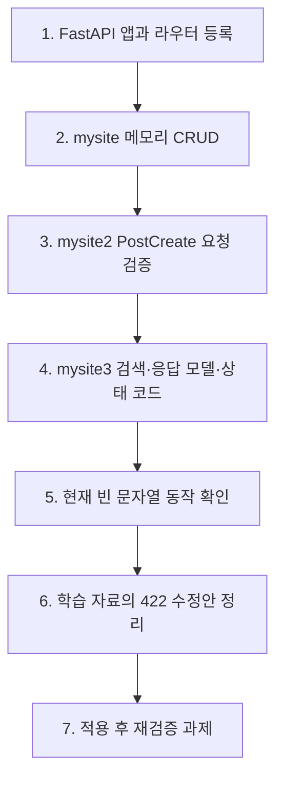

# 26.10.23 64일차(FastAPI · CRUD · Pydantic · 검색 및 입력 검증)

## [TIL] FastAPI 게시판을 단계별로 만들고 요청·응답을 검증하기

오늘은 제공된 FastAPI 학습 자료와 `fastapi_basic` 저장소를 대조해 첫 API, 메모리 CRUD, Pydantic 요청 모델, 검색용 쿼리 파라미터, 응답 모델과 상태 코드를 정리했다. 마지막으로 기존 Validation 자료를 연결해 **타입 검증을 통과해도 빈 문자열은 저장되는 현재 코드**와 422를 반환하도록 제시된 수정안을 비교했다.

이론과 실습은 다음 순서로 이어진다.



```plain text
1. FastAPI 앱과 라우터 등록
→ 2. mysite 메모리 CRUD
→ 3. mysite2 PostCreate 요청 검증
→ 4. mysite3 검색·응답 모델·상태 코드
→ 5. 현재 빈 문자열 동작 확인
→ 6. 학습 자료의 422 수정안 정리
→ 7. 적용 후 재검증 과제
```

---

## 1. FastAPI 앱과 첫 API

FastAPI는 Python으로 HTTP API를 작성하는 프레임워크이다. 클라이언트가 메서드와 URL로 요청하면 서버의 해당 함수가 실행되고, 반환값이 JSON 응답으로 전달된다. 제공 자료는 비동기 처리와 스트리밍 응답도 가능한 기능으로 소개하지만, 이번 저장소의 게시판 함수는 일반 `def`로 작성되어 있다.

### 1-1. 설치와 실행

제공 자료의 프로젝트 생성·설치 명령은 다음과 같다. 현재 저장소에는 `pyproject.toml`의 `fastapi[standard]>=0.161.1` 의존성과 `.venv`가 존재한다.

```bash
uv init fastapi_basic
cd fastapi_basic
uv add "fastapi[standard]"
```

이 명령은 새 프로젝트를 준비할 때 사용한다. 현재 코드 확인에는 이미 만들어진 `fastapi_basic` 폴더와 가상환경을 사용했다.

개발 서버 실행 명령은 다음과 같다. 실행 위치는 `main.py`가 있는 프로젝트 폴더이다.

```bash
uv run fastapi dev main.py
```

서버가 실행되면 `/docs`에서 Swagger UI로 요청을 보내고 `/redoc`에서 API 문서를 읽을 수 있다. 브라우저 주소창은 GET 요청에 사용하며 생성·수정·삭제는 Swagger UI에서 해당 메서드를 선택한다.

### 1-2. 앱과 라우터 연결

실제 `main.py`는 `FastAPI()`로 앱을 만들고 `mysite`, `mysite2`, `mysite3`, `mysite4` 라우터를 연결한다. 아래는 이번 자료와 직접 관련된 등록부를 발췌한 것이다.

```python
# main.py — 관련 부분 발췌
from fastapi import FastAPI
from mysite.post_api import router as post_router
from mysite2.post_api import router as pydantic_router
from mysite3.post_api import router as response_router

app = FastAPI()
app.include_router(post_router)
app.include_router(pydantic_router)
app.include_router(response_router)

@app.get("/")
def get_root():
    return {"Hello": "World"}
```

`GET /`는 딕셔너리를 JSON으로 반환한다. 실제 저장소의 함수 이름은 `get_root()`이며, 제공 자료의 예시 이름 `read_root()`와 다르다. `TestClient`에서 `GET /`의 200과 `{"Hello": "World"}`를 확인했다.

클라이언트와 서버의 기본 흐름은 다음과 같다. 브라우저나 앱이 HTTP 요청을 보내고 FastAPI 앱이 결과를 JSON 등의 HTTP 응답으로 돌려준다.

```plain text
클라이언트(브라우저·앱)
→ HTTP 요청
→ 서버(FastAPI 애플리케이션)
→ HTTP 응답(JSON 등)
→ 클라이언트
```

| 주소 | 문서 도구 | 용도 |
|---|---|---|
| `http://127.0.0.1:8000/docs` | Swagger UI | API 명세 확인과 요청 실행 |
| `http://127.0.0.1:8000/redoc` | ReDoc | API 명세 확인 |

제공 자료에는 `/hello`가 문자열, `/hi`가 리스트를 반환하는 확장 예제도 있다. 아래 두 함수는 **현재 저장소의 `main.py`에는 없는 학습 자료의 예시**이다.

```python
# 제공 학습 자료의 추가 엔드포인트 예시
@app.get("/hello")
def hello():
    return "Hello World!"

@app.get("/hi")
def hi():
    return ["hello", "World", "!"]
```

예시를 등록하면 `GET /hello`는 JSON 문자열 `"Hello World!"`, `GET /hi`는 JSON 배열 `["hello", "World", "!"]`을 반환한다. 이 두 경로는 현재 저장소에서 실행 확인한 결과로 적지 않는다.

---

## 2. `mysite`: 메모리 게시판 CRUD

`mysite/post.py`의 `Post`는 `id`, `title`, `content`를 담는다. `mysite/post_api.py`는 `posts` 리스트와 `post_id` 카운터를 사용하고, 라우터의 `prefix="/posts"`와 `tags=["mysite"]`로 경로와 문서 그룹을 정한다. 메모리 저장 방식이므로 서버가 재시작되면 코드에 정의된 초기 게시글 상태로 돌아간다.

| 기능 | HTTP 메서드 | 경로 | 실제 함수 |
|---|---|---|---|
| 생성 | POST | `/posts` | `create_post()` |
| 전체 조회 | GET | `/posts` | `get_posts()` |
| 단일 조회 | GET | `/posts/{id}` | `get_post()` |
| 수정 | PUT | `/posts/{id}` | `update_post()` |
| 삭제 | DELETE | `/posts/{id}` | `delete_post()` |

PUT은 이 자료에서 제목과 내용을 함께 바꾸는 데 사용한다. 일부 필드만 수정하는 PATCH는 이번 코드에 구현되어 있지 않다.

### 2-1. 게시글 생성과 조회

현재 `mysite/post_api.py`의 `create_post()`는 요청 본문을 받지 않고 고정된 제목·내용으로 `Post`를 만들어 리스트에 추가한다. 초기 데이터는 `Post(1, "기본 제목", "기본 내용")`이고 카운터는 1에서 시작한다.

```python
# mysite/post_api.py — 관련 부분 발췌
router = APIRouter(prefix="/posts", tags=["mysite"])
posts = []
post_id = 0

@router.post("")
def create_post():
    global post_id
    post_id += 1
    post = Post(post_id, "제목", "내용")
    posts.append(post)
    return post

posts.append(Post(1, "기본 제목", "기본 내용"))
post_id = 1

@router.get("")
def get_posts():
    return posts
```

`GET /posts`는 현재 리스트를 반환한다. 실제 `TestClient` 실행에서 초기 게시글 `id=1`이 조회됐고, 이어서 `POST /posts`는 `id=2`를 200으로 반환했다.

### 2-2. 경로 매개변수로 조회·수정·삭제

`/{id}`의 `id: int`는 경로 매개변수(Path Parameter)이다. 실제 함수들은 이 값으로 리스트를 순회한다.

```python
# mysite/post_api.py — 관련 부분 발췌
@router.get("/{id}")
def get_post(id: int):
    for post in posts:
        if post.id == id:
            return post
    return None

@router.put("/{id}")
def update_post(id: int):
    for post in posts:
        if post.id == id:
            post.title = "수정된 제목"
            post.content = "수정된 내용"
            return post
    return None

@router.delete("/{id}")
def delete_post(id: int):
    for i, post in enumerate(posts):
        if post.id == id:
            return posts.pop(i)
    return "삭제 실패"
```

조회·수정에서 대상이 없으면 `None`을, 삭제에서 없으면 문자열을 반환하는 단순 구현이다. 이 단계에는 명시적인 404 예외가 없다. `GET /posts` → `POST /posts` → `GET /posts/2` → `PUT /posts/2` → 다시 조회 → `DELETE /posts/2` → 목록 조회 순서가 제공 자료의 확인 흐름이다.

---

## 3. `mysite2`: Pydantic 요청 본문 검증

Pydantic은 타입 힌트로 입력 데이터의 구조를 정의하고 검증한다. `BaseModel`의 기본값이 없는 필드는 필수이다. FastAPI는 `PostCreate` 타입의 함수 인자를 요청 본문(Request Body)의 JSON으로 받아 함수 실행 전에 검증한다.

### 3-1. 요청 DTO와 서버 게시글 객체

`mysite2/post.py`는 요청 DTO(Data Transfer Object)인 `PostCreate`와 서버에서 저장하는 `Post`를 구분한다. 클라이언트는 제목과 내용을 보내고, 서버가 식별자 `id`를 부여한다.

```python
# mysite2/post.py
from pydantic import BaseModel

class PostCreate(BaseModel):
    title: str
    content: str

class Post:
    def __init__(self, id, title, content):
        self.id = id
        self.title = title
        self.content = content
```

`PostCreate`는 필수 필드와 타입을 검증하지만 문자열 길이 조건은 선언하지 않는다. 따라서 `""`도 통과하며, 이 문제는 5~7절의 Validation에서 다시 다룬다.

| 클래스 | 포함 데이터 | 역할 |
|---|---|---|
| `PostCreate` | `title`, `content` | 클라이언트가 보낸 요청의 형식과 검증 |
| `Post` | `id`, `title`, `content` | 서버가 식별자를 더해 저장하는 게시글 |

### 3-2. 생성·수정과 자동 422

`mysite2/post_api.py`는 `/posts-pydantic` 경로를 사용한다. 생성과 수정 함수의 `PostCreate` 매개변수는 요청 JSON을 받는다.

```python
# mysite2/post_api.py — 관련 부분 발췌
router = APIRouter(prefix="/posts-pydantic", tags=["mysite2"])

@router.post("")
def create_post(post_data: PostCreate):
    global post_id
    post_id += 1
    new_post = Post(post_id, post_data.title, post_data.content)
    posts.append(new_post)
    return new_post

@router.put("/{id}")
def update_post(id: int, updated_post: PostCreate):
    for post in posts:
        if post.id == id:
            post.title = updated_post.title
            post.content = updated_post.content
            return post
    return {"message": "수정할 대상이 없습니다."}
```

요청 흐름은 JSON 본문 → `PostCreate` 검증 → 함수 실행 → 응답이다. 실제 `TestClient`에서 정상 생성은 200, `content` 누락과 리스트 타입의 `title`은 모두 422였다. 검증에 실패하면 생성 함수가 실행되지 않는다.

| 요청 본문 | 자료의 예상 결과 | 현재 코드 실행 확인 |
|---|---|---|
| `{"title":"제목","content":"내용"}` | 생성 | 정상 본문으로 200 생성 확인 |
| `{"title":"제목"}` | `content` 누락 검증 실패 | 422, `body.content`의 `missing` 확인 |
| `{"title":["제목"],"content":"내용"}` | `title` 타입 검증 실패 | 422, `body.title`의 `string_type` 확인 |
| `{"title":"제목","content":null}` | `content`가 `None`이므로 실패 | 422, `body.content`의 `string_type` 확인 |

`mysite2/post_api.py`는 생성·수정 외에 전체 조회, 단일 조회, 삭제도 구현한다. 이 단계는 `mysite`와 달리 요청 본문을 Pydantic으로 검증하지만, 대상을 못 찾았을 때는 아직 메시지 딕셔너리를 정상 응답으로 반환한다.

```python
# mysite2/post_api.py — 조회·삭제 관련 부분 발췌
@router.get("")
def get_posts():
    return posts

@router.get("/{id}")
def get_post(id: int):
    for post in posts:
        if post.id == id:
            return post
    return {"message": "데이터를 찾을 수 없습니다."}

@router.delete("/{id}")
def delete_post(id: int):
    for index, post in enumerate(posts):
        if post.id == id:
            return posts.pop(index)
    return {"message": "삭제할 대상이 없습니다."}
```

목록은 `posts`를 반환하고, 단일 조회·삭제는 `id`를 경로에서 받는다. 제공 자료의 `content: null` 사례도 실제 코드로 확인해 **422**와 `body.content`의 `string_type` 오류가 나왔다.

---

## 4. `mysite3`: 검색·상태 코드·응답 모델

`mysite3/post_api.py`의 라우터 접두사는 `/posts-response`이다. `mysite3/post.py`는 요청용 `PostCreate`, 목록용 `PostListResponse`, 상세용 `PostDetailResponse`를 정의한다.

### 4-1. Path·Query·Body의 입력 위치

경로의 `{id}`에 대응하는 `id: int`는 Path, `/search` 경로에 없는 `keyword: str | None = None`은 Query, `PostCreate` 모델 매개변수는 Body로 받는다. `Query(default=None)`으로 검색 조건을 명시할 수도 있으나, 실제 저장소는 기본값 선언 방식을 사용한다.

| 전달 방식 | 요청 위치 | 함수 매개변수 | 목적 |
|---|---|---|---|
| Path | `/posts-response/1` | `id: int` | 특정 게시글 식별 |
| Query | `/posts-response/search?keyword=FastAPI` | `keyword: str \| None = None` | 제목 검색 조건 |
| Body | `{"title":"제목","content":"내용"}` | `post_data: PostCreate` | 생성·수정 데이터 |

### 4-2. 검색 함수와 등록 순서

실제 `search_posts()`는 제목에 `keyword`가 포함된 게시글을 반환한다. 검색어를 생략하거나 빈 문자열로 보내면 `if keyword`가 거짓이므로 전체 목록을 반환한다.

```python
# mysite3/post_api.py
@router.get("/search", response_model=list[PostListResponse])
def search_posts(keyword: str | None = None):
    if keyword:
        return [post for post in posts if keyword in post.title]
    return posts
```

이 함수는 `@router.get("/{id}")`보다 위에 있다. FastAPI가 경로를 등록 순서대로 확인하므로 고정 경로 `/search`가 가변 경로 `/{id}`보다 먼저 와야 한다. 실제 실행에서 제목에 `FastAPI`가 있는 게시글을 생성한 뒤 검색했을 때 해당 게시글이 반환됐다.

제공 자료는 같은 조건을 `Query()`로 명시한 예시도 제시한다. 이 코드는 **현재 저장소에는 없는 대안 표기**이며, 클라이언트는 동일하게 `?keyword=FastAPI`를 보낸다.

```python
# 제공 학습 자료의 Query 명시 예시
from fastapi import Query

@router.get("/search", response_model=list[PostListResponse])
def search_posts(keyword: str | None = Query(default=None)):
    if keyword:
        return [post for post in posts if keyword in post.title]
    return posts
```

`default=None`이므로 검색어를 생략할 수 있다. 자료는 경로와 본문에도 각각 `Path()`, `Body()`로 입력 위치를 명시할 수 있다고 설명한다.

### 4-3. 상태 코드와 예외

상태 코드는 처리 결과를 표현한다. `mysite3`는 생성 201, 조회·수정 200, 삭제 204를 사용하고, 없는 게시글에는 `HTTPException`으로 404를 반환한다. 요청 모델 검증 실패는 FastAPI가 422로 처리한다.

| 상태 코드 | 의미 | 이번 코드의 사례 |
|---|---|---|
| 200 | 요청 성공 | 조회·검색·수정 |
| 201 | 생성 성공 | `create_post()` |
| 204 | 성공, 본문 없음 | `delete_post()` |
| 404 | 대상 없음 | `get_post()`, `update_post()`, `delete_post()` |
| 422 | 요청 검증 실패 | 필수 필드 누락·타입 오류, 자료의 빈 문자열 수정안 |

실제 저장소의 다음 예외는 함수 실행을 중단하고 오류 본문 `detail`을 반환한다. `mysite2`처럼 메시지 딕셔너리만 반환하면 404 상태 코드가 되지 않는다.

```python
# mysite3/post_api.py — 대상이 없을 때
raise HTTPException(status_code=404, detail="게시글을 찾을 수 없습니다.")
```

실제 `GET /posts-response/999`는 404와 `detail`을 반환했다. `content`가 없는 생성 요청은 422였다.

생성 데코레이터의 `status_code=status.HTTP_201_CREATED`는 성공 응답을 201로 지정한다. 삭제 함수는 성공하면 게시글을 제거하고 본문 없이 204를 반환한다.

```python
# mysite3/post_api.py — 삭제 함수
@router.delete("/{id}", status_code=status.HTTP_204_NO_CONTENT)
def delete_post(id: int):
    for index, post in enumerate(posts):
        if post.id == id:
            posts.pop(index)
            return
    raise HTTPException(status_code=404, detail="게시글을 찾을 수 없습니다.")
```

입력은 경로의 `id`이며, 대상이 없으면 404가 발생한다. `TestClient`에서 없는 ID로 삭제했을 때 404와 `detail`을 확인했다. 성공한 삭제의 204는 자료와 코드에 근거한 예상 동작이며 이번 실행에서는 검증하지 않았다.

### 4-4. 응답 DTO와 필드 선택

목록·검색에는 내용 없이 `id`, `title`만 전달하고, 상세·생성·수정에는 `content`까지 전달한다. 응답 모델은 정상 응답의 필드를 제한한다.

```python
# mysite3/post.py
class PostListResponse(BaseModel):
    id: int
    title: str

class PostDetailResponse(BaseModel):
    id: int
    title: str
    content: str
```

`get_posts()`와 `search_posts()`의 `response_model`은 `list[PostListResponse]`이고, `create_post()`, `get_post()`, `update_post()`는 `PostDetailResponse`이다. 실제 생성 응답에는 `content`가 있었지만 전체 조회와 검색 응답에서는 빠졌다.

| 함수 | `response_model` | 응답 필드 |
|---|---|---|
| `get_posts()` | `list[PostListResponse]` | `id`, `title` |
| `search_posts()` | `list[PostListResponse]` | `id`, `title` |
| `get_post()` | `PostDetailResponse` | `id`, `title`, `content` |
| `create_post()` | `PostDetailResponse` | `id`, `title`, `content` |
| `update_post()` | `PostDetailResponse` | `id`, `title`, `content` |

응답 모델은 정상 응답의 구조를 검증하고 허용된 필드만 내보낸다. 따라서 필수 필드가 없는 메시지 딕셔너리를 정상 응답으로 반환하는 방식은 이 모델과 맞지 않으며, 대상이 없을 때 `HTTPException`을 사용한다.

| 요청 | 현재 코드의 상태 코드 | 확인할 응답 |
|---|---|---|
| `POST /posts-response` | 201 확인 | `id`, `title`, `content` |
| `GET /posts-response` | 200 확인 | 각 게시글의 `id`, `title` |
| `GET /posts-response/search?keyword=FastAPI` | 200 확인 | 제목이 일치하는 게시글의 `id`, `title` |
| `GET /posts-response/{id}` | 정상 대상 미실행 | 대상의 `id`, `title`, `content` |
| `PUT /posts-response/{id}` | 미실행 | 수정된 상세 응답 |
| `DELETE /posts-response/{id}` | 미실행 | 성공 시 204, 본문 없음 |
| 없는 ID로 조회 | 404 확인 | `detail` 오류 메시지 |
| `content` 없이 생성 | 422 확인 | `body.content`의 필수 필드 오류 |

---

## 5. Validation과 현재 요청 모델

### 5-1. 필수 필드·타입·값의 조건

유효성 검증(Validation)은 입력이 미리 정한 조건에 맞는지 확인하는 과정이다. 제공 자료는 게시글의 **필수 여부**, **타입**, **값의 조건**을 구분한다.

| 검증 기준 | 확인할 내용 | 현재 `PostCreate` 기준 |
|---|---|---|
| 필수 여부 | `title`, `content`가 요청에 있는가? | 두 필드가 필수이다. |
| 타입 | 두 필드가 문자열인가? | 두 필드가 `str`로 선언되어 있다. |
| 값의 조건 | 두 필드가 빈 문자열은 아닌가? | 별도 조건이 없어 `""`가 허용된다. |

`mysite3/post.py`의 `PostCreate`가 요청 본문을 정의한다. 이 선언에는 빈 문자열을 막는 필드 조건이 없다.

```python
# mysite3/post.py
class PostCreate(BaseModel):
    title: str
    content: str
```

`title`과 `content`를 입력받지만, 두 값이 `""`인지 확인하는 조건은 없다. `mysite2/post.py`에도 같은 `PostCreate` 선언이 있다.

### 5-2. 빈 문자열이 통과하는 사례

다음 요청은 필드가 모두 있고 값도 문자열이지만 제목이 비어 있다. 제공 자료가 값의 조건을 따로 설명한 이유가 이 사례이다.

```json
{"title": "", "content": "내용"}
```

현재 `mysite3/post_api.py`를 `TestClient`로 호출한 결과, `/posts-response`에 이 요청을 보냈을 때 **201**과 `id: 1`, `title: ""`가 반환됐다. 이는 **현재 코드의 실행 결과**이며, 아래 422 코드는 아직 저장소에 적용되지 않은 학습 자료의 수정안이다.

---

## 6. 저장소 코드와 학습 자료의 차이

### 6-1. 라우터와 현재 생성·수정 함수

`main.py`는 `mysite3.post_api`의 라우터를 등록하고, 이 라우터의 접두사는 `/posts-response`이다. 현재 `mysite3/post_api.py`의 `create_post()`는 `post_id`를 증가시킨 다음 바로 `posts`에 저장한다. `update_post()`도 대상 게시글을 찾으면 값을 바로 바꾼다.

| 위치 | 현재 저장소 | 제공 자료의 수정안 |
|---|---|---|
| `mysite3/post_api.py`의 `create_post()` | 빈 문자열 검사 없이 생성 | 검사 통과 후 ID 증가·저장 |
| `mysite3/post_api.py`의 `update_post()` | 대상 검색 후 바로 값 변경 | 먼저 검사하고 통과하면 값 변경 |
| `mysite2/post_api.py` | `/posts-pydantic` 라우터이며 빈 문자열 검사 없음 | 자료에 같은 검증을 넣는 별도 예시가 있음 |

학습 자료에는 `mysite2/post_api.py`와 `mysite3/post_api.py` 두 버전이 반복되어 있다. 실제 저장소에서는 `mysite3`가 응답 모델과 201·404 상태 코드를 갖추고 있어, 아래 핵심 수정안은 이 파일 기준으로 정리한다.

### 6-2. 생성 함수의 빈 문자열 검증

제공 자료는 `create_post()`에서 제목과 내용을 검사한 다음 ID를 증가시키도록 제시한다. 따라서 빈 문자열이면 저장 단계에 들어가기 전에 422 예외가 발생한다.

```python
# mysite3/post_api.py — 제공 학습 자료의 수정안
@router.post(
    "",
    response_model=PostDetailResponse,
    status_code=status.HTTP_201_CREATED,
)
def create_post(post_data: PostCreate):
    global post_id

    if post_data.title == "":
        raise HTTPException(
            status_code=status.HTTP_422_UNPROCESSABLE_CONTENT,
            detail="title을 입력하세요",
        )

    if post_data.content == "":
        raise HTTPException(
            status_code=status.HTTP_422_UNPROCESSABLE_CONTENT,
            detail="content를 입력하세요",
        )

    post_id += 1
    new_post = Post(post_id, post_data.title, post_data.content)
    posts.append(new_post)

    return new_post
```

입력은 `PostCreate`이고, 검증을 통과하면 `PostDetailResponse`에 해당하는 게시글이 반환된다. 이 수정안을 적용한 뒤의 실행 결과는 아직 확인하지 않았다.

### 6-3. 수정 함수의 빈 문자열 검증

제공 자료의 `update_post()`는 게시글을 찾기 전에 입력부터 검사한다. 검증을 통과한 경우에만 기존 게시글의 제목과 내용을 변경한다.

```python
# mysite3/post_api.py — 제공 학습 자료의 수정안
@router.put("/{id}", response_model=PostDetailResponse)
def update_post(id: int, updated_post: PostCreate):
    if updated_post.title == "":
        raise HTTPException(
            status_code=status.HTTP_422_UNPROCESSABLE_CONTENT,
            detail="title을 입력하세요",
        )

    if updated_post.content == "":
        raise HTTPException(
            status_code=status.HTTP_422_UNPROCESSABLE_CONTENT,
            detail="content를 입력하세요",
        )

    for post in posts:
        if post.id == id:
            post.title = updated_post.title
            post.content = updated_post.content
            return post

    raise HTTPException(status_code=404, detail="게시글을 찾을 수 없습니다.")
```

입력은 경로의 `id`와 `PostCreate` 본문이다. 빈 문자열이면 422, 검증을 통과하고 대상이 있으면 수정된 게시글, 대상이 없으면 404를 반환하도록 작성되어 있다. **입력 검사가 대상 검색보다 먼저**이므로 빈 문자열과 없는 ID를 함께 보내면 이 코드에서는 422가 먼저 발생한다.

---

## 7. 응답 확인과 다음 검증

제공 자료는 Swagger UI의 `mysite3` 그룹에서 `/posts-response`를 호출해 빈 문자열이면 생성·수정 모두 422, 정상 입력이면 생성 201·수정 200을 확인하도록 안내한다. 저장소의 수정안은 아직 반영되지 않았으므로, 현재 실행 결과와 자료의 예상 결과를 분리한다.

| 요청 조건 | 현재 저장소에서 확인한 결과 | 학습 자료 수정안의 예상 결과 |
|---|---|---|
| 제목 `""`, 내용 `"내용"`으로 생성 | `TestClient`에서 201, `title: ""` 확인 | 422, `title을 입력하세요` |
| 내용 `""`으로 생성 | 미실행 | 422, `content를 입력하세요` |
| 제목 또는 내용 `""`으로 수정 | 미실행 | 422, 해당 오류 메시지 |
| 정상 값으로 생성 | 미실행 | 201, `id`, `title`, `content` |
| 정상 값으로 수정 | 미실행 | 200, `id`, `title`, `content` |

비교 대상은 **현재 코드**와 **제공 자료의 수정안**이다. 실제로 측정한 값은 빈 제목 생성의 201 한 건뿐이다. 빈 문자열 저장을 막으려면 자료의 조건 검사가 필요하며, 적용 후에는 위 표의 나머지 요청을 재검증해야 한다.

| 현상 | 원인 | 대응 | 결과 또는 다음 확인 |
|---|---|---|---|
| 빈 제목으로 게시글 생성 | 현재 `PostCreate`는 문자열 타입만 선언하고 `create_post()`에 빈 문자열 조건이 없다. | 자료의 `HTTPException` 검사를 저장 전에 배치한다. | 수정안 적용 후 422 여부 재검증 필요 |
| 빈 값으로 게시글 수정 가능 | 현재 `update_post()`에 빈 문자열 조건이 없다. | 값을 변경하기 전에 두 필드를 검사한다. | 수정안 적용 후 기존 값이 유지되는지 재검증 필요 |

자료는 간단한 입력 검증을 Pydantic의 `Field`로도 설정할 수 있다고 덧붙인다. 이번 기록의 선택은 자료에 나온 **엔드포인트 내부 조건 검사**이며, `Field` 방식의 구체적인 설정이나 실행 결과는 자료에 없어 추가하지 않는다.

---

## 8. 헷갈린 점

`str` 타입을 선언했다는 사실만으로 빈 문자열까지 거절되는 것은 아니다. 현재 코드에서 `""`는 문자열로 처리되어 201 응답이 나왔고, **값의 조건**을 적용하려면 별도 검증이 필요하다. 또한 제공 자료의 422 응답 설명은 현재 저장소의 동작이 아니라 검증 코드를 넣은 뒤 확인할 목표이다.

---

## 오늘 배운 것 정리

- `FastAPI()`로 앱을 만들고 `include_router()`로 기능별 라우터를 연결한다.
- `APIRouter`의 `prefix`는 공통 경로, `tags`는 Swagger UI 그룹을 정한다.
- `/posts`의 `mysite`는 메모리 리스트로 CRUD를 구현하며 재시작하면 초기 상태로 돌아간다.
- `/posts-pydantic`의 `mysite2`는 `PostCreate`로 요청 본문의 필수 필드와 타입을 검증한다.
- 요청 DTO인 `PostCreate`와 서버의 게시글 객체 `Post`는 담는 데이터가 다르다.
- 경로의 `id`는 Path, 검색의 `keyword`는 Query, `PostCreate`는 Body로 처리된다.
- `/search`는 `/{id}`보다 먼저 등록되어야 한다.
- `/posts-response`의 `mysite3`는 생성 201, 삭제 204, 없는 게시글 404를 사용한다.
- 목록·검색 응답 모델은 `id`, `title`만 노출하고 상세 응답 모델에는 `content`도 포함한다.

- 유효성 검증은 필수 여부, 타입, 값의 조건으로 나누어 볼 수 있다.
- `mysite3/post.py`의 `PostCreate`는 `title`과 `content`를 `str`로 선언한다.
- 현재 `mysite3/post_api.py`에는 빈 문자열을 막는 조건이 없다.
- 빈 제목 생성 요청은 현재 코드에서 201로 처리되는 것을 확인했다.
- 자료의 수정안은 생성 전에 두 필드를 검사하고, 통과한 뒤 ID를 증가시킨다.
- 수정 함수도 값을 바꾸기 전에 두 필드를 검사한다.
- 자료의 검증 실패 응답은 422와 필드별 메시지이다.
- 수정안 적용 후 생성·수정의 실패 및 정상 응답을 다시 확인해야 한다.

게시판 요청을 다룰 때는 다음 순서로 확인한다.

```plain text
HTTP 메서드와 경로 확인
→ Path·Query·Body 입력 위치와 모델 검증
→ CRUD 또는 검색 실행
→ 응답 모델·상태 코드 확인
→ 빈 문자열 조건과 저장 결과 재검증
```

#부트캠프 #멀티캠퍼스부트캠프 #AI캠퍼스 #AI에이전트엔지니어
