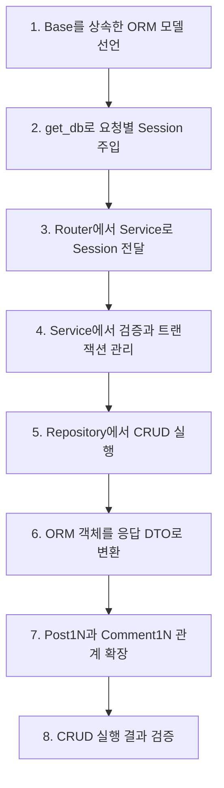
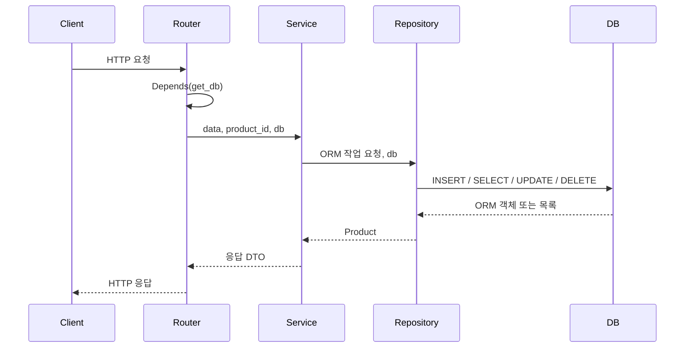

# 26.10.26 65일차(FastAPI · SQLAlchemy ORM · 계층형 CRUD · 1:N 관계)

## [TIL] SQLAlchemy ORM으로 계층형 CRUD와 1:N 관계 구현하기

오늘은 `fastapi_prac`, `mysite_db`, `mysite_one_to_many` 코드를 대조하며 **SQLAlchemy ORM 모델, 세션, 트랜잭션, Router-Service-Repository 흐름, 더티 체킹, 1:N 관계**를 정리했다. 상품 CRUD를 임시 SQLite 데이터베이스에서 실행해 생성 201, 조회·수정 200, 삭제 204와 삭제 후 빈 목록까지 확인했다.

이론과 실습은 다음 흐름으로 이어졌다.



```plain text
1. Base를 상속한 ORM 모델 선언
→ 2. get_db로 요청별 Session 주입
→ 3. Router에서 Service로 Session 전달
→ 4. Service에서 검증과 트랜잭션 관리
→ 5. Repository에서 CRUD 실행
→ 6. ORM 객체를 응답 DTO로 변환
→ 7. Post1N과 Comment1N 관계 확장
→ 8. CRUD 실행 결과 검증
```

---

## 1. ORM 모델과 API DTO

객체 관계 매핑(Object-Relational Mapping, ORM)은 Python 클래스와 데이터베이스 테이블을 연결한다. 클래스의 객체와 속성으로 데이터를 다루면 SQLAlchemy가 필요한 SQL을 생성한다.

### 1-1. `Product` ORM 모델

`fastapi_prac/models/product.py`의 `Product`는 `products` 테이블의 구조를 선언한다. `Mapped`는 Python 속성 타입을 나타내고 `mapped_column()`은 기본키, 자동 증가, 문자열 길이, NULL 허용 여부 같은 컬럼 제약을 정의한다.

```python
# fastapi_prac/models/product.py
class Product(Base):
    __tablename__ = "products"

    id: Mapped[int] = mapped_column(primary_key=True, autoincrement=True)
    name: Mapped[str] = mapped_column(String(50), nullable=False)
    price: Mapped[int] = mapped_column(nullable=False)
    discount_price: Mapped[int] = mapped_column(nullable=False)
    stock: Mapped[int] = mapped_column(nullable=False)
    category: Mapped[str] = mapped_column(String(50), nullable=False)
```

`Product` 클래스는 테이블의 설계도이며 `Product` 객체 하나는 상품 한 행에 대응한다. 실제 테이블은 서버 시작 시 `Base.metadata.create_all(bind=engine)`이 등록된 모델 정보를 읽어 생성한다.

### 1-2. 요청·응답 DTO

`fastapi_prac/schemas/product.py`는 API 요청과 응답의 형태를 정의한다. `ProductRequest`는 사용자 입력을 검증하고 목록과 상세 DTO는 노출할 필드를 구분한다.

```python
# fastapi_prac/schemas/product.py
class ProductRequest(BaseModel):
    name: str = Field(min_length=2, max_length=50)
    price: int = Field(ge=100)
    discount_price: int = Field(default=0, ge=0)
    stock: int = Field(default=10, ge=0)
    category: str = Field(min_length=2)

class ProductListResponse(BaseModel):
    id: int
    name: str
    final_price: int
    category: str

    model_config = ConfigDict(from_attributes=True)

class ProductDetailResponse(BaseModel):
    id: int
    name: str
    final_price: int
    category: str
    stock: int
    is_sold_out: bool

    model_config = ConfigDict(from_attributes=True)
```

`ConfigDict(from_attributes=True)`는 딕셔너리뿐 아니라 `product.id`, `product.name` 같은 ORM 객체 속성에서도 값을 읽게 한다. 다만 `final_price`와 `is_sold_out`은 테이블 컬럼이 아니므로 현재 서비스의 `to_detail_response()`가 계산해 DTO를 만든다.

| 구분 | 역할 | 현재 예시 |
|---|---|---|
| ORM 모델 | DB 테이블과 연결되어 저장·수정·삭제에 사용 | `Product`, `Post1N`, `Comment1N` |
| 요청 DTO | 클라이언트 입력 검증 | `ProductRequest`, `PostCreate`, `CommentCreate` |
| 응답 DTO | API 응답 필드 구성 | `ProductListResponse`, `ProductDetailResponse` |

---

## 2. Engine, Session, Base와 애플리케이션 생명주기

### 2-1. DB 연결과 요청별 세션

`fastapi_prac/database.py`는 환경 변수의 `DATABASE_URL`로 Engine을 만들고, `SessionLocal`로 요청마다 사용할 세션을 생성한다.

```python
# fastapi_prac/database.py
load_dotenv(Path(__file__).with_name(".env"))
DATABASE_URL = os.getenv("DATABASE_URL")

if not DATABASE_URL:
    raise RuntimeError(".env 파일에 DATABASE_URL을 설정하세요.")

engine = create_engine(DATABASE_URL)
SessionLocal = sessionmaker(bind=engine)

class Base(DeclarativeBase):
    pass

def get_db():
    db = SessionLocal()
    try:
        yield db
    finally:
        db.close()
```

Engine은 DB 연결과 연결 풀을 관리한다. Session은 ORM 객체를 조회·등록·변경·삭제하고 변경 상태를 추적하는 작업 단위이다. `yield db`는 라우터에 세션을 전달하며 요청 처리가 끝나면 `finally`가 세션을 닫는다.

### 2-2. 테이블 생성과 연결 정리

`fastapi_prac/main.py`의 lifespan은 서버 시작 전에 테이블을 준비하고 종료 시 연결 풀을 정리한다.

```python
# fastapi_prac/main.py
@asynccontextmanager
async def lifespan(app: FastAPI):
    try:
        Base.metadata.create_all(bind=engine)
        yield
    finally:
        engine.dispose()

app = FastAPI(lifespan=lifespan)
app.include_router(product_router)
```

`Base.metadata`에는 `Base`를 상속한 모델의 테이블 이름, 컬럼, 제약 조건이 모인다. `create_all()`은 없는 테이블을 만들지만 이미 존재하는 테이블의 구조 변경을 위한 마이그레이션 도구는 아니다.

---

## 3. Router-Service-Repository 계층

### 3-1. 호출 흐름과 의존성 주입

FastAPI가 직접 호출하는 Router에서 `Depends(get_db)`로 Session을 주입받고 Service와 Repository에 같은 세션을 전달한다.



```plain text
클라이언트 HTTP 요청
→ Router가 Depends(get_db)로 Session 주입
→ Service가 검증과 트랜잭션 관리
→ Repository가 같은 Session으로 DB 작업
→ Service가 ORM 객체를 응답 DTO로 변환
→ Router가 HTTP 응답 반환
```

`db`는 DB 작업을 하거나 DB 작업을 하는 다음 계층으로 세션을 전달할 때 필요하다. 이미 조회한 객체의 필드를 계산하는 `to_detail_response()`에는 세션이 필요 없다.

### 3-2. 계층별 책임

| 계층 | 현재 책임 | 예시 |
|---|---|---|
| Router | HTTP 경로, 상태 코드, 요청·응답 모델, Session 주입 | `@router.post`, `Depends(get_db)` |
| Service | 할인 검증, 404 판단, 트랜잭션, DTO 변환 | `with db.begin()`, `to_detail_response()` |
| Repository | ORM을 이용한 실제 DB CRUD | `db.add`, `db.get`, `db.scalars`, `db.delete` |

함수에 위치 인자로 전달할 때는 정의한 순서와 호출 순서가 같아야 한다. `delete(product, db)`에 `delete(db, product)`를 전달하면 Session과 Product가 서로 바뀌어 오류가 발생한다.

---

## 4. 상품 CRUD 구현

### 4-1. 생성

`ProductService.create_product()`는 할인 금액을 검사하고 ORM 객체를 만든다. `with db.begin()`은 블록이 정상 종료되면 commit하고 예외가 발생하면 rollback한다.

```python
# fastapi_prac/services/product_service.py
def create_product(self, db: Session, data: ProductRequest):
    with db.begin():
        if data.discount_price >= data.price:
            raise HTTPException(
                status_code=status.HTTP_422_UNPROCESSABLE_CONTENT,
                detail="할인 금액은 가격보다 작아야 합니다.",
            )

        new_product = Product(
            name=data.name,
            price=data.price,
            discount_price=data.discount_price,
            stock=data.stock,
            category=data.category,
        )
        product = product_repository.save(db, new_product)

    return self.to_detail_response(product)
```

Repository의 `save()`는 `db.add()`로 새 객체를 세션에 등록한다. 트랜잭션 종료 시 flush와 commit이 실행되어 INSERT가 확정된다.

### 4-2. 전체 조회와 기본키 조회

목록 조회는 `select(Product)`를 세션에서 실행하고 `.all()`로 ORM 객체 목록을 얻는다. 상세 조회는 기본키 전용 단축 메서드 `db.get()`을 사용한다.

```python
# fastapi_prac/repositories/product_repository.py
def find_all(self, db: Session):
    return db.scalars(select(Product).order_by(Product.id)).all()

def find_by_id(self, product_id: int, db: Session):
    return db.get(Product, product_id)
```

`scalars()`는 각 결과 행에서 첫 번째 값인 `Product` 객체를 꺼낸다. 여러 객체를 리스트로 만드는 동작은 `.all()`이 담당한다. `get()`은 기본키로 객체 하나를 조회하고 대상이 없으면 `None`을 반환한다.

### 4-3. 수정과 더티 체킹

Repository는 ID로 ORM 객체를 가져와 속성값을 변경한다. SQLAlchemy가 세션이 관리하는 객체의 변경을 감지하는 기능을 **더티 체킹(Dirty Checking)**이라고 한다.

```python
# fastapi_prac/repositories/product_repository.py
def update(self, product_id: int, data: ProductRequest, db: Session):
    product = db.get(Product, product_id)

    product.name = data.name
    product.price = data.price
    product.discount_price = data.discount_price
    product.stock = data.stock
    product.category = data.category
    return product
```

별도의 `UPDATE` 문자열을 작성하지 않아도 commit 과정의 flush에서 변경된 컬럼에 대한 UPDATE가 실행된다. 현재 Service는 `self.get_product()`로 존재 여부를 확인한 뒤 Repository에서 같은 ID를 다시 가져오며, 기능은 동작하지만 한 번 조회한 ORM 객체를 그대로 넘기는 구조로 줄일 수 있다.

### 4-4. 삭제와 ORM 객체

삭제는 반드시 SQLAlchemy가 매핑하고 세션이 관리하는 ORM 객체를 `db.delete()`에 전달한다.

```python
# fastapi_prac/services/product_service.py
def delete_product(self, product_id: int, db: Session):
    with db.begin():
        product = product_repository.find_by_id(product_id, db)
        product_repository.delete(product, db)

# fastapi_prac/repositories/product_repository.py
def delete(self, product: Product, db: Session):
    db.delete(product)
```

`ProductDetailResponse`는 API 응답 DTO이므로 DB 테이블과 매핑되지 않는다. 조회 후 DTO로 변환한 객체를 `db.delete()`에 전달하면 삭제할 수 없고, Repository가 반환한 `Product` ORM 객체를 사용해야 한다.

---

## 5. SQLAlchemy 주요 메서드와 조회 문법

### 5-1. 트랜잭션과 객체 상태

| 메서드 | 역할 |
|---|---|
| `add()` | 새 ORM 객체를 세션에 등록 |
| `add_all()` | 여러 ORM 객체를 한꺼번에 등록 |
| `flush()` | 변경 SQL을 실행하지만 트랜잭션을 확정하지 않음 |
| `commit()` | flush 후 트랜잭션 확정 |
| `rollback()` | 아직 확정하지 않은 변경 취소 |
| `refresh()` | DB에서 객체 값을 다시 조회 |
| `delete()` | ORM 객체를 삭제 대상으로 등록 |

현재 Service는 명시적인 `commit()` 대신 `with db.begin():`을 사용한다. 이 블록은 정상 종료 시 commit, 실패 시 rollback을 자동 처리한다.

### 5-2. 조회문 구성과 결과 추출

`stmt`는 Statement의 줄임말로 실행할 조회문을 담는 변수이다. SQLAlchemy는 조건, 정렬, 제한을 메서드 체인으로 구성한다.

```python
# 학습 자료의 SQLAlchemy 조회 예시
stmt = select(Post)
posts = db.scalars(stmt).all()

stmt = select(Post).where(Post.id == 1)
post = db.scalar(stmt)

stmt = select(Post).where(Post.title.like("%FastAPI%"))
posts = db.scalars(stmt).all()

stmt = select(Post).where(Post.id > 10, Post.title.like("%공부%"))
posts = db.scalars(stmt).all()

stmt = select(Post).where(or_(Post.id == 1, Post.title == "공지"))
posts = db.scalars(stmt).all()

stmt = select(Post).order_by(Post.id.desc()).limit(10)
posts = db.scalars(stmt).all()
```

`db.scalar(stmt)`는 첫 번째 행의 첫 번째 값을 반환하고 결과가 없으면 `None`을 반환한다. `db.scalars(stmt)` 뒤에는 `.all()`, `.first()`, `.one()`, `.one_or_none()`을 붙여 필요한 개수와 오류 조건을 정한다.

| 결과 메서드 | 반환과 조건 |
|---|---|
| `.all()` | 전체 결과 리스트, 없으면 `[]` |
| `.first()` | 첫 번째 결과, 없으면 `None` |
| `.one()` | 정확히 하나, 없거나 여러 개면 오류 |
| `.one_or_none()` | 하나 또는 `None`, 여러 개면 오류 |

---

## 6. 게시글과 댓글의 1:N 관계

### 6-1. 외래키와 양방향 관계

`mysite_one_to_many`는 하나의 게시글에 여러 댓글이 연결되는 1:N 관계를 구현한다. DB에는 댓글 테이블의 `post_id` 외래키가 저장되고 Python에서는 `post.comments`, `comment.post` 객체 관계로 접근한다.

```python
# mysite_one_to_many/models/post_1n.py
class Post1N(Base):
    __tablename__ = "post_1n"

    id: Mapped[int] = mapped_column(primary_key=True, autoincrement=True)
    title: Mapped[str] = mapped_column(String(50), nullable=False)
    content: Mapped[str] = mapped_column(Text, nullable=False)

    comments: Mapped[list["Comment1N"]] = relationship(
        "Comment1N",
        back_populates="post",
        cascade="all",
        order_by="Comment1N.id",
    )

# mysite_one_to_many/models/comment_1n.py
class Comment1N(Base):
    __tablename__ = "comment_1n"

    id: Mapped[int] = mapped_column(primary_key=True, autoincrement=True)
    content: Mapped[str] = mapped_column(String(200), nullable=False)
    post_id: Mapped[int] = mapped_column(
        ForeignKey("post_1n.id"), nullable=False
    )

    post: Mapped["Post1N"] = relationship(
        "Post1N", back_populates="comments"
    )
```

`back_populates`는 양쪽 속성이 같은 관계임을 연결한다. `order_by`는 댓글을 ID 순서로 제공하고 `cascade="all"`은 부모의 저장·병합·삭제 같은 작업을 연결된 자식에게 전파한다.

### 6-2. `TYPE_CHECKING`과 순환 import 방지

두 모델은 서로의 타입을 참조하므로 실행 시 직접 import하면 순환 import가 발생할 수 있다. 타입 검사 시에만 상대 모델을 import하고 관계 타입은 문자열로 선언한다.

```python
from typing import TYPE_CHECKING

if TYPE_CHECKING:
    from .comment_1n import Comment1N

comments: Mapped[list["Comment1N"]]
```

`TYPE_CHECKING`은 VS Code와 정적 타입 검사기가 분석할 때 `True`이고 일반 실행에서는 `False`이다. SQLAlchemy는 문자열로 지정한 모델 이름을 모델 등록 정보에서 찾는다.

### 6-3. 객체로 관계 연결하기

댓글 생성 Service는 게시글 ID를 댓글에 직접 복사하지 않고 조회한 `Post1N` 객체를 `post` 관계 속성에 넣는다.

```python
# mysite_one_to_many/services/comment_service.py
def create_comment(self, db: Session, post_id: int, data: CommentCreate):
    with db.begin():
        post = post_service.get_post(db, post_id)
        new_comment = Comment1N(content=data.content, post=post)
        comment_repository.save(db, new_comment)

    return new_comment
```

Python에서는 `post=post`로 객체 관계를 표현하고 SQLAlchemy가 저장할 때 `post.id`를 `comment_1n.post_id`에 반영한다. 댓글 수정·삭제는 댓글 ID와 URL의 게시글 ID가 같은 관계인지 함께 검사한다.

```python
# mysite_one_to_many/services/comment_service.py
def _get_verified_comment(self, db: Session, post_id: int, comment_id: int):
    comment = comment_repository.find_by_id(db, comment_id)
    if comment is None or comment.post_id != post_id:
        raise HTTPException(
            status_code=status.HTTP_404_NOT_FOUND,
            detail="해당 게시글의 댓글을 찾을 수 없습니다.",
        )
    return comment
```

`comment is None`이 참이면 `or`의 오른쪽을 평가하지 않는 단락 평가로 인해 없는 객체의 `post_id`에 접근하지 않는다.

---

## 7. CRUD 실행 결과와 오류 수정

### 7-1. 실행 조건과 결과

`fastapi_prac`의 실제 PostgreSQL `.env`는 아직 없으므로 임시 SQLite 파일과 FastAPI `TestClient`로 동일한 ORM 흐름을 실행했다. 상품 한 건을 생성한 뒤 목록·상세·수정·삭제하고 마지막 목록을 확인했다.

| 단계 | 요청 | 상태 코드 | 확인한 결과 |
|---|---|---:|---|
| 생성 | `POST /products` | 201 | `id=1`, `final_price=9000`, `stock=10` |
| 목록 | `GET /products` | 200 | 상품 한 건, 목록에는 `id`, `name`, `final_price`, `category` |
| 상세 | `GET /products/1` | 200 | `stock=10`, `is_sold_out=false` 포함 |
| 수정 | `PUT /products/1` | 200 | `name=updated product`, `final_price=8000`, `stock=0`, `is_sold_out=true` |
| 삭제 | `DELETE /products/1` | 204 | 응답 본문 없음 |
| 삭제 확인 | `GET /products` | 200 | `[]` |

비교 대상은 각 CRUD 단계의 예상 상태 코드와 실제 응답이다. 전체 단계가 예상 코드와 일치했고 수정된 계산 필드와 삭제 후 빈 목록까지 확인했으므로 현재 구조를 유지했다. 실제 PostgreSQL에서는 `.env` 설정 후 같은 요청을 다시 검증해야 한다.

### 7-2. DTO 삭제 오류

삭제 구현 중 `self.get_product()`의 반환값을 `db.delete()`에 전달했을 때 500이 발생했다. 상세 조회 Service는 ORM 객체를 `ProductDetailResponse`로 변환해 반환하므로 삭제 가능한 매핑 객체가 아니었다.

| 현상 | 원인 | 대응 | 수정 후 영향 |
|---|---|---|---|
| `DELETE /products/1`이 500 반환 | `self.get_product()`가 ORM `Product`가 아닌 응답 DTO를 반환 | `product_repository.find_by_id()`로 ORM 객체를 직접 조회 | 삭제 204, 삭제 후 목록 `[]` 확인 |
| 수정에서 상품을 두 번 찾는 구조 | 존재 확인과 Repository 수정에서 같은 ID를 각각 조회 | 현재 기능은 유지하고 추후 조회한 ORM 객체 전달 방식 검토 | 기능상 CRUD 전체 성공 |

오류 해결 흐름은 다음과 같다.

```plain text
self.get_product()가 ProductDetailResponse 반환
→ DTO를 db.delete()에 전달
→ ORM 매핑 객체가 아니어서 500
→ Repository의 find_by_id()로 Product 조회
→ db.delete(Product)
→ 204 및 삭제 후 빈 목록 확인
```

---

## 8. 헷갈린 점

처음에는 상세 조회에서 받은 객체를 수정·삭제에도 그대로 사용할 수 있다고 생각했다. 하지만 `get_product()`는 응답을 위해 ORM 객체를 `ProductDetailResponse` DTO로 바꾸므로, DB 변경 작업에는 Repository가 반환한 ORM `Product`가 필요했다.

또한 `scalars()`가 여러 결과를 만드는 것으로 혼동하기 쉬웠다. `scalars()`는 행에서 ORM 객체를 꺼내고 실제로 전체 결과를 리스트로 만드는 메서드는 `.all()`이다.

---

## 오늘 배운 것 정리

- ORM 모델은 Python 클래스와 DB 테이블을 연결하며 객체 하나는 테이블 한 행에 대응한다.
- Pydantic DTO는 API 요청 검증과 응답 필드 구성을 담당하며 DB에 매핑된 객체가 아니다.
- Engine은 연결과 연결 풀을 관리하고 Session은 ORM 객체의 DB 작업과 변경 추적을 담당한다.
- `Depends(get_db)`는 요청마다 세션을 만들고 Router에 주입한 뒤 요청 종료 시 닫는다.
- Router는 HTTP 입출력, Service는 검증·트랜잭션, Repository는 DB CRUD를 담당한다.
- `with db.begin()`은 정상 종료 시 commit하고 예외 발생 시 rollback한다.
- `db.get()`은 기본키 단건 조회, `db.scalars(select(...)).all()`은 객체 목록 조회에 사용한다.
- 더티 체킹은 ORM 객체의 속성 변경을 감지해 commit 시 UPDATE를 실행한다.
- 수정·삭제에는 응답 DTO가 아니라 Session이 관리하는 ORM 객체가 필요하다.
- 1:N 관계에서 DB는 외래키를 저장하고 Python은 `relationship()`으로 객체 관계를 다룬다.
- `back_populates`는 양방향 관계를 연결하고 `cascade`는 부모 작업을 자식에게 전파한다.
- `TYPE_CHECKING`과 문자열 타입 표기는 모델 간 순환 import를 피하면서 타입 정보를 제공한다.
- 상품 CRUD 실행에서 생성 201, 조회·수정 200, 삭제 204와 삭제 후 빈 목록을 확인했다.

ORM 기반 API를 구현할 때는 다음 순서로 확인한다.

```plain text
ORM 모델과 DTO 구분
→ 요청별 Session 주입
→ Router-Service-Repository 인자 순서 확인
→ Service에서 검증과 트랜잭션 관리
→ Repository에서 ORM 객체로 CRUD
→ 응답 직전에 DTO 변환
→ 상태 코드와 DB 반영 결과 검증
```

#부트캠프 #멀티캠퍼스부트캠프 #AI캠퍼스 #AI에이전트엔지니어
