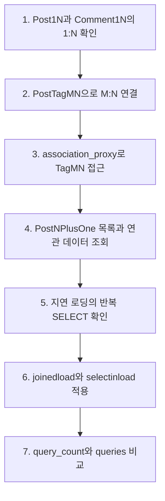
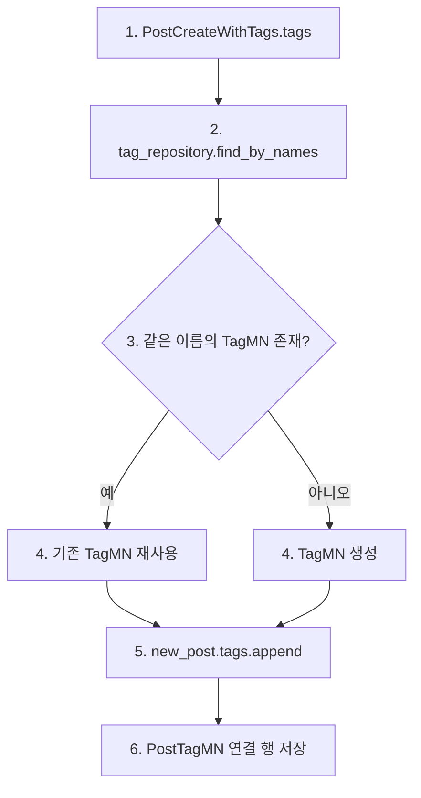

# 26.10.27 66일차(SQLAlchemy M:N 관계 · association_proxy · N+1 조회 최적화)

## [TIL] 중간 테이블로 다대다 관계를 만들고 연관 조회 횟수 비교하기

오늘은 `mysite_one_to_many`의 게시글·댓글 관계를 출발점으로 `mysite_many_to_many`의 게시글·태그 연결을 살펴보고, `mysite_nplusone`에서 지연 로딩과 즉시 로딩의 SQL 실행 횟수를 비교했다. 전날 정리한 ORM·세션·계층형 CRUD의 기본 설명은 반복하지 않고 **중간 연결 객체, `association_proxy`, N+1, `joinedload`, `selectinload`, `unique()`**에 집중했다. 아래 쿼리 수는 강의의 기본 데이터와 예상 결과이며, 이 글을 작성하면서 새로 측정한 값은 아니다.

이론과 실습은 다음 흐름으로 이어졌다.



```plain text
1. 1:N 관계 확인
→ 2. 중간 테이블로 M:N 연결
→ 3. 프록시로 태그 객체 접근
→ 4. 목록과 연관 데이터 조회
→ 5. 반복 SELECT 확인
→ 6. 즉시 로딩 적용
→ 7. SQL 횟수와 내용 비교
```

---

## 1. 1:N에서 M:N으로 확장

### 1-1. 게시글과 댓글은 한쪽에 외래 키를 둔다

`mysite_one_to_many/models/comment_1n.py`의 `Comment1N`은 `post_id` 외래 키로 게시글 한 건에 속한다. `mysite_one_to_many/models/post_1n.py`의 `Post1N.comments`는 연결된 댓글 여러 건을 파이썬 객체 목록으로 제공한다.

```python
# mysite_one_to_many/models/comment_1n.py
post_id: Mapped[int] = mapped_column(ForeignKey("post_1n.id"), nullable=False)
post: Mapped["Post1N"] = relationship("Post1N", back_populates="comments")

# mysite_one_to_many/models/post_1n.py
comments: Mapped[list["Comment1N"]] = relationship(
    "Comment1N", back_populates="post", cascade="all", order_by="Comment1N.id"
)
```

DB의 연결 값은 댓글의 `post_id`에 저장된다. `relationship()`은 `post.comments`와 `comment.post`로 객체를 따라갈 수 있게 하지만 외래 키를 대신하지 않는다.

### 1-2. 게시글과 태그는 중간 연결 행이 필요하다

태그 하나가 여러 게시글에 붙고 게시글 하나에도 여러 태그가 붙는다. `mysite_many_to_many/models/post_tag_mn.py`의 `PostTagMN`은 두 외래 키와 고유 제약으로 **연결 한 건**을 표현한다.

```python
# mysite_many_to_many/models/post_tag_mn.py
class PostTagMN(Base):
    __tablename__ = "post_tag_mn"
    __table_args__ = (
        UniqueConstraint("post_id", "tag_id", name="uq_post_tag_mn_post_tag"),
    )

    id: Mapped[int] = mapped_column(primary_key=True, autoincrement=True)
    post_id: Mapped[int] = mapped_column(ForeignKey("post_mn.id"), nullable=False)
    tag_id: Mapped[int] = mapped_column(ForeignKey("tag_mn.id"), nullable=False)

    post: Mapped["PostMN"] = relationship("PostMN", back_populates="post_tags")
    tag: Mapped["TagMN"] = relationship("TagMN", back_populates="post_tags")
```

`(post_id, tag_id)`가 같으면 같은 연결이므로 고유 제약이 중복 행을 막는다. 관계를 끊을 때 삭제 대상은 `PostTagMN` 행이며, 공유 중인 `TagMN` 자체는 유지한다.

| 관계 | 연결이 저장되는 곳 | 객체 접근 |
|---|---|---|
| 게시글 1:N 댓글 | `comment_1n.post_id` | `post.comments`, `comment.post` |
| 게시글 M:N 태그 | `post_tag_mn.post_id`, `post_tag_mn.tag_id` | `post.post_tags`, `link.tag` |

---

## 2. `association_proxy`가 중간 객체를 가리는 방식

### 2-1. 모델의 프록시와 API 응답

`mysite_many_to_many/models/post_mn.py`에서 `post_tags`의 원소는 `PostTagMN`이고, `tags` 프록시의 원소는 `TagMN`이다. 프록시가 새 DB 관계를 만드는 것은 아니다. 이미 선언한 관계를 따라 중간 객체의 `tag`를 보여준다.

```python
# mysite_many_to_many/models/post_mn.py
post_tags: Mapped[list["PostTagMN"]] = relationship(
    "PostTagMN",
    back_populates="post",
    cascade="all, delete-orphan",
    order_by="PostTagMN.id",
)
tags: AssociationProxy[list["TagMN"]] = association_proxy(
    "post_tags", "tag", creator=lambda tag: PostTagMN(tag=tag)
)
```

`post.post_tags[0]`은 연결 객체이고 `post.post_tags[0].tag`와 `post.tags[0]`은 같은 태그 객체다. `mysite_many_to_many/schemas/post.py`의 `PostDetailResponse.tags: list[TagResponse]`는 ORM 객체의 `post.tags`를 읽어 상세 응답에 태그를 담는다.

### 2-2. 태그 이름 입력부터 연결 해제까지

`mysite_many_to_many/services/post_service.py`의 `create_post_with_tags()`는 요청 DTO의 `data.tags`에서 문자열 이름들을 받는다. 중복 이름을 한 번만 처리하고, 기존 태그를 재사용하거나 새 `TagMN`을 만든 뒤 프록시에 추가한다.

```python
# mysite_many_to_many/services/post_service.py — create_post_with_tags()
names = list(dict.fromkeys(data.tags))
tags_by_name = {
    tag.name: tag for tag in tag_repository.find_by_names(db, names)
}
new_post = PostMN(title=data.title, content=data.content)

for name in names:
    tag = tags_by_name.get(name)
    if tag is None:
        tag = TagMN(name=name)
    new_post.tags.append(tag)

post_repository.save(db, new_post)
```

입력은 `data.tags`의 문자열 목록이고, `new_post.tags.append(tag)`에 전달하는 값은 `TagMN` 객체다. 프록시의 `creator`가 `PostTagMN(tag=tag)` 연결 객체를 만든다. `remove_tag_from_post()`의 `post.tags.remove(tag)`는 해당 연결을 떼며, `cascade="all, delete-orphan"`에 따라 고아가 된 연결 행이 삭제된다.



```plain text
1. 요청의 tags 문자열 목록
→ 2. 기존 태그 이름 조회
→ 3. 있으면 재사용 / 없으면 TagMN 생성
→ 4. new_post.tags.append(tag)
→ 5. 프록시가 PostTagMN 연결 객체 생성
→ 6. 트랜잭션 종료 시 연결 저장
```

이 프록시는 게시글에서 태그를 추가·조회·해제하는 코드에만 필요해 `PostMN`에 선언돼 있다. 반대 방향인 `tag.posts`가 필요한 기능은 현재 코드에 없어 `TagMN`에는 같은 프록시가 없다.

---

## 3. N+1은 연관 데이터를 읽는 시점에 발생한다

### 3-1. 지연 로딩과 응답 DTO 변환

`mysite_nplusone`의 `PostNPlusOne.comments`는 기본적으로 지연 로딩(Lazy Loading)을 사용한다. `mysite_nplusone/repositories/post_repository.py`가 게시글 목록을 한 번 읽은 뒤 각 게시글의 댓글에 접근하면 게시글별 댓글 SELECT가 추가된다.

```python
# 강의의 지연 로딩 예시
posts = db.scalars(select(PostNPlusOne)).all()

for post in posts:
    print(post.comments)
```

게시글 25개라면 게시글 1회와 댓글 25회로 총 **26회**다. 실제 `mysite_nplusone/services/post_service.py`는 `PostWithCommentsResponse.model_validate(post)`를 `collect_queries(db)` 안에서 실행하므로, 응답 DTO가 `comments`를 읽으며 발생한 추가 SQL까지 `query_count`에 포함한다.

`mysite_nplusone/query_debug.py`는 `before_cursor_execute` 이벤트로 SQL 문장을 기록하고 종료 시 리스너를 제거한다. 따라서 응답의 `queries`에서 게시글별 댓글 SELECT 반복을 확인할 수 있다.

### 3-2. 강의 기본 데이터의 비교 조건

강의의 `POST /nplusone/setup` 기준 데이터는 사용자 5명, 게시글 25개, 댓글 125개다. 아래 수치는 이 조건에서 강의가 제시한 예상 SQL 횟수이며, 로컬 실행 측정 결과로 쓰지 않았다.

| 조회 대상 | 지연 로딩 | 즉시 로딩 | 변화 원인 |
|---|---:|---:|---|
| 게시글과 작성자 | 6회 | `joinedload(user)` 1회 | 작성자별 조회 5회를 JOIN으로 대체 |
| 게시글과 댓글 | 26회 | `selectinload(comments)` 2회 | 댓글별 게시글 ID를 `IN`으로 일괄 조회 |
| 게시글과 댓글 | 26회 | `joinedload(comments)` 1회 | JOIN 한 번, 부모 행 반복과 `unique()` 필요 |
| 게시글·작성자·댓글 | 31회 | `joinedload(user)` + `selectinload(comments)` 2회 | 서로 다른 두 관계에 맞춰 로딩 |
| 게시글·댓글·댓글 작성자 | 31회 | `selectinload(comments).joinedload(user)` 2회 | 댓글 일괄 조회 SQL에서 작성자를 JOIN |

작성자 조회가 게시글 25회가 아닌 5회인 것은 같은 작성자 객체를 한 세션에서 재사용하기 때문이다. 비교 목적은 SQL 횟수와 `queries`에 나타나는 반복 SELECT, JOIN, IN 조건을 함께 보는 것이다.

---

## 4. `joinedload`와 `selectinload` 선택하기

### 4-1. 작성자 한 명과 댓글 여러 명

`mysite_nplusone/repositories/post_repository.py`의 `find_all_full()`은 작성자(N:1)에는 JOIN을, 댓글(1:N)에는 `IN` 일괄 조회를 적용한다.

```python
# mysite_nplusone/repositories/post_repository.py — find_all_full()
stmt = select(PostNPlusOne).order_by(PostNPlusOne.id)
if optimized:
    stmt = stmt.options(
        joinedload(PostNPlusOne.user),
        selectinload(PostNPlusOne.comments),
    )
return db.scalars(stmt).all()
```

작성자는 게시글당 한 객체라 JOIN으로 함께 읽기 쉽다. 댓글은 여러 건이므로 `selectinload()`로 게시글을 먼저 읽고 댓글을 `post_id IN (...)`으로 한꺼번에 가져오면 게시글 컬럼의 반복 전송을 피할 수 있다.

### 4-2. 댓글 컬렉션 JOIN에는 `unique()`가 필요하다

`find_all_with_comments_joined()`는 댓글까지 한 SQL로 가져오는 대안을 보여준다. 댓글이 여러 개면 JOIN 결과에 같은 게시글이 여러 행으로 나타나므로 SQLAlchemy 결과에서 게시글 객체를 한 번씩 반환하도록 `unique()`를 호출한다.

```python
# mysite_nplusone/repositories/post_repository.py — find_all_with_comments_joined()
stmt = (
    select(PostNPlusOne)
    .options(joinedload(PostNPlusOne.comments))
    .order_by(PostNPlusOne.id)
)
return db.scalars(stmt).unique().all()
```

`unique()`는 DB가 반환한 행 자체를 줄이지 않는다. 이를 생략하면 컬렉션 `joinedload()` 결과 처리에서 예외가 발생한다. `selectinload()`는 댓글을 별도 SQL로 가져와 게시글 결과 행을 늘리지 않으므로 이 이유로 `unique()`를 붙일 필요가 없다.

### 4-3. 댓글 작성자까지 경로를 이어 로딩한다

댓글 목록을 일괄 조회하면서 각 댓글 작성자도 필요하면 `PostNPlusOne → CommentNPlusOne → UserNPlusOne` 경로를 옵션으로 지정한다.

```python
# mysite_nplusone/repositories/post_repository.py — find_all_with_comment_users()
stmt = select(PostNPlusOne).order_by(PostNPlusOne.id)
if optimized:
    stmt = stmt.options(
        selectinload(PostNPlusOne.comments).joinedload(CommentNPlusOne.user)
    )
return db.scalars(stmt).all()
```

첫 SQL은 게시글, 둘째 SQL은 `post_id IN (...)`으로 댓글을 가져오면서 사용자를 JOIN한다. 일반 `.join(PostNPlusOne.user)`는 작성자 이름으로 필터링하는 데 쓸 수 있지만, 그 자체만으로 `post.user`를 미리 채우는 `joinedload()`와 같지 않다.

| 로딩 방식 | 강의의 대표 관계 | SQL 형태 | 선택 이유와 주의점 |
|---|---|---|---|
| 지연 로딩 | 게시글 → 댓글 | 게시글 1회 뒤 댓글별 SELECT | 필요한 때만 읽지만 목록에서는 N+1 발생 |
| `joinedload()` | 게시글 → 작성자 | 부모와 작성자 JOIN | N:1에 적합, 컬렉션 JOIN은 행 중복 주의 |
| `selectinload()` | 게시글 → 댓글 | 부모 SELECT + 댓글 `IN` SELECT | 1:N·M:N에서 부모 행 반복 감소 |

SQL 1회가 언제나 최선은 아니다. 필요한 관계만 미리 로딩하고 쿼리 횟수와 전송되는 행의 양을 함께 비교해야 한다.

---

## 5. 기획전 M:N 실습에 적용할 점

강의의 상품·기획전 과제는 `Collection`과 `Product` 사이에 `ProductCollection` 연결 모델을 요구한다. 기존 게시글·태그 예제와 마찬가지로 `product_id`, `collection_id` 외래 키와 두 값의 고유 제약을 먼저 선언하고, 연결 해제에서는 연결 행만 제거해야 한다.

| 요구사항 | 적용 지점 | 확인할 결과 |
|---|---|---|
| 기획전 생성·목록·상세 | `Collection` 모델과 `/collections` API | 이름 1~50자, 비어 있는 `products`는 `[]` |
| 기존 상품 연결 | `ProductCollection` 중간 행 | 연결의 `id`, `product_id`, `collection_id` 반환 |
| 중복 연결 방지 | `(product_id, collection_id)` 고유 제약과 서비스 검사 | 같은 상품 재연결 400 |
| 연결 해제 | 중간 행만 제거 | 상품 자체와 다른 기획전의 연결 유지, 204 |
| 존재하지 않는 대상 | 상품·기획전·연결 조회 | 404 |

현재 `fastapi_prac`의 기획전 코드는 작성 중이다. 요구 API의 성공·오류 결과를 실행 검증했다고 기록하지 않고, 모델 제약과 관계 등록을 마친 뒤 라우터·서비스를 구현하고 테스트할 항목으로 남긴다.

---

## 6. 헷갈린 점

처음에는 게시글과 태그가 `relationship()`으로 연결돼 있는데 왜 `association_proxy`가 또 필요한지 혼동했다. 실제 `post.post_tags`는 `PostTagMN` 목록이고, 상세 응답이 원하는 `post.tags`는 `TagMN` 목록이다. 프록시는 새 관계를 만드는 대신 연결 객체를 거쳐 태그를 읽고 추가하는 경로를 제공한다.

또 `selectinload()`가 내부적으로 `unique()`를 포함한다고 생각하기 쉽다. 실제로는 연관 컬렉션을 별도 SQL로 읽어 부모 조회 결과 행이 늘어나지 않으므로 컬렉션 JOIN의 중복 제거가 필요하지 않은 것이다. `joinedload()`는 관계가 단일 객체인지 컬렉션인지 먼저 확인해야 한다.

---

## 오늘 배운 것 정리

- 1:N은 자식 테이블의 외래 키로, M:N은 두 외래 키를 가진 중간 테이블로 연결한다.
- `PostTagMN`은 게시글·태그 연결 한 건이며 `(post_id, tag_id)` 고유 제약이 중복을 막는다.
- `association_proxy`는 `post.post_tags`의 연결 객체를 거쳐 `post.tags`의 태그 객체를 제공한다.
- 태그 이름 문자열은 기존 `TagMN` 조회 또는 새 객체 생성 후 `post.tags.append(tag)`에 전달한다.
- N+1은 목록 1회 뒤 항목마다 연관 SELECT가 반복되는 현상이다.
- 강의 기본 데이터에서는 게시글 25개와 댓글 조회가 지연 로딩 26회, `selectinload()` 2회다.
- `joinedload()`는 JOIN으로 연관 객체를 함께 읽지만 컬렉션 관계에서는 부모 행이 반복되어 `.unique()`가 필요하다.
- `selectinload()`는 부모와 자식을 별도 조회하고 부모 ID의 `IN` 조건으로 자식을 모아 가져온다.
- 작성자처럼 단일 객체는 `joinedload()`, 댓글처럼 컬렉션은 `selectinload()`를 우선 비교한다.
- 기획전 과제는 중간 연결 행만 해제하고 상품과 다른 기획전 연결을 유지하는지 검증해야 한다.

다음 실습에서는 `POST /nplusone/setup`으로 데이터를 준비하고 `query_count`, `queries`, `posts`를 비교한 뒤, `fastapi_prac`의 기획전 API를 완성해 400·404·422·204 응답과 연결 해제 범위를 확인한다.

```plain text
강의의 예상 SQL 횟수 확인
→ /nplusone/setup 실행
→ 지연 로딩과 즉시 로딩 API의 query_count·queries 비교
→ 기획전 M:N 모델·API 구현
→ 중복·없음·연결 해제 결과 검증
```

#부트캠프 #멀티캠퍼스부트캠프 #AI캠퍼스 #AI에이전트엔지니어
