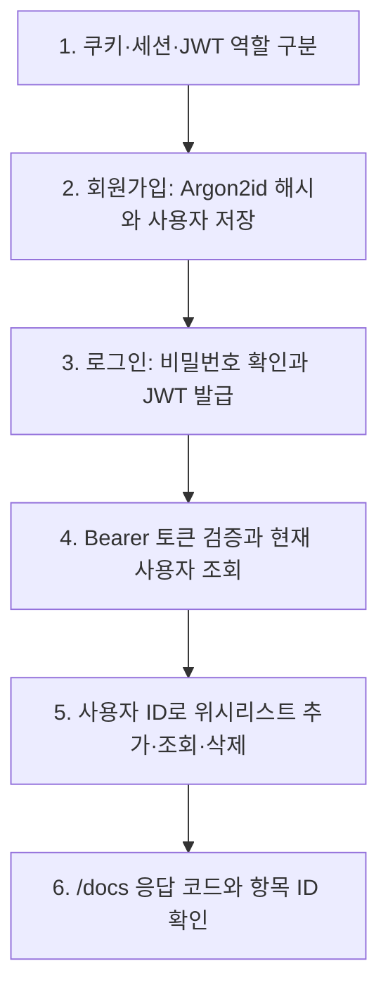

# 26.10.28 67일차(FastAPI 인증 · JWT · 개인 위시리스트)

## [TIL] 로그인 토큰으로 사용자를 확인하고 개인 위시리스트 구현하기

오늘은 쿠키·세션·토큰의 차이를 정리하고, `fastapi_basic`의 게시글 인증·인가 흐름을 확인했다. 이어 `fastapi_prac`에 회원가입, JWT 로그인, 현재 사용자 조회, 개인 위시리스트를 연결하고 `/docs`의 실제 응답으로 ID와 오류 상태를 구분했다.

이론과 실습은 다음 흐름으로 이어졌다.



```plaintext
1. 쿠키·세션·JWT 역할 구분
→ 2. 회원가입: Argon2id 해시와 사용자 저장
→ 3. 로그인: 비밀번호 확인과 JWT 발급
→ 4. Bearer 토큰 검증과 현재 사용자 조회
→ 5. 사용자 ID로 위시리스트 추가·조회·삭제
→ 6. /docs 응답 코드와 항목 ID 확인
```

---

## 1. 인증과 로그인 상태를 구분하기

### 1-1. 인증과 인가

**인증(Authentication)**은 요청한 사용자가 누구인지 확인한다. **인가(Authorization)**는 확인된 사용자가 그 작업을 할 권한이 있는지 판단한다. HTTP는 요청 사이의 로그인 상태를 자동으로 기억하지 않으므로, 이후 요청에는 세션 ID나 토큰 같은 식별 수단이 필요하다.

| 구분 | 확인하는 질문 | 이 실습의 예 |
|---|---|---|
| 인증 | 누구인가? | `Depends(get_current_user)`로 Bearer 토큰의 사용자 확인 |
| 인가 | 이 작업을 해도 되는가? | 게시글 작성자 또는 위시리스트 항목 소유자 비교 |

### 1-2. 쿠키·세션·토큰·JWT

이 네 단어는 같은 층위의 선택지가 아니다. 쿠키는 브라우저의 저장·전송 수단이고, 세션은 서버에 상태를 두는 방식이며, JWT는 토큰의 한 형식이다.

| 개념 | 역할 | 저장·검증 방식 |
|---|---|---|
| 쿠키(Cookie) | 브라우저가 요청에 값을 자동 전송 | 세션 ID나 JWT를 담을 수 있음 |
| 세션(Session) | 서버에 로그인 상태 보관 | 브라우저가 보낸 세션 ID로 DB·메모리·Redis 등의 상태 조회 |
| 토큰(Token) | 인증·접근에 제시하는 값 | 클라이언트가 요청에 동봉 |
| JWT(JSON Web Token) | 정보를 담는 토큰 형식 | 서버가 서명과 만료 시각을 검증 |

쿠키의 `HttpOnly`는 JavaScript의 직접 접근을 막고, `Secure`는 HTTPS 전송으로 제한한다. 서명형 JWT의 페이로드는 Base64URL 인코딩이므로 읽을 수 있으며 비밀번호를 넣지 않는다. 서명 검증은 단순 디코딩과 다르다.

**Access Token**은 API 접근에, **Refresh Token**은 Access Token 재발급에 사용한다. 이는 역할 구분이고 JWT는 형식 구분이다. `fastapi_prac`은 Refresh Token 없이 JWT Access Token만 발급한다. 서버는 이 Access Token 문자열을 DB에 저장하지 않지만, 사용자와 비밀번호 해시는 DB에 저장하고 인증 요청 때 토큰의 `sub`로 사용자를 다시 조회한다. JWT를 즉시 개별 폐기하려면 별도 상태 관리가 필요하다.

---

## 2. `fastapi_basic`에서 인증·인가 흐름 확인하기

### 2-1. 회원가입과 JWT 발급

`fastapi_basic/mysite_auth/services/auth_service.py`의 `signup()`은 이메일을 소문자로 통일하고 비밀번호를 해시한 뒤, 중복을 확인하고 사용자 저장을 요청한다. `with db.begin()`은 서비스가 DB 작업의 확정·취소 범위를 정한다. 실제 조회와 `db.add()`는 `user_repository`가 맡는다.

```python
# fastapi_basic/mysite_auth/services/auth_service.py — AuthService.signup()
email = str(data.email).lower()
hashed_password = hash_password(data.password)
with db.begin():
    if user_repository.find_by_email(db, email) is not None:
        raise HTTPException(status_code=status.HTTP_409_CONFLICT, detail="이미 등록된 이메일입니다.")
    user = User(email=email, hashed_password=hashed_password)
    user_repository.save(db, user)
```

입력은 이메일·비밀번호이고, 성공 시 비밀번호 해시를 제외한 사용자 정보를 반환한다. `security.py`의 `PasswordHash.recommended()`는 Argon2id 비밀번호 해시에 사용한다. JWT의 `HS256`은 별개로 토큰 서명에 사용한다.

`fastapi_basic/security.py`와 `fastapi_prac/security.py`의 `create_access_token()`은 사용자 ID와 발급·만료 시각을 담아 JWT를 만든다. `sub`는 문자열이며 `iat`, `exp`를 포함한다.

```python
# fastapi_prac/security.py — create_access_token()
now = datetime.now(timezone.utc)
payload = {
    "sub": str(user_id),
    "iat": now,
    "exp": now + timedelta(minutes=JWT_EXPIRE_MINUTES),
}
return jwt.encode(payload, JWT_SECRET_KEY, algorithm=ALGORITHM)
```

입력은 사용자 ID이고 출력은 서명된 Access Token 문자열이다. `JWT_SECRET_KEY`는 서버 설정으로 관리하며 토큰에 넣지 않는다. `fastapi_prac/routers/auth_router.py`의 로그인 응답은 `access_token`과 `token_type: "bearer"`를 반환하고, 토큰이 담긴 응답에 `Cache-Control: no-store`를 설정한다.

### 2-2. 토큰에서 현재 사용자 찾기

`fastapi_prac/dependencies.py`의 `get_current_user()`는 `HTTPBearer`가 추출한 토큰을 인증 서비스에 넘긴다. 서비스는 `decode_access_token()`으로 서명·만료를 검사하고 `sub`의 ID로 DB에서 사용자를 조회한다. `Bearer`는 HTTP 인증 헤더의 방식이며 JWT 자체의 이름이 아니다.

```python
# fastapi_prac/dependencies.py — get_current_user()
bearer_scheme = HTTPBearer(bearerFormat="JWT", auto_error=False)

def get_current_user(
    credentials: Annotated[HTTPAuthorizationCredentials | None, Depends(bearer_scheme)],
) -> UserResponse:
    if credentials is None:
        raise authentication_error("로그인이 필요합니다.")
    with SessionLocal() as db:
        user = auth_service.get_current_user(db, credentials.credentials)
        return UserResponse.model_validate(user)
```

인증 요청의 헤더는 `Authorization: Bearer <access_token>`이다. `Depends(get_current_user)`를 붙인 라우트만 이 검증을 먼저 수행한다. 토큰이 없거나 유효하지 않거나 토큰의 사용자가 없으면 `401`을 반환한다.

### 2-3. 게시글에서 인증과 인가 분리

`fastapi_basic/mysite_auth/routers/post_router.py`는 작성·수정·삭제에 `get_current_user`를 붙인다. 공개 목록·상세 조회에는 붙이지 않는다. `post_service.py`는 작성 시 `current_user.id`를 `user_id`로 저장하고, 수정·삭제 시 기존 작성자 ID와 비교해 다른 사용자면 `403`을 반환한다.

| 요청 | 인증 | 추가 인가 |
|---|---|---|
| 게시글 목록·상세 | 없음 | 없음 |
| 내 게시글 조회·작성 | 필요 | 인증된 사용자 ID 사용 |
| 게시글 수정·삭제 | 필요 | `post.user_id == current_user.id` 확인 |

---

## 3. `fastapi_prac` 개인 위시리스트 구현하기

### 3-1. 외래 키·고유 제약·상품 관계

`fastapi_prac/models/wishlist_item.py`의 `WishlistItem`은 사용자와 상품을 각각 외래 키로 참조한다. 같은 사용자가 같은 상품을 두 번 담지 못하도록 `(user_id, product_id)`에 고유 제약을 둔다. 서로 다른 사용자는 같은 상품을 담을 수 있다.

```python
# fastapi_prac/models/wishlist_item.py — WishlistItem
__table_args__ = (
    UniqueConstraint("user_id", "product_id", name="uq_wishlist_user_product"),
)
id: Mapped[int] = mapped_column(primary_key=True, autoincrement=True)
user_id: Mapped[int] = mapped_column(ForeignKey("users.id"), nullable=False)
product_id: Mapped[int] = mapped_column(
    ForeignKey("products.id", ondelete="CASCADE"), nullable=False
)
product: Mapped["Product"] = relationship("Product")
```

`ondelete="CASCADE"`는 상품 삭제 시 DB가 연결된 위시리스트 항목도 삭제하도록 지정한다. `relationship("Product")`는 `item.product`로 상품 정보를 읽기 위한 ORM 관계다. 삭제 API에서는 상품 자체가 아니라 위시리스트 항목 행을 삭제한다.

### 3-2. 라우터 → 서비스 → 레포지토리

`fastapi_prac/routers/wishlist_router.py`의 모든 API에는 `Depends(get_current_user)`가 있다. POST의 요청 본문에는 `product_id`만 받고 `user_id`는 인증된 사용자의 ID에서 얻는다. 서비스는 상품 존재·중복 여부와 항목 소유권을 판단하고, 레포지토리는 SQL 조회·저장을 실행한다.

| 메서드·경로 | 성공 | 주요 실패 조건 |
|---|---|---|
| `POST /me/wishlist` | `201`, 항목 `id`, `user_id`, `product_id` | 상품 없음 `404`, 중복 `400`, 입력 오류 `422` |
| `GET /me/wishlist` | `200`, 본인 항목과 상품 정보 | 토큰 오류 `401` |
| `DELETE /me/wishlist/{wishlist_item_id}` | `204`, 본문 없음 | 항목 없음 `404`, 다른 사용자 항목 `403` |

`fastapi_prac/services/wishlist_service.py`의 `add_item()`은 상품 조회, 중복 검사, 항목 저장을 한 트랜잭션으로 묶는다. `delete_item()`은 항목을 ID로 찾은 뒤 `item.user_id`와 인증된 사용자 ID를 비교한다. 상품 ID와 위시리스트 항목 ID는 별개다.

```python
# fastapi_prac/services/wishlist_service.py — WishlistService.delete_item()
with db.begin():
    item = wishlist_repository.find_by_id(db, wishlist_item_id)
    if item is None:
        raise HTTPException(status_code=status.HTTP_404_NOT_FOUND, detail="위시리스트 항목을 찾을 수 없습니다.")
    if item.user_id != user_id:
        raise HTTPException(status_code=status.HTTP_403_FORBIDDEN, detail="본인의 위시리스트 항목만 삭제할 수 있습니다.")
    wishlist_repository.delete(db, item)
```

입력은 위시리스트 항목 ID와 인증된 사용자 ID이며 성공 시 `204`로 본문 없이 종료한다. `product_repository.find_by_id()`는 상품 테이블을 조회하므로 위시리스트 항목 삭제 대상 조회에 대신 쓸 수 없다.

### 3-3. 목록 조회에서 상품을 함께 가져오기

`fastapi_prac/repositories/wishlist_repository.py`의 `find_by_user_id()`는 현재 사용자 항목만 조회한다. `WishlistItem` 한 건에 연결된 `Product`는 한 건이므로 `joinedload()`로 같은 조회에서 상품을 가져온다.

```python
# fastapi_prac/repositories/wishlist_repository.py — find_by_user_id()
stmt = (
    select(WishlistItem)
    .where(WishlistItem.user_id == user_id)
    .options(joinedload(WishlistItem.product))
    .order_by(WishlistItem.id)
)
return db.scalars(stmt).all()
```

목록 스키마의 항목 `id`는 **위시리스트 항목 ID**이고, 중첩 `product.id`는 **상품 ID**다. 전날 다룬 `selectinload()`는 여러 댓글 같은 컬렉션에 적합했고, 이 조회는 각 항목의 상품 한 건이므로 `joinedload()`를 선택했다.

---

## 4. `/docs` 실행 결과와 오류 해석

### 4-1. 관찰된 응답

오늘 Swagger UI의 실제 `Server response`와 문서의 `Example Value`를 구분해 확인했다. 아래 수치는 화면에 표시된 요청·응답이며, 전체 테스트 통과를 뜻하지는 않는다.

| 실행 조건 | 실제 응답 | 확인한 의미 |
|---|---|---|
| 회원가입 비밀번호 `123456789`(9자) | `422`, 최소 15자 오류 | `UserCreate` 입력 검증 동작 |
| Bearer 헤더 없는 `GET /me/wishlist` | `401`, 로그인 필요 | 인증 의존성이 요청을 차단 |
| 존재하지 않는 상품을 담으려는 POST | `404`, 상품을 찾을 수 없음 | 상품 존재 검사 동작 |
| 이미 담긴 `product_id: 1`로 POST | `400`, 이미 담은 상품 | 중복 검사 동작 |
| 로그인한 사용자의 GET 목록 | `200`, 항목 `id: 2`, 중첩 상품 `id: 1`, `final_price: 100` | 목록의 두 ID가 서로 다름 |
| `DELETE /me/wishlist/0` | `404`, 항목을 찾을 수 없음 | 항목 ID 0은 존재하지 않음 |

`POST` 문서 아래쪽의 `201 Example Value`에 보인 `id: 0`은 실제 저장 결과가 아니라 자동 예시였다. 실제 삭제 대상은 `GET /me/wishlist`의 `Server response → Response body`에 나온 위시리스트 항목 `id: 2`였다. 이 대화에서 `DELETE /me/wishlist/2`의 최종 성공 응답은 확인하지 않았으므로 재검증이 필요하다.

### 4-2. 오류에서 확인한 원인과 대응

| 현상 | 확인된 원인 | 대응 | 결과 또는 다음 확인 |
|---|---|---|---|
| 조회가 `401` | 요청의 Curl에 `Authorization` 헤더가 없었음 | 로그인 응답 토큰을 Swagger `Authorize`에 입력 | 이후 헤더가 포함된 GET에서 `200` 확인 |
| 상품 담기가 `404` | 요청 상품 ID에 해당하는 상품이 없었음 | 실제 상품 ID 확인 | 이후 상품 `id: 1`의 항목이 목록에 나타남 |
| 다시 담기가 `400` | 같은 사용자의 같은 상품 항목이 이미 있음 | 중복 추가 대신 목록 조회 | GET에서 항목 `id: 2` 확인 |
| 삭제가 `404` | 상품 ID와 항목 ID를 혼동하고 항목 ID `0`을 입력 | GET의 최상위 `id`를 삭제 경로에 사용 | `DELETE /me/wishlist/2` 재검증 필요 |

비교 대상은 요청 경로의 ID와 목록 응답의 두 ID였다. 실제 목록에서 **항목 ID 2와 상품 ID 1**이 달랐으므로, 삭제 경로에는 상품 ID 대신 항목 ID를 쓰기로 했다.

---

## 5. 헷갈린 점

처음에는 `joinedload()`와 `selectinload()`를 함께 쓰는 이유가 같은 관계를 두 번 읽기 때문이라고 생각했다. `fastapi_basic/mysite_nplusone/repositories/post_repository.py`에서는 작성자 한 명과 댓글 여러 건이라는 **서로 다른 관계**에 각각 적용했고, 둘 다 같은 로딩 방식으로 처리할 수도 있지만 결과 행 수와 쿼리 수의 차이를 고려한 선택이었다.

처음에는 사용자와 비밀번호를 DB에 저장하므로 Access Token도 매번 DB에 저장해야 한다고 생각했다. 실제 코드는 비밀번호 해시를 DB에 저장하고 로그인에서 검증한 뒤 JWT를 발급한다. 이후 요청은 JWT 서명·만료 검증 후 `sub`의 사용자 ID로 DB에서 사용자를 확인한다.

처음에는 위시리스트 삭제에 `product_id`를 넣어야 한다고 생각했다. 실제 응답의 최상위 `id`는 위시리스트 항목 ID이고 중첩 `product.id`는 상품 ID였다. 삭제 API가 요구하는 값은 전자다.

---

## 오늘 배운 것 정리

- 인증은 사용자 확인이고 인가는 그 사용자의 작업 권한 확인이다.
- 쿠키는 전달 수단, 세션은 서버 상태 관리 방식, JWT는 토큰 형식이다.
- Access Token과 Refresh Token은 역할 구분이며 이 실습은 JWT Access Token만 사용한다.
- Argon2id는 비밀번호 해시, HS256은 JWT 서명에 쓰인다.
- 서비스는 로그인·위시리스트 절차와 트랜잭션을 조정하고 레포지토리는 DB 조회·저장을 맡는다.
- `Depends(get_current_user)`는 Bearer 토큰을 검증해 현재 사용자를 라우터에 전달한다.
- 위시리스트 `user_id`는 요청 본문이 아니라 인증된 사용자에서 가져온다.
- `joinedload(WishlistItem.product)`는 항목별 상품 한 건을 함께 조회한다.
- 삭제 경로에는 `product.id`가 아니라 위시리스트 항목의 `id`를 사용한다.

실제 요청을 확인할 때는 다음 순서로 생각하면 된다.

```plaintext
로그인 응답의 Access Token 확인
→ Swagger Authorize에 토큰 입력
→ 실제 Server response의 코드와 본문 확인
→ 목록의 항목 ID로 삭제 요청
→ 삭제 후 목록 재조회로 결과 검증
```

#부트캠프 #멀티캠퍼스부트캠프 #AI캠퍼스 #AI에이전트엔지니어
