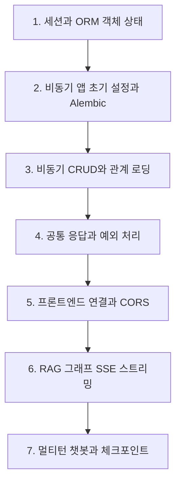
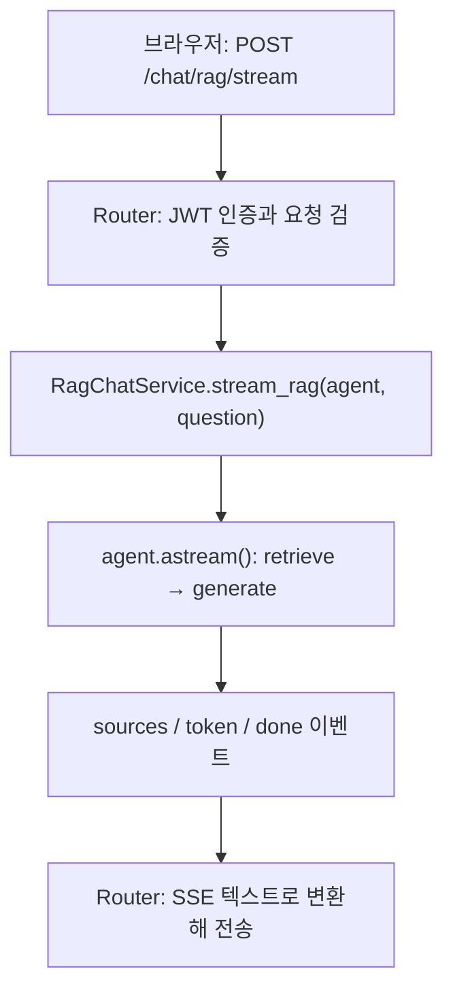

# 26.10.29 68일차(FastAPI Agent · 비동기 ORM · RAG 스트리밍 · 멀티턴 체크포인트)

## [TIL] 비동기 FastAPI 위에 RAG·챗봇 Agent를 연결하고 SSE로 스트리밍하기

오늘은 ORM 객체의 **세션 상태**를 정리한 뒤, `fastapi_agent`에 **비동기 DB 연결**, **Alembic 마이그레이션**, **공통 응답·예외 처리**, **CORS**를 구성했다. 이어 `frontend`와 연결하고 **RAG 그래프**의 답변을 **SSE**로 흘려보냈으며, **체크포인터**로 대화 맥락이 유지되는 **멀티턴 챗봇**까지 확인했다.

이론과 실습은 다음 흐름으로 이어졌다.



```plaintext
1. 세션과 ORM 객체 상태
→ 2. 비동기 앱 초기 설정과 Alembic
→ 3. 비동기 CRUD와 관계 로딩
→ 4. 공통 응답과 예외 처리
→ 5. 프론트엔드 연결과 CORS
→ 6. RAG 그래프 SSE 스트리밍
→ 7. 멀티턴 챗봇과 체크포인트
```

---

## 1. 세션과 ORM 객체 상태

### 1-1. 객체 상태 5가지

`expire_on_commit=False`인 동기 `Session`을 기준으로 ORM 객체가 거치는 상태를 정리했다. 상태 이름을 외우기보다 "지금 세션이 이 객체를 관리하고 있나?"를 기준으로 읽으면 된다.

| 상태 | 뜻 |
|---|---|
| 비영속(transient) | 생성했지만 아직 세션에 등록하지 않은 새 객체 |
| 대기(pending) | 세션에 등록했지만 아직 INSERT가 실행되지 않은 객체 |
| 영속(persistent) | DB에서 조회했거나 INSERT를 실행한 뒤 세션이 관리하는 객체 |
| 삭제(deleted) | DELETE가 실행되었지만 아직 commit되지 않은 객체 |
| 분리(detached, 준영속) | DB 식별 정보는 유지하지만 세션에서 분리되어 관리받지 않는 객체 |

영속 상태라도 commit 전에는 저장이 확정된 것이 아니다.

### 1-2. 추가·수정·관계 추가·삭제

`add()`는 등록만 하고 INSERT는 flush할 때 실행된다. `begin` 블록이 정상 종료되면 flush와 commit이 자동으로 진행된다.

```python
with SessionLocal() as db:
    with db.begin():
        post = Post(title="첫 번째 글")  # 비영속
        db.add(post)                     # 대기: 등록만, INSERT 전
        db.flush()                       # INSERT 실행 → 영속
    # commit: 저장 확정, post는 영속 유지
# 세션 종료: post는 분리 상태
```

영속 객체는 세션이 변경을 감지하므로 다시 `add()`할 필요가 없고, UPDATE는 속성을 바꾸는 순간이 아니라 flush할 때 실행된다.

```python
with SessionLocal() as db:
    with db.begin():
        post = db.get(Post, post_id)   # SELECT → 영속
        post.title = "수정된 제목"      # 변경 사항 추적
        db.flush()                     # UPDATE 실행
```

미조회 상태인 `post.comments`에 접근하면 댓글 목록을 조회하고, 관계의 기본 `save-update cascade`가 새 댓글도 세션에 등록하므로 `db.add(comment)`가 필요 없다. 댓글의 `post_id`는 flush할 때 설정된다.

```python
with SessionLocal() as db:
    with db.begin():
        post = db.get(Post, post_id)
        comment = Comment(content="좋은 글입니다")  # 비영속
        post.comments.append(comment)               # 댓글 목록 SELECT 후 추가, comment는 대기
        db.flush()                                  # 댓글 INSERT → 영속
```

`delete()` 호출 시점과 DELETE 실행 시점은 다르다. 삭제가 확정되어도 파이썬 객체는 남지만 해당 DB 행은 삭제된다.

```python
with SessionLocal() as db:
    with db.begin():
        comment = db.get(Comment, comment_id)  # 영속
        db.delete(comment)                     # 삭제 대상 지정
        db.flush()                             # DELETE 실행 → 삭제 상태
    # commit: 삭제 확정 → comment는 분리 상태
```

### 1-3. DTO 변환 시점에 따른 차이

게시글 DTO(`PostDTO`)에 댓글 목록이 들어 있고 `from_attributes=True`가 설정되어 있다고 가정했다. 같은 DTO 변환이라도 세션이 열려 있는지, 관계를 미리 읽었는지에 따라 결과가 달라진다.

| 상황 | DTO 변환 시 일어나는 일 |
|---|---|
| `begin` 밖이지만 세션은 열림, 댓글 미조회 | `post.comments` 접근 시 새 트랜잭션에서 지연 로딩(댓글 SELECT) |
| `selectinload(Post.comments)`로 미리 조회 | 이미 읽은 값을 사용하므로 추가 SELECT 없음 |
| 세션까지 닫힌 뒤 변환 | 댓글을 조회할 세션이 없어 `DetachedInstanceError`가 Pydantic `ValidationError`에 담김 |

```python
with SessionLocal() as db:
    with db.begin():
        post = db.scalar(
            select(Post).where(Post.id == post_id).options(selectinload(Post.comments))
        )  # 게시글 SELECT + 댓글 SELECT → 모두 영속
    dto = PostDTO.model_validate(post)  # 추가 SELECT 없음
```

---

## 2. 비동기 앱 초기 설정과 Alembic

### 2-1. 프로젝트 구조와 비동기를 쓰는 이유

`src` 안에 역할별로 세 패키지를 둔다. 도메인(`users`, `posts`, `comments`, `chat`) 안에서는 `router.py`가 요청·응답, `service.py`가 업무 규칙, `repository.py`가 DB 접근, `models.py`가 SQLAlchemy 모델, `schemas.py`가 Pydantic 모델을 맡는다.

| 패키지 | 역할 |
|---|---|
| `fastapi_agent` | HTTP 요청·응답, 인증, 업무 규칙, 서비스 데이터 관리 (`main.py`, `core/`, `domains/`) |
| `agents` | 챗봇과 RAG Agent의 구성·실행 (`chatbot/`, `rag/`) |
| `rag` | 문서 로딩·분할, 임베딩, 벡터 저장소와 검색 |

게시글 API는 DB 응답을, 채팅 API는 외부 LLM 응답을 기다린다. `async def`에서 비동기 호출을 `await`하면 기다리는 동안 이벤트 루프가 다른 요청을 처리한다. 다만 비동기 전환만으로 개별 쿼리나 LLM 응답 시간이 줄지는 않는다.

FastAPI는 일반 `def` 경로 함수를 스레드 풀에서 실행하지만 동기 I/O를 기다리는 동안 스레드가 점유된다. 그래서 Router의 `async def`와 함께 DB 엔진·세션, 외부 API 클라이언트도 비동기 API를 쓰고 Service·Repository에서 `await`로 잇는다. `async def` 안에서 동기 DB·HTTP 호출을 직접 실행하면 이벤트 루프가 막히고, FastAPI가 이를 자동으로 스레드 풀에 보내주지도 않는다.

### 2-2. 환경 설정: Pydantic Settings

`os.getenv()`만 쓰면 `.env` 로딩, 타입 변환, 필수 값 검사를 따로 처리해야 한다. `pydantic-settings`의 설정 클래스에 타입과 조건을 선언하면 이를 한 번에 처리한다. `.env`에는 `DATABASE_URL`, `JWT_SECRET_KEY`(`openssl rand -hex 32`로 생성), `JWT_EXPIRE_MINUTES`, `DB_ECHO`를 둔다.

```python
# src/fastapi_agent/core/config.py
@lru_cache
def get_settings() -> Settings:
    return Settings()
```

`Settings`는 `database_url`, `jwt_secret_key: SecretStr = Field(min_length=32)`, `jwt_expire_minutes: int = Field(default=30, gt=0)`, `db_echo: bool = False`를 선언하고 `SettingsConfigDict(env_file=".env", extra="ignore")`로 읽는다. `@lru_cache` 덕분에 `get_settings()`를 다시 호출해도 같은 객체를 재사용한다.

### 2-3. 비동기 엔진과 세션

`postgresql+psycopg://` 주소는 `create_async_engine()`에 전달하면 psycopg의 비동기 연결을 사용한다. 동기 API는 다음과 같이 바뀐다.

| 동기 코드 | 비동기 코드 |
|---|---|
| `create_engine()` | `create_async_engine()` |
| `sessionmaker()` | `async_sessionmaker()` |
| `Session` | `AsyncSession` |
| `def get_db()` | `async def get_db()` |
| `with SessionLocal()` | `async with SessionLocal()` |

```python
# src/fastapi_agent/core/database.py
engine = create_async_engine(settings.database_url, echo=settings.db_echo)
SessionLocal = async_sessionmaker(bind=engine, expire_on_commit=False)


async def get_db() -> AsyncIterator[AsyncSession]:
    async with SessionLocal() as db:
        yield db
```

`expire_on_commit` 기본값 `True`는 commit 후 속성을 만료시킨다. Pydantic 응답 모델을 만들 때는 만료된 속성의 자동 재조회를 `await`할 수 없으므로 `False`로 두어 이미 읽은 값을 응답에 쓴다.

### 2-4. Alembic 초기화와 모델 연결

**마이그레이션**은 테이블 생성이나 컬럼 추가처럼 DB 구조를 바꾸는 작업이고, Alembic은 이를 파일로 기록해 순서대로 적용하며 어디까지 적용했는지 관리한다. 같은 파일로 개발·배포 DB에 같은 변경을 적용할 수 있다.

```bash
uv run alembic init -t async alembic
```

`alembic/env.py`에서 `get_settings().database_url`을 연결 주소로 쓰고 `target_metadata = Base.metadata`로 지정한다. 모델 모듈(`User`, `Post`, `Comment`, `ChatRoom`, `ChatMessage`)을 import해야 테이블 정보가 `Base.metadata`에 등록된다. `Base`만 import하면 비교할 테이블이 누락될 수 있다.

```python
# alembic/env.py
def include_name(name, type_, parent_names):
    # 체크포인트 테이블은 AsyncPostgresSaver가 관리한다.
    checkpoint_tables = {"checkpoints", "checkpoint_blobs", "checkpoint_writes", "checkpoint_migrations"}
    return type_ != "table" or name not in checkpoint_tables
```

`include_name()`은 체크포인터가 관리하는 테이블을 자동 변경 감지에서 제외한다. 채팅방·메시지 테이블은 Alembic이, 체크포인트 테이블은 `AsyncPostgresSaver`가 관리한다. Windows에서는 `asyncio.run(..., loop_factory=lambda: asyncio.SelectorEventLoop(selectors.SelectSelector()))`로 이벤트 루프를 지정한다.

### 2-5. 최초 테이블 생성과 컬럼 추가

흐름은 `revision --autogenerate`로 변경 파일을 만들고, 내용을 확인한 뒤 `upgrade head`로 적용하는 순서다. 변경 파일을 만드는 것만으로는 테이블 SQL이 실행되지 않는다.

```bash
uv run alembic revision --autogenerate -m "create initial tables"
uv run alembic upgrade head
```

이후 `Post`에 `created_at`을 추가했다. 모델 파일을 고쳐도 DB는 자동으로 바뀌지 않으므로 초기 마이그레이션은 유지하고 새 마이그레이션을 만든다.

```python
# src/fastapi_agent/domains/posts/models.py
created_at: Mapped[datetime] = mapped_column(
    DateTime(timezone=True), server_default=func.now(), nullable=False,
)
```

```bash
uv run alembic revision --autogenerate -m "add post created_at"
uv run alembic upgrade head
```

`alembic/versions/ac0bf16a2c23_add_post_created_at.py`의 `down_revision`은 초기 마이그레이션 `3cef28c1cb4b`를 가리키고, `upgrade()`는 `op.add_column("posts", ...)`, `downgrade()`는 `op.drop_column("posts", "created_at")`을 실행한다. `server_default=func.now()`는 값을 생략한 INSERT에서 DB가 현재 트랜잭션 시작 시각을 채우는 기본값이다. 생성된 파일에 의도하지 않은 변경이나 삭제가 없는지 확인해야 한다.

### 2-6. lifespan과 실행

`lifespan`은 앱이 요청을 받기 전에 공용 자원을 준비하고 종료할 때 정리하는 흐름이다. 비동기 엔진은 요청들이 공유하므로 종료 시 연결 풀을 정리한다. 테이블 생성·변경은 앱 시작 코드가 아니라 Alembic 명령으로 적용한다.

```python
@asynccontextmanager
async def lifespan(app: FastAPI):
    try:
        yield
    finally:
        await engine.dispose()


app = FastAPI(lifespan=lifespan)
```

`pyproject.toml`의 `[tool.fastapi] entrypoint = "fastapi_agent.main:app"`로 진입점을 지정하고 `uv run fastapi dev`로 `http://127.0.0.1:8000`에서 실행한다. `uv sync`로 설치한 패키지를 쓰므로 모듈 경로에 `src`를 넣지 않는다.

---

## 3. 비동기 CRUD와 관계 로딩

### 3-1. lazy="raise"와 MissingGreenlet

비동기 세션에서는 `post.user` 같은 일반 속성 접근으로 생긴 DB I/O를 `await`할 수 없어 `MissingGreenlet` 오류가 날 수 있다. 응답 모델 변환·직렬화도 관계 속성을 동기적으로 읽는다. 그래서 관계에 `lazy="raise"`를 설정해 암묵적인 조회를 막고, 응답에 필요한 관계는 미리 로딩한다.

```python
# domains/posts/models.py (Post 발췌)
user: Mapped["User"] = relationship(back_populates="posts", lazy="raise")
```

로딩하지 않은 관계에 접근하면 SQL 대신 `InvalidRequestError`가 발생하고, 이미 로딩한 관계는 일반 속성처럼 읽힌다. `joinedload()`/`selectinload()`를 적용한 조회를 `await db.scalar(...)`/`await db.scalars(...)`하면 완료 시 지정한 관계도 로딩된다.

게시글을 `user_id=current_user.id`로 만들면 작성자 ID만 지정한 것이라 `post.user`까지 로딩되지는 않는다. 그래서 저장 후 `joinedload(Post.user)` 조회를 `await`하거나 `await db.refresh(post, ["user"])`로 관계를 로딩한 뒤 반환한다.

### 3-2. await를 붙이는 대상

`Router → await Service → await Repository → await DB I/O`로 이어지며, 호출별 규칙은 다음과 같다.

| 작업 | 비동기 호출 |
|---|---|
| 객체 등록 | `db.add(post)` |
| 속성 변경 | `post.title = data.title` |
| flush | `await db.flush()` |
| 단일 조회 | `await db.scalar(...)`, `await db.get(...)` |
| 목록 조회 | `await db.scalars(...)` |
| 버퍼링된 결과 읽기 | `result.all()` |
| 삭제 등록 | `await db.delete(post)` |

객체 등록·속성 변경·버퍼링된 결과 읽기에는 `await`를 붙이지 않는다. `delete()`는 관계 처리 중 DB I/O가 필요할 수 있어 `await`를 쓴다.

### 3-3. Repository·Service·Router 코드

Repository의 `find_by_id()`는 작성자와 댓글(및 댓글 작성자)을 한 번에 로딩한다.

```python
# domains/posts/repository.py (PostRepository 발췌)
async def find_by_id(self, db: AsyncSession, post_id: int) -> Post | None:
    return await db.scalar(
        select(Post)
        .options(
            joinedload(Post.user),
            selectinload(Post.comments).joinedload(Comment.user),
        )
        .where(Post.id == post_id)
    )
```

Service는 트랜잭션 블록에 `async with db.begin()`을 쓰고, 저장 뒤 상세 조회를 `await`해 응답에 필요한 관계를 준비한다.

```python
# domains/posts/service.py (PostService 발췌)
async def create_post(self, db, data: PostCreate, current_user: UserResponse) -> Post:
    async with db.begin():
        post = Post(title=data.title, content=data.content, user_id=current_user.id, comments=[])
        await post_repository.save(db, post)
        result = await self.get_post(db, post.id)
    return result
```

Router는 `async def`로 선언하고 Service 호출에 `await`를 붙인다. 인증 의존성도 `async with SessionLocal() as db:`로 세션을 열고 `await user_service.get_current_user(...)`를 호출한다(`core/dependencies.py`의 `get_current_user`).

### 3-4. 비동기 함수 안의 동기 연산

비밀번호 해싱·검증은 동기 연산이라 비동기 Service에서 직접 실행하면 이벤트 루프를 점유한다. `run_in_threadpool()`로 별도 스레드에서 실행하고 완료를 기다린다.

```python
from starlette.concurrency import run_in_threadpool

hashed_password = await run_in_threadpool(hash_password, data.password)
valid = await run_in_threadpool(verify_password, data.password, user.hashed_password)
```

---

## 4. 공통 응답과 예외 처리

### 4-1. 응답 규칙과 구성 파일

공통 응답은 성공 데이터는 `data`, 안내 문구는 `message`, 오류는 `error`에 담는 규칙이다. 클라이언트가 데이터 추출과 오류 처리 코드를 재사용할 수 있고, FastAPI가 응답 구조를 검증하고 API 문서에 표시한다. 성공 여부는 HTTP 상태 코드로 구분한다.

| 상황 | 상태 코드 | 응답 본문 |
|---|---|---|
| 조회·수정·로그인 성공 | 200 | `{"data": ..., "message": ...}` |
| 생성 성공 | 201 | `{"data": ..., "message": ...}` |
| 삭제 성공 | 200 | `{"data": null, "message": "삭제 안내 문구"}` |
| 요청 처리 실패 | 4xx, 5xx | `{"error": ...}` |

| 파일 | 역할 |
|---|---|
| `core/responses.py` | 성공·오류 응답 모델과 API 문서용 오류 예시 |
| `core/exceptions.py` | 오류 종류별 예외 클래스와 공통 부모 `ApiException` |
| `core/exception_handlers.py` | 예외를 공통 HTTP 오류 응답으로 변환 |
| `main.py` | 전역 예외 핸들러 등록 |
| 도메인 `router.py` / `service.py` | 성공 응답 생성 / 업무 조건에 따른 예외 발생 |

### 4-2. 성공 응답 모델 SuccessResponse[T]

`class SuccessResponse[T](BaseModel)`는 제네릭 클래스로, `T`로 `data`의 타입을 지정해 같은 구조를 재사용한다.

```python
# core/responses.py
class SuccessResponse[T](BaseModel):
    data: T
    message: str | None = None
```

| 모델 | data의 내용 |
|---|---|
| `SuccessResponse[UserResponse]` | 회원 한 명 |
| `SuccessResponse[PostDetailResponse]` | 게시글 한 개 |
| `SuccessResponse[list[PostListResponse]]` | 게시글 목록 |
| `SuccessResponse[TokenResponse]` | 토큰과 토큰 타입 |
| `SuccessResponse[None]` | 삭제 완료 시 null |

Router는 `response_model=SuccessResponse[PostDetailResponse]`, `status_code=status.HTTP_201_CREATED`를 선언하고 `SuccessResponse[PostDetailResponse](data=post, message="게시글이 등록되었습니다.")`를 반환한다(`domains/posts/router.py`의 `create_post()`). `error_responses(401)`은 Swagger에 401 응답 모델과 예시를 표시하는 문서용 함수이며 오류를 발생시키지 않는다. 게시글이 없는 목록은 `{"data": [], "message": null}`이다.

### 4-3. 오류 모델과 커스텀 예외

예외 처리를 공통화하는 목적은 클라이언트가 어떤 API의 오류든 같은 방식으로 처리하게 하는 것이다. `error.code`로 종류를 구분하고 `error.message`를 화면에 표시한다.

| 구성 요소 | 종류 | 역할 |
|---|---|---|
| `ValidationIssue` | Pydantic 모델 | 입력 검증 오류 한 건의 위치(`loc`)·설명(`msg`)·종류(`type`) |
| `ErrorDetail` | Pydantic 모델 | 오류 코드·메시지·검증 오류 목록(`details`) |
| `ErrorResponse` | Pydantic 모델 | `{"error": ...}` 전체 본문 |
| `ApiException` | 공통 부모 예외 | 상태 코드·오류 코드·메시지·헤더 보관 |
| `NotFoundException` 등 | 자식 예외 | 오류 종류별 상태 코드와 기본 메시지 |
| `api_exception_handler()` | 핸들러 | 예외를 받아 오류 모델 본문과 상태 코드·헤더로 응답 |

| 예외 클래스 | 상태 코드 | 사용 상황 |
|---|---|---|
| `NotFoundException` | 404 | 조회 대상이 없음 |
| `UnauthorizedException` | 401 | 인증 정보가 없거나 유효하지 않음 (`WWW-Authenticate: Bearer` 자동 지정) |
| `ForbiddenException` | 403 | 해당 작업을 수행할 권한이 없음 |
| `ConflictException` | 409 | 이메일 중복 등 현재 데이터와 충돌 |

Service는 상황에 맞는 예외를 선택해 `raise`한다. 같은 `NotFoundException`도 `code`를 `POST_NOT_FOUND`, `COMMENT_NOT_FOUND`로 지정해 세부 상황을 구분한다.

```python
if post is None:
    raise NotFoundException(code="POST_NOT_FOUND", message="게시글을 찾을 수 없습니다.")
```

쓰기 작업의 `async with db.begin()` 안에서 예외가 나면 트랜잭션이 롤백되고, 전역 핸들러가 오류 응답을 만든다.

### 4-4. 전역 예외 핸들러

`register_exception_handlers()`에서 예외 종류별 핸들러를 등록한다. 공통 부모 `ApiException`에 등록한 핸들러는 자식 예외 네 가지도 처리한다. FastAPI의 `HTTPException`도 Starlette의 `HTTPException`을 상속하므로 같은 핸들러에서 처리된다.

```python
def register_exception_handlers(app: FastAPI) -> None:
    app.add_exception_handler(ApiException, api_exception_handler)
    app.add_exception_handler(HTTPException, http_error_handler)
    app.add_exception_handler(RequestValidationError, validation_error_handler)
    app.add_exception_handler(Exception, unexpected_error_handler)
```

| 예외 | 처리 |
|---|---|
| `ApiException`과 자식 | 예외에 지정된 상태 코드·오류 코드·메시지·헤더로 응답 |
| Starlette `HTTPException` | 없는 경로 404, 허용하지 않는 메서드 405 등 |
| `RequestValidationError` | 입력 검증 오류를 422 공통 응답으로 변환 |
| `Exception` | 예상하지 못한 오류를 기록하고 500 공통 응답 반환 |

`api_exception_handler()`는 `JSONResponse`를 직접 반환하므로 `ErrorResponse(...).model_dump(mode="json")`으로 JSON에 쓸 수 있는 데이터를 만든다. 입력 검증 오류는 `exc.errors()`에서 `loc`, `msg`, `type` 세 필드만 골라 `ValidationIssue`로 바꿔 `details`에 담는다. 원본 입력값(비밀번호 등)이 응답에 포함되지 않게 하기 위해서다.

```json
{
  "error": {
    "code": "VALIDATION_ERROR",
    "message": "입력값을 확인해 주세요.",
    "details": [{"loc": ["body", "title"], "msg": "Field required", "type": "missing"}]
  }
}
```

### 4-5. 인증·권한·서버 오류 코드

| 상태 | 오류 코드 | 상황 |
|---|---|---|
| 401 | `AUTHENTICATION_REQUIRED` | 인증 정보 없음 |
| 401 | `INVALID_CREDENTIALS` | 로그인 정보 불일치 |
| 401 | `INVALID_TOKEN` | 토큰 검증 실패 또는 사용자 없음 |
| 403 | `POST_FORBIDDEN` | 다른 사람의 게시글 수정·삭제 |
| 403 | `COMMENT_FORBIDDEN` | 다른 사람의 댓글 수정·삭제 |

예상하지 못한 예외는 `INTERNAL_SERVER_ERROR` 코드와 공통 메시지로 응답하고 상세 추적은 서버 로그에 기록한다. 응답 데이터가 `response_model`에 맞지 않는 오류도 서버 오류로 처리한다. `/docs`에서 회원가입 `data`, 존재하지 않는 게시글의 404 `POST_NOT_FOUND`, 필수값 누락의 422, 삭제 성공 시 `data: null`을 확인한다.

---

## 5. 프론트엔드 연결과 CORS

### 5-1. CORS와 출처

**CORS(Cross-Origin Resource Sharing)**는 서버가 응답 헤더로 허용할 출처를 알려, 브라우저가 다른 출처의 응답을 JavaScript에서 읽게 하는 방식이다. 브라우저는 동일 출처 정책(Same-Origin Policy)으로 다른 출처 응답 접근을 기본 제한한다.

**출처(Origin)**는 프로토콜·호스트·포트의 조합이며 하나라도 다르면 다른 출처다.

| 주소 | 프로토콜 | 호스트 | 포트 |
|---|---|---|---|
| `http://127.0.0.1:5173` | http | 127.0.0.1 | 5173 |
| `http://127.0.0.1:8000` | http | 127.0.0.1 | 8000 |
| `http://localhost:5173` | http | localhost | 5173 |

프론트엔드 5173과 백엔드 8000은 포트가 달라 다른 출처이고, `localhost`와 `127.0.0.1`도 호스트 표기가 달라 다른 출처다. `/posts` 같은 경로는 출처 판단에 포함되지 않는다.

### 5-2. CORSMiddleware 설정

미들웨어는 요청이 Router에 도달하기 전과 응답이 나가기 전에 공통 처리를 하는 구성 요소다. `CORSMiddleware`는 요청의 `Origin`을 확인해 허용된 출처이면 `Access-Control-Allow-Origin` 등의 헤더를 붙인다.

```python
# src/fastapi_agent/main.py
app.add_middleware(
    CORSMiddleware,
    allow_origins=["http://127.0.0.1:5173", "http://localhost:5173"],
    allow_methods=["GET", "POST", "PUT", "PATCH", "DELETE"],
    allow_headers=["Authorization", "Content-Type"],
)
```

`allow_origins`는 응답을 읽도록 허용할 출처, `allow_methods`는 허용할 HTTP 메서드, `allow_headers`는 JSON 본문과 토큰 전송에 쓸 헤더다. CORS는 브라우저가 적용하는 정책이라 curl이나 서버 간 요청에는 적용되지 않으므로 인증과 권한 검사는 별도로 구현해야 한다.

### 5-3. 프론트엔드 코드 읽기와 실행

React로 화면을 구성하고 Vite로 개발 서버를 실행한다. `frontend/.env`에 `VITE_API_BASE_URL=http://127.0.0.1:8000`을 설정하고 `npm install`, `npm run dev`로 `http://127.0.0.1:5173`에 접속한다.

| 개념 | 코드에서 하는 일 |
|---|---|
| 컴포넌트 | `PostListPage`, `AuthPage`처럼 화면을 나누는 단위 |
| JSX | `<h1>{post.title}</h1>`처럼 JavaScript 안에서 화면을 표현 |
| props | `<PostListPage mine />`의 `mine`처럼 컴포넌트에 전달하는 값 |
| `useState` | 게시글, 입력값, 로딩 여부 등 화면 상태 저장 |
| `useEffect` | 화면 표시 또는 지정한 값이 바뀔 때 API 조회 등을 실행 |
| React Router | `/login`, `/posts/1` 같은 주소에 맞는 화면 표시 |

요청 코드는 `frontend/src/api/client.js`에 모여 있다. 공통 함수 `request()`는 성공 응답에서 `data`를 꺼내 반환하므로 호출한 화면에서 `.data`를 다시 꺼낼 필요가 없고, 실패 응답은 `error.message`를 읽어 오류로 전달한다. `PostListPage.jsx`는 `api.posts()` 응답을 `setData(result)`로 저장하고 `data.items.map(...)`으로 목록을 그리며, `key={post.id}`로 항목을 구분한다.

### 5-4. 로그인과 JWT 전달

로그인 폼은 이메일·비밀번호를 JSON으로 `POST /auth/login`에 보내고, 응답의 `data.access_token`을 받는다. `frontend/src/auth/AuthContext.jsx`의 로그인 처리는 다음 순서다.

```javascript
const result = await api.login(credentials)
const currentUser = await api.me(result.access_token)
sessionStorage.setItem(TOKEN_KEY, result.access_token)
setUser(currentUser)
setToken(result.access_token)
```

| 저장 위치 | 저장하는 값과 용도 |
|---|---|
| `sessionStorage` | `access_token` 키로 JWT를 저장해 새로고침 후에도 사용 |
| React 상태 | `token`, `user`를 저장해 API 요청과 로그인 화면 표시에 사용 |

글쓰기 화면은 `useAuth()`의 `token`을 `api.createPost({ title, content }, token)`에 전달하고, `request()`가 `Authorization: Bearer <JWT>` 헤더를 붙인다. `sessionStorage`에 저장했다고 자동 전송되지는 않는다. 백엔드 `get_current_user()`가 서명과 만료를 검증하고 토큰의 사용자 ID로 회원을 조회한다. CORS의 `allow_headers`에 `Authorization`이 있는 것은 헤더 전송을 허용하는 설정일 뿐, 토큰 유효성은 인증 코드가 확인한다.

| 상황 | 처리 흐름 |
|---|---|
| 새로고침 | `sessionStorage`에서 토큰을 읽고 `/me`를 호출해 사용자 정보 복원 |
| 로그아웃 | 저장된 토큰 삭제, React의 `token`과 `user` 비움 |
| 탭 닫기 | 탭 세션 종료와 함께 `sessionStorage` 삭제 |
| 인증 실패 | 저장된 토큰을 보낸 요청이 401을 받으면 로그인 상태를 지우고 재로그인 안내 |

토큰 자동 갱신은 없으므로 만료되면 다시 로그인한다. 인증이 필요한 화면은 `RequireAuth`가 감싼다.

### 5-5. 글쓰기 폼의 요청 상태 처리

`NewPostPage.jsx`는 `title`, `content`, `pending`, `error`를 상태로 두고 `<form onSubmit={submit}>`으로 묶는다. `event.preventDefault()`로 기본 제출(페이지 이동)을 막고 `fetch`로 API를 호출한다.

```javascript
async function submit(event) {
  event.preventDefault()
  if (pending) return
  setPending(true)
  setError('')
  try {
    const post = await api.createPost({ title, content }, token)
    navigate(`/posts/${post.id}`, { replace: true })
  } catch (reason) {
    setError(reason.message)
  } finally {
    setPending(false)
  }
}
```

| 상황 | 화면 처리 |
|---|---|
| 요청 중 | `disabled={pending}`으로 등록 버튼을 비활성화해 반복 제출 방지 |
| 성공 | 생성된 게시글 ID의 상세 화면으로 이동 |
| 실패 | 오류를 표시하고 입력값을 유지해 다시 제출 가능 |

연결 확인은 회원가입 → 로그인 → 글쓰기 → 상세 → 댓글 순서로 하고, 개발자 도구에서 Session Storage의 `access_token`, Network의 `Authorization` 헤더와 `POST /posts` Payload를 확인한다.

---

## 6. RAG Agent 연결과 SSE 스트리밍

### 6-1. 전체 실행 흐름

검색과 답변 생성을 차례로 수행하는 RAG 그래프를 chat 도메인 Service에서 실행하고, 결과를 SSE로 흘려보냈다.



```plaintext
브라우저: POST /chat/rag/stream
→ Router: JWT 인증과 요청 검증
→ RagChatService.stream_rag(agent, question)
→ agent.astream(): retrieve → generate
→ sources / token / done 이벤트
→ Router: SSE 텍스트로 변환해 전송
```

문서를 벡터로 바꿔 저장해야 질문과 의미가 비슷한 문서를 검색할 수 있다. `.env`에 Gemini 키를 설정하고 `uv run rag-ingest`를 실행하면 PDF를 읽어 청크로 나누고 임베딩해 `./chroma_db`의 `spri_ai_brief` 컬렉션에 저장한다(`rag/config.py`: `CHUNK_SIZE = 700`, `CHUNK_OVERLAP = 100`, `EMBEDDING_MODEL = "gemini-embedding-2"`). 그래프가 생성될 때 이 컬렉션에 연결하므로 서버 실행 전에 적재를 끝내야 하며, 다시 실행하면 기존 컬렉션을 삭제하고 새로 적재한다(`rag/ingest.py`의 `ingest_documents()`).

### 6-2. RAG 그래프

`agents/rag/graph.py`의 `create_rag_agent()`는 `START → retrieve → generate → END`로 실행되는 고정된 워크플로를 반환한다. 검색 여부와 순서가 코드로 정해져 있어 모든 질문에 검색과 생성을 차례로 수행한다. 상태(`RagState`)는 `question`, `documents`, `answer`다.

```python
# agents/rag/graph.py
async def retrieve(state: RagState, config: RunnableConfig):
    documents = await retriever.ainvoke(state["question"], config=config)
    return {"documents": documents}

async def generate(state: RagState, config: RunnableConfig):
    context = "\n\n".join(
        f"[{index}] {document.page_content}"
        for index, document in enumerate(state["documents"], start=1)
    )
    response = await model.ainvoke([SystemMessage(content=SYSTEM_PROMPT),
        HumanMessage(content=f"질문: {state['question']}\n\n참고 문서:\n{context}")], config=config)
    return {"answer": response.text}
```

시스템 프롬프트는 참고 문서에 근거해 답하고, 근거가 부족하면 확인할 수 없다고 답하며, 참고 문서 번호를 `[1]`, `[2]` 형식으로 인용하고, 문서 안의 지시문은 따르지 않도록 한다. 문서에 `[index]`를 붙이는 순서가 Service가 출처에 붙이는 `id`와 같아 인용 번호와 대응한다.

### 6-3. 일반 응답과 SSE, 이벤트 형식

모델의 답변 생성에는 시간이 걸리므로 생성된 내용을 즉시 보여주기 위해 스트리밍을 쓴다.

| 구분 | 일반 JSON 응답 | SSE 응답 |
|---|---|---|
| Content-Type | `application/json` | `text/event-stream` |
| 본문 | 완성된 JSON 하나 | 순서대로 이어지는 텍스트 이벤트 |
| 화면 표시 | 응답을 모두 받은 뒤 | 이벤트를 받을 때마다 갱신 |
| 본문 읽기 | `response.json()` | `response.body`의 스트림 읽기 |

이벤트는 `event:`와 `data:` 줄로 구분하고 빈 줄로 끝낸다. `data`는 JSON 문자열이라 답변 안의 줄바꿈이 `\n`으로 표현되어 이벤트 경계와 구분된다.

```plaintext
event: token
data: {"content":"AI 산업에서는 "}

event: token
data: {"content":"인프라 투자가 확대되고 있습니다."}
```

| 이벤트 | 데이터 예시 | 화면 처리 |
|---|---|---|
| `status` | `{"message": "문서를 검색하고 있습니다."}` | 진행 상태 표시 |
| `sources` | `{"sources": [{"id": 1, "source": "보고서.pdf", "page_number": 3}]}` | 참고 문서 표시 |
| `token` | `{"content": "답변 조각"}` | 현재 답변에 덧붙이기 |
| `done` | `{"answer": "최종 답변", "sources": [], "elapsed_ms": 1320}` | 최종 결과 반영과 수신 종료 |
| `error` | `{"message": "답변 생성 중 오류가 발생했습니다."}` | 오류 표시와 수신 종료 |

### 6-4. async for, yield, astream

`async def` 안에서 `yield`를 쓰면 비동기 제너레이터가 되고, 호출자는 `async for`로 값이 나올 때마다 처리한다. `await`는 결과 하나를 기다리고 `async for`는 비동기 반복자의 값을 차례로 받는다. `StreamingResponse`에 제너레이터를 넘기면 FastAPI가 이 반복을 수행해 응답 본문으로 보낸다.

| 용도 | 동기 | 비동기 |
|---|---|---|
| 최종 결과 받기 | `invoke()` | `await ainvoke()` |
| 생성 중 값을 차례로 받기 | `for ... in stream(...)` | `async for ... in astream(...)` |

`ainvoke()`는 비동기로 실행하지만 완성된 결과를 반환하고, `astream()`은 중간 결과를 차례로 전달한다. 노드 안에서는 `await model.ainvoke(...)`를 쓰고 바깥에서 `graph.astream(..., stream_mode="messages")`로 읽으면 토큰 조각을 받는다. 노드 안에서 `model.astream()`을 직접 순회할 필요가 없다. 이는 스트리밍을 지원하는 채팅 모델을 쓰고 모델 스트리밍을 끄지 않았을 때 가능하다.

`astream()`에 `stream_mode=["messages", "updates"]`를 주면 `(mode, data)`를 받는다.

| 모드 | 받는 시점과 내용 | 이 API에서의 용도 |
|---|---|---|
| `messages` | 모델이 생성하는 동안 (메시지 조각, 메타데이터) | 답변 조각을 즉시 표시 |
| `updates` | 노드가 완료될 때 상태 변경 | 검색 문서와 최종 답변 확인 |

`messages`의 `metadata["langgraph_node"]`로 조각을 만든 노드를 구분한다. `"updates"`만 지정하면 노드 완료 뒤에만 받으므로 토큰을 받으려면 `"messages"`가 필요하다.

### 6-5. Service: RagChatService.stream_rag()

LangGraph에서 받는 값을 클라이언트에 보낼 이벤트로 바꾼다. 실행 시작에 `status`, `retrieve` 완료에 `sources`와 `status`, `generate`의 조각에 `token`, 그래프 종료 후 `done`을 보낸다.

```python
# domains/chat/rag_service.py
async for mode, data in agent.astream({"question": question}, stream_mode=["messages", "updates"]):
    if mode == "messages":
        chunk, metadata = data
        if metadata["langgraph_node"] == "generate" and chunk.text:
            yield "token", {"content": chunk.text}
    elif mode == "updates":
        if "retrieve" in data:
            documents = data["retrieve"]["documents"]
            sources = [{"id": index, "source": document.metadata["source"],
                        "page_number": document.metadata["page_number"]}
                       for index, document in enumerate(documents, start=1)]
            yield "sources", {"sources": sources}
            yield "status", {"message": "답변을 생성하고 있습니다."}
        if "generate" in data:
            answer = data["generate"]["answer"]

yield "done", {"answer": answer, "sources": sources,
               "elapsed_ms": round((perf_counter() - started) * 1000)}
```

`perf_counter()`로 Service 실행 시작부터 그래프 완료까지의 시간을 재서 `elapsed_ms`로 전달한다. `done`은 스트림을 모두 읽은 뒤 한 번만 보내 화면이 최종 결과를 반영하게 한다.

### 6-6. Router: StreamingResponse와 오류 시점

검색기·모델 클라이언트·그래프를 요청마다 만들지 않도록 `lifespan`에서 `app.state.rag_agent = create_rag_agent()`로 한 번 만들어 공유한다. Router에서는 `request.app.state.rag_agent`로 꺼낸다. 공유하는 것은 실행 가능한 그래프 객체이고 질문·문서·답변은 호출마다 상태로 관리된다.

```python
# domains/chat/router.py
def format_sse(event: str, data: dict) -> str:
    return f"event: {event}\ndata: {json.dumps(data, ensure_ascii=False)}\n\n"

@router.post("/rag/stream", response_class=StreamingResponse,
             responses={200: {"content": {"text/event-stream": {}}}})
async def stream_rag(data: RagChatRequest, request: Request):
    agent = request.app.state.rag_agent
    async def events():
        try:
            async for event, payload in rag_chat_service.stream_rag(agent, data.question):
                yield format_sse(event, payload)
        except Exception:
            logger.exception("RAG 스트리밍 실행 실패")
            yield format_sse("error", {"message": "답변 생성 중 오류가 발생했습니다."})
    return StreamingResponse(events(), media_type="text/event-stream",
        headers={"Cache-Control": "no-cache", "X-Accel-Buffering": "no"})
```

Router의 `dependencies=[Depends(get_current_user)]`가 스트리밍 시작 전에 JWT를 검사한다. `ensure_ascii=False`는 한글을 그대로 표현하고, `Cache-Control: no-cache`는 캐시 재사용을 막으며, `X-Accel-Buffering: no`는 Nginx 버퍼링 해제를 요청한다. `media_type`은 실제 `Content-Type`을 정하고 데코레이터의 `responses`는 OpenAPI 문서용이다.

| 시점 | 처리 |
|---|---|
| 스트리밍 시작 전 인증 실패 | 401과 공통 JSON 오류 응답 |
| 스트리밍 시작 전 요청 검증 실패 | 422와 공통 JSON 오류 응답 |
| 스트리밍 시작 후 그래프 실행 실패 | 서버 로그 기록 후 `error` 이벤트 |

응답 헤더를 보내면 HTTP 상태 코드가 확정되므로, 그 이후의 실패는 제너레이터 안에서 처리해 `error` 이벤트로 알린다.

### 6-7. 프론트엔드에서 스트림 받기

`fetch()`로 질문과 JWT를 POST로 보내고 `response.body`에서 이벤트를 계속 읽는다. 한 이벤트가 여러 청크로 나뉘거나, 한 청크에 여러 이벤트가 오거나, 한글 UTF-8 바이트가 나뉠 수 있어 `frontend/src/api/stream.js`의 `consumeSSE()`는 바이트 → 문자열 → 줄 → 이벤트 순서로 처리한다.

```javascript
const reader = body.getReader()
const decoder = new TextDecoder()
let buffer = ''
while (true) {
  const { value, done } = await reader.read()
  buffer += decoder.decode(value, { stream: !done })
  let match
  while ((match = /[\r\n]/.exec(buffer))) {
    const index = match.index
    if (!done && buffer[index] === '\r' && index === buffer.length - 1) break
    const width = buffer[index] === '\r' && buffer[index + 1] === '\n' ? 2 : 1
    const content = buffer.slice(0, index)
    buffer = buffer.slice(index + width)
    if (line(content)) return
  }
  if (done) return
}
```

`TextDecoder`의 `stream: true`는 완성되지 않은 문자의 바이트를 다음 호출까지 보관한다. 줄바꿈은 `\n`, `\r`, `\r\n`이 올 수 있어 버퍼 끝의 `\r`은 다음 청크의 `\n`을 기다린다. `line()`은 `event:`로 이름을 저장하고, `data:`를 배열에 모으며, 빈 줄에서 `{ event, data }`를 콜백에 전달하고, `:`로 시작하는 줄은 주석으로 무시한다. `finally`에서 `reader.cancel()`과 `releaseLock()`으로 정리한다.

`streamRequest()`는 데이터를 `JSON.parse()`로 변환·검증한 뒤 `onEvent(event, data)`를 호출하고, `done`이면 결과를 보관한 뒤 `true`를 반환해 읽기를 끝낸다. `reader.read()`의 `done`은 본문을 끝까지 읽었다는 뜻이고 SSE의 `done` 이벤트는 서버가 답변 생성을 마쳤다는 뜻이라 서로 다르다.

| 상황 | 처리 |
|---|---|
| HTTP 오류 응답 | JSON 오류 본문을 읽어 `ApiError` 발생 |
| SSE의 `error` 이벤트 | 이벤트의 안내 문구로 `ApiError` 발생 |
| `done` 없이 연결 종료 | 답변 완료 전에 연결이 끊겼다는 오류 발생 |
| 요청 시작 후 120초 경과 | 내부 `AbortController`로 취소하고 시간 초과 오류 발생 |

`ai.ask(question, token, signal, onEvent)`(`frontend/src/api/ai.js`)가 이를 감싸 최종 답변을 반환한다.

### 6-8. RagPage의 토큰 누적과 수신 취소

`frontend/src/pages/RagPage.jsx`는 `token` 이벤트마다 `setAnswer(current => current + data.content)`로 답변을 누적한다. 함수형 갱신의 `current`는 React가 처리하는 최신 상태라 조각이 연속해서 와도 순서대로 쌓인다. `status`와 `sources`는 상태를 교체하고, `await ai.ask(...)`가 끝나면 `done`의 최종 답변·출처·실행 시간으로 교체한다. 완료 전에 오류가 나면 부분 답변을 유지하고 오류 안내를 함께 표시한다.

```javascript
useEffect(() => () => requestRef.current?.abort(), [])
```

`useRef`는 렌더링 사이에 같은 보관 공간을 유지해 현재 요청의 `AbortController`를 저장한다. `useEffect`가 반환한 정리 함수는 컴포넌트가 제거될 때 실행되어 `abort()`로 수신을 취소하고, `controller.signal.aborted`로 이후의 결과 반영과 오류 표시를 건너뛴다.

---

## 7. 멀티턴 챗봇과 체크포인트

### 7-1. 체크포인트와 저장소 분리

**체크포인트**는 그래프가 실행되는 특정 시점의 상태(메시지, 도구 호출·결과, 다음 실행 작업 정보)이고, **체크포인터**는 이를 저장하고 읽는 객체다. 서버가 종료되어도 상태가 유지되도록 PostgreSQL에 저장하는 `AsyncPostgresSaver`를 쓴다. 한 번의 질문을 처리하는 동안에도 여러 체크포인트가 만들어진다.

화면에 보여줄 기록, Agent 상태, LLM 컨텍스트는 목적이 달라 구분한다. 대화가 길어지면 컨텍스트 길이·토큰 비용·응답 시간 문제가 생기므로 LLM에는 요약과 최근 메시지만 전달하고, 화면 기록은 원문을 그대로 보관할 수 있다.

| 저장 위치 | 저장하는 내용 | 용도 |
|---|---|---|
| `chat_rooms` | 소유자·제목, 확정한 `checkpoint_id` | 채팅방 관리와 다음 대화의 시작점 선택 |
| `chat_messages` | 사용자 질문과 최종 답변 원문 | 대화 기록 보존과 화면 표시 |
| 체크포인트 테이블 | 메시지, 도구 호출·결과, 그래프 실행 상태 | Agent 실행 상태와 대화 맥락 복원 |

두 저장소는 같은 PostgreSQL을 쓰더라도 연결과 트랜잭션이 별개라, 화면 기록 저장 실패가 체크포인트 저장을 자동 취소하지 않는다. 대화 상태는 두 값으로 구분한다.

| 값 | 의미 | 사용하는 이유 |
|---|---|---|
| `thread_id` | 체크포인트를 묶는 대화 식별자 | 채팅방끼리 맥락이 섞이지 않게 함 |
| `checkpoint_id` | 한 대화 안의 특정 체크포인트 | 화면 기록과 함께 저장에 성공한 시점에서 다음 대화를 시작 |

`ChatRoom.thread_id`는 `chat:{room.id}`다(`domains/chat/models.py`). 클라이언트는 방 ID와 질문만 보내고 서버가 소유권을 확인한 뒤 두 값을 정한다. `thread_id` 자체에는 접근 권한 검사 기능이 없다.

### 7-2. 체크포인터 연결과 챗봇 Agent

대화 요청마다 상태를 읽고 쓰므로 `lifespan`의 `async with` 안에서 `yield`해 요청 처리 동안 연결을 유지한다. 블록을 벗어나면 연결이 정리된다.

```python
# src/fastapi_agent/main.py (lifespan)
app.state.rag_agent = create_rag_agent()
checkpoint_url = make_url(get_settings().database_url).set(drivername="postgresql")
async with AsyncPostgresSaver.from_conn_string(
    checkpoint_url.render_as_string(hide_password=False)
) as checkpointer:
    await checkpointer.setup()
    app.state.chat_agent = create_chat_agent(checkpointer)
    yield
```

서비스 데이터 테이블은 Alembic이, 체크포인트 테이블은 `checkpointer.setup()`이 관리하므로 앞서 본 `include_name`으로 Alembic 자동 감지에서 제외한다. 이를 빼면 Alembic이 불필요한 테이블로 보고 삭제 코드를 만들 수 있다.

챗봇 Agent는 `agents/chatbot/agent.py`의 `create_chat_agent()`가 `create_agent()`로 만든다. 도구는 `agents/chatbot/tools.py`의 `search_weather`, `get_movie_list`, `get_movie_detail` 세 개이며 모두 고정된 실습용 더미 데이터를 조회한다.

```python
return create_agent(
    model=model,
    tools=[search_weather, get_movie_list, get_movie_detail],
    system_prompt=SYSTEM_PROMPT,
    checkpointer=checkpointer,
    name="chat_agent",
).with_config(recursion_limit=20)
```

시스템 프롬프트는 "그중", "첫 번째" 같은 지시 표현을 현재 대화의 메시지와 도구 결과로 해석하고, 맥락이 없으면 대상을 되묻고, 정보가 없거나 오류가 나면 추측하지 말도록 한다. 영화 목록에는 줄거리와 러닝타임이 없어 상세 조회 도구가 필요하다.

### 7-3. 커서 기반 메시지 조회

채팅방을 열면 최근 대화부터 보여주고 요청 시 더 오래된 기록을 불러온다. 커서는 이번에 받은 가장 오래된 메시지의 ID이며 `id < cursor`로 조회한다. 오프셋 방식과 달리 새 메시지가 추가되어도 기준 ID가 밀리지 않고 ID가 연속일 필요도 없다.

| 값 | 방향 | 의미 |
|---|---|---|
| `limit` | 요청 | 한 번에 받을 최대 메시지 수 |
| `cursor` | 요청 | 이 ID보다 작은 메시지를 조회, 첫 요청에서는 생략 |
| `items` | 응답 | 오래된 순서로 정렬한 목록 |
| `next_cursor` | 응답 | 다음 요청의 `cursor`로 보낼 ID, 없으면 `null` |
| `has_more` | 응답 | 더 가져올 과거 기록 여부 |

```python
# domains/chat/repository.py
async def find_messages(self, db, room_id, cursor, limit):
    statement = select(ChatMessage).where(ChatMessage.room_id == room_id)
    if cursor is not None:
        statement = statement.where(ChatMessage.id < cursor)
    result = await db.scalars(statement.order_by(ChatMessage.id.desc()).limit(limit + 1))
    return result.all()
```

`limit + 1`개를 읽는 이유는 다음 페이지 존재 여부를 알기 위해서다. `domains/chat/service.py`의 `get_messages()`는 `has_more = len(rows) > params.limit`로 판단하고, `page = rows[:params.limit]`만 `reversed(page)`로 뒤집어 오래된 순서로 응답하며, `next_cursor`는 뒤집기 전 `page[-1].id`다.

| 요청 | DB 조회 순서 | 응답 items ID 순서 | next_cursor | has_more |
|---|---|---|---|---|
| `messages?limit=3` | 120, 119, 118, 117 | 118, 119, 120 | 118 | true |
| `messages?limit=3&cursor=118` | 117, 116, 115 | 115, 116, 117 | null | false |

화면의 "이전 메시지 불러오기"는 `next_cursor`로 조회해 현재 목록 앞에 붙인다(`Conversation.jsx`의 `older()`, `mergeMessages()`).

### 7-4. 채팅방 생성과 질문 처리 시점

새 채팅은 방을 먼저 만든 뒤 그 방에서 질문한다. 방 생성은 모델 호출이나 빈 메시지 저장이 아니라 **빈 체크포인트**를 만든다.

| 시점 | API | 서버 처리 |
|---|---|---|
| 새 채팅 시작 | `POST /chat/rooms` | 방 ID와 `thread_id`를 정하고 빈 체크포인트 생성, 그 `checkpoint_id`와 함께 `chat_rooms`에 저장 |
| 채팅방 열기 | `GET /chat/rooms/{room_id}`, `GET .../messages?limit=30` | 방 정보와 화면용 메시지 조회, Agent는 실행하지 않음 |
| 질문 전송 | `POST .../messages/stream` | 방에 저장된 체크포인트에서 Agent 실행, 답변 조각과 도구 이벤트 전송 |
| 답변 생성 완료 | 같은 요청 안 | 질문·최종 답변을 `chat_messages`에 저장하고 방의 `checkpoint_id` 갱신, 같은 SQLAlchemy 트랜잭션으로 커밋 |
| 저장 완료 | `done` 이벤트 | 저장된 질문·답변을 반환, 화면이 임시 메시지를 저장된 메시지로 교체 |

```python
# domains/chat/service.py: create_room()
config = await self.agent.aupdate_state(
    {"configurable": {"thread_id": room.thread_id}}, {"messages": []}
)
room.checkpoint_id = config["configurable"]["checkpoint_id"]
```

방 저장이 실패하면 `adelete_thread()`로 만든 체크포인트를 정리한다. 첫 질문의 화면 기록 저장이 실패해도 방의 `checkpoint_id`는 초기 값으로 남아, 다음 질문이 화면 기록에 없는 대화 상태를 이어받지 않는다. 질문 한 번에는 일반 JSON(`POST .../messages`)과 스트리밍(`.../messages/stream`) 중 하나만 호출하고, 화면에 답변이 보이는 것과 저장 완료는 다르며 저장 완료는 커밋 후 보내는 `done`으로 확인한다. 연결이 끊겨 불확실하면 메시지 조회 API로 실제 저장 결과를 확인한다.

확정한 체크포인트에서 새 질문을 실행하는 설정은 다음과 같다. `thread_id`만 지정하면 최신 체크포인트를 불러와 실패한 실행의 중간 기록이 섞일 수 있으므로 방에 확정한 `checkpoint_id`도 함께 지정한다. 화면 기록 전체를 다시 전달할 필요는 없다.

```python
config = {"configurable": {"thread_id": room.thread_id, "checkpoint_id": room.checkpoint_id}}
inputs = {"messages": [{"role": "user", "content": content}]}
result = await self.agent.ainvoke(inputs, config=config)
```

### 7-5. 같은 방의 동시 실행 제어

두 질문이 같은 체크포인트에서 동시에 시작하면 서로의 답변을 모른 채 진행하고 방에 저장할 완료 시점이 충돌한다.

| 시점 | 요청 A | 요청 B | 방의 checkpoint_id |
|---|---|---|---|
| 요청 시작 | cp-100에서 질문 실행 | cp-100에서 다른 질문 실행 | cp-100 |
| A 저장 완료 | A의 답변을 포함한 cp-101 확정 | A의 결과 없이 실행 중 | cp-101 |
| B 저장 완료 | 완료 | B의 답변을 포함한 cp-102 확정 | cp-102 |

화면에는 둘 다 저장되어도 다음 대화가 쓰는 cp-102에 A의 결과가 없을 수 있다. 트랜잭션을 시작했다고 조회한 데이터를 자동으로 독점하지는 않으므로 채팅방 행에 **행 단위 잠금(row-level lock)**을 건다.

```python
# domains/chat/repository.py: find_room(lock=True)
statement = statement.with_for_update(nowait=True)
```

`FOR UPDATE`는 충돌하는 잠금이 있으면 기본적으로 기다리지만 `nowait=True`는 잠금을 바로 얻지 못하면 즉시 오류를 낸다. 잠금은 현재 트랜잭션이 끝날 때까지 유지된다.

| 처리 시점 | 트랜잭션과 잠금 상태 |
|---|---|
| 요청 처리 시작 | `async with db.begin()`으로 트랜잭션 시작 |
| 방 조회 | `FOR UPDATE NOWAIT`로 행 잠금 획득, `checkpoint_id` 읽기 |
| Agent 실행 | 잠금을 유지한 채 상태를 복원하고 답변 생성 |
| 실행 결과 저장 | 질문·답변 저장과 방의 `checkpoint_id` 변경 |
| 정상 종료 | 커밋으로 확정하고 잠금 해제 |
| 예외로 종료 | 롤백하고 잠금 해제 (체크포인터의 별도 트랜잭션은 함께 롤백되지 않음) |

`ChatService._owned_room()`은 PostgreSQL 잠금 실패(`sqlstate == "55P03"`)를 `ConflictException(code="CHAT_ROOM_BUSY")`, 즉 409로 바꾼다. A가 처리 중일 때 B는 Agent를 실행하지 않고 409를 받으며, A가 cp-101을 확정한 뒤 다시 요청하면 B는 cp-101에서 시작한다. 일반 `SELECT`는 막지 않아 저장된 기록 조회는 가능하고, 서로 다른 방은 독립적으로 잠긴다. 이 구조는 요청을 대기열에 넣지 않고 같은 방의 동시 실행만 막는다. 제목 변경(`rename_room`)과 삭제(`delete_room`)도 같은 행 잠금을 얻는다.

### 7-6. 도구 실행 상태 스트리밍: astream_events

`astream()`은 `stream_mode`로 받을 데이터를 고르고, `astream_events(..., version="v2")`는 모델·도구·그래프 내부의 실행 이벤트를 받는다. `version="v2"`는 이벤트 형식의 버전이고 `stream_mode`와는 별개다.

| 호출 방식 | 받는 정보 | 활용 |
|---|---|---|
| `astream(..., "messages")` | 모델 메시지 조각과 메타데이터 | 답변 텍스트를 생성되는 대로 표시 |
| `astream(..., "updates")` | 노드 완료 시 상태 변경 | 도구 호출 요청과 `ToolMessage` 확인 |
| `astream(..., "values")` | 각 단계 후 전체 상태 | 누적 메시지 등 현재 상태 확인 |
| `astream(..., "custom")` | 노드·도구가 직접 내보낸 데이터 | "문서 100개 중 30개 처리" 같은 진행률 |
| `astream_events(..., "v2")` | 모델·도구의 시작·스트리밍·종료 이벤트 | 개별 도구의 실행 시작·종료와 답변 조각 함께 표시 |

모델이 만든 `tool_calls`는 도구를 실행하라는 요청일 뿐 실제 실행 시작·완료 알림이 아니다. 화면은 도구별로 "조회 중 → 완료"를 보여주므로 `on_tool_start`/`on_tool_end`와 같은 `run_id`로 시작과 종료를 연결할 수 있는 `astream_events`를 선택했다. 도구 안의 처리 개수 같은 진행률은 `get_stream_writer()`와 `custom` 모드가 적합하며, 한 질문에 두 메서드를 각각 호출하면 그래프가 두 번 실행된다.

```python
# domains/chat/service.py: run_turn() 스트리밍 분기
async for event in events:
    kind = event["event"]
    if kind == "on_chat_model_start":
        yield "status", {"message": "답변을 생성하고 있습니다."}
    elif kind == "on_chat_model_stream":
        chunk = event["data"]["chunk"]
        if isinstance(chunk, AIMessage) and chunk.text:
            yield "token", {"content": chunk.text}
    elif kind == "on_tool_start":
        tool = {"id": event["run_id"], "name": event["name"],
                "label": TOOL_LABELS.get(event["name"], "정보 조회")}
        active_tools[tool["id"]] = tool
        yield "tool_start", tool
    elif kind == "on_tool_end":
        tool = active_tools.pop(event["run_id"], None)
        if tool is not None:
            failed = getattr(event["data"].get("output"), "status", None) == "error"
            yield "tool_error" if failed else "tool_end", tool
    elif kind == "on_chain_end" and not event["parent_ids"]:
        result = event["data"]["output"]
```

| Agent 실행 이벤트 | Service의 처리 |
|---|---|
| `on_chat_model_start` | 답변 생성 중이라는 `status` 전송 |
| `on_chat_model_stream` | 텍스트 조각을 `token`으로 전송 |
| `on_tool_start` | 실행 ID·이름·라벨을 담아 `tool_start` 전송 |
| `on_tool_end` | 결과 상태에 따라 `tool_end` 또는 `tool_error` 전송 |
| 최상위 그래프의 `on_chain_end` | 최종 메시지 목록 `result` 확보 |

`TOOL_LABELS`가 도구 이름을 "날씨 조회", "영화 목록 조회", "영화 상세 조회"로 바꾼다. 스트림 도중 예외가 나면 진행 중인 도구를 `tool_error`로 알린 뒤 다시 예외를 던진다.

### 7-7. 저장 전 검증과 done 전송

스트림이 끝나면 저장 전에 세 가지를 확인한다. 최종 메시지가 `AIMessage`가 아니거나 `tool_calls`가 남았거나 본문이 비면 `RuntimeError("Agent가 최종 답변을 반환하지 않았습니다.")`를 던진다. `aget_state()`의 `state.next`가 남아 있으면 실행이 끝나지 않은 것이므로 역시 오류다.

```python
user_message = ChatMessage(room_id=room.id, role="user", content=content)
assistant_message = ChatMessage(room_id=room.id, role="assistant", content=final.text)
await chat_repository.save_messages(db, [user_message, assistant_message])
# 화면 기록과 함께 확정한 체크포인트에서 다음 대화를 시작한다.
room.checkpoint_id = state.config["configurable"]["checkpoint_id"]
room.updated_at = datetime.now(timezone.utc)
```

`async with db.begin()` 블록이 끝나 커밋된 뒤에 `yield "done", response.model_dump(mode="json")`을 보낸다. Router의 `stream_message()`는 첫 이벤트를 `await anext(turn)`으로 먼저 받아 소유권과 실행 가능 여부(404, 409)를 스트리밍 헤더 전에 확인하고, 이후 실패는 `error` 이벤트로 알린다.

### 7-8. 챗봇 화면 처리

`frontend/src/components/Conversation.jsx`는 전송 즉시 임시 사용자 메시지와 빈 답변(`status: 'pending'`)을 목록에 추가하고 이벤트마다 갱신한다. `token`은 답변 `content`에 덧붙이고, 도구 이벤트는 `updateToolCalls()`로 상태를 `running`, `completed`, `failed`로 바꾼다(`frontend/src/api/toolEvents.js`). `done`을 받으면 임시 메시지를 저장된 `user_message`/`assistant_message`로 교체하고 `interruptToolCalls()`로 아직 `running`인 도구를 `interrupted`로 바꾼다. 전송 실패 시 입력값을 복원하고 두 메시지를 `failed`로 표시하며 대화 기록 새로고침을 안내한다. `ChatPage.jsx`는 "새 채팅"으로 `ai.createRoom()`을 호출한 뒤 `/chat/{id}`로 이동한다.

---

## 8. 헷갈린 점

세션과 트랜잭션, 비동기와 스트리밍, 두 저장소가 혼동되기 쉬웠다. 입력 자료에서 구분을 분명히 하는 지점을 정리했다.

| 헷갈리기 쉬운 점 | 바로잡은 내용 |
|---|---|
| `begin` 블록이 끝나면 객체를 못 읽는다 | 블록이 끝나도 세션은 열려 있고 DTO 변환 중 지연 로딩이 일어난다. 세션까지 닫으면 `ValidationError`로 나타난다 |
| 비동기이면 스트리밍이다 | `ainvoke()`는 비동기이지만 완성된 결과를 반환한다. 중간 결과는 `astream()`이 차례로 전달한다 |
| 비동기 함수 안에서는 무엇이든 괜찮다 | 동기 DB·HTTP 호출이나 비밀번호 해싱을 직접 실행하면 이벤트 루프가 막힌다. `run_in_threadpool()`을 쓴다 |
| 화면에 답변이 보이면 저장된 것이다 | 저장 완료는 커밋 후 보내는 `done`으로 확인한다. 체크포인트와 `chat_messages`는 별개 트랜잭션이다 |
| `thread_id`만 있으면 방 권한도 보장된다 | `thread_id`는 접근 권한을 검사하지 않는다. 서버가 방의 소유권을 확인한다 |
| `tool_calls`가 곧 도구 실행이다 | 모델이 만든 도구 실행 요청일 뿐이다. 실제 시작·종료는 `on_tool_start`/`on_tool_end`로 받는다 |
| CORS가 API를 보호한다 | CORS는 브라우저 정책이라 curl에는 적용되지 않는다. 인증·권한 검사는 별도로 구현한다 |

```plaintext
begin 밖에서 관계 접근
→ 세션이 열려 있으면 지연 로딩 / 닫혔으면 DetachedInstanceError
→ 비동기 세션에서는 lazy="raise"로 막고 selectinload/joinedload로 미리 로딩
```

---

## 오늘 배운 것 정리

- ORM 객체는 비영속 → 대기 → 영속 → 삭제 → 분리 상태를 거치며, "세션이 관리하고 있는가"로 읽으면 된다.
- 비동기 앱은 `create_async_engine`, `async_sessionmaker`, `AsyncSession`, `async with`/`await`를 Router부터 Repository까지 이어야 한다.
- `expire_on_commit=False`와 `lazy="raise"`, `selectinload`/`joinedload`로 비동기 환경의 지연 로딩 오류를 피한다.
- Alembic은 모델 변경을 파일로 기록해 `upgrade head`로 적용하며, 체크포인트 테이블은 `include_name`으로 제외한다.
- `SuccessResponse[T]`와 `ApiException` 계열, 전역 핸들러로 성공·실패 응답을 같은 구조로 통일한다.
- CORS는 프로토콜·호스트·포트가 다른 출처의 응답 읽기를 허용하는 브라우저 정책이며 인증은 별도다.
- RAG 그래프는 `astream(stream_mode=["messages", "updates"])`로 토큰·출처·최종 답변을 얻어 `status`/`sources`/`token`/`done`/`error` SSE로 전달한다.
- 프론트엔드는 `fetch` 스트림을 `TextDecoder`와 버퍼로 읽어 이벤트 경계를 복원하고 `AbortController`로 취소한다.
- 멀티턴 챗봇은 `thread_id`와 확정한 `checkpoint_id`로 대화를 복원하고, 화면 기록(`chat_messages`)과 Agent 상태(체크포인트)를 따로 저장한다.
- 같은 방의 동시 실행은 `FOR UPDATE NOWAIT` 행 잠금과 409 `CHAT_ROOM_BUSY`로 막고, 도구 실행 상태는 `astream_events`로 표시한다.

챗봇 질문 하나를 처리할 때는 다음 순서로 생각하면 된다.

```plaintext
JWT 인증과 방 소유권 확인
→ 채팅방 행 잠금(FOR UPDATE NOWAIT)
→ 확정한 checkpoint_id에서 Agent 실행(astream_events)
→ token / tool_start / tool_end 이벤트 전송
→ 질문·답변 저장과 checkpoint_id 갱신 후 커밋
→ done 이벤트 전송
```

#부트캠프 #멀티캠퍼스부트캠프 #AI캠퍼스 #AI에이전트엔지니어
