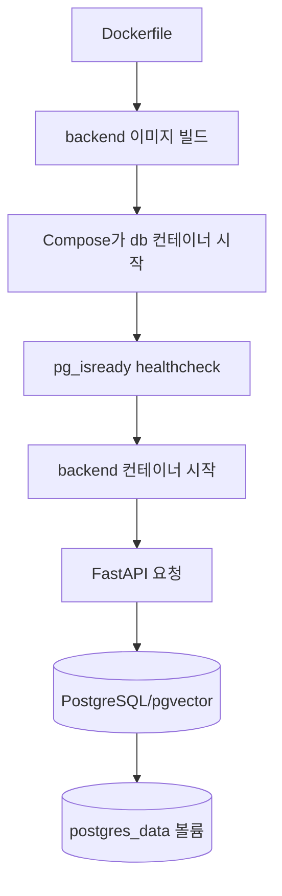
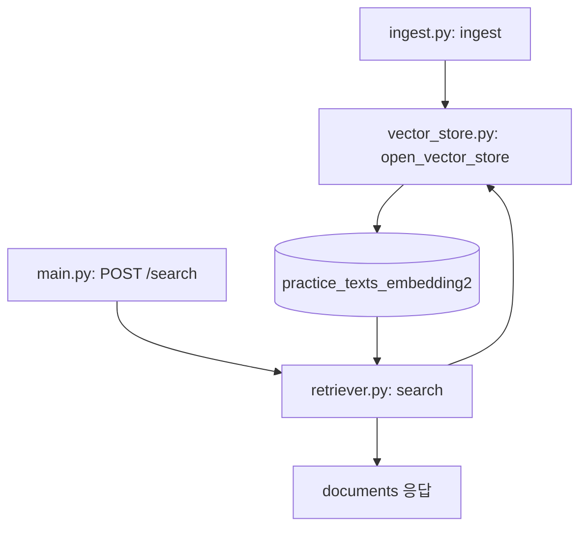

# 26.10.30 69일차(Docker · PostgreSQL/pgvector · FastAPI Compose)

## [TIL] Docker로 DB와 FastAPI를 묶고 데이터·코드의 수명을 구분하기

오늘은 Docker의 이미지·컨테이너·볼륨을 정리하고, PostgreSQL/pgvector와 FastAPI를 Compose로 실행하는 구성을 확인했다. 강의 자료의 `docker/docker_prac/backend` 실습과 `fastapi/fastapi_agent` 프로젝트를 대조해 네트워크 주소, 시작 순서, 개발 중 코드 반영 방식을 구분했다.

이론과 실습은 다음 흐름으로 이어졌다.



```plain text
1. Dockerfile로 backend 이미지 빌드
→ 2. Compose가 db 컨테이너 시작
→ 3. pg_isready 통과 후 backend 시작
→ 4. FastAPI 요청에서 PostgreSQL/pgvector 사용
→ 5. postgres_data 볼륨에 DB 데이터 보존
```

---

## 1. 이미지·컨테이너·볼륨의 역할

### 1-1. 실행 환경을 이미지로 묶기

Docker 이미지는 애플리케이션 실행 파일, Python과 라이브러리, 소스 코드, 시작 명령을 묶는다. 같은 이미지를 기반으로 컨테이너를 만들면 컴퓨터마다 Python·패키지 버전을 따로 맞추는 일을 줄일 수 있다. 이미지 태그는 나중에 다른 내용을 가리킬 수 있으므로 태그 문자열만으로 영구히 동일한 빌드를 보장하지 않는다.

| 구분 | 역할 | 실습에서의 예 |
|---|---|---|
| 이미지 | 컨테이너 생성에 쓰는 파일·설정 묶음 | `pgvector/pgvector:pg17-trixie`, 직접 빌드한 backend |
| 컨테이너 | 격리된 환경에서 프로그램을 실행하는 단위 | `db`, `backend` 서비스 |
| 이름 있는 볼륨 | 컨테이너를 삭제해도 유지할 데이터 저장 | `postgres_data` |
| Bind mount | 호스트 파일을 컨테이너 경로에 연결 | `./main.py:/app/main.py` |

Python 가상환경 `.venv`는 프로젝트별 패키지를 분리한다. 컨테이너는 Python 실행 파일과 시스템 라이브러리, 파일·프로세스·네트워크까지 실행 환경을 구성한다. Docker CLI의 명령은 Docker Engine에 전달되고, Docker Desktop은 로컬 실행 환경과 관리 화면을 제공한다.

### 1-2. 컨테이너 재생성과 데이터 보존

강의의 볼륨 전후 비교에서는 볼륨 없이 저장한 메모가 `docker compose down` 후 재생성하자 `GET /notes`의 빈 목록으로 확인됐다. 이후 `postgres_data:/var/lib/postgresql/data`를 연결하고 새 메모를 저장한 뒤 같은 명령으로 재생성했을 때, 같은 볼륨의 메모를 다시 조회하는 절차를 제시한다. 이는 강의의 관찰 설명이며 이 원고 작성 중 별도 컨테이너 실행 로그를 수집한 것은 아니다.

| 비교 대상 | 저장 위치 | 컨테이너 삭제·재생성 후 강의의 관찰 |
|---|---|---|
| 볼륨 설정 전 메모 | DB 컨테이너 자체 저장 공간 | `GET /notes`가 빈 목록 |
| 볼륨 설정 후 메모 | `postgres_data` | 저장한 `id`, `text`를 다시 조회 |

원인은 컨테이너 삭제 시 자체 저장 공간의 변경분도 사라지는 데 있다. DB 데이터에는 이름 있는 볼륨을 선택했고, 소스 변경을 즉시 보려는 개발 목적에는 bind mount를 사용한다. `down`은 기본적으로 이름 있는 볼륨을 삭제하지 않지만 볼륨 삭제 옵션을 붙인 경우는 별도로 확인해야 한다.

---

## 2. PostgreSQL과 pgvector를 Compose로 실행하기

### 2-1. DB 서비스·포트·준비 상태

`docker/docker_prac/backend/compose.yaml`은 PostgreSQL 17과 pgvector가 포함된 이미지를 사용한다. 다음 설정에서 호스트의 `127.0.0.1:5433`은 DB 컨테이너의 `5432`로 연결하고, 볼륨은 DB 데이터 경로에 연결한다.

```yaml
name: docker-practice

services:
  db:
    image: pgvector/pgvector:pg17-trixie
    environment:
      POSTGRES_USER: postgres
      POSTGRES_PASSWORD: "1234"
      POSTGRES_DB: docker_prac
    ports:
      - "127.0.0.1:5433:5432"
    volumes:
      - postgres_data:/var/lib/postgresql/data
    healthcheck:
      test: ["CMD-SHELL", "pg_isready -U postgres -d docker_prac"]
      interval: 5s
      timeout: 3s
      retries: 10
      start_period: 10s

volumes:
  postgres_data:
```

`pg_isready`는 PostgreSQL이 접속을 받을 준비가 됐는지 검사한다. `start_period: 10s`는 시작 직후 검사 실패의 횟수 처리에 쓰이며, `retries: 10`은 컨테이너 재시작 횟수가 아니다. `POSTGRES_*` 값은 빈 데이터 디렉터리의 최초 초기화에 적용되는 설정이다.

설정을 검사한 뒤 서비스를 실행하고 상태·로그를 확인한다. 아래 명령은 `docker/docker_prac/backend`에서 사용한다.

```bash
docker compose config -q
docker compose up -d --build
docker compose ps
docker compose logs db
docker compose logs backend
```

`config -q`는 유효한 설정이면 출력 없이 종료한다. 강의는 DB 로그의 `database system is ready to accept connections`와 `/health`의 `{"status": "ok"}`를 확인 대상으로 제시한다. 이 글에서는 명령을 새로 실행해 성공 여부를 검증하지 않았다.

### 2-2. 로컬 주소와 서비스 주소

`docker/docker_prac/backend/main.py`의 `connect_db()`는 `DATABASE_URL`로 연결한다. 호스트에서 `uv run fastapi dev main.py`를 실행할 때는 `localhost:5433`, backend 컨테이너에서는 Compose 서비스 이름 `db:5432`를 쓴다. 컨테이너 안의 `localhost`는 그 컨테이너 자신이므로 DB 컨테이너 주소가 아니다.

| 실행 위치 | DB 호스트·포트 | FastAPI 접속 주소 |
|---|---|---|
| 호스트에서 실행한 FastAPI | `localhost:5433` | `http://localhost:8000/docs` |
| `docker-practice`의 backend 컨테이너 | `db:5432` | `http://localhost:8000/docs` |
| `fastapi-agent`의 backend 컨테이너 | `db:5432` | `http://localhost:8001/docs` |

`docker/docker_prac/backend/compose.yaml`의 `backend.depends_on.db.condition: service_healthy`는 DB healthcheck가 성공한 뒤 백엔드를 시작하게 한다. 실행 중 DB 장애의 복구나 backend 자동 재시작까지 보장하는 설정은 아니다. `env_file`은 `.env` 값을 전달하고, `environment`의 `DATABASE_URL`은 컨테이너에서 사용할 `db:5432` 주소로 덮어쓴다.

---

## 3. pgvector 검색과 FastAPI API

### 3-1. 텍스트 등록에서 검색까지

`docker/docker_prac/backend/ingest.py`의 `ingest()`는 Docker 이미지·Compose·볼륨·FastAPI·LangGraph·React 문장 **6개**에 고정 ID를 부여해 저장한다. `vector_store.py`의 `open_vector_store()`는 `practice_texts_embedding2` 테이블과 **768차원** 임베딩을 사용하고, `retriever.py`의 `search()`는 관련 문서 **2개**를 반환하도록 설정한다.



```plain text
1. ingest.py의 ingest()에서 문장 6개 등록
→ 2. vector_store.py의 open_vector_store()에서 pgvector 테이블 사용
→ 3. main.py의 POST /search가 retriever.py의 search() 호출
→ 4. 유사 문서 2개를 documents로 응답
```

검색 개수를 정하는 핵심 코드는 `docker/docker_prac/backend/retriever.py`의 `search()`이다. 입력은 질문 문자열이며 반환값은 검색된 문서 목록이다.

```python
def search(query):
    with open_vector_store() as vector_store:
        retriever = vector_store.as_retriever(search_kwargs={"k": 2})
        return retriever.invoke(query)
```

실습 순서는 `uv run ingest.py`로 등록한 뒤 `uv run retriever.py` 또는 `POST /search`로 검색하는 것이다. API는 키가 비어 있거나 텍스트를 등록하지 않았으면 `503`, 검색 중 다른 오류가 나면 로그를 남기고 `502`를 반환하도록 구현되어 있다. 검색 품질의 비교 지표나 정확도 수치는 자료에 없으므로 재검증이 필요하다.

### 3-2. 메모 API와 검색 API의 차이

`docker/docker_prac/backend/main.py`는 시작 시 `notes` 테이블을 만들고 `/health`, `POST /notes`, `GET /notes`, `POST /search`를 제공한다. `GET /notes`는 `ORDER BY id DESC LIMIT 20`으로 최근 메모 최대 **20개**를 조회한다. 검색 API는 notes 테이블이 아니라 별도 임베딩 테이블의 텍스트를 찾는다.

| 경로 | 기능 | 확인 자료 |
|---|---|---|
| `GET /health` | DB 연결 확인 | 강의 예시 `{"status": "ok"}` |
| `POST /notes` | 메모 저장 | 생성된 `id`, `text` |
| `GET /notes` | 최근 메모 조회 | 최대 20개 |
| `POST /search` | 임베딩 문서 검색 | `documents` 목록, 검색 설정 `k=2` |

---

## 4. FastAPI 이미지와 개발용 코드 반영

### 4-1. Dockerfile은 빌드 방법, Compose는 실행 설정

`docker/docker_prac/backend/Dockerfile`은 Python 3.13 slim 이미지에서 `uv==0.13.6`을 설치하고, 의존성 파일을 먼저 복사해 설치한 뒤 소스를 복사한다. 다음 `CMD`는 빌드 중 실행되는 명령이 아니라 컨테이너 시작 시 사용하는 기본 명령이다.

```dockerfile
FROM python:3.13-slim

WORKDIR /app
RUN pip install --no-cache-dir uv==0.13.6
COPY pyproject.toml uv.lock ./
RUN uv sync --frozen --no-dev
COPY . .

CMD ["uv", "run", "--no-sync", "fastapi", "run", "main.py", "--host", "0.0.0.0", "--port", "8000"]
```

`0.0.0.0`은 컨테이너의 네트워크 인터페이스에서 요청을 받도록 한다. 브라우저는 공개된 호스트 포트인 `localhost:8000`으로 접속한다. `.dockerignore`는 `.venv`, `.env`, `.git`, Compose 예제 등을 빌드 컨텍스트에서 제외하며 API 키를 이미지에 넣지 않게 한다.

`fastapi/fastapi_agent/Dockerfile`은 패키지 구조에 맞춰 `README.md`까지 먼저 복사하고, `uv sync --frozen --no-dev --no-install-project` 후 소스를 복사해 다시 `uv sync --frozen --no-dev`를 실행한다. 두 프로젝트 모두 의존성 파일과 소스를 나누어 복사하지만, `fastapi_agent`는 프로젝트 자체를 두 번째 동기화 단계에서 설치한다.

### 4-2. Bind mount와 재빌드의 선택

`docker/docker_prac/backend/compose.dev.yaml`은 기본 Compose 설정 위에 개발용 명령과 파일 마운트를 얹는다. 이 파일은 자동 적용되지 않으므로 `-f`로 두 파일을 지정한다.

```yaml
services:
  backend:
    command: ["uv", "run", "--no-sync", "fastapi", "dev", "main.py", "--host", "0.0.0.0", "--port", "8000"]
    environment:
      WATCHFILES_FORCE_POLLING: "true"
    volumes:
      - ./main.py:/app/main.py
```

`./main.py:/app/main.py`는 호스트 파일을 컨테이너 경로에 연결한다. `fastapi dev`가 변경을 감지해 재시작하므로 강의에서는 제목 수정 후 이미지 재빌드 없이 `/docs` 새로고침으로 변경을 확인한다. 마운트하지 않은 파일, Dockerfile, 의존성 파일의 변경에는 재빌드가 필요하다.

개발용 설정을 합치고 실행할 때 아래 명령을 사용한다. 기본 실행으로 돌아가려면 `docker compose up -d`를 사용하고, 이미지 코드까지 갱신해야 하면 `--build`를 붙인다.

```bash
docker compose -f compose.yaml -f compose.dev.yaml config -q
docker compose -f compose.yaml -f compose.dev.yaml up -d
docker compose -f compose.yaml -f compose.dev.yaml up -d --build
```

`fastapi/fastapi_agent/compose.yaml`에는 개발용 bind mount가 없고, backend의 호스트 포트는 **8001**, DB 호스트 포트는 **5434**이다. `fastapi_agent`의 앱은 `src/fastapi_agent/main.py`에서 RAG 에이전트와 PostgreSQL 체크포인터를 시작 시 준비하므로 DB 준비 상태에 대한 `depends_on` 설정이 특히 필요하다.

---

## 5. 헷갈린 점

확인해야 할 지점은 `localhost`의 기준이 실행 위치에 따라 달라진다는 것이다. 호스트 FastAPI의 `localhost:5433`과 컨테이너 FastAPI의 `db:5432`는 같은 DB에 닿지만 경로가 다르다. 또한 Dockerfile을 저장하는 것만으로 이미지를 만들거나 서버를 시작하지 않는다. `docker compose up -d --build`가 빌드와 실행을 수행한다.

볼륨과 bind mount도 목적이 다르다. 볼륨은 DB 데이터 보존에, bind mount는 개발 중 파일 변경 반영에 사용한다. 자료의 볼륨 전후 결과는 강의의 실습 설명이므로 현재 로컬 환경에서 같은 결과가 나오는지는 재검증이 필요하다.

---

## 오늘 배운 것 정리

- Docker 이미지는 실행 환경을 묶고, 컨테이너는 그 환경에서 프로그램을 실행한다.
- Dockerfile은 이미지 빌드 방법을, Compose 파일은 서비스 실행·연결 설정을 정의한다.
- PostgreSQL 데이터는 이름 있는 볼륨에 두어 컨테이너 재생성 뒤에도 사용한다.
- 호스트의 `localhost:5433`과 컨테이너의 `db:5432`는 접속 위치에 따른 주소다.
- DB healthcheck와 `service_healthy`로 FastAPI 시작 순서를 제어한다.
- pgvector 실습은 문장 6개를 768차원으로 저장하고 검색 시 2개를 요청한다.
- `fastapi_agent`는 별도 Compose 프로젝트로 8001/5434 호스트 포트를 사용한다.
- 개발 중 `main.py` 수정은 bind mount와 `fastapi dev`로 반영하고, 마운트하지 않은 파일은 재빌드한다.

실행·검증할 때는 다음 순서로 생각하면 된다.

```plain text
Compose 설정 검사
→ DB 준비 상태 확인
→ backend 실행 및 /health 확인
→ /notes 저장·조회
→ ingest.py 등록 후 /search 확인
→ 볼륨 재생성 및 코드 변경 반영 방식 확인
```

#부트캠프 #멀티캠퍼스부트캠프 #AI캠퍼스 #AI에이전트엔지니어
