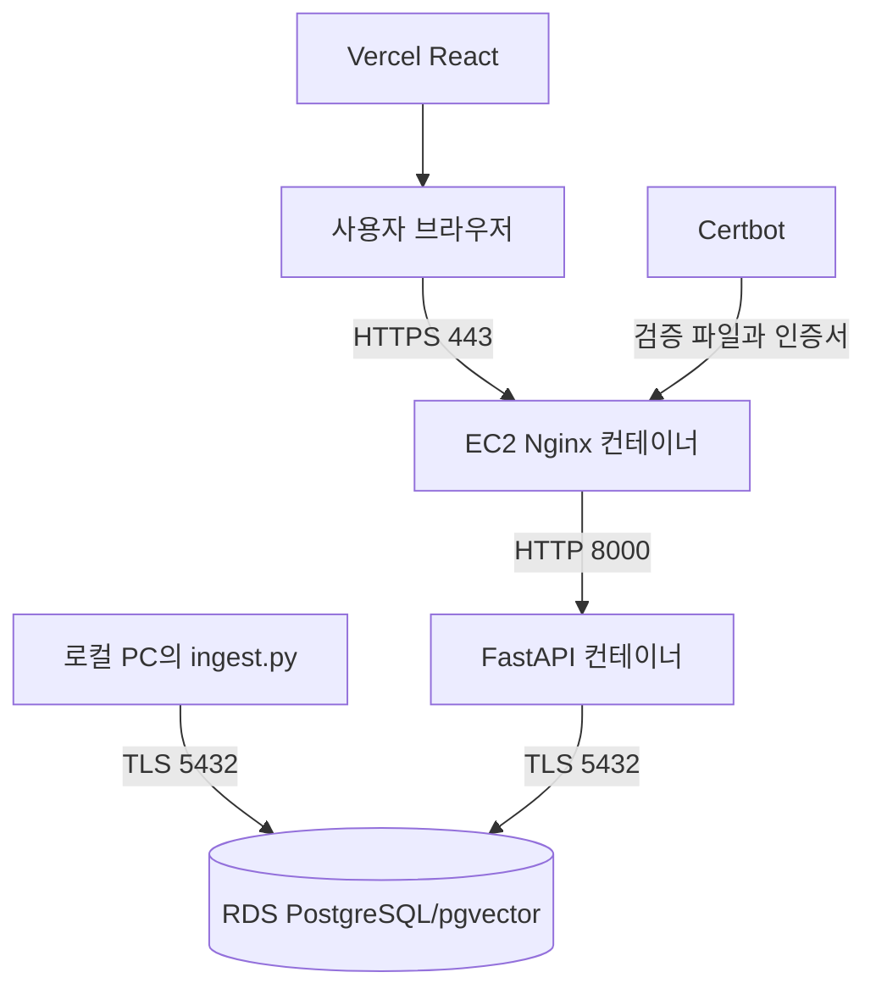

# 26.11.02 70일차(AWS EC2 · RDS · Docker · Nginx/HTTPS · Vercel 배포)

## [TIL] FastAPI와 React를 AWS·Vercel에 연결하고 HTTPS 경로 확인하기

오늘은 강의의 배포 절차를 읽고 `backend`와 `frontend` 저장소의 실제 설정을 대조했다. EC2의 Docker Compose와 Nginx, RDS PostgreSQL/pgvector, Vercel React를 연결하는 순서와 TLS·CORS·인증서 갱신의 확인 지점을 정리했다. 아래 성공 응답은 강의의 **확인 기준**이며 이번 정리 중 배포를 새로 실행해 얻은 결과는 아니다.

이론과 실습은 다음 흐름으로 이어졌다.



```plain text
1. 로컬 ingest.py → TLS 5432 → RDS PostgreSQL/pgvector
→ 2. Vercel React → 사용자 브라우저
→ 3. 사용자 브라우저 → HTTPS 443 → EC2 Nginx
→ 4. Nginx → HTTP 8000 → FastAPI → TLS 5432 → RDS
→ 5. Certbot 검증 파일·인증서 → Nginx
```

---

## 1. 배포 구성과 AWS 네트워크

### 1-1. 서비스별 역할

배포는 실행 서버뿐 아니라 DB 접속, 외부 접속 경로와 HTTPS를 함께 구성하는 일이다. EC2(Elastic Compute Cloud)는 가상 서버, RDS(Relational Database Service)는 관리형 DB, Nginx는 리버스 프록시, Vercel은 React 정적 파일의 빌드·배포를 맡는다.

| 구성 요소 | 역할 | 이 자료의 위치 |
|---|---|---|
| EC2 | Docker 컨테이너 실행 | Ubuntu 인스턴스 |
| RDS | PostgreSQL/pgvector 운영 | `aim_agent` DB |
| Nginx | HTTPS 종료·FastAPI 전달 | EC2 컨테이너 |
| Vercel | React 빌드·제공 | 프론트엔드 저장소 |
| 로컬 PC | 검색 문서 적재 | `backend/ingest.py` |

### 1-2. 리전·VPC·보안 그룹·포트

강의는 서울 리전에서 EC2와 RDS를 같은 가상 사설망(VPC)에 두고, RDS 보안 그룹의 PostgreSQL 규칙에서 EC2 보안 그룹을 소스로 허용한다. 로컬 적재에는 강의상 RDS 퍼블릭 액세스와 현재 PC 공인 IP의 5432 접근 허용이 추가로 필요하다.

| 포트 | 용도 | 접근 범위 |
|---|---|---|
| 22 | EC2 SSH/Instance Connect | 관리 접속 |
| 80 | HTTP와 인증서 검증 파일 | 외부 요청 |
| 443 | HTTPS API | 외부 요청 |
| 5432 | PostgreSQL | EC2 및 적재 PC |
| 8000 | FastAPI | Compose에서 `127.0.0.1:8000`에 바인딩 |

---

## 2. EC2에서 Docker와 RDS 연결 준비

### 2-1. Docker 설치와 확인

EC2 Ubuntu에서 Docker의 APT 서명 키와 저장소를 등록한 뒤 Engine·Compose를 설치한다. 강의의 핵심 확인 명령은 다음과 같다.

```bash
sudo apt update
sudo apt install -y ca-certificates curl git
sudo install -m 0755 -d /etc/apt/keyrings
sudo curl -fsSL https://download.docker.com/linux/ubuntu/gpg -o /etc/apt/keyrings/docker.asc
sudo chmod a+r /etc/apt/keyrings/docker.asc
sudo apt update
sudo apt install -y docker-ce docker-ce-cli containerd.io docker-buildx-plugin docker-compose-plugin
sudo systemctl enable --now docker
sudo docker run --rm hello-world
sudo docker compose version
```

이 명령은 설치 흐름의 발췌이며 실제 저장소 등록 파일 `docker.sources` 작성은 강의 원문 절차를 따른다. `Hello from Docker!`와 Compose 버전 출력이 확인 기준이다.

### 2-2. RDS TLS 연결과 pgvector

전송 계층 보안(TLS)은 SQL 요청과 결과를 보호한다. `sslmode=verify-full`은 CA 신뢰성과 접속 호스트 이름까지 검증하므로 RDS CA 번들을 컨테이너 안에 읽기 전용으로 연결한다.

```bash
curl -fsSL https://truststore.pki.rds.amazonaws.com/global/global-bundle.pem -o /home/ubuntu/global-bundle.pem
sudo docker run --rm -it \
  -v /home/ubuntu/global-bundle.pem:/certs/global-bundle.pem:ro \
  postgres:17-alpine \
  psql "host=<RDS_ENDPOINT> port=5432 dbname=aim_agent user=postgres sslmode=verify-full sslrootcert=/certs/global-bundle.pem"
```

출처는 강의의 EC2 터미널 절차다. RDS 엔드포인트와 비밀번호를 입력해야 연결되며, 접속 후 다음 SQL로 확장을 활성화하고 조회한다.

```sql
CREATE EXTENSION IF NOT EXISTS vector;
SELECT extname, extversion FROM pg_extension WHERE extname = 'vector';
```

`vector`와 버전이 반환되는 것이 확인 기준이다. 실제 RDS의 반환값은 이 자료에 없다.

---

## 3. FastAPI 컨테이너와 검색 데이터

### 3-1. Compose와 상태 확인

`backend/compose.yaml`은 FastAPI를 빌드하고 `.env`를 읽으며, CA 파일을 마운트한다. 실제 설정의 핵심은 아래와 같다.

```yaml
name: deploy-backend
services:
  backend:
    build: .
    env_file: [./.env]
    environment:
      PGSSLMODE: verify-full
      PGSSLROOTCERT: /certs/global-bundle.pem
      FORWARDED_ALLOW_IPS: "*"
    volumes:
      - /home/ubuntu/global-bundle.pem:/certs/global-bundle.pem:ro
    ports:
      - "127.0.0.1:8000:8000"
    restart: unless-stopped
```

출처는 `backend/compose.yaml`의 `backend` 서비스다. `.env`에는 `DATABASE_URL`, `PGPASSWORD`, `GEMINI_API_KEY`, `CORS_ALLOWED_ORIGINS`가 필요하며 실제 비밀 값은 본문에 싣지 않는다. 강의는 `docker compose up -d --build backend`, `docker compose ps`, 로그 확인 뒤 `curl -i http://127.0.0.1:8000/health`에서 `200 OK`와 `{"status":"ok"}`를 기대한다. `backend/main.py`의 `health()`는 DB에 `SELECT 1`을 실행하므로 이 응답은 API와 DB 연결을 함께 확인한다.

### 3-2. 로컬 적재와 검색

`backend/ingest.py`의 `ingest()`는 Docker·Compose·볼륨·FastAPI·LangGraph·React에 관한 텍스트 **6개**를 벡터 저장소에 넣는다. 로컬 PC에서는 RDS 5432 연결, CA 번들, `.env`의 `PGSSLMODE=verify-full`과 `PGSSLROOTCERT=./global-bundle.pem`을 준비한다.

```bash
uv sync --frozen
uv run --no-sync ingest.py
curl -i http://127.0.0.1:8000/search \
  -H 'Content-Type: application/json' \
  -d '{"query":"Docker Compose는 무엇인가요?"}'
```

앞의 두 명령은 로컬 백엔드에서 적재하고, 마지막 검색 요청은 강의에서 EC2 터미널에서 실행한다. `backend/main.py`의 `search_documents()`는 검색 결과를 `documents` 배열로 돌려주며, 검색 데이터가 없으면 503을 반환한다. 강의는 예제 6개 저장을 설명하지만 이번 정리에서 실제 적재·검색 결과를 측정하지는 않았다.

---

## 4. Nginx와 IP 주소 HTTPS

### 4-1. HTTP 검증에서 HTTPS까지

`backend/nginx.conf`의 80번 서버는 `/.well-known/acme-challenge/` 파일을 제공하고 나머지 요청을 HTTPS로 `308` 이동시킨다. 443번 서버는 Let's Encrypt 인증서와 개인 키를 읽고 `backend:8000`으로 프록시한다.

```nginx
server {
    listen 443 ssl;
    server_name 3.34.2.196;
    ssl_certificate /etc/letsencrypt/live/ec2-prac/fullchain.pem;
    ssl_certificate_key /etc/letsencrypt/live/ec2-prac/privkey.pem;
    ssl_protocols TLSv1.2 TLSv1.3;
    location / {
        proxy_pass http://backend:8000;
        proxy_set_header Host $host;
        proxy_set_header X-Forwarded-For $remote_addr;
        proxy_set_header X-Forwarded-Proto $scheme;
    }
}
```

출처는 `backend/nginx.conf`의 HTTPS 서버 블록이다. 이 IP는 현재 파일에 적힌 값이며 현재 유효한 퍼블릭 IP인지 별도 검증하지 않았다. `backend/compose.yaml`의 Nginx 서비스는 `80:80`, `443:443`을 게시한다.

### 4-2. Certbot 발급·검증·갱신

강의는 Nginx와 Certbot이 공유하는 `/var/lib/letsencrypt`에 확인 파일을 만들고, 외부에서 `ok`가 읽히는지 검사한다. 그다음 Certbot의 `webroot`, `--preferred-profile shortlived`, `--ip-address`로 IP 인증서를 요청하며, 성공 문구는 `Successfully received certificate.`다. 인증서가 발급된 뒤 `nginx -t`를 통과해야 HTTPS 설정을 적용한다.

```bash
echo ok | sudo tee /var/lib/letsencrypt/.well-known/acme-challenge/check
curl "http://<EC2_PUBLIC_IP>/.well-known/acme-challenge/check"
sudo docker run --rm -it --pull=always \
  -v /etc/letsencrypt:/etc/letsencrypt \
  -v /var/lib/letsencrypt:/var/www/certbot \
  certbot/certbot:latest certonly --webroot --webroot-path /var/www/certbot \
  --preferred-profile shortlived --ip-address "<EC2_PUBLIC_IP>" --cert-name "<CERT_NAME>"
```

출처는 강의의 인증서 검증·발급 명령이다. 첫 번째는 EC2, 두 번째는 로컬 터미널에서 실행한다. 강의는 IP 인증서 유효기간을 약 **6일**로 설명하므로 `renew --dry-run` 뒤 systemd 서비스에서 Certbot 갱신, `nginx -t`, `nginx -s reload`를 순서대로 수행하고 타이머를 서울 시간 **03시·15시**에 설정한다.

| 비교·확인 | 강의의 기준 | 미충족 시 다음 확인 |
|---|---|---|
| HTTP 검증 경로 | 외부 `curl` 결과 `ok` | 보안 그룹 80·공유 경로·Nginx 설정 |
| 인증서 발급 | `Successfully received certificate.` | IP·webroot·검증 파일 제공 |
| HTTPS 상태 | `/health`에서 `200 OK`, `{"status":"ok"}` | 인증서 경로·Nginx 문법·백엔드 로그 |
| 갱신 예약 | timer와 journal 출력 | `renew --dry-run`·서비스 실행 결과 |

이 표는 실측 성공 기록이 아니라 강의의 **검증 기준**이다. 실패 로그와 수정 후 결과가 제공되지 않아 원인 확정과 재검증 결과는 남길 수 없다.

---

## 5. Vercel 프론트엔드와 CORS

### 5-1. API 주소와 브라우저 요청

강의는 프론트엔드 GitHub 저장소를 Vercel에 연결하고 환경변수 `VITE_API_URL`에 HTTPS 백엔드 주소를 넣은 후 재배포한다. 실제 `frontend/src/main.jsx`의 `API_BASE_URL`은 환경변수가 비어 있으면 `/api`를 기본값으로 쓰고, `request()`가 `/health`와 `/search`에 요청한다.

```jsx
const API_BASE_URL = (import.meta.env.VITE_API_URL?.trim() || "/api").replace(/\/+$/, "");
response = await fetch(`${API_BASE_URL}${path}`, options);
```

출처는 `frontend/src/main.jsx`의 주소 결정식과 `request()` 호출부다. Vercel에서는 강의대로 `VITE_API_URL`을 설정해야 브라우저가 배포된 API를 호출한다. `backend/main.py`의 CORS 미들웨어는 `.env`의 `CORS_ALLOWED_ORIGINS`를 쉼표로 나눠 허용한다.

### 5-2. 최종 확인 순서

프론트엔드 출처를 `CORS_ALLOWED_ORIGINS=<FRONTEND_ORIGIN>`으로 지정하고 강의는 백엔드를 강제 재생성한 뒤 Nginx를 reload한다. 이어 HTTPS `/health` 응답, 브라우저 검색 결과, Network의 요청 URL, Console의 CORS 오류 유무를 확인한다.

```plain text
Vercel의 VITE_API_URL 지정·재배포
→ EC2의 CORS_ALLOWED_ORIGINS 지정·백엔드 재생성
→ HTTPS /health 확인
→ 브라우저 검색·Network 요청 주소·Console 확인
```

실제 프론트엔드 URL과 브라우저 결과가 입력에 없으므로 최종 배포 성공 여부는 **재검증 필요**다.

---

## 6. 헷갈린 점

`127.0.0.1:8000:8000`은 EC2 내부의 호스트 포트를 열고, 외부 브라우저에는 Nginx의 443 포트가 접점이 된다. `VITE_API_URL`은 빌드된 프론트엔드가 호출할 API 주소이고, `CORS_ALLOWED_ORIGINS`는 백엔드가 허용할 프론트엔드 출처이므로 서로 다른 값을 설정하는 항목이다. 자료만으로 실제 인증서 발급·배포 성공을 단정할 수 없다.

---

## 오늘 배운 것 정리

- EC2는 FastAPI·Nginx 컨테이너를 실행하고 RDS는 PostgreSQL/pgvector를 맡는다.
- RDS 연결은 보안 그룹 규칙과 `sslmode=verify-full`·CA 파일을 함께 맞춘다.
- `backend/compose.yaml`은 FastAPI 8000을 EC2의 loopback 주소에 바인딩한다.
- `backend/ingest.py`에는 검색용 예제 텍스트 6개가 정의돼 있다.
- Nginx는 80에서 인증서 검증 경로를 제공하고 443에서 HTTPS 요청을 받는다.
- Certbot의 갱신 결과를 Nginx가 읽도록 검사와 reload가 필요하다.
- Vercel의 `VITE_API_URL`과 백엔드의 `CORS_ALLOWED_ORIGINS`를 각각 설정한다.
- `/health`, 검색 결과, Network와 Console은 최종 동작 확인 지점이다.

배포를 확인할 때는 다음 순서로 생각하면 된다.

```plain text
AWS 네트워크·RDS TLS 확인
→ Docker Compose 백엔드와 데이터 적재
→ Nginx HTTP 검증·HTTPS 인증서
→ Vercel API 주소·CORS
→ 브라우저에서 상태와 검색 재검증
```

#부트캠프 #멀티캠퍼스부트캠프 #AI캠퍼스 #AI에이전트엔지니어
