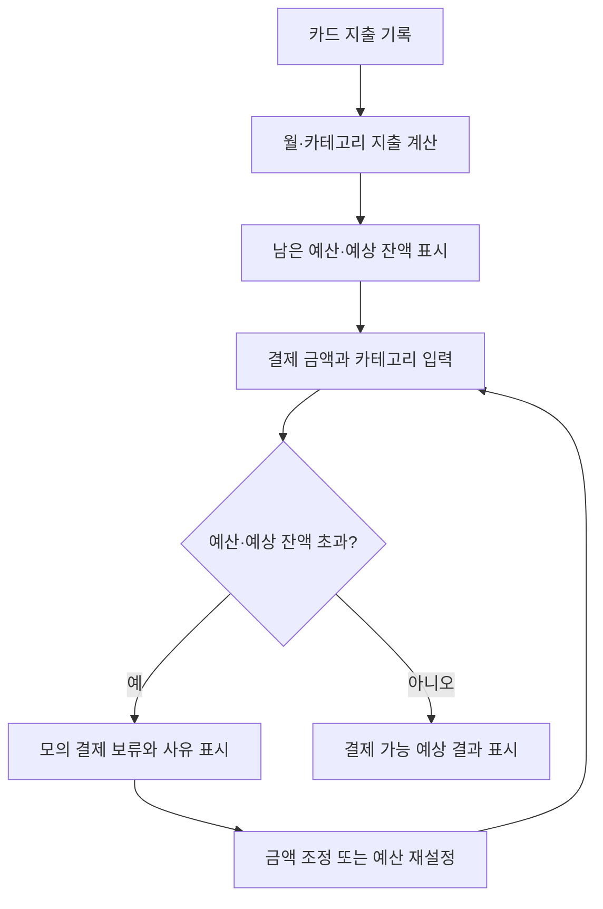
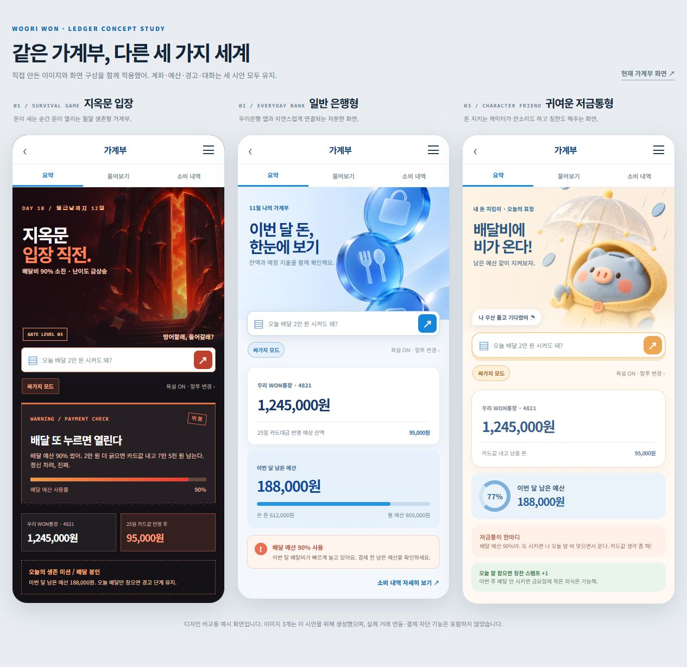
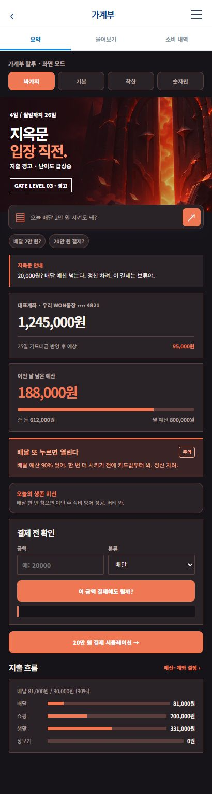
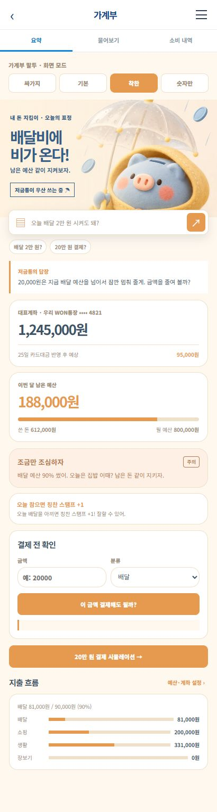

# 26.11.04 71일차(은행 앱 클론 · 가계부 4모드 디자인 · HTML 기획안)

## [TIL] 은행 앱 클론의 가계부를 기획하고 네 가지 화면 모드를 HTML로 구현했다

오늘은 중간 프로젝트의 **은행 모바일 웹서비스** 요구사항을 읽고, 담당 기능인 가계부의 화면·데이터·결제 전 확인 흐름을 기획했다. 지옥문·일반 은행형·귀여운 저금통형 이미지를 적용한 뒤, 싸가지·기본·착한·숫자만 **네 가지 모드**와 간단한 지출 기능이 동작하는 HTML 프로토타입을 만들었다.

기획에서 실제 동작 확인까지의 순서는 다음과 같다.

```plaintext
프로젝트 요구사항 확인
→ 가계부 기능·DB·자연어 흐름 기획
→ 디자인 3종과 4모드 HTML 제작
→ 예시 지출·예산·결제 보류 동작 확인
→ feature/ledger 브랜치와 초안 PR에 정리
```

---

## 1. 중간 프로젝트 요구사항과 담당 범위

### 1-1. 공통 요구사항

중간 프로젝트는 자주 사용하는 은행 앱을 참고하여 **은행 모바일 웹서비스**를 만드는 작업이다. 팀은 기능 목록, 이용 흐름, DB 구조, 구현 순서를 함께 정하고 매일 진행 상황에 맞춰 계획을 조정한다. 코드는 각자 작성한다.

| 필수 제출물 | 프로젝트에서 요구한 내용 | 이번 가계부 작업에서 준비한 것 |
|---|---|---|
| 기획 자료 | 기능 목록·주요 이용 흐름·DB 구조 | `가계부_기획안.md`, `가계부_기획안.html` |
| 실행 코드 | 구현한 프로그램 | `가계부_4가지_모드_체험.html`, 디자인 비교 HTML, 이미지 자산 |
| 실행 안내 | 방법·기능·자연어 예시·실패 상황 확인 결과 | `Proposal/Ledger/README.md` |
| 회고 | 배운 점·어려움·해결·남은 한계 | 이 글의 결과·헷갈린 점·다음 단계 |

은행 기본 기능, 회원가입·인증, 자연어 입력, 지난 미니 프로젝트의 **검색 증강 생성(RAG)**도 공통 필수 범위다. 현재 가계부 HTML은 예시 데이터로 작동하는 독립 프로토타입이며, 팀의 인증·계좌·카드·RAG 서버에 연결된 구현으로 기록하지 않는다.

### 1-2. 가계부가 답해야 할 질문

일반적인 월말 지출 합계보다 **“오늘 이 돈을 써도 되는가?”**를 앞에 두었다. 사용자는 카드 사용 내역으로 지난달과 지지난달의 소비를 비교하고, 이번 달 남은 예산과 카드대금 반영 후 예상 잔액을 본다.



```plaintext
카드 지출 기록
→ 월·카테고리 지출 계산
→ 남은 예산·예상 잔액 표시
→ 결제 금액과 카테고리 입력
→ 초과하면 모의 결제 보류 / 초과하지 않으면 가능 예상 결과
→ 보류 시 금액 조정 또는 예산 재설정 후 다시 확인
```

---

## 2. 네 가지 디자인 모드와 화면 설계

### 2-1. 세 가지 이미지 방향

은행 공통 헤더는 유지하되 가계부 화면은 소비 상태가 기억에 남도록 별도 이미지를 사용했다. 이미지가 숫자와 버튼을 대신하지 않도록, 금액과 경고 문구는 HTML 텍스트로 남겼다.

| 디자인 방향 | 화면 역할 | 적용 모드 |
|---|---|---|
| 지옥문 입장 | 강한 지출 경고와 월말 생존 분위기 | 싸가지 |
| 일반 은행형 | 잔액·예산을 차분하게 읽는 화면 | 기본 |
| 귀여운 저금통형 | 절약을 돕는 캐릭터와 칭찬 | 착한 |
| 숫자 중심 화면 | 이미지 대신 표·격자와 계산값 우선 | 숫자만 |


지옥문 이미지는 **경고 단계의 메인 비주얼**로 사용했다. 어두운 배경 위에 결제 보류 문구와 예산 수치를 별도 카드로 배치한다.


푸른 유리 토큰은 **은행형 요약 화면**의 배경이다. 카드와 계좌 정보를 읽는 데 방해되지 않도록 글자를 이미지 밖의 HTML 요소로 표시한다.


저금통 캐릭터는 **착한 모드의 경고·칭찬 화면**에 연결된다. 배달 예산이 위험할 때 우산을 든 모습으로 보여 주며, 실제 결제 판정은 다른 모드와 동일하다.

브라우저에서 실제로 연 화면을 캡처해 세 가지 디자인을 한눈에 비교했다.







### 2-2. 모드는 표현만 바꾼다

같은 예산과 거래가 들어오면 모드가 달라도 결과는 같아야 한다. `싸가지`는 반말과 직설적인 문구, `기본`은 차분한 안내, `착한`은 격려, `숫자만`은 계산값 위주로 답한다.

`Proposal/Ledger/가계부_4가지_모드_체험.html`의 `setMode()`와 `drawMode()`는 선택한 모드를 저장하고 이미지·색·문구를 다시 그린다. 결제 보류 계산은 별도 `blockReason()`에 두어 말투 변경이 판단을 바꾸지 않게 했다.

```javascript
function setMode(mode){
  if(!MODES[mode])return;
  state.mode=mode;
  save();
  renderSummary();
}
```

입력은 네 모드 중 하나이고 출력은 같은 거래 데이터를 유지한 새 화면이다. 모드 선택은 브라우저 저장소(localStorage)에 남지만, 서버 계정 설정으로 동기화되지는 않는다.

---

## 3. HTML에서 동작하도록 만든 가계부 기능

### 3-1. 예산과 예상 잔액

HTML 프로토타입은 계좌 잔액 `1,245,000원`, 월 예산 `800,000원`, 예시 카드 지출 `612,000원`, 카드대금 반영 후 예상 잔액 `95,000원`에서 시작한다. 이 값은 사용자 금융 정보가 아니라 동작 확인용 예시이다.

| 계산값 | 예시 결과 | 의미 |
|---|---:|---|
| 이번 달 카드 지출 | 612,000원 | 예시 승인 거래 합계 |
| 이번 달 남은 예산 | 188,000원 | 800,000원 − 612,000원 |
| 배달 지출·예산 | 81,000원 / 90,000원 | 배달 예산 90% 사용 |
| 카드대금 반영 후 예상 잔액 | 95,000원 | 예시 예정 카드대금 반영 결과 |

`metrics()`는 현재 월의 거래를 다시 합산하고 남은 예산·배달 잔여액·사용률을 반환한다. `renderSummary()`는 지출을 추가하거나 예산을 고친 뒤 화면의 수치를 갱신한다.

```javascript
function metrics(){
  const spent=spentFor(currentMonth),
        remaining=state.budget-spent,
        delivery=categoryFor(currentMonth,'배달'),
        deliveryRemaining=state.deliveryBudget-delivery,
        projected=forecast();
  return {spent,remaining,delivery,deliveryRemaining,projected,
    ratio:Math.round(spent/state.budget*100),
    deliveryRatio:Math.round(delivery/state.deliveryBudget*100)};
}
```

입력은 브라우저에 저장된 거래·예산이고 출력은 월별 집계값이다. 실제 서비스에서는 이 계산을 서버에서도 다시 수행해야 하며, 카드 승인 시점과 카드대금 출금 시점을 구분해야 한다.

### 3-2. 결제 전 확인과 실패 상황

사용자가 금액과 카테고리를 입력하면 `paymentPreview()`가 `blockReason()`의 결과를 보여 준다. 월 예산, 카드대금 반영 후 예상 잔액, 배달 예산 중 하나라도 부족하면 **모의 결제 보류**를 표시한다. 실제 카드 결제는 발생하지 않는다.

```javascript
function blockReason(amount,category){
  const m=metrics();
  if(amount>m.remaining)return m.remaining<=0
    ?'월 예산을 이미 초과했습니다.'
    :`월 예산 잔여 ${money(m.remaining)}을 넘습니다.`;
  if(amount>m.projected)return m.projected<=0
    ?'카드대금 반영 후 예상 잔액이 없습니다.'
    :`카드대금 반영 후 예상 잔액 ${money(m.projected)}을 넘습니다.`;
  if(category==='배달'&&amount>m.deliveryRemaining)return m.deliveryRemaining<=0
    ?'배달 예산을 이미 초과했습니다.'
    :`배달 예산 잔여 ${money(m.deliveryRemaining)}을 넘습니다.`;
  return '';
}
```

이 함수의 반환값이 빈 문자열이면 데모에서 결제 가능 예상 결과를 보여 준다. 사유가 있으면 보류 문구를 보여 주고, 결제 시도 자체를 거래에 추가하지 않는다.

### 3-3. 소비 내역과 월별 비교

`소비 내역` 탭에서 날짜·카테고리·사용처·금액을 입력하면 거래가 추가된다. 월 선택으로 지난달과 지지난달을 보고, 총액과 가장 큰 지출 카테고리를 비교한다. 추가한 거래는 삭제할 수 있고, 예산과 모드 선택은 새로고침 뒤에도 유지된다.

자연어 입력은 현재 **규칙 기반 데모**이다. `parseAmount()`가 `2만 원` 같은 금액을 찾고, `classify()`가 잔액·예산·지난달 질문을 분류한다. “그럼 1만 원은?”처럼 카테고리를 생략하면 직전 카테고리를 재사용하지만, 생성형 모델이나 RAG 검색은 연결되어 있지 않다.

---

## 4. 팀 통합을 위한 데이터와 RAG 계획

### 4-1. DB 구조 초안

프로토타입의 `localStorage`는 시연용 저장소이다. 팀의 인증과 카드 거래 DB에 연결할 때는 사용자별 접근을 강제하고 금액을 정수 원 단위로 저장해야 한다.

| 데이터 | 핵심 필드 | 역할 |
|---|---|---|
| `users`, `accounts` | `user_id`, `balance`, `masked_number` | 본인 계좌 잔액 조회 |
| `card_transactions` | `user_id`, `amount`, `category`, `approved_at`, `status`, `refund_of` | 승인·거절·환불 구분 |
| `budgets`, `category_budgets` | `month`, `total_amount`, `category`, `amount` | 월·카테고리 예산 |
| `planned_outflows` | `due_date`, `amount`, `type` | 카드대금·고정비 예정 출금 |
| `payment_attempts` | `amount`, `result`, `reason` | 모의 결제 시도와 보류 근거 |
| `chat_sessions`, `chat_messages` | `content`, `intent`, `context_json` | 자연어 후속 질문 맥락 |
| `rag_documents` | `source_url`, `version`, `chunk_text` | 상품·혜택 안내 문서 |

### 4-2. 자연어 요청과 RAG의 역할 분리

잔액·소비 합계·결제 가능 여부는 인증된 사용자의 구조화된 거래 데이터와 계산 함수로 답한다. 상품 금리·가입 조건·카드 혜택처럼 **문서 근거가 필요한 질문**은 팀의 RAG로 검색하고 출처와 기준일을 표시해야 한다.

```plaintext
사용자 요청
→ 거래·예산 질문이면 인증 데이터 조회와 서버 계산
→ 상품·이용 안내 질문이면 RAG 문서 검색과 출처 확인
→ 금액·날짜·카테고리가 모호하면 추가 질문
→ 근거가 있으면 답변, 없으면 확인 불가 안내
```

현재 HTML은 이 연결 구조를 설명하는 시안이며, 실제 회원가입·로그인·계좌 생성·RAG 동작을 구현했다는 뜻은 아니다.

---

## 5. 확인 결과와 수정 과정

가계부 기획안 HTML을 브라우저에서 열어 한글, 표와 이미지 배치를 확인했다.

### 5-1. 예시 데이터로 확인한 동작

| 확인 조건 | 확인된 결과 | 다음 선택 |
|---|---|---|
| 초기 월 예산 800,000원, 지출 612,000원 | 남은 예산 188,000원 | 계좌 잔액과 예산을 다른 값으로 표시 |
| 10,000원 카드 지출 추가 | 지출 622,000원, 남은 예산 178,000원, 예상 잔액 85,000원 | 추가 후 즉시 재계산 |
| 배달 예산 90,000원에 81,000원 사용한 상태에서 배달 20,000원 시도 | 배달 잔여 9,000원 초과로 모의 결제 보류 | 카테고리 예산도 결제 전 검사 |
| 지출 추가 뒤 새 탭 열기 | 추가한 지출이 유지됨 | 브라우저 저장 확인 후 테스트 기록 초기화 |
| 월 예산을 700,000원으로 수정 | 저장 메시지와 재계산 확인 | 예시 데이터로 초기화 |

비교 대상은 **모드별 화면과 같은 예산 데이터**였다. 숫자와 보류 기준이 같아야 하므로 `blockReason()`을 모드별 문구 생성과 분리했다. 이미지 세 개를 적용하되 `숫자만`은 장식 이미지를 빼고 정보 밀도를 높였다.

### 5-2. 구현 중 겪은 오류

| 현상 | 확인된 원인 | 대응 | 수정 후 영향 |
|---|---|---|---|
| 페이지를 열었을 때 영웅 영역의 글자와 계산값이 비어 보임 | HTML 설정 폼 ID는 `settingsPanel`인데 JavaScript가 `settingsForm`을 찾으며 `null.addEventListener` 오류 발생 | JavaScript의 대상 ID를 `settingsPanel`로 수정 | 화면 초기화와 탭·설정 이벤트 연결 확인 |
| 소비 내역 탭에서도 질문창이 보임 | `.chat`·`.quick`의 `display` 스타일이 `hidden` 속성보다 우선 적용됨 | `.phone [hidden]{display:none!important}` 추가 | 탭에 맞는 내용만 표시 |
| 이미 배달 예산을 초과한 뒤 보류 사유에 음수 잔여액이 표시됨 | 잔여액을 그대로 문장에 삽입 | 잔여액이 0 이하일 때 별도 문구 표시 | “배달 예산을 이미 초과했습니다”로 안내 |

수정 뒤 브라우저에서 탭 전환, 거래 추가, 예산 변경, 결제 보류를 다시 확인했다. 디자인과 기획 자료는 GitHub의 `feature/ledger` 브랜치와 [초안 PR #1](https://github.com/MumuKim0212/aim-middle-project/pull/1)에 올렸으며, `main`에는 병합하지 않았다.

---

## 6. 헷갈린 점

**계좌 잔액과 쓸 수 있는 돈은 같은 수치가 아니다.** 카드 결제 직후 계좌 잔액은 바로 줄지 않을 수 있지만 월 예산 사용액과 미결제 카드대금은 변한다. 따라서 요약 화면에 현재 잔액과 카드대금 반영 후 예상 잔액을 따로 놓았다.

**네 가지 모드는 네 가지 결제 규칙이 아니다.** 화면과 말투만 다르고 예산 초과 판단은 하나의 계산 함수에서 한다. 실제 서비스에서는 서버가 인증된 카드 거래를 다시 계산해야 하며, 현재 HTML의 `localStorage` 결과만으로 실제 결제를 막을 수 없다.

---

## 오늘 배운 것 정리

- 프로젝트 요구사항과 현재 프로토타입의 구현 범위를 구분해 적었다.
- 계좌 잔액, 월 예산 잔여액, 카드대금 반영 후 예상 잔액은 서로 다른 값이다.
- 결제 보류 기준은 모드별 문구와 분리해 한곳에서 계산해야 한다.
- 지출을 추가하면 월별 합계와 카테고리 사용률을 다시 계산해야 한다.
- `hidden` 속성과 CSS `display` 규칙이 충돌하면 실제 화면에서 탭이 제대로 숨겨지지 않는다.
- 자연어 데모의 규칙 기반 응답과 팀이 구현할 생성형 AI·RAG를 혼동하지 않아야 한다.
- 디자인 이미지는 분위기를 만들고, 금액·경고·버튼은 읽기 쉬운 HTML 요소로 유지했다.
- 기획안, 실행 안내, 시안과 실패 상황 확인 결과를 함께 제출해야 팀 통합이 쉬워진다.

팀 통합에서는 다음 순서로 진행할 계획이다.

```plaintext
인증 사용자·계좌·카드 거래 모델 확인
→ 서버 측 예산·예상 잔액 계산
→ 모의 카드 승인 전 보류 판정 연결
→ 자연어 라우팅과 대화 맥락 연결
→ 상품·혜택 안내 RAG와 출처 검증
→ 실패 상황과 사용자별 접근 검사
```

#부트캠프 #멀티캠퍼스부트캠프 #AI캠퍼스 #AI에이전트엔지니어
