# 26.11.05 72일차(가계부 구현 · 회원가입·로그인 인증 · 읽기 전용 text-to-SQL)

## [TIL] 기획한 가계부를 FastAPI·React로 구현하고, 회원·인증을 붙여 로그인 사용자의 데이터만 보게 했다

오늘은 어제 HTML로 기획한 **가계부**를 `feature/ledger-app` 브랜치에서 FastAPI(백엔드)와 React(프론트)로 구현했다. 이어서 팀의 회원·인증 기획서에 맞춰 **회원가입·로그인·간편비밀번호·기기 등록 쿠키**를 만들고, 가계부를 `user_id` 기준으로 바꿔 로그인한 사용자의 데이터만 보이게 했다. 정해 둔 질문에 맞지 않는 조회는 **읽기 전용 text-to-SQL**로 푸는 길을 열되, 안전장치를 DB와 코드에 두었다.

구현은 다음 흐름으로 이어졌다.

```plain text
가계부 구현(질문 해석 → 계산 → 말투 입히기)
→ 모드별 대화·기록·달력·추이 화면
→ 정해 둔 질문 밖의 조회를 읽기 전용 text-to-SQL로 처리
→ members → users(BIGINT) 전환과 회원가입·로그인·세션
→ 가계부를 current_user·user_id에 연결
→ 점검 세트로 확인하고 README·캡처 갱신
```

---

## 1. 가계부 구현: 숫자는 서버가, 말투는 LLM이

### 1-1. 질문이 답변이 되기까지

가계부에서 가장 중요한 원칙은 **판정과 숫자를 LLM이 만들지 않는 것**이다. 질문 의도만 LLM(Gemini)과 규칙으로 읽고, 금액 계산과 가능/보류 판정은 서버 함수가 확정한다. LLM은 확정된 사실(facts)을 현재 모드의 말투로 풀어 쓸 뿐이며, 답변에 사실에 없는 숫자가 있으면 검증에서 걸러진다.

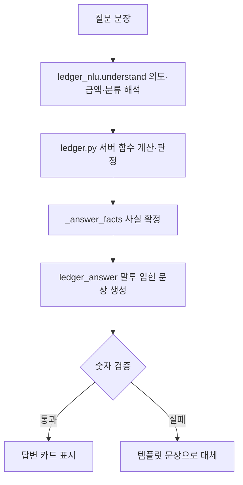

```plain text
질문 문장
→ understand(): 의도·금액·분류 해석 (규칙 + Gemini)
→ 서버 함수: 계산·판정 확정
→ _answer_facts(): 사실 확정
→ ledger_answer: 말투 입힌 문장 생성
→ 숫자 검증: 통과하면 카드, 실패하면 템플릿 문장
```

해석할 수 있는 의도는 구매 가능 여부(`purchase`), 잔액(`balance`), 예산(`budget`), 지난달(`last`)·지지난달(`prev2`), 지출 기록(`record`), 수입 기록(`income`), 이번 주(`week`), 분류별 합계(`category`), 오늘 쓸 수 있는 돈(`daily`), 자유 조회(`query`), 잡담(`chat`) 12가지이다.

`ledger_nlu.py`의 `classify()`는 정해진 순서로 규칙을 확인한다. 같은 문장이 여러 의도에 걸릴 수 있어서 순서가 곧 우선순위이다. 예를 들어 금액이 있고 과거형이며 묻는 말투가 아니면 기록(`record`), 금액이 없고 분류 이름과 "얼마"가 있으면 분류별 합계(`category`)로 본다.

```python
def classify(text: str, amount: int | None) -> str:
    if re.search(r"지지난달", text):
        return "prev2"
    if re.search(r"지난달|저번달", text):
        return "last"
    if re.search(r"잔액|통장|계좌", text):
        return "balance"
    if amount is None and _DAILY_HINT.search(text):
        return "daily"
    if re.search(r"예산|얼마 남", text) and amount is None:
        return "budget"
    if amount is not None and _INCOME_HINT.search(text) and not _ASKING.search(text):
        return "income"
    if amount is not None and _RECORD_HINT.search(text) and not _ASKING.search(text):
        return "record"
    ...
    return "chat"  # 억지로 가계부 질문으로 끼워 맞추지 않는다
```

위 코드는 일부를 줄여 옮겼다. 규칙 해석은 키 없이도 돌아가므로 Gemini가 실패해도 같은 질문을 처리한다. 또 LLM이 잡담(`chat`)이라고 답해도 규칙이 예산·잔액 같은 분명한 의도로 읽었으면 규칙을 따른다.

### 1-2. 요약 화면: 오늘 쓸 수 있는 돈과 소진 예측

요약 탭에는 남은 예산과 예상 잔액, 소진 예측, 결제 전 확인이 모여 있다. **오늘 쓸 수 있는 돈**은 오늘 아침 기준 남은 예산을 오늘 포함 남은 일수로 나눠서 구한다.

```python
def _daily(db: Session, user_id: int, remaining: int, month: str) -> dict | None:
    today = date.today()
    first, nxt = month_range(month)
    days_left = (nxt - first).days - today.day + 1
    spent_today = sum(category_spent(db, user_id, today, today + timedelta(days=1)).values())
    base = remaining + spent_today  # 오늘 쓰기 전의 남은 예산
    allowance = max(0, base // days_left) if base > 0 else 0
    return {"allowance": allowance, "todaySpent": spent_today, "left": allowance - spent_today, "daysLeft": days_left}
```

`ledger.py`의 `_daily()`는 이번 달에만 계산한다. 남은 예산 188,000원을 11월 5일 기준 남은 일수 26일로 나눠 하루 기준 7,230원이 나왔다.

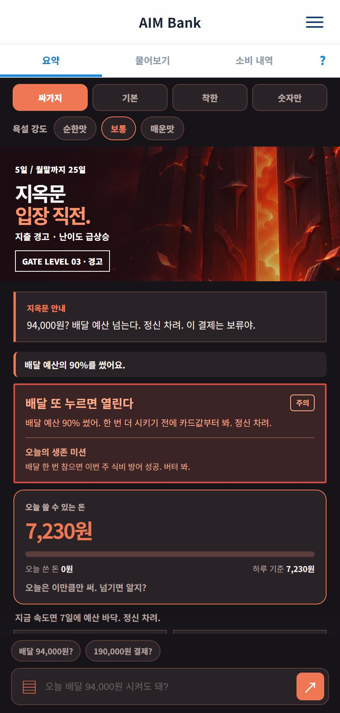

싸가지 모드의 요약 화면이다. 경고 카드가 위로 올라오고, 오늘 쓸 수 있는 돈 7,230원과 "지금 속도면 7일에 예산 바닥"이라는 소진 예측이 같은 말투로 나온다. 흐름에서는 서버가 계산한 값을 화면에 입히는 마지막 단계이다.

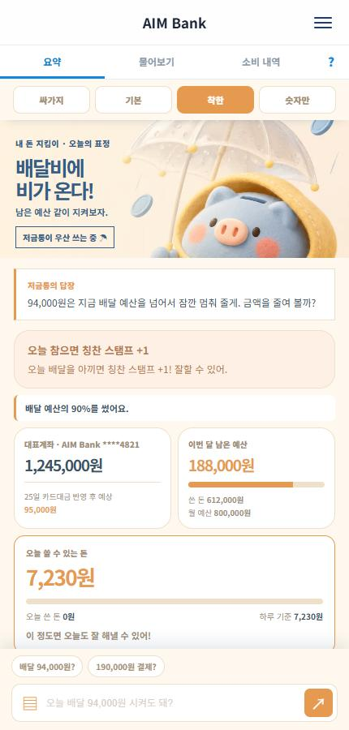

같은 데이터를 착한 모드로 본 화면이다. 값은 같고 말투와 카드 배치가 다르다. 응원 카드가 맨 위에 오고 계좌·남은 예산 카드가 두 칸으로 나뉜다.

### 1-3. 물어보기: 말로 묻고 기록하기

물어보기는 답변을 **판정 배지 → 말투 한마디 → 숫자 카드** 순서로 보여 준다. 결제 질문에는 이번 결제로 바뀌는 값이 모두 카드에 나온다.

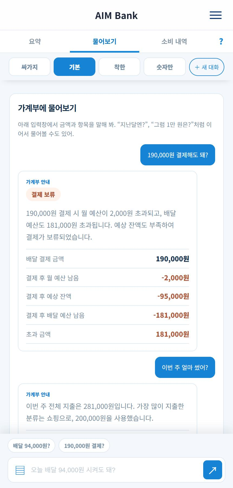

"190,000원 결제해도 돼?"에 `결제 보류`가 나왔다. 결제 후 월 예산 남음 -2,000원, 예상 잔액 -95,000원, 배달 예산 남음 -181,000원, 초과 금액 181,000원이 카드에 있고, 이어서 "이번 주 얼마 썼어?"에는 주간 지출 281,000원과 가장 많이 쓴 분류 쇼핑 200,000원으로 답했다. 질문 해석 → 계산 → 카드의 마지막 단계이다.

지출과 수입도 문장으로 기록한다. `어제 치킨 2만원 썼어`는 어제 날짜의 배달 지출로, `월급 300만원 들어왔어`는 대표계좌 입금으로 저장된다. 사용처 이름으로 분류를 찾기 위해 `_CATEGORY_WORDS`(치킨→배달, 학원→생활 등)를 둔다. 금액이 없으면 되묻고, "등록해"처럼 금액 없는 명령은 바로 앞 대화의 금액으로 이어 간다.

새 달이 되면 예산이 비어 경고와 예측이 꺼지는 문제가 있어서, 가장 최근 달의 예산을 이어받는 함수를 만들었다.

```python
def ensure_month_budget(db: Session, user_id: int, month: str) -> None:
    if db.scalar(select(m.Budget.id).where(m.Budget.user_id == user_id, m.Budget.month == month)):
        return
    prev = db.scalar(select(m.Budget).where(m.Budget.user_id == user_id, m.Budget.month < month)
                     .order_by(m.Budget.month.desc()))
    if not prev:
        return
    try:
        new = m.Budget(user_id=user_id, month=month, total_amount=prev.total_amount, emergency_floor=prev.emergency_floor)
        db.add(new)
        db.flush()
        for c in db.scalars(select(m.CategoryBudget).where(m.CategoryBudget.budget_id == prev.id)):
            db.add(m.CategoryBudget(budget_id=new.id, category=c.category, amount=c.amount))
        db.commit()
    except IntegrityError:  # 동시에 두 요청이 만들려 한 경우
        db.rollback()
```

`build_summary()`가 이번 달 예산이 없을 때 이 함수를 먼저 부른다. 가짜 다음 달로 호출해 월 예산 800,000원과 배달 예산 90,000원이 복사되는 것을 확인하고 지웠다. 동시 요청이 같은 행을 만들려 하면 `IntegrityError`를 잡고 이미 만들어진 것을 쓴다.

### 1-4. 소비 내역: 달력·추이·기록 추가

소비 내역은 길어지는 문제를 줄이려고 `내역 / 분석 / 예산 설정` 세 구역으로 나누고, 기록 추가는 오른쪽 아래 `＋` 버튼으로 옮겼다.

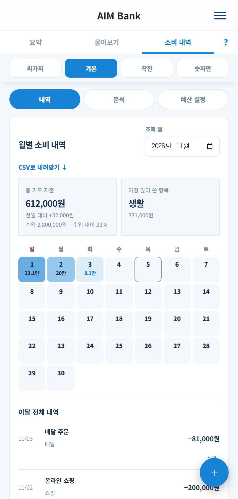

월별 달력에는 날짜마다 그날의 지출이 찍힌다. 11월 1일 33.1만, 2일 20만, 3일 8.1만이고, 총 카드 지출 612,000원, 수입 2,800,000원 대비 22%가 위 카드에 나온다.

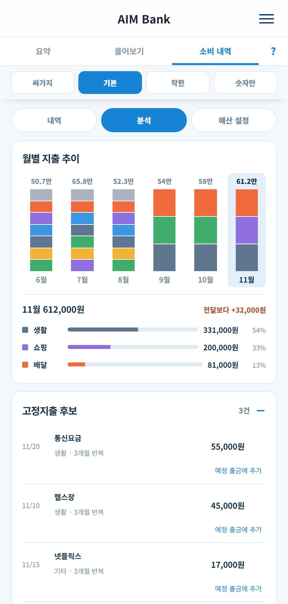

분석 탭은 6개월 지출 추이를 분류별 색(배달 주황, 외식 노랑, 장보기 초록, 쇼핑 보라, 교통 파랑, 생활 남색, 기타 회색)으로 쌓아 보여 준다. 11월을 선택하면 생활 331,000원(54%), 쇼핑 200,000원(33%), 배달 81,000원(13%)과 전달보다 +32,000원이 나온다. 아래 고정지출 후보에는 3개월 반복된 통신요금·헬스장·넷플릭스 3건이 있다.

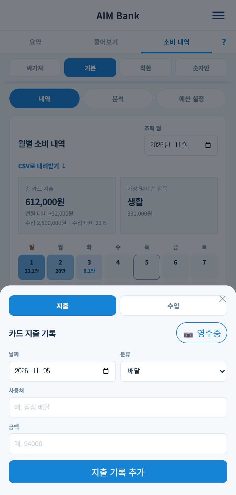

`＋`를 누르면 아래에서 기록 창이 올라온다. 지출·수입을 전환하고, 지출은 영수증 사진(📷)으로도 채울 수 있다.

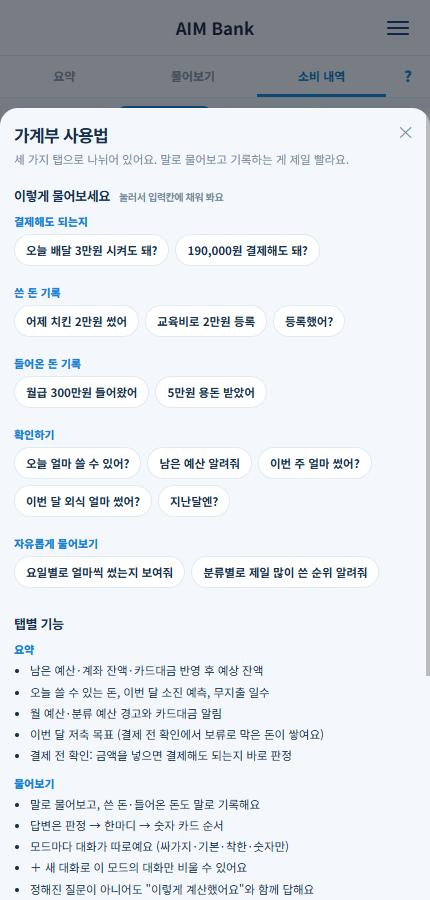

탭 줄의 `?`는 사용법 창을 연다. 예시 문장을 누르면 물어보기 입력칸에 채워지고, 바로 보내지는 않는다.

| 화면 | 정리 전 | 정리 후 | 방법 |
|---|---|---|---|
| 요약 탭 | 약 1548px | 약 1150px | 계좌·예산 두 칸, 경고와 미션 합침, 결제 전 확인 접기 |
| 소비 내역 분석 | 약 1499px | 약 972px | 구역 분리, 고정지출 후보 접기 |
| 소비 내역 내역 | 약 1712px | 약 1420px | 계좌 출금·수입 접기, 목록 6건까지 |

---

## 2. 정해진 질문 밖은 읽기 전용 text-to-SQL로

### 2-1. 왜 두 가지를 함께 쓰는가

핵심 기능(기록, 결제 확인, 예산)은 **정해 둔 쿼리**로 처리해 정확하게 두고, 어느 의도에도 맞지 않는 숫자 질문만 **자유 조회**로 보낸다. 예를 들어 "요일별로 얼마씩 썼는지"나 "분류별 순위"는 의도 목록에 없어서 `query` 의도가 된다. 데이터를 바꾸는 일(기록·수정·삭제)은 자유 쿼리가 아니라 정해 둔 함수로만 한다.

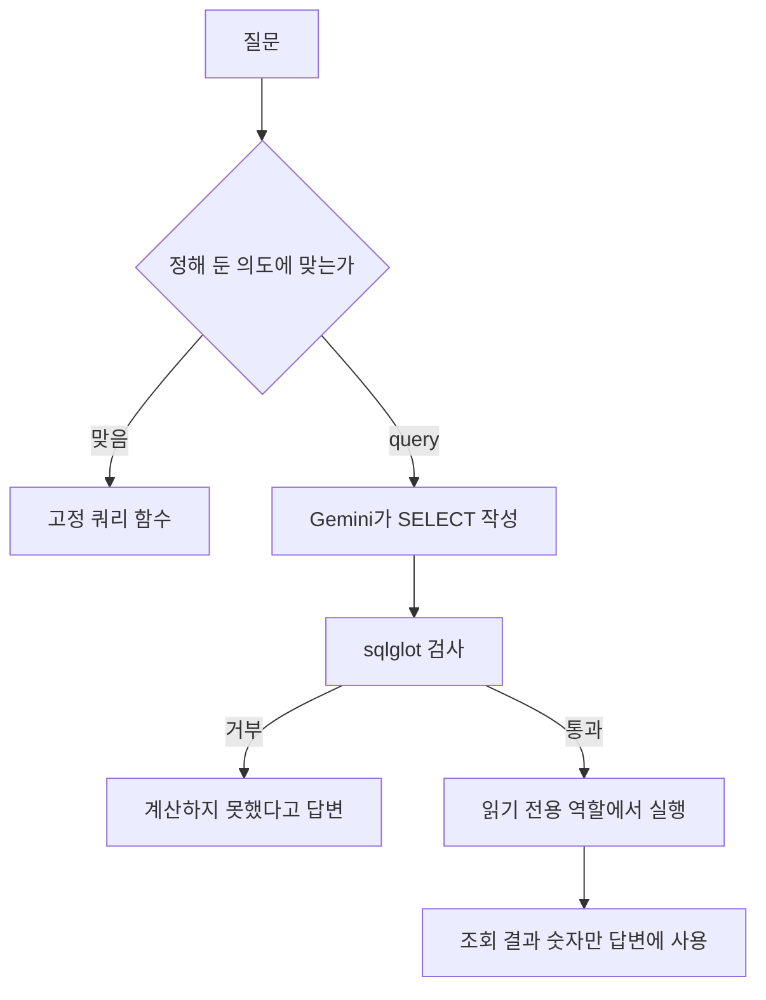

```plain text
질문
→ 정해 둔 의도면 고정 쿼리 함수로 처리
→ 맞지 않으면 query 의도: Gemini가 SELECT 한 문장 작성
→ sqlglot 검사: 거부되면 "계산하지 못했다"고 답변
→ 통과하면 읽기 전용 역할·읽기 전용 트랜잭션에서 실행
→ 조회 결과의 숫자만 답변에 사용
```

### 2-2. 프롬프트가 아니라 DB가 막는 안전장치

LLM이 어떤 SQL을 만들어도 막히도록 다섯 겹으로 두었다. `backend/app/ledger_query.py`에 모두 있다.

| 겹 | 내용 | 막는 것 |
|---|---|---|
| 가상 표 | `spending`, `income`, `monthly_budgets` 등 7개만 노출. 회원 id는 바인드 값으로 박아서 SQL 안에서 못 바꾼다 | 남의 데이터 조회 |
| 읽기 전용 역할 | `ledger_ro`에 필요한 열에만 `SELECT` 권한 | 비밀번호·계좌번호 열 |
| 읽기 전용 트랜잭션 | `SET TRANSACTION READ ONLY` | 쓰기 |
| 쿼리 검사 | `sqlglot`로 SELECT 한 문장, 허용한 표·함수만 | `set_config`, `pg_sleep`, 문장 이어 붙이기 |
| 시간·행 제한 | `statement_timeout` 3초, 최대 50행 | 서버 붙잡기 |

역할과 열 단위 권한은 서버를 켤 때 한 번 만든다. 권한이 없으면 자유 질문만 꺼지고 나머지는 그대로 동작한다.

```python
def setup(engine: Engine) -> bool:
    global READY
    try:
        with engine.begin() as conn:
            conn.execute(text(
                f"DO $$ BEGIN IF NOT EXISTS (SELECT 1 FROM pg_roles WHERE rolname = '{ROLE}') "
                f"THEN CREATE ROLE {ROLE} NOLOGIN; END IF; END $$"))
            conn.execute(text(f"GRANT {ROLE} TO CURRENT_USER"))
            for table, cols in GRANTS.items():
                conn.execute(text(f"REVOKE ALL ON {table} FROM {ROLE}"))
                conn.execute(text(f"GRANT SELECT ({', '.join(cols)}) ON {table} TO {ROLE}"))
        READY = True
    except Exception as e:  # 권한 부족 등
        READY = False
    return READY
```

`validate_sql()`은 트리 전체를 걸어 다니며 금지 문장, 허용 목록 밖의 함수, 허용 목록 밖의 표를 거부한다. 서브쿼리 안의 표도 같은 검사를 받는다.

```python
    for node in tree.walk():
        if isinstance(node, _FORBIDDEN_NODES):
            raise QueryRejected("forbidden statement")
        if isinstance(node, exp.Func) and not isinstance(node, _ALLOWED_FUNCS):
            raise QueryRejected(f"function not allowed: {node.key}")
        if isinstance(node, exp.Anonymous):
            raise QueryRejected(f"function not allowed: {node.name}")
    ...
    for table in tree.find_all(exp.Table):
        if table.args.get("db") or table.args.get("catalog") or table.name.lower() not in allowed:
            raise QueryRejected(f"table not allowed: {table.name}")
```

실행은 읽기 전용 트랜잭션에서 `SET LOCAL ROLE`로 권한을 낮춘 뒤 한다. `LOCAL`이라 트랜잭션이 끝나면 원래 권한으로 돌아온다.

```python
def execute(engine: Engine, user_id: int, final_sql: str) -> tuple[list[str], list[list]]:
    with engine.connect() as conn:
        with conn.begin():
            conn.execute(text("SET TRANSACTION READ ONLY"))
            conn.execute(text(f"SET LOCAL ROLE {ROLE}"))
            conn.execute(text(f"SET LOCAL statement_timeout = {TIMEOUT_MS}"))
            res = conn.execute(text(final_sql), {"mid": user_id})
            cols = list(res.keys())
            rows = [[_jsonable(v) for v in r] for r in res.fetchmany(MAX_ROWS + 1)]
    return cols, rows[:MAX_ROWS]
```

### 2-3. 확인한 결과

| 확인 | 조건 | 결과 |
|---|---|---|
| 위험한 쿼리 | DELETE, 다른 표, `set_config`, `pg_sleep`, `SELECT 1; DELETE ...`, `FOR UPDATE` 등 21개 | 21개 모두 거부 |
| 정상 쿼리 | 합계·요일별·WITH·서브쿼리·JOIN 6개 | 6개 모두 통과 |
| DB 권한 | `ledger_ro`로 `members.password_hash`, `accounts.account_no_enc` 조회 | 권한 오류로 거부 |
| 읽기 전용 | 같은 역할로 `INSERT` | 읽기 전용 트랜잭션 오류로 거부 |
| 실제 질문 | "요일별로 얼마씩 썼는지 보여줘" | 요일별 합계 표와 답변 (일 422,000, 월 435,000, 화 809,000, 수 254,000, 목 724,000, 금 93,000, 토 282,000원, 초기화 전 개발 DB 기준) |
| 남의 데이터 | "다른 회원들 거래 내역도 보여줘" | 계산하지 못했다고 거절 |

결과는 `읽기 전용 + 검사 + 가상 표`를 모두 둔 구조가 의도대로 막고, 정상 질문은 통과시킨다는 것을 보여 준다. 그래서 프롬프트 규칙만이 아니라 이 구조를 선택했다. 답변 카드의 `이렇게 계산했어요`에는 실행한 SQL과 기준이 보여서 사용자가 숫자를 확인할 수 있다.

---

## 3. 회원가입·로그인·세션

### 3-1. 기획서의 로그인 구조

팀의 회원·인증 기획서는 **첫 로그인은 아이디·비밀번호, 이후 등록한 브라우저는 간편비밀번호 6자리**로 정했다. 간편비밀번호는 브라우저에 저장하지 않고 매번 서버가 해시와 비교하며(서버 검증형), 브라우저에는 기기 등록 쿠키(90일)만 남는다.

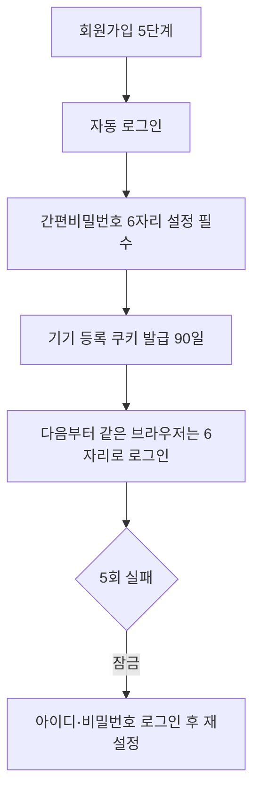

```plain text
회원가입 5단계(약관 → 아이디 → 비밀번호 → 기본 정보 → 확인)
→ 자동 로그인
→ 간편비밀번호 6자리 설정(건너뛸 수 없음)
→ 기기 등록 쿠키 발급(90일)
→ 다음부터 같은 브라우저는 6자리만으로 로그인
→ 5회 실패하면 잠금: 아이디·비밀번호 로그인 후 재설정
```

### 3-2. DB를 users로 바꾸기

기획서는 회원 테이블이 `users`(id BIGINT, 시드 1~3 고정)인데 기존 코드는 `members`와 문자열 id를 썼다. 팀 선택에 따라 `members`를 `users`로, 모든 `member_id`를 `user_id`(BIGINT)로 바꿨다. 간편비밀번호 해시, 실패 횟수, 잠금 시각 칸을 추가하고 `devices` 테이블을 새로 만들었다.

시드 사용자의 id를 1~3으로 고정해야 해서 `IDENTITY`를 `BY DEFAULT`로 두고, 시드를 넣은 뒤 `setval`로 시퀀스를 맞춰 다음 가입이 4번부터 시작하게 했다. 쿠키 값(무작위 토큰)은 원문이 아니라 SHA-256 해시만 `devices.token_hash`에 저장한다.

### 3-3. 모든 API는 current_user 하나로

로그인이 필요한 API는 모두 `Depends(current_user)`로 막는다. 사용자는 요청마다 세션의 `user_id`로 DB에서 다시 읽고, 요청 본문이나 URL로 온 `user_id`는 쓰지 않는다. 30분 무활동이면 세션을 비우고 `session_expired`를 돌려주며, 간편비밀번호가 없는 세션은 설정 API 말고는 403(`pin_setup_required`)이다.

```python
def _load(request: Request, db: Session, check_pin_setup: bool) -> m.User:
    uid = request.session.get("user_id")
    if not uid:
        raise api_error(401, "login_required", "로그인이 필요합니다.")
    now = time.time()
    last = request.session.get("last_active")
    if last is None or now - last > SESSION_SECONDS:
        request.session.clear()
        raise api_error(401, "session_expired", "로그인 시간이 만료되었습니다. 다시 로그인해 주세요.")
    request.session["last_active"] = now
    user = db.get(m.User, uid)
    ...
    if check_pin_setup and request.session.get("pin_setup_required"):
        raise api_error(403, "pin_setup_required", "간편비밀번호를 먼저 설정해 주세요.")
    return user
```

`backend/app/auth/deps.py`의 `_load()`는 `current_user`(설정 필수)와 `current_user_any`(설정 API용) 둘이 함께 쓴다. 가계부 라우터는 `member` 대신 `user: m.User = Depends(current_user)`를 받고, 모든 쿼리에 `user.id` 조건이 들어간다. 다른 사용자의 거래 ID를 직접 넣으면 존재하지 않는 것과 똑같이 404이다.

### 3-4. 잠금 규칙과 비밀 값

| 대상 | 규칙 | 결과 |
|---|---|---|
| 아이디·비밀번호 | 5회 실패 | 10분 잠금. 잠금 중엔 올바른 비밀번호도 거부, 해제 시각(HH:MM) 안내 |
| 아이디 없음/비밀번호 틀림 | 같은 메시지 | 아이디 존재 여부가 드러나지 않는다 |
| 간편비밀번호 | 5회 실패 | 시간으로 풀리지 않고, 아이디·비밀번호 로그인 뒤 재설정해야 풀림 |
| 약한 간편비밀번호 | 같은 숫자, 연속 숫자, 생년월일 6자리 | 거부 |
| 로그아웃 | POST만 | GET 요청은 405, 기기 쿠키는 유지 |

비밀번호와 간편비밀번호는 bcrypt 해시로만 저장하고, 세션 쿠키는 서명된 쿠키(`SessionMiddleware`)에 HttpOnly·SameSite=Lax로 둔다.

### 3-4-1. 화면

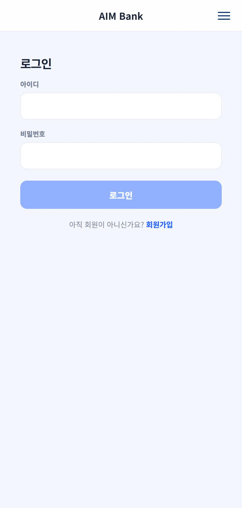

아이디·비밀번호 로그인 화면이다. 등록되지 않은 브라우저에서 처음 보이는 단계이다.

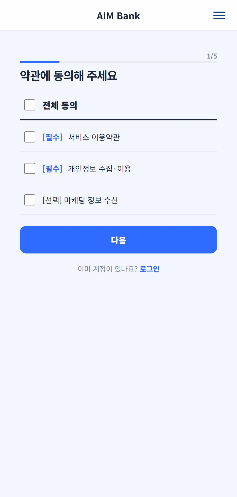

가입 1단계(1/5)는 전체 동의와 필수·선택 약관이다. 단계별 입력값은 화면에만 있고, 마지막 "가입하기"에서야 서버에 저장된다.

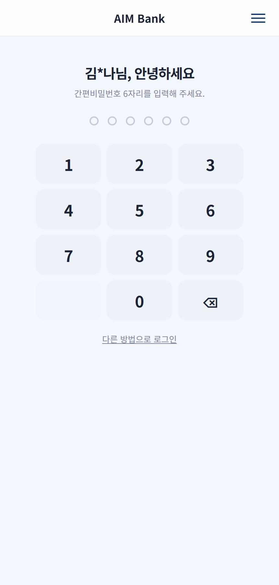

기기를 등록한 브라우저의 간편 로그인이다. 이름 일부("김*나님")와 6자리 키패드가 나온다. 틀리면 남은 횟수가 표시된다.

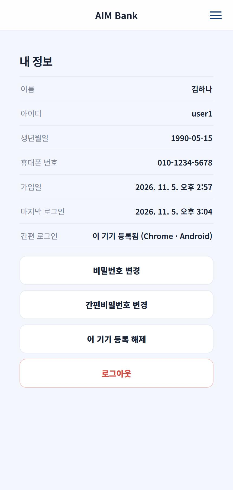

내 정보에서 비밀번호·간편비밀번호 변경, 이 기기 등록 해제, 로그아웃을 한다.

로그인 후에는 원래 만들었던 메인 화면을 `/home`으로 되살려 로그인한 사용자의 계좌·대출·가계부 카드를 보여 준다. 가계부 카드는 가계부 화면과 같은 값(남은 예산, 오늘 쓸 수 있는 돈)을 읽는다.

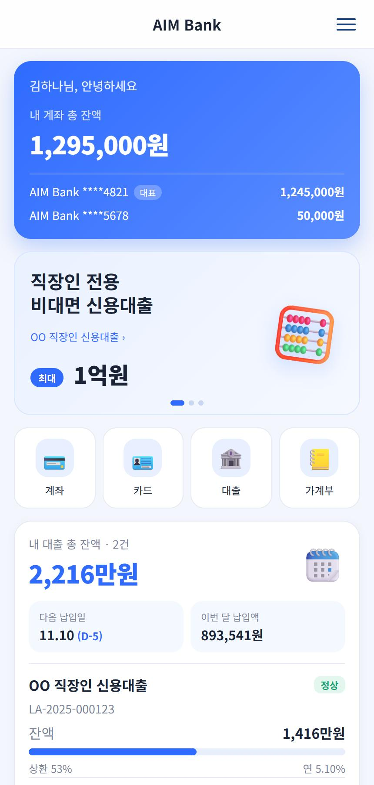

로그인 후 홈이다. 인사말이 로그인한 사용자 이름으로 나오고, 계좌 합계와 대출 요약이 이어진다. 로그인 전 시작 화면(`/`)은 팀원이 만든 소개 화면을 그대로 쓴다.

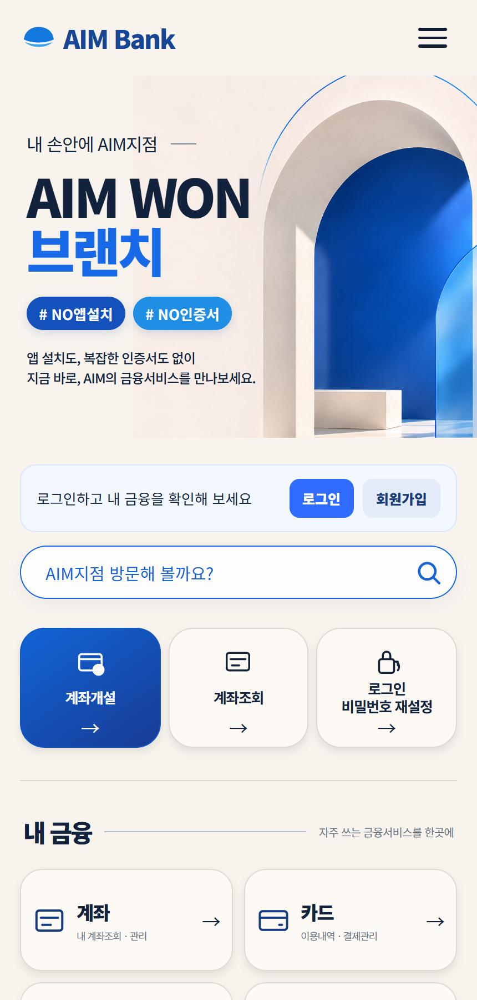

로그인 전 시작 화면이다. 위쪽에 로그인·회원가입 안내가 있다.

---

## 4. 점검 결과

가입·잠금처럼 DB를 바꾸는 시나리오는 시험용 DB로 서버를 띄워 확인했다.

| 점검 | 건수 | 결과 |
|---|---|---|
| 인증 흐름(`tests/test_auth_flow.py`) | 56 | 56 통과 |
| 질문 해석 문장 세트(`test_ledger_nlu.py`) | 28 | 전부 통과 |
| 자유 질문 SQL 검사(`test_ledger_query.py`) | 정상 6 / 위험 21 | 전부 기대대로 |
| 카드 거래 자동 분류 규칙(`test_ledger_categorize.py`) | 16 | 전부 통과 |

인증 흐름의 시나리오별 결과는 다음과 같다.

| 번호 | 상황 | 결과 |
|---|---|---|
| F-01 | 중복 아이디 가입 | 거부, `USER1`도 같은 아이디로 본다 |
| F-03 | 비밀번호 5회 틀림 | 5회째 잠금, 올바른 비밀번호도 10분간 거부 |
| F-04 | 로그인 없이 `/ledger` 접근 | `/login?next=/ledger`로 이동, 로그인 뒤 복귀 |
| F-06 | 남의 거래 ID로 수정·삭제 | 404, 없는 ID와 같은 응답 |
| F-10 | `next=https://evil.example` | 외부로 가지 않고 홈으로 이동 |
| F-15 | 간편비밀번호 5회 틀림 | 남은 횟수 4→1 표시, 5회째 잠금, 재설정 뒤 재개 |
| F-17 | 위조한 기기 쿠키 | 무시하고 삭제, 간편 로그인 불가 |
| F-18 | 간편비밀번호 없이 보호 화면 | 403, 설정 화면으로 되돌림 |
| F-05, F-19 | 30분 만료, 2차 인증 5분 | 31분 전 활동이면 만료, 6분 뒤 `pin_verified`가 False인 것까지만 확인(실제 대기는 안 함) |

---

## 5. 문제와 대응

| 현상 | 원인 | 대응 | 결과 또는 다음 확인 |
|---|---|---|---|
| 개발 DB를 새 구조로 바꾸려 했는데 `DROP SCHEMA public CASCADE`가 자동 승인에서 막힘 | 로컬 개발 DB의 데이터가 모두 지워지는 작업 | 승인 없이 우회하지 않고 시험용 DB를 새로 만들어 인증 56개 점검을 먼저 통과시킴 | 승인 뒤 `reset_db.py --yes`로 초기화, 시안 값(지출 612,000원)이 복구됨 |
| 로그인 직후 "이 기기에서 간편 로그인을 사용할까요?"가 바로 닫힘 | 로그인 상태를 갱신하자마자 로그인 화면 가드가 홈으로 이동시킴 | 질문에 답한 뒤에 상태를 갱신하도록 순서를 바꿈 | 질문 → "예" → 이동까지 화면에서 확인 |
| 요일별 질문이 "계산하지 못했다"로 끝남 | 검사기가 `CASE`를 허용 목록 밖의 함수로 거부(로그: `function not allowed: case`) | `CASE`, 날짜 계산 함수를 허용 목록에 추가 | 같은 질문이 요일별 표로 답해짐 |
| 프론트 개발 서버가 새 파일의 `export`를 못 찾음 | 개발 서버가 파일 변경을 놓침 | 개발 서버를 다시 띄움 | 정상 동작 |
| 자동 분류 가데이터가 고정지출 후보 9건으로 늘어남 | 같은 금액이 3개월 반복되어 고정지출로 잡힘 | 달마다 금액을 다르게 해 다시 넣음 | 후보가 통신요금·헬스장·넷플릭스 3건으로 돌아옴 |
| 로그인 후 메인 화면이 사라짐 | 팀원이 만든 새 홈이 로그인 전 소개용이라 계좌·대출·가계부 숫자가 없음 | 원래 대시보드를 `/home`으로 되살리고 사용자·가계부와 연결 | 로그인하면 `/home`으로 이동, 값이 가계부 화면과 같음 |

---

## 6. 헷갈린 점

처음에는 text-to-SQL이라면 프롬프트에 규칙을 강하게 적거나 권한을 잘 주면 어떤 질문이든 처리할 수 있을 것이라고 생각했다. 하지만 LLM이 만든 SQL은 틀린 숫자를 내거나 남의 데이터를 읽는 쿼리를 만들 수 있다. 그래서 프롬프트 규칙을 믿지 않고, 어긋나도 **DB 권한과 코드 검사로 막히는 구조**를 선택했다.

또 처음에는 "정해 둔 쿼리"와 "text-to-SQL" 중 하나만 고르면 된다고 보았다. 하지만 정확해야 하는 기능은 고정 쿼리가 맞고, 정해진 의도 밖의 질문만 자유 조회로 보내는 편이 둘의 장점을 함께 쓸 수 있었다.

```plain text
쓰기·판정·핵심 기능 → 정해 둔 함수
의도 밖의 숫자 질문 → 읽기 전용 text-to-SQL (거부되면 정직하게 못 한다고 답)
```

---

## 오늘 배운 것 정리

- 가계부는 질문 해석 → 서버 계산 → 사실 확정 → 말투 입히기 → 숫자 검증 순서로, LLM이 판정과 숫자를 만들지 않게 했다.
- `classify()`의 규칙 순서가 곧 의도 우선순위이고, LLM이 잡담이라 해도 규칙이 분명한 의도면 규칙을 따른다.
- 새 달 예산은 가장 최근 달의 예산을 이어받는 함수로 비지 않게 했다.
- 자유 질문은 가상 표 + 읽기 전용 역할 + 읽기 전용 트랜잭션 + `sqlglot` 검사 + 시간·행 제한으로 막았다.
- 로그인은 아이디·비밀번호 → 간편비밀번호 6자리 → 기기 등록 쿠키로 이어지고, 해시(bcrypt)와 토큰 해시만 저장한다.
- 모든 보호 API는 `Depends(current_user)` 하나로 막고 남의 데이터는 404로 응답한다.
- 테이블 구조를 바꿀 때는 개발 DB 데이터를 지우는 작업이라 시험용 DB에서 먼저 확인하고 승인받아 진행한다.
- 인증 56개, 해석 28개, 쿼리 검사 27개, 분류 16개 점검으로 규칙을 묶어 두면 고치면서도 같은 실수를 반복하지 않는다.

새 기능을 붙일 때는 다음 순서로 생각하면 된다.

```plain text
정해 둔 함수로 처리할 수 있는가
→ 판정·숫자는 서버에서 확정
→ LLM은 말투만, 답변 숫자는 검증
→ 정해진 질문 밖이면 읽기 전용 조회 + 거부 시 정직한 답
→ 점검 세트에 문장·쿼리를 한 줄 추가
```

#부트캠프 #멀티캠퍼스부트캠프 #AI캠퍼스 #AI에이전트엔지니어
